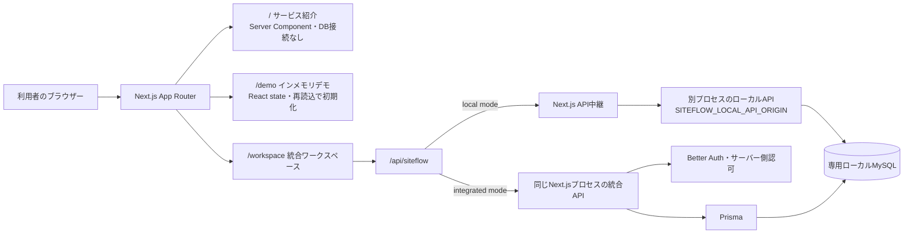

# SiteFlow — チームの仕事を、ひとつの場所に。

案件の担当・進捗・変更の経緯を共有し、進捗会議の確認事項や次の対応につなげる業務管理ツールです。未経験Webエンジニアへの転職を目指すポートフォリオとして、Next.js、TypeScript、Prisma、MySQLを使って開発しています。

| 状態 | 内容 |
| --- | --- |
| 実装済み | 認証付きワークスペース、案件管理・検索、進捗会議、相談・決定事項、対応事項の引き継ぎ、チーム・所属・招待管理 |
| ローカル検証済み | 専用MySQLを使ったAPI・DB試験と、範囲を限定したChrome試験。条件と限界は[検証記録](docs/VERIFICATION.md)を参照 |
| 実環境未確認 | 現在の公開URL・公開状態、公開環境での全機能、実AWS上の運用 |
| CD | CI workflowとローカルの安全制御コードは存在するが、GitHub実設定・実API取得・EC2 polling・自動本番配信は未確認。本番自動CDはNO-GO |

## 1. SiteFlowの概要

SiteFlowは、案件の状況と変更履歴を一か所で確認し、会議で決めたことを次の対応へつなげるためのWebアプリです。現職の土木建設コンサルタントとしての経験を開発テーマの背景にしています。個別の職場課題や導入効果を実証したものとしては説明していません。

## 2. 開発背景と解決したい課題

案件の担当・進捗・状態が別々に管理されると、現在の状況や変更理由を追いにくくなる場合があります。SiteFlowでは案件情報、変更履歴、会議での確認、次回までの対応を関連付けて記録できる形を目指しています。これは開発上の課題設定であり、実際の職場での導入実績や改善効果を示すものではありません。

## 3. 主要機能

- **案件管理**：案件の登録・編集、担当者、進捗・状態、履歴、保管・復元。
- **検索・絞り込み**：キーワード、担当者、状態、進捗条件を組み合わせた一覧検索。
- **進捗会議**：対象案件の確認、進捗差分、相談・決定事項、会議時点の記録。
- **対応事項**：担当者・期限・状態を記録し、未対応事項を選んで次回会議へ引き継ぐ。
- **チーム管理**：チーム設定、所属メンバー、役割、既存アカウントへの招待。

## 4. スクリーンショット

README用の画像は、安全な公開用画像として確認できたものがないため、現時点では掲載していません。検証用画像には開発バッジや読み込み途中の画像が含まれる可能性があります。公開前に架空データだけを使って撮り直し、個人情報・内部URL・開発情報がないことを確認します。

## 5. 公開デモと認証付き統合画面

| 画面 | 体験内容 | データ・認証 |
| --- | --- | --- |
| `/demo` | 旧インメモリ指摘管理デモの一部操作 | ブラウザー内のReact stateのみ。業務DB・認証APIを使わず、再読み込みで初期状態に戻る |
| `/workspace` | 案件・会議・チーム管理の統合画面 | 既存アカウントで認証し、設定されたサーバー接続モードを通して業務API・MySQLを利用 |

`/demo`は統合版全体を試す環境ではありません。公開用の読み取り専用アカウントや利用者ごとの保存領域はありません。新規登録と実メール認証も有効化していません。デモ方式の経緯と今後の検討は[公開デモ計画](docs/PUBLIC_DEMO_PLAN.md)を参照してください。

## 6. 使用技術と選定理由

| 技術 | SiteFlowでの役割 |
| --- | --- |
| Next.js 16 App Router | ページ、サーバー側API入口、画面配信を構成 |
| React 19 / TypeScript 5 | 画面状態と操作を型付きで実装 |
| Prisma 7 / MySQL 8.4 | リレーショナルな業務データ、制約、トランザクションを扱う |
| Better Auth | 統合モードの既存アカウント認証・セッション管理 |
| Node.js `node:test` | 業務ルール、API、DB連携の自動テスト |
| Docker | ローカル検証用MySQLなどの環境を分離して起動 |

## 7. システム構成

次の図はローカル開発で使う2つの接続方式を区別しています。公開用の接続構成や本番配信の完成を示す図ではありません。

通常のlocal modeはNext.jsから別プロセスのローカルAPIへ中継します。integrated modeはNext.jsのAPI入口から統合ハンドラーとPrismaを呼び出します。接続先や起動手順は[ローカル開発手順](docs/LOCAL_WORKSPACE.md)と[Next.js API統合記録](docs/NEXTJS_API_INTEGRATION.md)を確認してください。

## 8. データベース設計

認証ユーザー、チーム所属、過去の人物記録、案件、変更履歴、会議、確認記録、相談・決定メモ、対応事項、会議スナップショットを分けています。チームIDを含む複合リレーションで、別チームのデータを誤って関連付けにくくしています。実際のモデルとER図は[データモデル](docs/DATA_MODEL.md)を参照してください。

## 9. 技術的な工夫

- 認証済みであることと、対象チームで操作権限があることをサーバー側で別々に確認します。
- 所属情報と、過去の担当者・記録者を識別する人物記録を分け、退会後も履歴を保持します。
- Team・案件・対応事項の版番号を更新条件に使い、古い画面からの更新競合を検出します。
- 案件・履歴や会議スナップショットなど、一緒に保存すべきデータはトランザクションで扱います。
- 会議スナップショットは会議時点の記録を残し、後日の対応事項の変更で過去記録を書き換えません。
- 未保存入力は編集開始時の値との差で判定し、保存中の二重送信や画面移動時の入力消失を抑えます。

## 10. セキュリティと運用上の境界

APIで入力・セッション・チーム所属・操作権限を確認し、秘密情報はサーバー側設定に置きます。デモは業務DBと認証から分離されています。DB migrationは段階管理し、ローカル検証用DBと本番環境を区別します。

GitHub ActionsにはCIおよびリリース承認用workflowのコードがあります。ローカルのpolling・復旧関連コードは模擬データで検証する設計で、GitHub実設定・実API認証・本番承認・EC2上の自動実行を証明しません。AWS/CDの過去の検証記録と未確認範囲は[検証記録](docs/VERIFICATION.md)および[公開デモ計画](docs/PUBLIC_DEMO_PLAN.md)で確認してください。本番自動CDはNO-GOです。

## 11. テストと品質管理

Node.js標準テスト、TypeScript型検査、ESLint、Next.js build、専用ローカルMySQLを使ったAPI/DB試験、限定したChrome操作試験を段階ごとに実施しています。結果は実行日・対象・条件・未検証範囲とともに[検証記録](docs/VERIFICATION.md)へ記録します。テスト件数やローカルでの成功は、実環境すべての動作保証を意味しません。

2026-11-21には当時の公開HTTPS環境で、準備済みアカウントのログイン・案件保存と再取得・ログアウトを確認した記録があります。これは過去の時点の結果で、現在の公開状態を示しません。対象と限界は[当時の公開確認記録](docs/MANUAL_PUBLIC_RELEASE.md)を参照してください。

## 12. ローカル環境の起動方法

Node.jsの要件、依存関係、MySQL検証環境、環境変数、local modeとintegrated modeの起動手順は[ローカル開発手順](docs/LOCAL_WORKSPACE.md)にまとめています。認証情報を含むローカル設定ファイルは公開せず、値をREADMEへ転記しないでください。

## 13. 制約と今後の改善

- 現在の公開URL・公開状態と、過去の公開環境が現在も稼働しているかは未確認です。
- 公開用スクリーンショットの撮り直しと、過去の検証で残った可能性のある試験セッションの確認・失効は別工程です。
- 本番での認証、DB接続、バックアップ復元、容量・性能、全ブラウザー・支援技術の検証は完了していません。
- 実GitHub APIから承認済みreleaseを取得する接続、本番EC2上のpolling、Docker/Nginx切替、手動復旧の実運用検証は未完了です。
- 公開用の利用者別デモ、新規登録、実メール本人確認は未実装です。

詳しい設計・学習資料は[会議フロー](docs/MEETING_FLOW.md)、[所属管理](docs/MEMBERSHIP_AND_HISTORY.md)、[非機能要件](docs/NON_FUNCTIONAL_REQUIREMENTS.md)、[学習ガイド](docs/LEARNING_GUIDE.html)を参照してください。READMEの記載は実装・検証の状態を分けており、公開や本番CDの承認を示しません。

---

このポートフォリオの開発背景や紹介文は、公開前に開発者本人が事実と意図に合っていることを確認してください。
