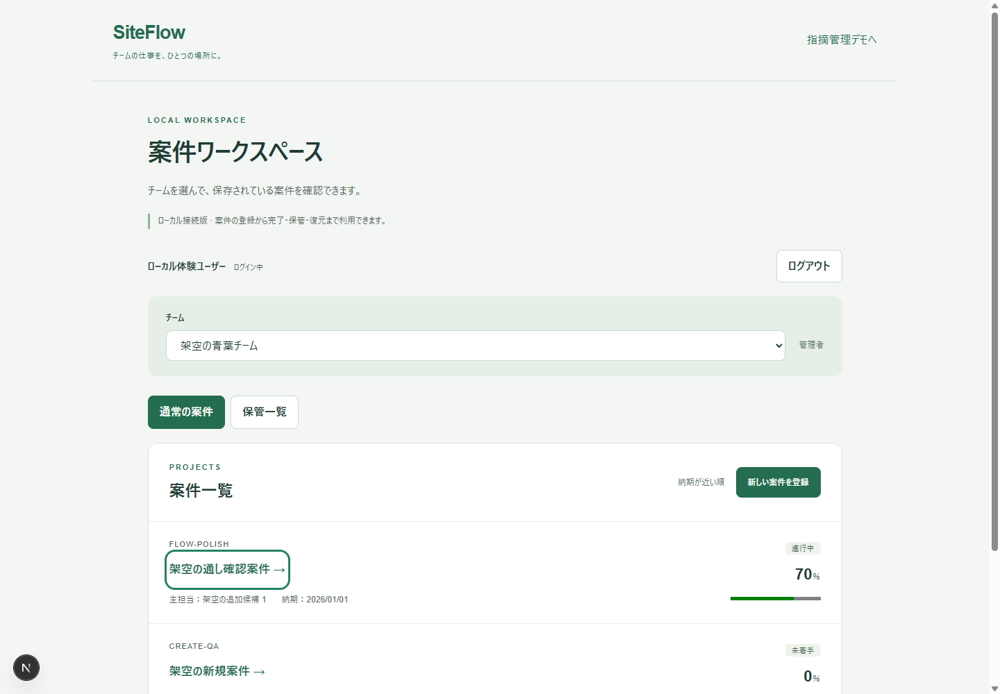
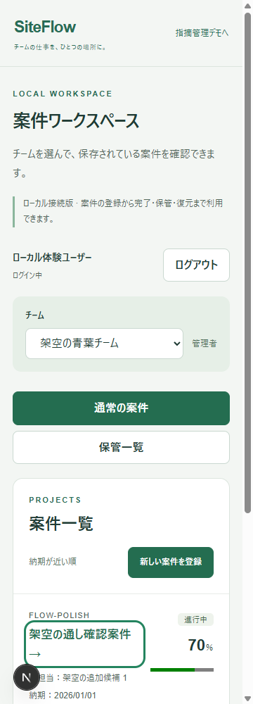
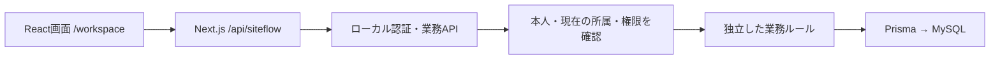

# SiteFlow — チームで案件の進捗と経緯を共有する

案件の担当・進捗・状態を管理し、変更の経緯を履歴から確認する学習用ポートフォリオです。現場・プロジェクトで「誰が担当し、どこまで進み、なぜ変更したか」を追えることを目指しています。サンプルはすべて架空です。

**2026-11-21：Next.js＋MySQL版を既存AWSで初回公開しました。** [公開ワークスペース](https://13.237.188.172/workspace)で、準備済みテストアカウントのログイン・案件保存・再取得・ログアウトを公開HTTPS経由で確認済みです。新規登録・招待などは未完成です。認証情報はリポジトリに掲載しません。[実際の公開結果・未検証事項](docs/MANUAL_PUBLIC_RELEASE.md)を参照してください。DBにつながる案件ワークスペースと、以前からあるメモリ上の指摘管理デモは別機能です。

**公開は手動で行っており、自動デプロイ（CD）は未導入です。** GitHub ActionsのCIは検査・イメージ保存の仕組みで、本番への自動反映とは別です。OIDCなどを使う新CDはローカル検証の段階で保留しており、今回の公開には使用していません。

公開資料のAWS識別子・個人PCパスは匿名化しています。`deploy/manual-public.py`は公開用テンプレートで、EBS識別子の仮値のままでは安全確認で停止します。実環境の構成記録と照合し、対象を確定してから使う設計です。公開用ソースの整理だけで稼働中のEC2設定を変更することはありません。

## 現在できること

| 画面 | 保存・認証 | 機能 |
| --- | --- | --- |
| `/workspace` | MySQLへ保存、準備用アカウントでログイン。接続モードをサーバーで指定 | 所属チーム選択、案件登録・一覧・詳細・基本編集、主副担当変更、進捗/状態更新、完了/理由付き再開、保管/閲覧/復元、担当・進捗/状態の履歴 |
| `/` | Reactのメモリ。再読み込みでリセット | 指摘登録、状態/期限の絞り込み、対応記録、確認依頼・差し戻し・完了、集計 |

未指定の公開用ビルドでは`/workspace`は案内のみ、APIは404です。公開プレビューは専用のURLとモードを明示した場合だけ有効になり、不正な設定では閉じます。[接続モードと検証手順](docs/WORKSPACE_PREVIEW.md)を参照してください。ビルド成功を公開環境の完成とは扱いません。



<details>
<summary>スマホ画面を見る</summary>



</details>

## 5分で試す流れ

ローカル接続版の起動後、次の順で架空の案件を1件操作します。

1. ログインし、所属チームを選ぶ。
2. 案件名・納期・主担当を入力して登録する。
3. 詳細で基本情報・担当・進捗を変更し、履歴を読む。
4. 進行中→確認待ちへ進め、進捗100％で完了する。
5. アーカイブ→保管一覧で確認→復元する。完了状態は保持する。
6. 理由付きで再開し、再読み込みしても保存内容が残ることを確認する。

操作は専用MySQLを更新します。チーム/一覧切替・画面移動・再読み込み・入力破棄・セッション失効では、未保存の入力は失われます。

## 技術と設計

| 技術 | 役割 |
| --- | --- |
| Next.js 16.3.4 / React 19 / TypeScript | App Router、フォーム・状態管理、型検査、ローカルAPIへの中継 |
| Node.js / Better Auth | `examples/mysql/`に分離したローカル検証用の認証・業務API |
| Prisma / MySQL 8.4 | 案件・担当・履歴の保存、制約・トランザクション |
| node:test / 実Chromeによる検証 | 業務ルール・中継・API/DB・実画面の操作確認 |



- **権限はAPIでも確認**：画面の表示や選択中チームを根拠にせず、本人の現在の所属と担当を読む。
- **競合を無言で上書きしない**：共通の版番号で検出し、入力を保持して「編集開始時・最新・自分の入力」を比較する。版だけの自動差替えや自動再送はしない。
- **一緒に成功すべき保存をまとめる**：担当/進捗/状態の変更と必要な履歴をトランザクションで保存する。履歴名は当時のコピーとして保持する。
- **完了・保管・削除を区別**：100％と完了を分け、保管/復元で状態・進捗・既存履歴を変えない。物理削除の操作は公開しない。
- **通信の状態を見せる**：読み込み中・0件・失敗/再試行を用意し、チーム/通常・保管の切替で旧応答を混ぜない。

## ローカルで起動する

Node.js 22.13以降とnpmを使用します。検証環境はWindows / Node.js 24です。Windowsで`npm.ps1`が拒否される場合は`npm.cmd`、`npx.cmd`を使用します。

### メモリデモだけを動かす

`npm ci`はルートのロックファイルどおり依存関係を復元し、`node_modules`を更新します。`npm run dev`はNext.js開発サーバーを起動します。内部の`--port 5173`はポート、`--hostname 127.0.0.1`はPC内だけで待ち受ける指定です。DBは変更しません。

```sh
npm ci
npm run dev
```

表示されたURLの`/`を開きます。通常は`http://127.0.0.1:5173/`です。

### DB接続版を動かす

先に[ローカルMySQLの準備](docs/LOCAL_DATABASE.md)と[専用スキーマの設定・マイグレーション](docs/SCHEMA_DATABASE_CHECK.md)、[接続版の設定](docs/LOCAL_WORKSPACE.md)を確認してください。専用DB設定はGit除外の環境ファイルで用意します。通常DBや本番DBを自動リセットする手順ではありません。

ルートの`.env.local`には、Next.jsサーバーだけが読む接続先を指定します。既存の設定は保持してください。

```dotenv
SITEFLOW_LOCAL_API_ORIGIN=http://127.0.0.1:5175
```

以下の`--prefix examples/mysql`は検証パッケージを指定します。`ci`はそのロックファイルの依存を復元、`run prepare:workspace`はPrisma生成と架空ユーザー・2チーム・21案件の準備です。初回だけ専用DBへ保存し、ログイン情報を`.env.workspace.local`へ新規作成します。再実行は照合のみで上書きしません。

```sh
npm --prefix examples/mysql ci
npm --prefix examples/mysql run prepare:workspace
```

`run dev:auth`で分離APIを5175番へ起動します。別ターミナルの`run dev`でNext.jsを5173番へ起動します。どちらも終了するまでターミナルを使います。

```sh
npm --prefix examples/mysql run dev:auth
```

```sh
npm run dev
```

`http://127.0.0.1:5173/workspace`を開きます。ログイン情報は手元の`.env.workspace.local`で確認し、README・Git・画像へ転記しないでください。API再起動後は再ログインが必要です。準備用アカウントは実メール認証・新規登録フローの実装を意味しません。

### ビルド後の確認

`npm run build`は`.next/`へ公開用ファイルと型情報を生成します。`npm start`はビルドをポート3000で配信します。内部の`--port 3000`はポート、`--hostname 0.0.0.0`は待ち受け先の指定です。デプロイ処理は行いません。

```sh
npm run build
npm start
```

`http://127.0.0.1:3000/`でメモリデモ、`/workspace`でローカル専用の案内を確認できます。DB接続版を公開環境で利用できる状態にはまだしていません。

## 検証

`tsc --noEmit`はコードを出力せず型を検査し、`--incremental false`は型キャッシュを更新しません。Nodeの`--experimental-strip-types`は型を読み飛ばし、`--test`は指定ファイルのテストを実行します。`lint`は規約検査で、自動修正しません。`build`は`.next/`と型情報を生成します。これらはDBを変更しません。

```sh
npx tsc --noEmit --incremental false
node --experimental-strip-types --test tests/domain.test.mjs tests/local-api.test.mjs tests/public-api-settings.test.mjs tests/public-api-proxy.test.mjs tests/workspace-connection.test.mjs
npm run lint
npm run build
```

接続版の起動後、`run test:workspace`は一時Chromeと専用DBの架空データで画面を検証し、終了時にそのデータだけ削除します。画像はGit除外の`work/workspace-preview/`へ保存します。`run test:auth-check`は分離API/DBの権限・境界・競合・巻き戻し等を検証し、同様に一時データを削除します。

```sh
npm --prefix examples/mysql run test:workspace
npm --prefix examples/mysql run test:auth-check
```

実行日・件数・条件と未検証範囲は[検証記録](docs/VERIFICATION.md)に集約します。ビルドだけで、全操作・全ブラウザー・全競合・性能を確認済みとは扱いません。

## コードを読む入口

| 場所 | 役割 |
| --- | --- |
| `app/` | ルート・レイアウト・API中継 |
| `components/siteflow/` | 接続版の一覧/詳細/登録/編集と、旧指摘管理デモ |
| `lib/siteflow/domain.ts` | React/HTTPから独立した入力検証・権限/状態遷移の業務ルール |
| `lib/siteflow/local-api.ts` | 開発限定の許可経路・Host/Origin・本文上限・Cookie/応答の制限 |
| `examples/mysql/` | ローカル検証用API・Prisma・保存サービス・画面検証 |
| `db/design/` | 統合スキーマとSQL履歴。ローカル検証済み、本番未適用 |
| `tests/` | 業務・中継・API/DBのテスト |

学習用の図・短いコード・問い・説明例は[理解ノート](docs/LEARNING_GUIDE.html)の1ファイルへまとめています。ローカルでブラウザーから開き、1テーマずつ読めます。[非機能要件](docs/NON_FUNCTIONAL_REQUIREMENTS.md)では目標と測定結果を区別しています。[データモデル](docs/DATA_MODEL.md)、[Next.js移行記録](docs/NEXTJS_MIGRATION.md)も参照できます。

## 今後の範囲

以下には初回公開前の検証履歴も含みます。「まだ公開していない」「AWSへ反映していない」は当時の記録で、最新の公開状態は冒頭と[手動公開記録](docs/MANUAL_PUBLIC_RELEASE.md)を優先してください。

公開・休止・再公開の最新方針は[AWS計画](docs/AWS_DEPLOY_PLAN.md)、手順と未確認事項は[AWS手順書](docs/AWS_DEPLOY_RUNBOOK.md)を参照してください。[以前の公開準備案](docs/PUBLIC_DEMO_PLAN.md)には当時の未実装記述も含まれます。

[公開用設定からの起動経路](docs/PUBLIC_API_SETTINGS.md)から進み、現在は通常アプリのDocker/HTTPS17シナリオ、公開migration6項目、実Nginxでの切替/復旧3項目をローカル検証済みです。CIの承認記録と配信候補も手元で実装しました。配信判定のGitHub APIと、Nginx試験内のDocker操作は代役で、実AWS・GitHub承認・既存Vinextとの切替は未検証です。詳細と限界は[ローカル検証](docs/LOCAL_DOCKER_CHECK.md)。

[公開用の中継とCookie](docs/PUBLIC_API_PROXY.md)を明示設定でNext.js画面/ルートへ接続し、[ビルド済みNext.jsのHTTPSプレビュー](docs/WORKSPACE_PREVIEW.md)でログイン・案件作成/編集・再読み込み・ログアウトを確認しています。実際のネット公開はまだ行っていません。

[初期のHTTPS Cookie検証](docs/HTTPS_COOKIE_CHECK.md)から段階的に進めています。現在の検証もPC内の一時証明書と架空データを使うもので、公的な公開証明書や実AWSでの動作を確認した結果ではありません。

- 公開環境の認証・セッション/メール・配信構成と、その環境での検証
- ユーザー登録/招待、チーム作成・所属管理の画面（関連APIの一部は検証済み）
- 会議の進捗差分/重要業務優先/相談事項、決定事項/引き継ぎ、写真・報告書、検索・全体集計（会議の開始/確認/取消/継続/終了の最小範囲はローカル実装・検証済み）
- 基本情報や保管/復元操作そのものの監査履歴、サーバー側の新規登録の冪等性、性能・読み上げ等の追加検証

旧Sites/Vinext/Cloudflare用の設定・依存は段階的な整理のため残っていますが、通常の開発起動はNext.jsです。ローカルのCI/Docker/配信候補は更新済みです。AWS設定・GitHub設定・push・本番反映はしておらず、既存AWSのVinextへ今回の版を送っていません。
