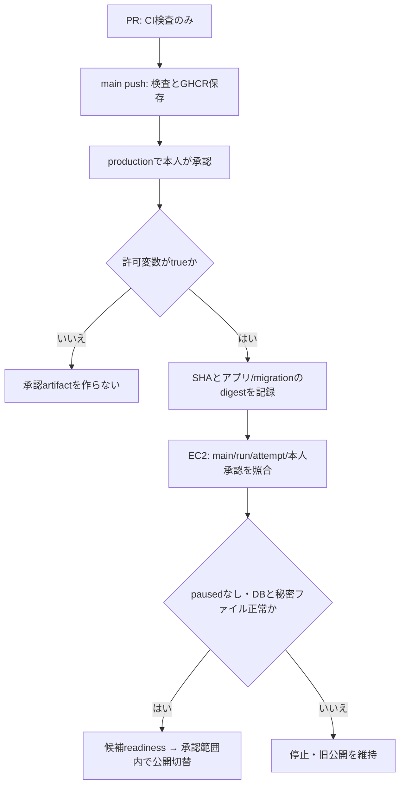

# 承認付きCDの導入準備

## CD作業の一時中断と再開条件（2026-11-24）

CDはローカル保存で一区切りとし、SiteFlow本体の機能開発へ戻る。**本番CDはNO-GO**。以下の過去の検証・判断は当時の記録として保持する。

公開用整理では、保留AWS方式のEC2・EBS識別子を要設定の例示文字列、公開先を`https://siteflow.example.invalid`へ変更した。IAMの対象制限と完全一致の照合を維持し、設定例は`liveEnabled:false`のまま実行を拒否する。整理後のAWS・CI関連203件は成功、失敗0件。変更したコード・テストのESLintはエラー・警告0件。実AWS接続試験ではない。

- 現行の候補はGitHub App＋EC2 polling方式。モデルの`executionAllowed:false`を維持し、実通信・本番実行入口・自動デプロイは導入していない。
- 現行`ci.yml`のAction固定は公式公開情報で確認済み。checkout v4.2.2、setup-node v4.4.0、docker/login-action v3.6.0、upload-artifact v4.6.2の実在SHAを固定した。入力・Node20ランタイムを確認し、jobs・production承認・permissions・concurrency・gate・artifact契約は維持した。既存1026件成功とは別に、Action更新時の関連202件成功・ESLint 0/0・YAML構造不変を確認。最新一式の全回帰を再実行した結果とは扱わない。
- **保留AWS方式は別**。追加AWS workflowの署名Action・再利用workflow・実装commitなどの未確定／全0 pinは意図的な導入ブロックであり、現行CIのAction固定完了とは混同しない。AWS構築・OIDC有効化・SSM実行を再開する許可ではない。
- incident v2の仕様と統合修正はローカル検証・再レビュー済み。実Linuxの権限・fsync・電源断、実通知・実復旧・Certbot排他は未検証。

再開時は、(1)再開する方式と承認範囲を本人が指定、(2)資料・コード・設定例の公開用情報を確認、(3)実GitHubの保護設定・pending runのrun ID/SHA/ref/適用workflowを別承認で読み取り、(4)承認済みcommit由来のworkflow/関連コード固定hashをレビュー、(5)GitHub App作成と秘密情報の安全な管理・実API試験を個別承認、(6)隔離Linuxで永続性・ロック・停止・世代整理・復旧を検証、(7)余力・DB互換性・バックアップを確認してから本番配置／有効化を別承認する。通常CDからmigration・DB巻き戻しは行わない。

ローカルコミットだけではGitHubやpending runは変わらない。push/mergeは別承認とし、既存pendingの保護を確認する前に行わない。キャッシュ2件は保存対象から除外し、既存変更は破棄しない。

## 2026-11-24 M5：polling CDの障害記録・通知計画・手動復旧

**現在の結果はローカル模擬実装のみ。本番CDはNO-GO。** 本節はNext.js＋MySQL方式の事故対応を定義する。下に残すPAT方式・AWS方式・旧Vinextへの切り戻しは過去時点の記録であり、新polling CDの復旧へ転用しない。**3002番VinextはMySQL版の復旧先にしない。** 本番の公開環境は変更していない。

### 役割と安全境界

- `deploy/poll/incident.mjs`：許可項目だけの障害記録、通知イベント、同一障害の通知抑制。ネットワーク・ログ出力・解除処理を持たない。
- `persistent-state.mjs`：既存のローカル試験専用ディレクトリへ、障害詳細・通知試行・模擬結果を排他的に保存し、fsyncと読み戻しを行う。新しい本番保存先は導入していない。
- `integration.mjs`：配信途中の失敗と記録を接続。ロック競合や配信ID消費前の通常の検証拒否は、進行中の事故と混同しない。例外時の古いDocker/Nginx観測は「unknown」と記録する。
- `recovery.mjs`：新しい`planManualRecovery`は人が照合するための計画を返す。観測が模擬である以上、真正性を証明しない。実操作・解除・CD再開の入口はなく、全結果で`executionAllowed:false`、`newDeploymentsAllowed:false`を維持する。

障害詳細はincident ID、時刻、workspace/状態revisionと確からしさ、release/run ID、固定の理由・操作段階、stable/rollback/最後の正常版のポートとOCI digest、停止状態、Nginx/Docker照合結果、復旧段階だけ。コンテナ設定全文、環境変数、秘密鍵、token、DB接続文字列、例外本文、API応答は保存しない。不明な値は推測せずnull/unknownにする。初期3001のbare sha256値はローカルimage IDの可能性があるため、OCI digestへ読み替えない。

### incident v2：事故をまとめるIDと、記録を守るチェックサム

2026-11-24の修正後は、障害詳細だけを`version: 2`へ更新した。目的は、発生日時が別の有効な整数へ変わるような破損も検出すること。保存先の名前は`incident-record-<incidentId>.json`のままで、通知試行・通知結果はそれぞれ`version: 1`を維持する。通常の状態JSONの`schemaVersion`とは別の形式である。

| 記録する項目 | 意味 |
| --- | --- |
| `version`、`mode`、`executionAllowed` | 形式は2、用途は`local-incident-model`、実行許可は常にfalse |
| `incidentId`、`occurredAt` | 重複判定用IDと、記録時に取得したUTC Unix秒。正確な障害発生瞬間を外部から証明した時刻ではない |
| `workspaceId`、`stateRevision`、`stateConfidence` | 参照した保存領域・状態の世代・検証できた範囲。`validated`でもDocker実測やGitHub認証の真正性を意味しない |
| `releaseId`、`runId`、`reason`、`stage`、`phase` | 対象配信と、固定コードによる理由・操作段階・保存状態 |
| `stable`、`rollback`、`lastKnownGood` | 保存済みNext.jsのポートとOCI digest。取得不能な情報はnull |
| `stopStatus`、`nginxMatch`、`dockerMatch`、`recoveryPhase` | 停止要求、設定照合、復旧の状態。例外時の古い観測を現在の一致として扱わない |
| `integritySha256` | `occurredAt`を含む記録全体の整合性を確認するSHA-256値 |

両方ともSHA-256を使うが、用途と計算対象は異なる。

- **incident ID**：`incidentId`自身、`occurredAt`、`integritySha256`を除く項目から計算する。同じ事故を時刻だけの違いで別通知にしないためのID。同じIDを再検出した場合は既存記録を返し、発生日時を更新しない。
- **記録全体のチェックサム**：`integritySha256`自身だけを除いた全項目から計算する。incident IDと日時も対象なので、`occurredAt`が有効な整数同士で変わっても検証に失敗する。実装は`JSON.stringify`した内容を使用するため、項目の順序を任意に並べ替えて編集する運用は行わない。

`validateIncidentRecord`は許可項目・型・バージョン・ID・チェックサムを検証し、保存済み記録の読み戻しでも使われる。**チェックサムは偶発的な破損を見つける仕組みであり、署名やMAC（秘密の鍵を使う認証コード）ではない。** 書込権限を持つ攻撃者は内容とハッシュを一緒に作り直せるため、悪意ある改ざんへの耐性をこれだけで保証しない。

v1には日時を含む検証値がない。変更されていない元の日時を証明できないため、v2としてハッシュを付け直して自動採用しない。v1・破損・不明形式を検出したら読み取り／新規記録を拒否し、元の障害記録を上書き・削除しない。将来の扱いは、記録を保全した上で別途確認・承認する。通知用のv1ファイルまで一律に拒否する、という意味ではない。

### 状態破損・保存不能時の扱いと統合経路

`integration.mjs`の初回状態読み込み失敗と、`boot-recovery.mjs`の起動復帰失敗から、可能な範囲で構造化記録を作り、その後に模擬通知計画を生成する。状態ファイルが壊れている場合は正常状態に置換せず、取得不能な情報をnull、保存状態の`phase`をunknown、確からしさを`unconfirmed`として記録する。状態不明時の`stateRevision: 0`を正常な初期状態の証明と解釈しない。復旧計画は状態不明を理由に拒否する。

保存領域の識別情報まで壊れている場合、書込不能、容量不足、時計不正などでは、詳細記録そのものが作れない場合がある。成功を装わず`record_not_confirmed`等を返し、事故ラッチ／残存ロックによって前進を拒否する。ラッチさえ保存できない場合の永続的な通知・記録までは保証しない。EBS検証に失敗して安全な保存先に到達できない場合も、別の領域へ勝手に保存しない。

詳細記録を保存できても通知計画の生成に失敗した場合は、保存済みincidentを保持し、`plan_not_confirmed`を返す。承認期限が切れても、時計と保存先が妥当なら安全停止・事故記録を妨げない。未知の状態を復旧成功として扱うことも、通知計画の成功を事故解決として扱うこともない。

### 記録・通知の見方

図：異常検出 → **障害を保存** → 通知試行を保存 → 安全なイベント計画 → 模擬送信結果 → **incidentは維持**。

1. 障害詳細は`incident-record-<ID>.json`へ追記し、上書きしない。同じ状態revision・段階・理由・対象・照合結果の記録は時刻だけで別障害にしない。理由や段階、対象、状態が変われば別IDとなる。事故を解決したという意味ではない。
2. 通知計画の前に`incident-notice-<ID>-<時刻>.json`を保存する。同一障害の未確定/失敗した通知は300秒間抑制する。模擬成功は同一IDの以後の通知を抑制する。異なるIDの新しい障害は抑制しない。別の実原因が全く同じ許可項目になる場合、同一の未解決事故として集約される限界がある。
3. `incident-outcome-<ID>-<時刻>.json`は`simulated_delivered`または`simulated_failed`のみ。**実メール・Issue作成・journald送信は実装していない。** 成功しても保存済みincident、STOP、消費済みrelease IDは維持する。
4. 将来journaldへ届けるイベントは32桁16進の`MESSAGE_ID`、`PRIORITY=3`、固定`MESSAGE`、`SITEFLOW_INCIDENT_ID/RELEASE_ID/RUN_ID/STAGE/REASON`だけ。未知のIDは文字列unknown。任意のエラー本文をMESSAGEへ足さない。現在systemd/journaldでこのイベントを確認できるとは扱わない。
5. 保存失敗、壊れた記録、逆行/不正な時計、通知予約の保存失敗は成功を返さず、事故ラッチと残存ロックで前進を拒否する。ディスクが完全に書込不能なら詳細もラッチも残せない可能性がある。その場合も成功とは返さず、別の管理経路での確認が必要。承認期限を過ぎても事故/復旧記録には時計の妥当性だけを要求し、前進の期限判定とは分離する。

管理者はincident ID、最後の操作段階、停止要求の記録と実際の停止完了の違い、公開先、stable/rollbackのdigest、保存済みNginxバックアップ、整理未完了、記録保存失敗の有無を確認する。秘密情報をチャットやログへ貼らない。raw inspect、全環境変数、API応答全文の出力は行わない。

### 人が確認する6つの復旧手順

全段階で、まずEBS・保存状態・STOP/ロック・MySQLの準備を確認し、その後に保存済みNext.jsのOCI digest/コンテナ設定、Nginx、公開HTTPSを照合する。これは操作順序の設計であり、現在の模擬関数が実機を調査するわけではない。

| 状況 | 確認する内容・理由 | 正常な結果と計画 | 異常・停止条件と注意 |
| --- | --- | --- | --- |
| A 配信前 | stableとNginxが一致するか。未開始の更新を復旧と混同しないため | stableと公開HTTPSが正常なら維持し、停止理由を確認 | 不明candidateを起動しない。一致しなければ計画を拒否 |
| B 候補起動後・切替前 | 旧stableのdigest/設定/正常性とNginxの参照先。公開中の版を守るため | 旧stableを維持しcandidateを棚卸しする | candidateを自動削除・再利用しない。旧stable/公開確認失敗なら停止 |
| C Nginx切替中 | 保存済み変更前/後ハッシュ、バックアップ、旧stableのdigest/設定/正常性、設定変更の排他 | 正しい保存済みNext.jsへの復旧について別承認を求め、構文検査→reload→新接続で公開確認する計画 | ハッシュ不明、設定競合、バックアップ不足、復旧先不一致ならincidentを維持。Certbotとの実排他は未検証 |
| D 切替後 | 故障した新stableの識別と、旧rollbackの正常性を分け、保存情報・バックアップ・公開経路を照合 | 新stableが停止／不健康でも、正常な旧rollbackのID・世代ID・所有者・digest・設定が一致すれば、別承認を求める復旧計画を作る | 復旧先不明・不一致・不健康なら拒否。計画は実行許可ではない。DBを自動巻き戻ししない。期限切れ承認で新規切替・新規確定を行わない |
| E 世代整理中 | 整理intent、対象ID/digest/設定/所有者と保護対象、stop済み/rm確認済み/不明を照合 | 現在のstable/rollbackを保持し、整理対象の状態を確認するだけ | 不明は拒否。削除確認前は空きにしない。noneは整理記録なしを表し、空き証明ではない。自動再試行なし |
| F 再起動後 | EBS→保存状態/STOP/incident→MySQL→固定digest/設定→コンテナ→Nginx→公開確認。二重起動防止 | 稼働中stableは観測。停止中ならSTOP clearと情報一致を条件に別の起動承認を求める計画 | STOP中は停止済みstableを起動しないためサイトが復帰しないことがある。既存3001 serviceとの競合、不明digest、別ポートなら停止。latest/mainを選ばない |

停止要求中の計画は、既に正常稼働しているstableの観測だけ。切替・起動・整理は許可しない。停止状態不明、破損状態、EBS/MySQL未準備、設定不一致、5秒より古い観測は拒否する。模擬の照合成功を本番の安全証明にしない。

修正後のrollback計画では、incident ID・workspace・状態revision・ロック保持・最新停止状態・Nginx参照先の整合性も検査する。保存側と観測側のrollback情報を分離し、設定は既存の`compareSavedContainerConfiguration`で比較する。ただし、これらは渡された模擬データ同士の照合であり、本番での保存元・実コンテナの真正性を証明する処理ではない。実Docker操作・Nginx変更・incident解除・migration・DB巻き戻しの実行入口は追加していない。

### incident解除とCD再開は別承認

解除APIは今回作成していない。将来の解除には本人の明示承認と、対象incident ID・workspace/revision・最新観測・操作範囲の結び付けが必要。`approved:true`だけで解除させない。

再開前の必須条件：保存状態と実観測の一致、stableと公開HTTPS正常、Nginx一致、Docker設定/OCI digest一致、STOPの明示的な処置、整理未完了なし、GitHubの新しい本人承認・現在の配信許可・最新main・workflowの再確認、新しい未消費release ID。通知成功・EC2再起動・承認期限の経過だけでは解除しない。事故/STOP/使用済みID/ロックのファイルを手動削除して再開する手順は採用しない。

### 検証記録

**最新の修正結果**：既存1000件＋追加26件＝1026件成功、失敗・skip0。修正7ファイルのESLintはエラー・警告0。初回状態破損／起動復帰失敗→incident→模擬通知、同一事故の再処理、別事故、通知計画失敗、別ポート・別digestの正常なrollback、識別不一致、日時の有効値同士の改変、v1記録の保全・拒否を確認した。修正差分の読み取りレビューはPASS。これらは前回のローカル実行・レビュー結果で、今回の文書更新では回帰テストを再実行していない。

**初回M5時点の履歴（障害詳細v1、上記v2仕様への更新前）**：新規68件＋既存932件＝全1000件成功、失敗・skip0。変更JavaScript5ファイルのESLintはエラー・警告0。初回の回帰では999成功・1失敗：完了済みIDの再利用拒否を新しい配信事故として記録し、正常な完了状態の読取まで止めていた。今回消費した配信IDの失敗と、開始前の通常拒否を区別する最小修正後、全回帰を再実行して成功。既存テストの削除・緩和はない。当時は障害/通知記録をversion=1の別ファイルとし、状態JSONのschemaVersionは変更していなかった。旧形式の状態を自動移行しない方針は維持する。

Windowsのローカル一時領域による模擬試験であり、Linux権限・親ディレクトリfsync・電源断、実通知、実Docker/Nginx/Certbot、実認証、手動復旧の実認可は未検証。本番配置・本番導入・自動CD有効化は未実施。

実行する検証コマンドの意味：`node --test --test-reporter=tap <テストファイル群>`はNode標準のテストランナーで指定ファイルを実行し、TAP形式で結果を出す。`--test`はテスト実行、`--test-reporter=tap`は表示形式、ファイル群はpoll系全テストとimage-recordの明示的な対象。試験自身の一時データだけを読み書きし、実サービスは操作しない。`eslint.cmd --max-warnings=0 <対象5つのJavaScriptファイル>`は既存ローカルESLintで変更コードを検査する。`--max-warnings=0`は警告も失敗にし、`--fix`を付けないためソースを自動変更しない。依存の取得や外部接続はしない。

## 2026-11-24 M3：polling用CI契約をローカルで整合

**現在の採用方針はEC2 polling。ローカル準備のみで、GitHub反映・Actions実行・本番導入はNO-GO。** 本節より下のAWS/OIDC/SSM/DynamoDB記録は当時の設計・結果として保持する。保留方式のコードや安全テストを削除・有効化していない。

今回の変更は次の3点に限る。

1. `ci.yml`のproducer（承認記録の生成側）を、既存polling consumer（取得・検証側）の契約へ合わせた。同一runの`docker-build`成功後に`release-approved`へ進み、main push・初回attempt・`production`環境の本人承認を要求する。CI、Dockerテスト、GHCR app/migration保存は維持。承認jobに実配信・SSH・AWS操作・migrationは加えない。
2. 承認と配信許可を分離した。承認後の`release-record.mjs --check-gate`で文字列`true`だけを有効にし、同じgateでJSON生成とartifact uploadを制御する。false・未設定は生成せず、不正値は拒否する。OCI digestは`needs.docker-build.outputs`から引き継ぎ、承認jobでは再build・タグ再解決をしない。artifact ZIPのdigestはJSON内のOCI digestと別物であり、取得側のID/run/attempt/SHA/ZIP/JSON/workflow固定hash照合は変更していない。
3. 旧AWS方式の「CIに承認jobがないこと」を要求するテスト1件だけを、採用方式変更の理由付きで置換した。他のIAM/署名/停止/復旧テストは保持。`poll-workflow-policy.test.mjs`は実`ci.yml`を読む標準Nodeだけの契約試験と変異拒否試験を追加し、mockの固定ソースだけで整合済みとは判定しない。

### 検証と限界

- ローカル検証は既存poll/image852件＋M3追加34件＝886件成功（失敗・skip0、分割実行）。回帰884件を実行後、未知コマンド/Action拒否2件を補い、最終契約suite52件（既存18＋追加34）を再実行した。保留AWS関連は別集計141件成功、旧方針の衝突1件だけを明示置換し他は保持。ESLint対象2ファイルはエラー・警告0。追加依存・実通信・Docker操作はない。
- 既存`js-yaml`でYAML構文と2ジョブ構造を解析した。`actionlint`は未導入であり、Nodeの限定的な構造検査とYAML解析だけでGitHub Actionsの式・権限・Action実動作まで証明したとは扱わない。
- **このM3実装時点では未確定だったpinの履歴**：当時のGHCR login／artifact uploadは全0SHAで、checkout/setup-nodeも公式ソースへの再確認前だった。その後、冒頭の中断記録に示す公式確認・固定を完了した。保留AWS workflow側の未確定pinは別に残っている。可変tagや推測SHAへ戻さない。
- `production`という名前だけでは本人承認を保証しない。実GitHubのreviewer ID、保護・管理者迂回禁止、main限定、許可変数、workflow ID、artifact時刻/metadata、GHCR可視性・権限は未確認で、別承認の読取試験が必要。
- workflowと6関連ソースの固定hashは、将来の承認済みGit commitのblob bytesから別途レビューして管理する。実行時に取得した内容を正解として自動採用しない。未commitの今回に公開SHA/hashの確定を主張しない。

### pending runを保護する反映停止条件（計画v2）

現行のconcurrencyは`siteflow-ci-${{ github.ref }}`、`cancel-in-progress: true`を**変更していない**。mainへの新しいpush/mergeで同groupの既存production承認待ちrunが取消される可能性がある。

1. 今回はGitHub接続・push・merge・承認・取消・再実行・環境変更を行わない。
2. 将来の反映直前に、別承認の読み取りで実pendingのrun ID・SHA・event/ref・statusと、当該SHAのworkflowからgroup/cancel方針を確認する。groupをrun APIの保証された応答項目とは仮定しない。不明なら停止する。
3. 同groupのpendingが残る間はpush/mergeを行わない。取消・解消、または別groupへ移す設計/設定は、影響を説明して本人の別承認を得る。`cancel-in-progress: false`へ替えるだけで旧pendingやキューの安全を保証したとは扱わない。
4. 新契約の採用対象は、反映後のレビュー済みworkflow hashに一致する新mainのattempt1 runと新artifactだけ。旧pendingを新契約の検証済みrunへ読み替えない。条件未達なら反映NO-GOを維持する。

読むファイル：`.github/workflows/ci.yml`、`deploy/release-record.mjs`、`deploy/poll/{acquire,github,check,workflow-policy}.mjs`、`tests/{aws-cd,poll-workflow-policy}.test.mjs`。今回pollingの公開安全境界`executionAllowed: false`と本番authorized入口なしを変更していない。

## 2026-11-21 ローカル修正・再レビュー

条件付きFINALを確定点にし、結果不明はABORTとの競合で裁定する。復旧は共通ロックとactive IDを照合し、incidentを先に永続化。publishは完了候補が必須。固定実装SHA・期限付き本人確認・安全なSSM結果出力も追加した。[最新の差分・検証・残条件](AWS_CD_STAGE1.md#2026-11-21-修正と再レビュー)を優先する。

停止状態のAWS基盤準備はGOだが実行未承認。Actionの未確定SHAが残るためpush/Actions/本番導入はNO-GO。通常のCIもこの作業ツリーをそのまま反映しない。過去の記録は以下に保持する。

## 最新方針（2026-11-20：ローカル第1段階）

PATによるEC2側GitHub API照会は新CDでは採用しない。Actions＋OIDC/STS＋固定SSM＋DynamoDB台帳＋署名付き指示へ移行するローカルコードとテストを追加した。[第1段階の実装・検証・未解決条件](AWS_CD_STAGE1.md)を参照。以下の旧方式は過去の設計・検証記録として保持する。

GitHub変数falseによる進行中停止は新方式ではAWS側STOPへ移す。新しい配信ワークフローは未設定値と意図的な全0pinで導入をブロック。push・AWS基盤構築・EC2導入・公開はいずれも未実施でNO-GO。

更新：2026-11-19 JST。**ローカル実装のみ。本番公開は引き続きNO-GO。** GitHub設定・push・Actions実行・EC2配信・Nginx変更・再起動・正式DB更新は今回行っていない。

## 1. 何を用意したか

### 最新の補強：現在値・期限・再利用制限（2026-11-19）

以前の「falseは既存artifactを失効させない」不足に対し、ローカルで以下を追加した。GitHub/EC2への反映はしていない。最新の実測結果は本書末尾の追記を参照。

| ファイル | 追加した役割 |
| --- | --- |
| `deploy/check-release-permission.sh` | 専用の読取API。HTTP200・名前一致・文字列true・有効なupdated_atだけを許可。401/403/404/5xx/通信失敗/不正JSON/欠損/Boolean true/TRUE/空白付き値/リダイレクトを拒否。過去の成功値へ戻らない |
| `deploy/cd-check.sh` | 開始時とrelease直前に現在値/更新時刻を再確認。artifact発行から60分未満・未来時刻なし・許可更新より後のartifactに限定。run/attemptを1回の試行で使用済みに記録し、再配信しない。CD全体もflockで排他 |
| `deploy/release.sh` | token fileを第3引数に要求。許可context/期限なしの直接呼出しは拒否。image pull・非公開旧枠stop・候補run・Nginx設定置換/reload・公開記録確定の前に再照会。API応答後にも期限確認。既存digest/revision/migration/DB/secret保護は維持 |
| `tests/deploy.test.mjs` | 現在値拒否・過去artifact・権限/API障害・途中変更・期限・再利用をLinux代役試験で確認。旧UUID拒否試験は、より早いEBS保護で拒否する現在のエラー名へ期待値を修正 |
| `tests/deploy-proxy-check.mjs` | 新しい第3引数/contextとAPI代役をfixtureへ反映。実GitHubへ接続する試験にしない。proxy実試験の再実行は別の残課題 |

### API認証・秘密情報・有効期限の設計

- 基本案はfine-grained PAT。Resource ownerを本人、対象repositoryをSiteFlowだけ、Contents/Actions/Environmentsを**read**だけにする。GitHub側の実token作成・権限変更・EC2保存は今回未実施。実APIの利用可否はまだ検証していない。
- APIにはBearer認証を使う。tokenは暗号化EBS上のroot/0600 fileから読む。シンボリックリンク・EBS外・UUID違い・swap/core有効を拒否。値をargv・Docker Env・ログへ出さず、curlのstdin設定へ渡す。shellのtraceを有効にしない。
- PATの期限は**30日以内を推奨する運用案**であり、GitHubの固定仕様ではない。期限前に本人が更新を計画し、失効/期限切れ/権限不足は401/403として停止。無期限tokenや自動的な権限拡大は採用しない。tokenの退避/更新も別承認。
- GitHub Appのinstallation tokenは公式仕様で1時間。長期運用には選択肢だが、App作成・秘密鍵・短期token更新の仕組みが増える。今回は導入せず、PATで必要権限を得られない場合に読取権限だけのAppを検討する。管理者権限や保護緩和で迂回しない。どちらも利用できなければ自動CDを停止し、本人確認付きの手動配信を別設計・別承認する。
- GHCR package読取はGitHub API tokenとは別用途。private packageの場合は別に最小権限/保存方法を検討し、fine-grained PATでpackagesまで扱えると決めつけない。

公式確認：2026-11-19。[環境変数APIはEnvironments read](https://docs.github.com/en/rest/actions/variables#get-an-environment-variable)、[fine-grained PATの対象/権限/期限設定](https://docs.github.com/en/authentication/keeping-your-account-and-data-secure/managing-your-personal-access-tokens)、[App tokenは1時間](https://docs.github.com/en/apps/creating-github-apps/authenticating-with-a-github-app/authenticating-as-a-github-app-installation)。

### 承認対象・再利用・競合の扱い

- 承認対象はrepository・production・main SHA・workflow run ID/attempt・アプリ/migration digest・schemaHash。以前の照合を削除していない。
- 時間はGitHub artifactの`created_at`を基準に発行から**60分未満**。実際の画面承認クリック時刻そのものを測る仕様ではない。時刻不明・不正・未来・期限切れは拒否する。EC2の時計同期が前提。
- 許可変数のupdated_atより後に発行されたartifactが必要。同じ秒で前後関係が確定しない場合も拒否。false→trueへ戻した後に古いartifactを再利用せず、再発行・本人承認する。
- `used-RUN-aATTEMPT` directoryを暗号化EBSのstate下へ作る。配信失敗・途中停止も使用済みのまま。再照会して同じ承認が見つかった場合は`APPROVAL_ALREADY_USED_SKIP`で終了し、配信しない。この出力はアプリの健康確認成功を意味しない。
- 使用済み状態を手動削除して再試行しない。新しいActions attempt/承認が必要。EBS/snapshotから復旧するときもCDをpausedに保ち、古い状態から自動配信を再開しない。起動復帰は別の設計であり、このCDの再実行で代用しない。
- CD開始時から各変更直前まで値とupdated_atの一致を確認。確認途中のfalse/API失敗/更新を検知すると次の操作を止める。公開経路変更前なら旧公開を保持し、起動した候補だけを片付ける。変更を試みた後なら既存のrollback処理で旧経路へ戻す。rollbackに失敗したら両コンテナを残し停止する。
- **GitHub変数の変更とEC2操作は原子的な処理ではない。** API取得直後の変更、API反映遅延、timestampの粒度内の変更まで即座に取り消す保証はない。既に始まったdocker pull等は次のcheckpointで停止する。確実な休止は別承認のtimer停止・paused・配信lock/進行状態確認を組み合わせる。falseへ変えるだけで既存サイトを停止する処理は追加していない。

CIは変更を検査する仕組み、CDは検査した版をサーバーへ届ける仕組み。今回の方式はEC2が承認記録を取得する「pull方式」。GitHubにEC2のSSH秘密鍵を置かず、新しい受信ポートも開けない。



### ローカル変更の役割

| ファイル | 変更と理由 |
| --- | --- |
| `.github/workflows/ci.yml` | CIのビルド・業務テスト・HTTP smoke・GHCR保存を維持。イメージ照合テストと許可スイッチを追加。承認jobはproductionを利用し、未設定/falseでは配信記録を作らない |
| `deploy/image-record.mjs` | `verifiedImageDigest`が正しいGHCR repositoryのdigestとOCI revisionを照合。OCI revisionはイメージに付けるソースのGit SHAラベル。配列の先頭を無条件に信用しない |
| `deploy/release-record.mjs` | 許可変数は文字列trueだけ有効。false/未設定は無効、誤記はエラー。main push・run ID・attemptと2つのdigestを記録 |
| `deploy/cd-check.sh` | 管理者による保護ルール迂回も無効であることを確認。不明なら配信を拒否 |
| `deploy/github-production-environment.example.json` | `can_admins_bypass:false`を例にも追加。本人IDは実アカウントと照合して使用する |
| `deploy/release.sh` | migration検証記録のdigestと承認digestを結合。ローカルにあるmigrationイメージのrevisionも照合。同一版でも管理ラベル・image・稼働・OOM・loopback port・revision・内外readinessを確認する。停止版を自動再起動しない |
| `tests/image-record.test.mjs`, `tests/deploy.test.mjs` | 誤digest/revision/許可変数、管理者迂回、同版の停止・OOM・不正port等を拒否する試験 |
| `tests/deploy-proxy-check.mjs`, `examples/mysql/check-public-migration.mjs` | proxy統合fixtureをファイル秘密情報方式へ修正。架空の資格情報を標準入力で渡し、コンテナのtmpfsにUID1000/0400で作成。Envにはファイル参照だけを渡す。旧転送先はlegacy3002とする |

digestはイメージ内容から決まる識別値。SHAタグが同じでも内容は差し替えられるため、配信は`ghcr.io/syucream02/siteflow@sha256:...`を使用する。Git SHAだけではdigestの代用にならない。

**境界：** migrationの実行はCDの自動処理に追加していない。正式DB変更は別承認。管理者が実際のmigrationコンテナのdigest/revision・接続先・適用結果を照合した後だけ、保護した`schema.json`を保存する。環境変数でdigestを名乗らせただけでは実行証跡にならない。

## 2. GitHub画面で必要な設定（今回は操作していない）

### 追記：本人の設定完了と画面読戻し確認（2026-11-19 JST）

本人がWindows Chromeで設定を実施。production環境IDは`27812753875`。その後、同じ設定ページを読み取り、再読み込み後も以下が維持されることを確認した。今回AIが行ったUI操作は観察・スクロール・再読み込みだけで、保存ボタンは押していない。

| 項目 | 保存後の確認結果 |
| --- | --- |
| 環境 | production |
| Required reviewers | 有効、syucream02のみ |
| Prevent self-review | オフ |
| Allow administrators to bypass configured protection rules | オフ |
| Deployment branches and tags | Selected branches and tags、mainの1 branch・0 tags |
| Environment variables | SITEFLOW_RELEASE_ENABLED = false |

設定作成だけではworkflowは実行されない。push・Actions実行・EC2配信・Nginx変更・正式DB変更・公開切替は今回していない。falseは対応する新workflowで承認artifactの生成を抑止する設定で、既存workflowやproductionを参照しない配信をすべて停止する機能ではない。既存CI/旧CDの前回監査結果は別の時点の記録であり、今回EC2の状態は再照会していない。

**productionの画面設定確認は完了。** 実GitHub API/承認artifactとの照合、CI実行、EC2への適用は未検証・未実施。本番公開NO-GOは継続。以下は設定前に作った手順と調査記録。

前回読取結果ではrepositoryはpublic、production環境は未作成。今回アカウントの契約画面は再調査していない。公開repositoryなら現在のFree/Pro/Team等でRequired reviewersを利用できる。旧契約や非公開化では条件が変わるため、実画面とAPI読戻しで確認する。

1. repository `syucream02/siteflow` → **Settings → Environments → New environment**。
2. 名前を **production** → **Configure environment**。
3. **Required reviewers**を有効にし、本人`syucream02`だけを指定。
4. **Prevent self-review**はオフ。本人のpushを本人が承認するため。チーム開発なら別人承認へ見直す。
5. **Allow administrators to bypass configured protection rules**はオフ。権限不足等で設定できなければ停止。
6. **Deployment branches and tags → Selected branches and tags → Add deployment branch or tag rule**。種類をBranch、名前を`main`とする。他のrule/tagは追加しない。
7. 同じproduction画面の **Environment variables → Add environment variable**で`SITEFLOW_RELEASE_ENABLED`を文字列`false`として作成。初期導入ではtrueにしない。repository/organization側に同名trueがないことも確認する。
8. **Settings → Actions → General → Workflow permissions**は原則read。workflowはビルドjobだけ`packages:write`、承認jobは`contents:read`。GitHubの短期`GITHUB_TOKEN`でGHCRへ保存し、DB秘密情報やEC2秘密鍵は登録しない。
9. 別途承認したpush後に **Actions → 対象run → Review deployments → production → Approve and deploy**。この操作は承認jobの実行許可であり、今回実行しない。

保護設定は**pushより先**に作る。workflowが未作成環境を参照すると、保護なしの環境が作成される場合がある。変数・本人の承認履歴・EC2のpausedを別々に検査して防ぐ。falseでもproduction job自体は承認待ちになり得るが、承認artifactは生成されない。

利用できない場合：環境承認を省いた自動公開には変更しない。EC2をpausedのまま保ち、CIのSHA/digestを本人が確認した単発の手動配信を、対象と復旧方法を示して別承認する。契約変更は今回不要。

公式確認日：2026-11-19。
[環境の管理・利用条件](https://docs.github.com/en/actions/how-tos/deploy/configure-and-manage-deployments/manage-environments)、[本人による承認](https://docs.github.com/en/actions/how-tos/deploy/configure-and-manage-deployments/review-deployments)。

## 3. EC2で必要になる設定（未導入）

- 新CDのscript/service/timerをレビューした版で配置する。旧`siteflow-cd.timer`と旧配信scriptは有効化しない。初期状態は新timerも停止・無効、`paused`あり。
- `/srv/siteflow-mysql/release/settings.json`等をroot管理し、暗号化EBSのUUID/Volume IDを照合する。例のpublicOriginは仮値なので実HTTPS originへ置換する。秘密値を例に書かない。
- 正式接続先は **mysql.siteflow.test:3306 / siteflow_public_app / siteflow_runtime**。復元DB名、復元用ユーザー、rootは指定しない。実PROCESSLISTと権限を確認し、接続先不明なら停止。
- 秘密ファイルは暗号化EBSの指定path、UID1000/0400、readonly bind。非秘密runtime.envはroot/0600。CAは公開証明書としてreadonly。swap/core dump禁止、log-driver noneを維持する。
- GitHub読取tokenは暗号化EBSのroot/0600で管理。対象repositoryのContents/Actions/Environmentsの読取に限定し、実際に必要なAPIとartifact取得を検証する。403等は停止し、無断でadmin権限を追加しない。
- GHCRのpackage公開範囲は別確認。privateなら`read:packages`だけの資格情報管理を別承認する。Docker認証設定を非暗号化ルートEBSへ保存しない。
- `schema.json`は今回承認されたmigration digest・schemaHash・正式DB・host・CA hashが一致した検証記録だけ。既存DBと構造が同じでも、旧digestの記録を新digestへ書き換えて済ませない。正式DB検証/マイグレーション実行は別承認。
- Nginxの初期include/slot header設定はまだ変更しない。変更日は既存設定のbackupを取り、**転送先legacy3002のまま**構文・HTTPS確認してから別段階で候補へ切り替える。

EC2からGitHub/GHCRへHTTPS送信できることが必要。SSH鍵・新規受信port・新しいAWSリソースはこの方式のためには追加不要。tokenの作成・保存も承認対象。

## 4. ローカル検証結果

### 最新：現在値の再確認・承認期限・再利用制限の検証（2026-11-19）

**最終Linux103件成功・失敗0・skip0（約94.6秒）。** 以前の73件に、現在値/過去artifact/API障害/途中変更/期限/再利用の30件を追加した。追加image-record3件、全体lint（0エラー・0警告）・型検査・業務42件・build・shell構文も成功。実行環境はnetwork none・ホストmountなし・512MiB/swapなし/coreなしの専用コンテナ。実GitHub/API token/正式DB/EC2は使っていない。

初回は99件中98件成功・1件失敗。新しいEBS保護がより早く不正UUIDを拒否したため、従来のエラー名を期待するテストが不一致だった。安全チェックは緩めず期待値を現在の拒否順序に合わせた。続く102件が成功し、API応答待ち中の期限切れ1件を追加して最終103件も成功した。証跡は`work/cd-permission-linux-verified-20261119.log`と同JSON。

再点検時の差分は194件（新しいpermission script追加で前回から+1）。条件付き送信候補190件・除外4件。秘密鍵/token/AWS access ID形式とローカル.env秘密値の一致は0件。一時work/.env/鍵/生成Prisma Client/node_modulesは候補外、Vinextの生成lock・trackedローカル指示/キャッシュは個別除外を継続。比較用のauth-generated.prismaとschema previewは設計資料として扱い、runtime生成Clientとは区別する。画像6枚は直前の目視と内容不変の結果を再利用。

**ローカル修正の検証は合格。pushは引き続き保留。** 今回stage/commit/pushはしていない。承認後に専用branchへ送ってPR CIを確認する準備は可能だが、送信allowlist・実認証/branch保護・EC2 CD停止状態を先に確定する。mainへの反映と自動CI/GHCR保存、実API tokenの準備、EC2配置/試験、CD有効化、本番公開は別承認。実APIの権限と応答形式、proxy実統合、起動復帰、GitHub/EC2にまたがる競合の運用対応はまだ未検証。保護や権限は変更していない。

### 最新：ローカルLinux配信試験合格（2026-11-19）

本人がDocker Desktopを起動した後、Linux Engineの応答とローカルcontextを確認し、上記deploy-checkをbuild/runした。**保留していたLinux限定72件と共通1件、合計73件が成功。失敗0・skip0、約43.4秒。** 別途image-recordの3件も成功した。コードの修正・再試験は不要だった。

- 実コンテナの読取確認：network=none、mounts=0、memory=536870912、memorySwap=536870912、autoRemove=true。確認時メモリ約96.91MiB（ピーク値ではない）。終了後、同じ検証imageを参照する残存コンテナ0件を確認。
- 実行したのはLinux配信制御の試験。Docker/GitHub/Nginx/DB/EBS識別はfixtureの代役で、秘密情報はダミーのみ。ホストのsocketや秘密ファイルは渡していない。実EC2・正式DB・GitHub Actionsへの接続・設定変更はしていない。
- 証跡：`work/linux-deploy-check-20261119.log`、`work/linux-deploy-check-20261119.json`。ローカル検証imageは再現用に保持。イメージ削除やDocker Desktopの終了はしていない。
- **GitHub production設定手順の案内へ進める。** 実設定変更・push・Actions実行は本人の別承認が必要で、今回は行わない。実Nginx/Next/TLS MySQL proxy統合、実GitHubの保護・artifact/API、EC2への停止状態での新CD導入、起動復帰、公開切替は未検証/未実施のまま。公開NO-GOは継続。

以下は起動前の経過記録であり、最新結果は上記。

### 追加確認：Windows Docker起動待ち・lint整理（2026-11-19）

Docker contextはローカルの`npipe:////./pipe/dockerDesktopLinuxEngine`。Engineへの接続は2回とも失敗し、Linux配信72件は今回も**未実行**。Dockerの設定変更・強制起動・代替のリモート接続は行わず、本人へDocker Desktop起動を案内した。以下の前回結果と区別する。

- 全体lintの再現結果：5エラー・4警告。5エラーは`work/db-validation-client/export-modules.cjs`のCommonJS `require()`。3警告はwork内の未使用変数/式、1警告は`scripts/check-private-preview-browser.mjs`の条件演算子による関数呼出し。
- work内の対象は一時的なDB検証モジュール書出し・検証記録用。app/lib/components/deployからの実行参照は見つからず、GitとDocker contextの除外対象。本番アプリに含まれる不具合とは確認されていない。
- `eslint.config.mjs`の既存work部分除外を`work/**`へ拡張。一時ツールを本番用に書き直さず、app/deploy/scripts/testsへのルールは維持した。`scripts/check-private-preview-browser.mjs`の条件演算子を同じ動作のif/elseに変更。ブラウザー試験自体は起動せず、本番接続していない。
- 修正後：**全体lint 0エラー・0警告、型検査成功、業務42件成功、通常権限build成功、変更スクリプトの構文確認成功**。Linuxテスト用の配信script/安全チェックは今回変更していない。
- GitHub productionの設定案レビューは進められるが、Linux試験合格を根拠とした導入判断は保留。GitHub設定・push・Actions・EC2・正式DBは未操作。

起動方法：WindowsスタートメニューでDocker Desktopを開き、Linux Engineが`Engine running`になるまで待つ。起動エラーなら内容を確認して停止する。利用可能になった後だけ、次節のdeploy-checkをローカルでbuildし、network noneで実行する。

### 前回のローカル補強時点の記録

| 検査 | 2026-11-19の結果 |
| --- | --- |
| `node --test tests/image-record.test.mjs tests/deploy.test.mjs` | 実行4件成功、Linux限定72件skip。skipは合格数に含めない |
| `node --experimental-strip-types --test tests/domain.test.mjs` | 42件成功 |
| `node node_modules/typescript/bin/tsc --noEmit` | 成功 |
| `bash -n deploy/release.sh` / `bash -n deploy/cd-check.sh` | 成功（Git Bash。Linux上の実動作の代用ではない） |
| `node scripts/check-deploy-config.mjs` | 通常権限で5項目成功。Composeの展開だけ、コンテナ起動なし |
| `npm.cmd run build` | 最初はsandboxがworkの保護folder読取を拒否。通常権限で再実行し成功。権限緩和なし |
| `npm.cmd run lint` | 全体は既存work内CJSのrequire禁止5エラー・その他警告で失敗。今回変更したJS6ファイルの個別ESLintは警告/エラー0 |
| Linux配信・実Nginx/Next/MySQL統合 | **未実行**。Docker Desktop Linux Engineへの接続不可。起動していない |
| 学習ガイド | JSON・script実行・新テーマ・図解切替・自己チェック処理・既存テーマ移動・参照pathをメモリ上のDOMで確認。実ブラウザーの表示検証ではない。追記時の文字化けをUTF-8で修復し再確認 |

型検査は型の整合、業務テストは振る舞い、ビルドは配信用成果物の作成を確認する。これらは正式DBへ接続してデータを変更する検証ではない。build時にPrisma Clientを生成するがmigrationは実行しない。

### Dockerが使えるLinux環境で行う試験

以下は**今回未実行の手順**。PCのDocker Desktopを本人が起動し、ローカルLinux Engineを選ぶ。EC2やリモートDocker contextでは実行しない。使用メモリはPC側で確保する。

```powershell
docker info --format '{{.OSType}}'
docker build --target deploy-check -t siteflow:deploy-check-local .
docker run --rm --pull=never --network none --memory 512m --memory-swap 512m --ulimit core=0 siteflow:deploy-check-local
```

- `info --format`：EngineのOSを読む。`linux`が期待結果。設定は変更しない。
- `build --target`：Dockerfileの検査専用段階を作る。`-t`はローカルの名前、`.`はソースの場所。依存image/packageのダウンロードとPCディスク使用が発生する。`.dockerignore`で.env・work・鍵を除外する。
- `run --rm`：終了後に検査コンテナを削除。`--pull=never`は別imageの自動取得禁止、`--network none`は通信禁止。`--memory 512m`と同額`--memory-swap`で512MiB・swapなし。`--ulimit core=0`でcore dump禁止。Docker socketや本番ファイルを渡さない。Docker/Nginxは代役を用いたLinux制御試験で、実本番切替ではない。

実Nginx・Next・TLS MySQLを使う追加fixture：

```powershell
docker image inspect mysql:8.4.13 --format '{{.Id}}'
docker build --target migration -t siteflow:migration-check-20261116 .
docker build --target proxy-check -t siteflow:proxy-check-20261116 .
node --experimental-strip-types examples/mysql/check-public-migration.mjs --proxy
```

`inspect`はローカルのMySQL image存在確認のみ。なければ公式image取得を別途行ってから試験する。`build`の意味は前記と同じで、migrationはDB構造変更用、proxy-checkは通信検証用の段階。`node --experimental-strip-types`はTypeScript型を取り除いて実行、`--proxy`はproxy試験を選択する。

このrunnerはローカルcontextを確認し、乱数名network/volume・架空DBを作成し、終了時に自分で作ったものだけを削除する。本番DB・age秘密鍵は使わない。結果は`work/deploy-proxy-check.json`、失敗時は秘密を伏せた診断だけを保存する。

秘密保護の範囲：proxyアプリの秘密はstdin→tmpfsファイルで渡す。既存の使い捨てMySQL fixtureでは生成した架空資格情報をEnvに使う箇所が残る。本番方式と同等の秘密保護を全fixtureで達成したとは扱わない。EBSのmount/UUID/Volume IDは代役、Docker起動もプロセス代役。Nginx・Next・TLS MySQLは実物、旧公開先は架空HTTP serverであり実Vinextではない。実EC2のEBS保護・再起動の試験は別途必要。

## 5. 非公開候補更新と切り戻し

`release.sh`はNginx公開切替まで行うため、**候補更新だけの承認では実行しない**。

1. 旧Vinext3002と既存候補3001を保持。新imageはCIで発行したdigest/revisionを照合する。
2. 別承認後、新候補をloopback3101/3102の空き枠へ起動。メモリ/空き容量、既存接続を確認し、既存枠を無断削除しない。
3. DB接続先と権限、TLS、readinessを確認。本人限定HTTPS確認経路を使う。ログインはsession書込を伴うため正式DB操作の別承認が必要。ブラウザー操作試験は復元DBなら既承認範囲を確認する。
4. 候補不良なら候補だけを停止する承認済み手順で戻す。公開先はVinextのままなのでNginx切替は不要。DBを戻さない。
5. 本番切替は別承認。事前にS3 backup/別DB復元実績・最新backupの取得時点、証明書期限と自動更新、旧image/config、正式DB整合、余力を確認する。
6. 切替後、外部HTTPS200・正しいslot header・readiness・TLS・正式DB接続・ログ・OOMなしを確認。承認済み架空アカウントでlogin/作成/保存/再取得/logoutをブラウザー確認する。
7. 失敗時はCDをpausedにし、退避したNginx転送先を復元→`nginx -t`成功後にreload→HTTPS200と旧Vinext応答を照合する。新旧コンテナ・DBを保持する。reload失敗時は両コンテナを残して停止報告。DBスキーマの逆変更や正式DB上書きはしない。

ロールバックは**公開経路の復旧**。旧VinextではNext/MySQLの新機能が利用できず、DBの内容をVinextへ移すものではない。破壊的schema変更がある版は互換性を別途確認し、承認なしに自動実行しない。

## 6. 再起動後の自動復帰は計画段階

現状のMySQL/candidateの`restart=no`を勝手に`always`へ変えない。既存MySQL unitは前回調査では起動時無効。新CD timerも未導入なので、**再起動すれば全部戻る状態ではない**。

設計順序は「EBS UUID/Volume照合→MySQL保護unit→healthy→保存した承認済みdigestのアプリ→readiness→公開経路検査」。復帰時にmain/latestを取得して新しい版へ更新しない。CDはpausedを維持する。マウント失敗ならMySQL/Nextを起動させず、EC2本体の管理接続は維持する。

まずローカルで依存関係・欠損mount・停止版の拒否を検証する。blue/green用の復帰unitと保存状態照合は未実装。既存`recover-candidate.sh`は3001候補専用で、新CDの復帰unitの代わりにはならない。

実機試験は別承認後、最新EBS snapshot/S3 backup、Elastic IP関連付け、SSM接続、旧Vinext復旧用設定を確認して行う。再起動後にmount・MySQL・アプリ・Nginx・証明書・EIP・メモリを確認する。失敗時はCD停止のままEBS/保存済み版を照合し手動復旧する。EC2停止/起動の料金・IP・証明書の休止中管理は既存`AWS_DEPLOY_PLAN.md`も参照する。

## 7. 次の承認単位と公開条件

1. ローカルLinux検査を完了。これは既承認の安全なローカル検証の範囲。
2. **GitHub production設定の作成と読戻し**：上記保護・false変数だけ。push/Actions実行の許可を兼ねない。
3. **GitHubへレビュー済み差分をpush・CI/承認job検証**：GHCR/artifactを確認。EC2はpaused、変数falseから開始。true化と実配信許可は別確認。
4. **EC2へ新CDを停止状態で配置・候補更新**：旧公開は維持。token保存と秘密管理を含め具体pathを承認してから実行。Nginx初期設定変更も範囲を明示する。
5. **正式DBのmigration検証/必要変更**、**実機復帰設定と再起動試験**、**公開切替と正式DB smoke**はそれぞれ影響を示して承認。切替当日には証明書と自動更新を再確認。

Linux試験、実GitHub保護/API認証、GHCR固定版、EC2のpaused導入、復帰方法、本人限定ブラウザー確認が未完了。ローカル修正だけでGOへ変更しない。新AWS resource・契約・有料プランの変更は今回していない。
