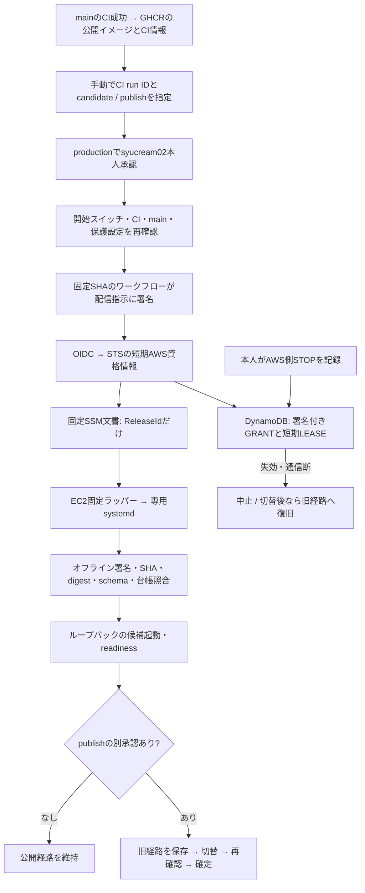

# 新CD 第1段階：ローカル実装と検証

> 2026-11-24 中断整理：本書は保留AWS/OIDC/SSM/DynamoDB方式の過去の設計・実績。現在の候補はGitHub App＋EC2 pollingであり、最新の安全条件と再開手順は[承認付きCDの導入準備](APPROVED_CD_SETUP.md)を参照する。現行CIのAction SHA固定は完了したが、保留AWS workflow・実装・署名Actionの未確定pinは別に残る。以下の構築承認は当時の範囲に限り、自動的な再開許可ではない。本番CDはNO-GO。

公開資料では実アカウント番号・EC2等の環境識別子をプレースホルダーへ置換した。調査の経緯・結果は保持し、この値を実環境の実行引数として使わない。再開時は本人の別承認で実設定を確認し、保留方式を再採用する場合も既存環境・費用制約・STOPと明示Denyを再評価する。

最新：2026-11-21 JST。**ローカル修正済み。第2段階の停止状態の基盤構築は本人承認済みだが、事前調査でOIDC確認がSCPに拒否されたため構築保留・未実施。本番導入・GitHub反映はNO-GO。**
最新の実環境調査は末尾「2026-11-21 第2段階の事前調査：SCPにより構築保留」を優先する。ローカル実装の結果は「2026-11-21 修正と再レビュー」を参照する。過去の記録は履歴として保持する。
第1段階のテストは模擬試験。第2段階では既存CloudShellからAWSのポリシーを読み取り確認したが、EC2内の動作試験・配信は実施していない。

## 今回の変更は3つ

1. PATをEC2へ置く方式から、Actionsの短期AWS認証と固定SSM指示へ変更するコードを追加。
2. 配信許可・期限・停止・一回限り利用をDynamoDB台帳で扱うコードを追加。
3. 既存CIのビルド・業務テスト・HTTP確認を残し、配信を手動申請＋production本人承認へ分離。

既存のPAT方式のスクリプトは削除していない。旧方式との比較・復旧資料として保持するが、新CDから呼ばない。
アプリ本体、業務ルール、DB、Dockerfile、稼働サービスは変更していない。

## 全体図と用語



- **CI**：変更したコードのビルドやテスト。**CD**：検証済み版をサーバーへ届ける処理。
- **PAT**：人のGitHub操作権限を持つトークン。期限・保管・漏えい対応が必要になるため、新CDには採用しない。
- **OIDC**：GitHubが「どのワークフローか」をAWSへ証明する仕組み。**STS**：証明を確認して短時間だけ使えるAWS資格情報を発行するサービス。
- **IAM**：誰に何を許すかを決めるAWSの権限設定。**SSM**：SSH秘密鍵や新しい受信ポートなしでEC2へ管理指示を送るAWSの仕組み。
- **DynamoDB**：AWSのデータ保存サービス。今回の1テーブルは配信許可の台帳専用であり、業務用MySQLとは別物。
- **GHCR**：Dockerイメージの保管先。公開イメージを認証なしで取得する。**digest**：イメージ内容を識別するハッシュ。タグの付け替えに左右されない。
- **署名付き証明（attestation）**：特定のGitHubワークフローが特定のファイルを発行した証拠。暗号化ではなく、改ざんと発行元を検証するために使う。
- **schema**：DBのテーブル構造。**readiness**：候補アプリが処理を受け付けられるかを調べる確認。
- **LEASE**：短時間だけ有効な許可。**epoch（世代）**：停止・再開前の許可を区別する通し番号。

## 台帳の形式と状態遷移

テーブル案は `deploy/aws/table.example.json`。パーティションキーは文字列 `pk`、オンデマンド課金、保存時暗号化、削除保護。TTLによる自動削除は設定しない。

| キー | 内容 | 書ける主体 |
| --- | --- | --- |
| CONTROL#production | epoch / notBefore | 独立した本人用再開権限 |
| STOP#世代 | 停止時刻・操作者 | 本人用停止権限 |
| GRANT#releaseId | 正規化前提のJSON文字列・hash・署名bundle | production承認後の配信ロール |
| LEASE#releaseId | 同じhash・世代・更新時刻・期限 | 同じ配信ロール |
| USED#releaseId | 取得済みhash・取得時刻 | EC2ワーカー |
| STATE#releaseId | 結果 | EC2ワーカー |

署名対象にはrepo名・repo ID・署名ワークフロー・その固定SHA・アプリSHA・両イメージdigest・schemaHash・CI run/attempt・配信run/attempt・作成/発行/失効時刻・世代・candidate/publishを含める。余計なフィールドは拒否する。

```text
初期状態: epoch=0 + STOP#0 → 閉鎖
別承認の初期開放 → 新世代 → 本人承認 → GRANT + LEASE
              ↓ 原子的な条件付き取得 → USED（以降は再利用不可）
           候補試験 → CANDIDATE_READY
           公開試験 → COMMITTED
STOP / 期限切れ / 確認不能 → ABORTED または ROLLED_BACK
復旧に失敗 → ROLLBACK_FAILED + 現状保持・本人調査
再開: 古いSTOPとUSEDを消さず世代を進め、新しいrunと本人承認を要求
```

配信指示の有効期間は発行後最大600秒。LEASEは最大30秒、Actionsは約10秒ごとに再確認・更新、EC2は約5秒ごとと各処理の前後に確認する。
EC2が既に受理した期限を過ぎた場合、遅れて届いた更新で復活させない。ActionsをキャンセルしてもSSMの即時停止は仮定しない。
通信断なら次の変更へ進まず、切替後は台帳への通信に依存せずローカル記録から復旧する。

## 最小権限と署名元の保護

`issuer-policy.example.json` は指定テーブルのGRANT/LEASE、固定SSM文書と対象EC2だけを許す。STOP・USED・CONTROL・STATEの書換えを明示拒否する。
EC2は台帳参照とUSED/STATE書込みのみ。本人の停止と再開権限は分離し、配信ロールには与えない。既存EC2ロールのSSM・バックアップ権限は置換しない。
AWSのトランザクションは各項目のGetItem/PutItem/UpdateItem/ConditionCheckItem権限で評価される。ローカル試験は実IAMによる認可試験ではない。

OIDC信頼ポリシーはaudを `sts.amazonaws.com` に固定し、subは**実際に確認したrepo ID・production・固定reusable workflowを含むカスタムsubject**へ完全一致させる。
`oidc-trust.example.json` のプレースホルダーを推測で埋めない。通常の `repo:...:environment:production` だけでは、別ワークフローのロール取得を十分に防げない。
カスタムsubjectの実現可否は実GitHub/AWSで別承認の確認が必要。実現できなければ導入停止し、権限を広げて回避しない。

署名元reusable workflowとそのコードを固定コミットにする。CIファイルもレビュー済みハッシュと照合する。
管理者による保護解除、信頼設定変更、署名済みコード自体の悪意まで暗号署名では防げない。main保護・変更レビュー・本人承認・固定pinの更新手順が必要。
一回限りの条件は実装の条件付きトランザクションで実現する。IAM自体がすべての条件式を強制するという意味ではない。EC2のroot侵害は信頼境界の外側となる。

## 署名の利用条件と未解決事項

GitHub公式では公開repoのartifact attestationsはFree/Pro/Teamで利用可能（旧契約など例外あり）。今回、GitHubの現行公開範囲・契約画面は取得していない。過去記録だけで現時点の利用可否を確定しない。
bundle・GitHub CLI・trusted rootを揃えるオフライン検証は公式に用意されている。
実装はCLIとtrusted rootのSHA256、Linuxでのroot所有と書込み権限、信頼情報のレビューから30日以内を要求する。新しい信頼情報への更新も別途レビューする。CLIをLinuxの `unshare --net` で別のネットワーク空間に入れ、予期しない外部参照を拒否する実装を加えた。このLinux機構の利用可否と実bundle成功は未検証であり、利用不可なら停止する。

**今回の暗号テストは一時生成したEd25519鍵をメモリ内で使うもの。GitHub/Sigstoreの実証明を検証した試験ではない。**
実bundleの証明書フィールド、source-ref、reusable workflowのsigner digest、匿名の完全オフライン動作は、ネットワーク遮断したLinuxで追加検証する必要がある。
署名が成功しても、同じSHAのコードが安全であることや本人が内容を理解したことを証明するものではない。

## ファイルの役割

| ファイル（deploy/aws/以下） | 役割・必要な理由 |
| --- | --- |
| contract.mjs | 指示の形式・承認・期限・イメージ・禁止操作の共通判定 |
| memory-ledger.mjs | 通信しないテスト用台帳。本番エントリーから利用しない |
| ledger.mjs | DynamoDBの条件付き・複数項目一括処理 |
| engine.mjs | 監視・排他・候補確認・切替・失効時復旧の順序 |
| external.mjs | AWS CLIの実行境界、環境変数の選別、タイムアウト、エラー秘匿 |
| github.mjs | Actions内だけでGET読取り。CI/main/保護/承認を確認しCI情報を取得 |
| ci-record.mjs | CI成功版のdigest等を記録。配信許可は発行しない |
| publish.mjs | Actionsの許可発行、固定SSM起動、LEASE更新 |
| verify-attestation.mjs | 固定されたCLI・信頼情報による実署名検証の接続部 |
| driver.mjs | Linuxでの固定Docker操作・readiness・公開経路の保存と復旧 |
| worker.mjs | EC2実行入口とsystemd異常終了後の復旧入口 |
| operator.mjs | AWS側の停止・再開と結果確認。権限・本人操作が別途必要 |
| start-release.sh / ssm-document.json | 任意コマンドを受け取らない固定入口 |
| siteflow-aws-release@.service | 1回限り実行、swap/core制限、障害時復旧。timerなし |
| settings.example.json | 秘密値を含めない設定例。初期値liveEnabled=false |
| issuer/worker/stopper/maintainer-policy.example.json | 配信・EC2・本人停止・本人再開の権限を分離 |
| oidc-trust.example.json | AWSが受け入れる発行元とsubjectの案 |
| table.example.json / bootstrap.example.json | 台帳と初期閉鎖状態の案 |
| logging-policy.example.json | 固定CloudWatchログ先へのEC2書込み案 |

ワークフロー変更：

- `.github/workflows/ci.yml`：既存ビルド・Linuxテスト・業務テスト・HTTP確認・GHCR保存を維持。旧 `release-approved` を外し、CI情報artifactを保存する。
- `.github/workflows/siteflow-release-request.yml`：手動受付。main・初回実行・準備済みスイッチを要求し、同時配信を抑止。
- `.github/workflows/siteflow-deploy.yml`：固定SHAで呼ぶ署名・配信処理。production本人承認と開始スイッチの後だけAWS認証する。
- `tests/aws-cd.test.mjs`：実外部接続なしの異常系・状態遷移・設定構造のテスト。

今回更新した資料は `docs/AWS_CD_STAGE1.md`（全体の実装・検証記録）、`docs/APPROVED_CD_SETUP.md`（旧方式との区別）、`docs/AWS_DEPLOY_RUNBOOK.md`（運用方針の参照先）、`docs/EC2_PAT_READONLY_PLAN.md`（PAT転送案の保留・履歴保持）、`docs/LEARNING_GUIDE.html`（初心者向け図・要点・練習・履歴）。これらと上記24の実装/設定案、3ワークフロー、1テストファイルで対象33ファイル。

既存の `schema-hash.mjs`、イメージrevisionラベル、`check-database-mount.sh`、`check-app-secrets.sh`、業務テストを再利用する。
新エンジンは旧 `release.sh` を呼ばない。旧スクリプトはPATによる再確認を前提としており、そのままの呼出しではPAT不要にならないため。

## 開始・停止・再開の操作仕様（将来用・今回は実行禁止）

### 開始

本番基盤・固定pin・署名・権限を追加検証した後、本人がmainの成功CIを指定して手動申請する。最初はcandidateのみ。
公開には別のpublish申請と本人承認、EC2側allowedModesの明示承認が必要。候補の許可ではNginxを変更しない。
CIが成功しただけではCDを開始しない。正式DBのmigrationはこの仕組みから常に拒否する。

### Windowsから停止する場合

WindowsブラウザーでAWSへ本人ログインし、CloudShellで停止補助を動かす方式とする。WindowsへAWS長期アクセスキーを保存しない。
CloudShellへ置く補助ファイルと設定は別承認の配置対象。今回そこへの配置・実行はしていない。

`node deploy/aws/operator.mjs stop settings.json CONFIRM-SITEFLOW-PRODUCTION deploy-123456-1`

- 全体：台帳に停止を記録し、指定配信のEC2側結果を確認する将来用コマンド。
- `node` はJavaScript実行環境、次が補助ツールのパス。`stop` は停止要求、`settings.json` は対象AWSを固定した非秘密設定。
- `CONFIRM-SITEFLOW-PRODUCTION` は誤操作防止の固定確認文字、末尾は止めたい配信IDの例。実値に置換する。
- 期待結果：STOP記録の読み戻し後、ABORTED/ROLLED_BACK等の結果。最大約90秒で確認できなければ「未確認」で終了する。
- 影響・リスク：AWS台帳へ書き込むため今回は禁止。要求成功だけではEC2停止完了を意味しない。完了済み配信の取り消しは別の復旧作業。

`node deploy/aws/operator.mjs resume settings.json CONFIRM-SITEFLOW-PRODUCTION deploy-123456-1`

- 全体：前回の終端結果を確認し、停止世代を残して次の世代を開く将来用コマンド。
- 引数は上と同じで、`resume` が再開を表す。配信IDは復旧確認済みの前回ID。
- 目的・期待結果：古い承認を復活させず、新しく作ったrunと本人承認だけを受け入れる。
- 影響・リスク：CONTROL変更権限が必要。自動再配信やincident解除はしない。初期epoch=0の開放は前回STATEがないため、このツールでは実行できず、基盤構築時の別承認作業。

従来：GitHub変数をfalseにしてEC2側API再確認で止める。
新方式：GitHub変数falseは**新規開始の抑止だけ**。進行中の停止はAWS側STOPを使う。ActionsキャンセルではLEASE更新が途絶えるが、即時停止の保証にはしない。
STOPと切替は分散システムの別処理であり、瞬間的な競合は残る。直前・直後の検査と復旧で対処する。OS停止やdockerd固着時の停止時間は保証できない。

## 復旧と本番導入前の条件

- 旧Vinextと既存3001候補は操作対象外。新しい枠は3101/3102のループバック。既存MySQLデータを操作しない。
- 候補起動も正式DBへのアプリ接続を伴うため、本番実行・アプリ操作試験は別承認が必要。
- Nginx固定includeとslotヘッダー、root所有のcurrent.json・schema.json、秘密ファイル参照は**将来の導入条件**。現行EC2が既にこの形だとは確認していない。
- schema.jsonは事前に本人が確認したschemaHash・migration digest・正式DB名/ホスト・CAハッシュを記録する。CDでmigrationを実行して作らない。
- この照合は「承認された構造確認記録との一致」であり、稼働DBの全DDLを毎回読み直した検証ではない。記録後に外部操作でDBが変更された場合の検出範囲は限られる。実schema確認と記録の更新・失効手順を本番前の監査に含める。
- 切替前異常では作成した候補のみ整合性を確認して停止。切替後異常では以前の経路を戻しHTTPSを確認する。既存コンテナを削除しない。
- 復旧失敗、RUNNINGのままの異常終了、ロック残留、候補の重複はincidentとして人が調査する。inactive slotを自動削除・再利用しない。繰返し配信には後片付けの別承認手順が残る。
- systemdのExecStopPostはSWITCHING記録からローカル復旧する。COMMITTED/CANDIDATE_READYの記録後にOSが落ちた場合、台帳とローカル結果が不一致になり得る。完了扱いを推測しない。
- ホストNode.js 22以降、AWS CLI、GitHub CLI、curl等と固定コードのroot所有配置は未実施。新しいランタイム常駐サービスは追加しない。
- 新systemd unitはswap=0/core=0を要求。ルートEBS上の既存swap、ホストや他プロセスのcore、SSM Agent・Docker daemon・短期AWS資格情報のメモリ残留問題は別途残る。PAT不要でも解消したことにはならない。

## ローカル検証結果

2026-11-20 Windows / Node.js v24.20.0（プロジェクト要件は22.13以降）。

| 検証 | 結果 | 範囲 |
| --- | --- | --- |
| 新CDテスト | 95成功・0失敗 | ダミー台帳・偽Docker/Nginx・一時Ed25519署名・設定構造・実子プロセスの終了/エラー秘匿 |
| 既存イメージ照合 | 3成功・0失敗 | digest/revisionと旧開始スイッチ判定 |
| 既存業務テスト | 42成功・0失敗 | 権限・入力・状態遷移等 |
| 型検査 / lint | 成功 | 既存設定を変更せず実行 |
| YAML / JSON解析 | 成功 | 新旧3ワークフローとAWS案JSON |
| 最終差分・教材確認 | 成功 | 対象33ファイルの既知秘密値パターン0件・2MB超0件、教材83テーマ/120履歴・JSON/JS構文・新テーマ参照先を確認。ブラウザー操作は今回未実施 |
| build | 成功 | 制限環境では既存work保護フォルダー走査で失敗。同じコマンドを承認された通常権限で再実行して成功。権限・アプリ設定は変更していない |

正常許可、本人承認なし、CI失敗、main違い、署名改変/別鍵、別repo/workflow、digest/schema違い、期限切れ、STOP、世代違い、再利用、同時実行、通信障害、Actions停止相当、各段階の失効、Docker処理中断、切替前後の中断、旧経路復旧/復旧失敗、不正SSM入力、候補による公開変更、migration拒否を検証した。
テスト追加時に属性制限を調べる対象の選び方が1件誤っており、テスト側の選択条件を修正した。最終結果に失敗はない。
実AWS・実GitHub・本番DBへ接続する試験は行っていない。既存Linux配信103件は以前の検証記録であり今回の再実行結果ではない。

再実行コマンド：

- `node --test tests/aws-cd.test.mjs tests/image-record.test.mjs`：`--test`で指定2ファイルのテストを実行。ダミーと一時領域だけを使い、98成功を期待。本番へ接続しない。
- `node --experimental-strip-types --test tests/domain.test.mjs`：型記法を除去して既存業務テストを実行。42成功を期待。DB書込みなし。
- `node node_modules/typescript/bin/tsc --noEmit`：インストール済み型検査を使い、JSを出力せず不整合を調べる。終了コード0を期待。既存設定に従い型検査キャッシュは更新され得る。
- `npm.cmd run lint`：Windowsのnpm実行ファイルから既存lintスクリプトを実行。警告・エラーなしを期待。自動修正オプションは付けていない。
- `npm.cmd run build`：既存prebuildのPrismaクライアント生成とNext.js公開用ビルド。ローカル生成物を更新するがmigrationや配信を実行しない。既存ローカル環境設定は通常ビルドとして読み込まれる。

## 第2段階へ進む前の未検証事項と承認

**この状態のままpush・配信しない。** 新ワークフローには意図的に解決不能な全0のSHAが2か所ある（署名元reusable workflowとactions/attest）。
レビュー済みの実コミットに固定するには、ローカルレビュー後のcommit/pushについて別承認が必要。`@main`へ変えて回避しない。
`settings.example.json` の実行許可はfalse、信頼ハッシュ・repo ID・SSM文書version/hash・operator ARNは未設定。GitHubの準備スイッチも設定していない。

1. GitHubの公開範囲・契約・GITHUB_TOKENでの承認/保護情報GET・実bundleとCLIの完全オフライン検証。
2. OIDCの実subjectと固定署名workflowへの制限、IAM全体の合成結果・トランザクション認可・権限外拒否の実試験。
3. 固定SSM文書の改変禁止、実環境AgentのENV_VAR対応、version/hash照合、CloudWatchログ先と保存期間/暗号化。
4. AWS基盤作成（DynamoDB・IAM/OIDC・SSM・ログ）、新CDを停止・無効化した状態での配置とswap/core対策。**基盤構築・EC2配置は別承認。EC2本体を停止する指示ではない。**
5. EC2実ドライバーのLinux統合試験、疑似通信断・プロセス強制終了・Docker daemon遅延・Nginx復旧・時刻同期・t3.smallの余力確認。**本番影響のある試験は別承認。**
6. 候補起動と正式DBの操作試験、公開切替、migration、再起動検証はそれぞれ別承認。今回のモック成功を本番安全性の証明としない。

今回の追加AWS費用は0（リソース未作成）。将来はDynamoDBの読書き・保存とCloudWatch保存が従量課金になる。既存EC2/EBS等の費用は継続する。新しいサービスは採用済みの範囲以外に追加していない。

## 公式根拠（2026-11-20確認）

- [GitHub：artifact attestationsの利用条件と権限](https://docs.github.com/en/actions/how-tos/secure-your-work/use-artifact-attestations/use-artifact-attestations)
- [GitHub：オフライン検証・信頼情報](https://docs.github.com/en/actions/how-tos/secure-your-work/use-artifact-attestations/verify-attestations-offline)
- [GitHub CLI：署名workflow・digest・source-refの検証オプション](https://cli.github.com/manual/gh_attestation_verify)
- [AWS：DynamoDBトランザクションのIAM認可](https://docs.aws.amazon.com/amazondynamodb/latest/developerguide/transaction-apis-iam.html)
- [AWS：LeadingKeysと項目単位の権限制御](https://docs.aws.amazon.com/amazondynamodb/latest/developerguide/specifying-conditions.html)

### 既存作業の保全

作業開始時からの `.agents/skills/web-development-learning/SKILL.md`、`AGENTS.md`、`examples/mysql/.vinext/` は編集していない。既存の学習ガイド差分は保持して追記した。`docs/EC2_PAT_READONLY_PLAN.md` は既存未追跡ファイルを残して冒頭に新方針を追記した。`tsconfig.tsbuildinfo` は開始時から差分があり、今回も通常の型検査・ビルドで更新され得る生成キャッシュとして扱う。無断で取り消し・stageしない。

公式仕様の確認と、自分のアカウントで利用・認可が成功する確認は別である。

## 2026-11-21 修正と再レビュー

### 結論と今回の範囲

**停止状態のAWS基盤構築に向けた準備はGO。実行は別承認後。GitHub反映・Actions実行・本番導入・公開はNO-GO。**
ローカルのCDコード・テスト・資料だけを変更した。GitHub/AWSへの認証・接続、Git commit/push/fetch/pull、EC2配置、SSM実行、実Docker/Nginx/systemd、DB、swap/EBSは操作していない。新サービス・認証方式・依存パッケージは追加していない。

### 今回の要点（3つ）

1. 署名元と実行コードを別SHAで扱い、固定checkout・未確定pin拒否・期限付き本人確認を追加。
2. 条件付きFINALを確定点にし、ABORTで遅れた完了を封じ、復旧も共通ロックとactive IDで制御。
3. publishの事前候補確認を必須化し、実ドライバーメソッドを通す46件の追加試験・安全なログ経路を整備。

### 修正前後とコードの再確認

| 指摘 | 修正前 | 修正後 |
| --- | --- | --- |
| 実行コード | GitHub変数でcheckout先が変わる | checkoutと実装SHAを同じリテラルで固定。署名元SHAと区別し、implementationShaを署名・EC2 policyへ結び付ける。全0は拒否 |
| 確定点 | ローカルCOMMITTEDの後に最終確認 | DECIDING永続化→最終確認→条件付きFINAL→ローカル確定→LOCAL完了ACK |
| 結果不明 | 単純な失敗扱い | FINALを強整合読取り。不在だけでは未成立と決めず、ABORTとの排他的transactionで裁定。確認不能ならCOMMIT_UNKNOWN |
| 復旧の排他 | 復旧側はロックなし | 通常/復旧共通ロック。active ID・owner ID・旧PID終了を照合。別ID・生存中・所有者不明は拒否 |
| 事故記録 | 復旧の後段で書く | 復旧前にfsync＋renameでincidentを保存。失敗時はlock/activeを保持。自動解除なし |
| 候補と公開 | publish内で新規起動可能 | 完了candidateの別release ID・SHA・両digest・schema・slot/portが必須。不在時はrunもNginx操作もしない |
| 切替の中断 | signal未使用 | 設定置換・構文確認・reloadの各操作前にsignalと許可を再確認 |
| 迂回禁止 | 未保証のREST項目に依存 | 期限付き本人確認記録のhashを署名とEC2 policyへ結び付け、APIでは承認履歴・承認者・main制限を継続照合 |
| 外部Action | CIに可変タグ | 全usesを40桁SHA形式へ。前回実在確認済み3件を保持。未確認は全0で拒否し、反映前レビューを必須化 |
| ログ | worker結果はjournalだけ | 固定SSMラッパー→report.mjs→機密を除いたSSM stdout→固定CloudWatchログ先。必要な参照権限案も追加 |
| 暗号化 | SSE Enabled=true | SSE指定を省略し標準のAWS所有キー。暗号化無効化ではない |
| 大容量bundle | 単一コマンド引数 | AWS CLIのfile:///dev/stdinへ標準入力で渡す。bundleの一時ファイル・argvは不要 |
| 配置表現 | EC2の停止状態 | 新CDを停止・無効化した状態。EC2停止は含まない |

### 確定と停止の仕組み

```text
候補/公開の試験 → DECIDINGを保存 → 最後の許可確認
 → FINALの条件付きtransaction【唯一の確定点】
 → current/candidate・ローカル完了記録
 → STATE: LOCAL_COMMITTED / LOCAL_CANDIDATE_READY
 → ActionsはFINAL＋LOCAL ACK＋SSM Successを確認して完了
```

FINALではSTOP不在・同じ世代・有効LEASE・同じGRANT/USED・ABORT不在を一括確認する。STOPが先ならFINALは失敗。FINALが先なら、その後のSTOPは次の配信を止める。確定済み公開の取消しは別承認で行い、FINALを削除して再試行しない。

**ABORTは既存1テーブル内の追加記録で、新サービスではない。** 応答を失っても元の要求が遅れて成立する可能性がある。FINAL不在を条件にABORTを作り、FINAL側もABORT不在を要求することで片方だけを成立させる。FINAL/ABORTのどちらも確認不能なら推測で経路を変えず、incident/lockを残す。確認回復後の復旧入口が裁定を再確認する。
FINAL/ABORTもTTLなし。配信ロールはこれらを書けない。EC2に必要なGet/ConditionCheck/Putだけを権限案に追加する。

### 永続ロックと事故時の対処

release-lock.mjsは排他的ディレクトリ・owner(PID/release ID)・active.jsonを管理する。通常配信は残ったlock/activeを消さない。復旧は同じreleaseの終了済みPIDだけを引き継ぐ。PID再利用・権限不足・所有者情報欠落は安全側に止まる。
復旧同士にも排他的引継ぎ記録を用いる。古いSWITCHINGがあってもactive IDが違えば操作しない。ロックを消して再試行する自動処理はない。
incident保存・reload・HTTPS確認・復旧記録・LOCAL ACKが失敗した場合も、成功と推測せずロックを保持する。RUNNING中のdockerd操作結果が不明ならコンテナを推測で削除しない。
事故解除用の自動ツールは追加しない。将来の本人承認後、FINAL/ABORT・active・経路・実稼働・HTTPSを照合し、対象を限定して解除する。復旧自体の中断で引継ぎ記録が残った場合も手動調査が必要。

### 本人確認と固定SHAの未解決条件

manualProtectionReviewはconfirmed=false/bypassDisabled=falseが初期値。本人がGitHub画面で迂回禁止を確認した記録について、確認者・repo ID・production・期限（最大24時間）・hashを検査する。各runの本人承認履歴も必須。未保証REST項目をfalse扱いする経路は削除した。
この記録は画面確認を自動生成するものでも、後日の設定変更を常時検出する仕組みでもない。本人による再確認と設定変更時の即時停止・記録失効を本番導入条件にする。AIがconfirmed=trueへ変更してはいない。

action-pins.example.jsonは前回レビューで実在を確認した3件と未確認一覧を分離する。今回は外部へ再確認していない。実在確認はActionの安全性・最新性の確認とは別。
docker/login-action、actions/upload-artifact、actions/attest、署名元コミット、実装コミットは未確定。**全0は実在SHAではなく導入ブロック。このままpushするとCI/CDを実行できないため、GitHub反映はNO-GO。**
将来の順序は、外部Actionの読取確認・採用レビュー→実装コミットAの別承認→checkoutをAへ固定した署名workflowのコミットBの別承認→呼出し/EC2 policyをB/Aへ固定。自分自身のコミットSHAを自分の内容へ埋める循環は作らない。

### 追加・変更ファイルと理由

| ファイル | 今回の目的 |
| --- | --- |
| decision.mjs（新規） | 確定/結果不明の裁定 |
| release-lock.mjs（新規） | 通常・復旧の共通永続ロック |
| recovery.mjs（新規） | active所有者を照合した復旧 |
| report.mjs（新規） | 許可した結果項目だけを出力 |
| action-pins.example.json（新規） | 実在確認済みと未確定の区別 |
| oidc-trust.disabled.example.json（新規） | 第2段階で配信ロールを明示Deny |
| engine/driver/worker/ledger/memory-ledger.mjs | 確定・監視・永続記録・復旧を一貫化 |
| contract/github/publish/operator.mjs、settings.example.json | 固定実装・本人確認・確定と実完了の区別 |
| external.mjs | 大きな入力をstdinへ |
| start-release.sh、logging-policy.example.json | 安全なSSM結果とログ権限 |
| table.example.json | AWS所有キーによる標準暗号化 |
| issuer/worker/stopper/maintainer-policy.example.json | FINAL/ABORTの必要権限。既存SSM/S3権限を置換しない |
| .github/workflows/ci.yml、siteflow-deploy.yml | 固定checkout、可変タグ排除、追加テスト |
| tests/aws-cd-recovery.test.mjs（新規） | 46件の再発防止試験 |
| tests/aws-cd.test.mjs | 新しい指示形式・確定点へ追随 |
| 本書、APPROVED_CD_SETUP.md、AWS_DEPLOY_RUNBOOK.md、LEARNING_GUIDE.html | 判断・実測・未検証・学習内容を追記 |

業務テストは変更していない。既存CDテストの「commit後のSTOP」1ケースは、新しい確定点に合わせて「確定済みを戻す」から「次を止める」期待へ変更した。既存ケースは削除していない。

### 検証結果と範囲

既存140件＋追加46件＝**186件成功、失敗0**。型検査・lint・buildの最終結果は下の最終検証欄を参照。
追加試験では実ReleaseDriverのstage/switch/commit/rollback、実ファイルの書込み・rename・fsync、共通ロック・復旧入口を利用した。ただしLinux/root/固定パス初期化とホストpreflight、AWS/Docker/Nginx/curlの通信はテスト用に置換している。
3件では実Node子プロセスを起動し、最終確認前・直後・FINAL成立後を再現して強制終了、残ったファイルから復旧した。確認処理は実manifest/snapshot検証を通る。DynamoDBはダミー台帳である。
Windowsの強制終了はLinuxのSIGKILL/systemd/cgroup試験の代用にはならない。実Docker daemonの遅延完了、Nginx reload、実AWSのtransaction認可・競合は未実施。
初回追加試験ではWindowsで読取り専用ハンドルのfsyncが拒否された。検証用ハンドルをr+へ修正して成功した。ファイル権限・機密保護は緩めていない。

再実行：`node --test tests/aws-cd.test.mjs tests/aws-cd-recovery.test.mjs tests/image-record.test.mjs tests/domain.test.mjs`。
nodeは既存JavaScript実行環境、--testはテスト実行、4つの引数は対象ファイル。目的は旧機能と今回の拒否・復旧条件の確認。186成功を期待する。本番認証情報を渡さず、work下の限定一時領域だけを作成・検証後に削除する。外部接続・配信・DB変更は行わない。

### 再レビューと段階別の判定

コード上で、FINALがローカル完了記録に先行すること、FINAL/ABORTが排他であること、復旧が同じactive/lockを必要とすること、事故記録が先に保存されること、publishが候補必須であること、実装pinが変数に依存しないことを再確認する。テスト成功だけを判定根拠にしない。

**第2段階（停止状態の基盤）**：別承認・既存リソース照合・固定ログ先・AWS所有キーで暗号化した1テーブル・CONTROL#production(epoch=0)+STOP#0の一括登録・TTLなし・削除保護・固定SSM文書・権限案の検証・配信ロールの明示Denyを条件とする。EC2配置、サービス操作、SendCommand、Actions実行、信頼関係の開放は含めない。基盤を作っただけで配信が始まる経路を作らない。

**第3段階以降（反映・導入・配信）**：Action/pinの実在・安全性レビュー、現契約と公開範囲、実署名とネットワーク遮断検証、OIDC実subjectと固定workflowへの限定、実IAM合成認可・DynamoDB競合、SSM Agent/ログ経路、Linux強制終了・実Docker/Nginx復旧、EC2配置とswap/core対策、本人の保護設定再確認が必要。本番公開は別承認。

### 最終検証欄（2026-11-21）

| 項目 | 実際の結果 |
| --- | --- |
| 既存テスト | 140成功・0失敗（新形式/確定点への追随を含む） |
| 追加再発防止テスト | 46成功・0失敗 |
| 合計 | 186成功・0失敗・skipなし |
| 型検査 | 成功 |
| lint | 成功。初回の未使用import警告1件を除去し、最終確認で再検査 |
| build | 成功。既存の通常ビルド手順を承認された権限で実行。アプリ設定・保護フォルダーの権限変更なし |
| 学習ガイド | 既存83テーマ/120履歴を保持して84テーマ/121履歴。JSON・JS構文と新テーマ参照先を確認。ブラウザー操作は今回未実施 |

コード再確認時、確定前のSWITCHINGはAWS通信断でもローカル経路から復旧し、DECIDING以降はAWSアカウントを照合して裁定するよう補強した。切替途中のオフライン復旧、誤ったAWSアカウントでの復旧拒否の2件も追加46件に含む。
Docker CLIは今回のPATHでは確認できず、Linux/systemd/実Docker/Nginx統合試験は今回未実施。過去のLinux配信103件を今回再実行した結果として扱わない。

最後の再確認では、同じrelease IDの古いjournalを通常実行が再びactiveにしないよう、ロック取得前に既存journalを拒否した。確定後の重複SSM相当要求がDocker/Nginx操作やincident作成へ進まないことも追加試験内で確認した。
停止補助はFINAL成立とローカル完了を区別して表示し、再開補助はFINALだけでなくLOCAL完了ACKを要求する。再開してもEC2のincident/lockは自動解除しない。

残るリスクは、停止の瞬間的競合、AWS条件式がサーバー現在時刻を直接評価できないことによるクライアント時刻/遅延、OS/ストレージ停止、短期資格情報のメモリ残留、古い信頼情報、本人確認後の設定変更。即時停止や絶対的安全を保証しない。不明時はincident/lockで止める。実schema確認記録の鮮度とt3.smallの余力も本番条件として残る。
## 2026-11-21 第2段階の事前調査：SCPにより構築保留

これは基盤構築の完了記録ではない。構築の承認後、既存環境を読み取り確認した時点の記録である。

- 本人のCloudShell出力：アカウントAWS_ACCOUNT_ID、ap-southeast-2、対象EC2 EC2_INSTANCE_IDはrunning/t3.small。インスタンス・システム・接続EBSのステータスはok、SSMはOnline、公開HTTPSは200。
- 本人の確認時点で、SiteFlowRelease、SiteFlow-ApprovedRelease、/siteflow/release、SiteFlow-GitHub-Release-Roleは存在しなかった。EC2ロールにはAmazonSSMManagedInstanceCoreとインラインSiteFlowS3Backupのみ。これらは自動操作時点で全項目を再取得した結果ではない。
- 自動操作で既存CloudShellへ接続し、AmazonSSMManagedInstanceCoreの既定バージョンv2と本文を取得できた。SSM Agent通信関連のAllowであり、DynamoDBや新CD実行用の権限は含まれない。既存S3ポリシーも変更していない。
- 本人のListOpenIDConnectProviders実行は、組織のSCPによる明示Denyで失敗。拒否された操作の再試行・別認証での回避・権限追加は行っていない。実際のSCP本文は未確認。

AWS公式の新しいAWS利用体験向け管理ポリシーには、Free/Paid双方にiam:*Provider*の拒否が記載されている。画面とエラーに整合する原因候補だが、適用されたSCP本文との同一性を確認した事実ではない。有料プランへの変更だけで解消すると判断しない。

公式の高度な機能有効化は取り消せず、事前アップグレードや支出上限の撤廃を伴うため、今回の承認で実施しない。次は制限解消の正式な選択肢と費用・運用影響を整理し、変更が必要なら別承認を得る。

**判定：第2段階は未完了・構築保留。第3段階と本番導入はNO-GO。** 新規AWSリソース、追加IAMポリシー、STOP初期データは未作成。新CDも未配置。今回の自動操作ではGit・Actions・EC2サービス・DB・公開経路を変更していない。Next.js候補・MySQLのプロセス状態は今回直接確認しておらず、過去の正常記録と区別する。新CDリソースを作成していないため、今回の構築による追加利用料は発生していない。

参照（2026-11-21）：[AWS管理ポリシーとSCP](https://docs.aws.amazon.com/accounts/latest/reference/scps-and-rcps-for-projects.html)、[高度な機能の有効化と影響](https://docs.aws.amazon.com/accounts/latest/reference/activate-advanced-features.html)。
