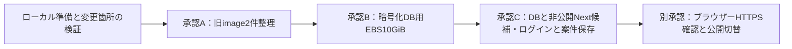
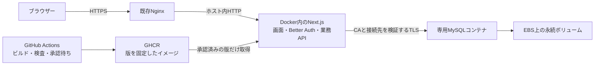

# SiteFlowを公開・検証し、安全に休止・再公開する計画

最新（2026-11-17 21:21 JST）：**PC実Chromeの非公開HTTPSでログイン・案件保存35％・再読み込み・ログアウトに成功**。証明書dry-run/再読込hook/通常renew正常（実証明書の期限延長なし、11月21日15:26 JST）。候補だけの停止再開と保存保持も成功、旧Vinext/Nginxルーティング維持・HTTPS200。S3/IAMは承認待ち、GitHub production未作成、CD/公開経路変更はローカル準備のみ。詳細は[21節](PREDEPLOY_VALIDATION.md#21-公開前準備証明書非公開ブラウザー復旧cd)。後段は過去の履歴を含む。

最新（2026-11-17 20:08〜20:10 JST）：**AWS Next.js候補版が127.0.0.1:3001で稼働**。新正式DBへ確認済み2履歴を適用、runtimeは業務tableのCRUDのみ、migrationユーザーはロック。実HTTPでログイン/案件作成保存再取得/ログアウトと401を確認。Next約181〜188MiB/384MiB、MySQL約231MiB/512MiB、EC2 available最少約826MiB。旧公開HTTPS200・不変。S3/一般公開切替/Git push/再起動は未実施。詳細は[20節](PREDEPLOY_VALIDATION.md#20-aws-nextjs候補版の起動正式db移行ログイン保存検証)。後段の未起動/提案は過去の履歴。

最新（2026-11-17 19:40 JST（10:40 UTC））：AWS上の架空DB backup→別空DB restoreの定義/全行/整合性一致、アプリ用最小CRUD・TLS必須・他DB/DDL拒否、Next.jsと同じ接続設定/Prisma adapterで正常TLSと不正CA/誤名/平文拒否を確認。MySQL約205MiB/512MiB、host最少約891MiB、旧公開HTTPS200。**実Next HTTP候補/Prisma migration/EC2外backupは未実施。** 詳細・残作業・S3承認案は[検証19節](PREDEPLOY_VALIDATION.md#19-awsでの検証dbバックアップ復元アプリ用tls接続)。後段は過去時点の記録を含む。

最新更新（2026-11-17 18:41 JST）：**AWS MySQLのみ起動済み・healthy**。暗号化追加EBSへの保存、正常停止・コンテナ再作成後の検証データ保持、3306非公開、秘密/ログのEBS配置・swap/core制限を確認。旧公開HTTPS200、既存Docker/Nginx不変。DB自動起動はdisabled。Next.js未配信、本番SQLの別保存先backup/restore・ネットワークTLS接続・実再起動は未検証。以降の「DB未起動」等は当時の履歴で、現状は[最新検証18節](PREDEPLOY_VALIDATION.md#18-aws-mysql初回起動と永続化検証)を優先する。

## 現在の実行方針：候補版のログイン・案件操作を最優先（2026-11-16〜17）

ユーザーが作業単位の統合を指示した。既存の15項目の保持/TLS/復元、3項目のNginx試験、停止4containerの整理結果は再利用し、同じ調査を毎回繰り返さない。以下を最新の順序とし、後段の細分化した手順は対象照合/復旧の資料として残す。承認済みはローカル実装・テスト・文書と無影響な読み取り。**その後Aだけ承認され、2026-11-17 05:52 JSTに対象2imageの削除と公開維持確認が完了。B/Cは未承認。** [実行事実](PREDEPLOY_VALIDATION.md#12-承認a旧2イメージの整理結果2026-11-17)。

最新のB準備（11月17日06:01 JST）：読み取りでAZ **ap-southeast-2c**、既存diskはroot20GiBのみ、追加path/fstab未存在を確認。[作成値と画面別手順](PREDEPLOY_VALIDATION.md#13-b準備ebs作成値と画面別手順2026-11-17)。ユーザーの最新指定により、Bは作成/attach/format/mountをそれぞれ個別承認する。今回は作成前の提示のみ。Dockerの自動再起動がhost guardを迂回し得るため、DB専用systemd＋mount依存とDB restart明示管理の補強を初回DB起動条件に追加（未実装/未適用）。

その後ユーザーがB1作成/B2attachを手動実施と報告。新VolumeIdは`vol-01a737715ed956301`、AWS名`/dev/sdf`。06:26 JSTに同EC2で10GiBの`/dev/nvme1n1`へVolumeId/serial/ebsnvme-id一致、FS署名/UUID/mountなしを読み取り確認した。[調査と次の承認単位](PREDEPLOY_VALIDATION.md#14-ユーザー作成接続後のnvme読み取り照合2026-11-17)。format/mount/fstab/MySQL/既存公開の変更は行っていない。次はB3のXFS formatだけを承認対象にする。

最新：B3 formatだけをユーザー承認後、06:34 JSTに同VolumeId/10GiB/nvme1n1/署名・mountなしを再確認しXFS作成成功。**UUID=276f374a-7e33-4ff0-b6f4-b0f185280cd6、label=SITEFLOW_DB、未mount**。root metadata/fstab/Nginx/3containerは前後一致、HTTPS200。[実施結果](PREDEPLOY_VALIDATION.md#15-b3承認後の新10gib-xfsフォーマット結果)。次はB4 mountだけを別承認。DB/Next/push/公開は含めない。

最新B4：06:40 JST、手動mountだけの承認後、同VolumeId/UUID/XFS/既存mountなし/接続先にdataなしを再照合。空dirを作りUUIDで`/srv/siteflow-mysql`へmount、findmnt/lsblk/df一致、空き約9.84GiB。root/fstab/Nginx/3container不変、HTTPS200。[実測16節](PREDEPLOY_VALIDATION.md#16-b4承認後の手動マウント結果)。自動mount/fstab/Docker設定/DB/Next/pushは未実施。

最新B5（11月17日）：ユーザー承認後、fstabをroot専用backupし、UUID/XFS/nofail/10秒device待ちの1行と、DB専用systemd/UUID・EBS guard/Compose MySQL restart=noを反映。[設定と実測17節](PREDEPLOY_VALIDATION.md#17-自動マウントとmysql起動保護の設定結果)。実マウント正例・誤ID/UUID・隔離namespaceでのmount不在拒否が成功。DB unitはdisabled/inactive/許可markerなしで実DBは未起動。既存Docker/NginxのPID/起動時刻/設定、3container、HTTPSを維持。実EC2/daemon再起動・MySQL起動・Next/pushは未実施。

旧Vinext/Nginx3002/HTTPSはCが終わるまで維持する。EC2停止を伴うroot交換は今の最短経路から外し、既存rootは保持する。root暗号化を完了扱いにはしない。新しい推奨は暗号化したDB用gp3 EBS10GiBを同じEC2へ追加し、DB永続Volumeをそこへbindする案。月＋0.96ドルは前段のシドニー単価0.096ドル/GiB月による見積（税/backup等別、今回価格/残高の再照会なし）。root上の秘密設定は引き続き非暗号化媒体にあるため、権限制限とEC2外の暗号化設定backupを行い、root暗号化は後日の別作業に残す。このリスクを承認済みとはしない。

| 承認群 | 具体的に実施する範囲 | リスクと復旧/停止条件 |
| --- | --- | --- |
| A・容量整理 | 既に確定済みのimage `04d3b36a25dc`と`bf9dda4647e1`だけを、参照0/完全ID/保持版/保存済み復旧情報を実行直前に照合して除去。現公開d749/直前31b/local1.0と全volumeは保持。HTTPSと容量を確認 | image固有約2.345GBの見込みで実解放は保証しない。戻す場合は固定digest再取得が必要。失敗時force/pruneなし。旧サイトを停止しない |
| B・DB保存先 | 同AZの暗号化gp3 10GiBを**1件だけ**作成/接続。新規VolumeId/所有tag/未format/既存rootではないことを照合して新volumeだけをformat/mount。`/srv/siteflow-mysql`、fstabの限定追記/起動順/読取確認、所有label付きexternal bind volume/networkを準備 | 有料保存月0.96ドル。formatは対象を誤ると破壊的なので、AWS側のIDとOS serialを一致させ不明なら停止。root/既存EBS/既存snapshot/SG/Nginxは変更しない。失敗時は旧サイトを維持、新volumeを勝手に削除しない。AWS実権限でできなければ該当コンソール操作をまとめて案内 |
| C・候補起動と確認 | 検証済み設定/TLS鍵/固定secret/専用DB userを配置、固定imageを取得、MySQL初回起動→専用migration→架空テストaccount/team→Next候補をloopback3001へ起動。SQL/秘密設定をEC2外へ暗号化backupし別DB復元を確認。SSH経由の検証でログイン/案件作成/進捗更新/再取得/ログアウト、実機メモリ/空き/拒否条件をまとめて確認 | 新DBへDDL/テストdataを書き込む。失敗時は候補アプリ/DBだけを制御停止し、volume/data/記録を残すことをこの群の復旧範囲に含める。旧3002/Nginx/HTTPS/旧CD休止は維持。DB復元は別の空DBへ。公開切替/無関係な削除はしない |

A/B/Cは各群ごとの承認。群内の低リスク確認を逐一承認で止めないが、想定外の破壊的変更/費用増加は改めて提示する。Bのformatは新規作成した1件だけという条件付きであり、既存EBSの初期化を含まない。

容量ゲートは保存先別に評価する。root一体案の10GiB開始ゲートはDB/temp予算も含んでいた。DBを別10GiB EBSへ移す本案では、rootの25％約5GiB＋新image約2.32GiB＋取得一時1GiB＋host log約0.1GiB＝約8.42GiBを仮予算とし、**root取得前8.5GiB以上/配置後25％以上**を条件にする。整理後の推定9.28GiBなら計算上は収まるが、実取得量で判定する。data EBSも25％以上、DB/redo/temp/backupの予算を別測定。実測不足なら無断拡張/追加削除せず停止。

初回は旧Vinext192MiB＋Next1台384MiB＋MySQL512MiBまで。migration/backup/復元はアプリ増台と重ねない。実機の5人/21案件以上/15分/保存・会議/available200MiB目安/OOMなしは公開前ゲートとして維持し、最初のログイン成功を全公開要件の完了としない。

### ローカルで今回実装した範囲

- compose.production.yaml：新containerだけにlog10m×3、app停止猶予30秒、DB60秒/認証付きSQL healthcheck、appのHOSTNAME/PORTを明示。mysql.cnfは初版binlog無効。release.sh側にも同じapp log上限/停止猶予を追加し、Composeと設定が食い違わないようにした。
- start-database.sh：追加EBSを使う場合のmountpoint/実NVMe serialとVolumeId/volume bind先の照合。未mountや別媒体への誤初期化を拒否。既存のローカルnamed volumeは従来どおり。Linux実機のmount/boot順はBで検証する。
- scripts/check-candidate.mjs：明示許可・loopback接続・HTTPS Origin・架空account/対象teamを必須にする候補確認。既定はlogin/read/logout、書込は別フラグ。専用テスト案件を新規作成して進捗25％へ更新/再取得する。既存案件を変更/削除しない。HTTP応答のredirectを追わず、POSTを自動再送せず、秘密/response本文を出力しない。

このローカル変更はユーザーの今回の包括指示に基づく。本番配置の承認ではない。Dockerfile/.github/workflows/Nginx/systemd/EC2/AWSは今回変更していない。

### 候補確認の見方と後回しにするもの

候補はloopback HTTP3001だけで、3306や3001をSGへ公開しない。PC→SSH tunnel→EC2 loopbackという暗号化経路で専用検証ツールを動かし、Host/Originを本来のHTTPS Originへ合わせる。これはAPI/DBの実動作試験で、ブラウザーのSecure Cookieや公開HTTPS経路を試験した意味ではない。

後続のまとまり：候補合格後に、ブラウザーHTTPS確認用の承認済み公開経路/切替案を提示。S3/IAM/age timer/通常CD/production承認/Git push/長期停止再開は別承認の作業にする。S3自動化を候補起動の前提にしないが、候補DBのEC2外backup/復元と秘密鍵の安全な保管は省かない。決定事項/招待/進捗差分は未完成の表示を維持する。

本番backup/ageとテストaccount発行の運用処理、Bの実mount/起動順、Linux本番鍵権限、Cの実機負荷は残作業。現時点でA/B/Cを実行できる完全自動scriptが完成したとは報告しない。既存migration/fixture/接続検査を再利用して承認後の範囲を具体化する。

---

- 最新の限定実行（2026-11-16 23:07〜23:08 JST）：ユーザーが指定した停止4containerだけの削除を条件付き承認。ID/image/mountなし/SizeRw0/diffなしを再確認しroot専用に復旧情報を保存、4件だけ除去した。現公開/直前版/保留版と全6image、Nginx/CD状態を保持し、EC2/PCからHTTPS200。[実行記録](PREDEPLOY_VALIDATION.md#10-承認された停止4コンテナの整理結果2026-11-16)。image削除/EBS/S3/MySQL/Next/push/切替は含めていない。

- 最新の調査・提案（2026-11-16 22:47 JST以降）：[事前検証9節](PREDEPLOY_VALIDATION.md#9-削除対象の再確認暗号化の推奨と個別承認手順2026-11-16)に候補2imageの完全ID/サイズ/作成時刻/停止4container/旧記録の参照を再確認。現公開/直前版を保持する対象限定整理と、DB導入前root暗号化・容量30GiB候補を提案し、S3/IAM/料金/復元/個別承認25段階を記録した。今回は読み取りと文書更新だけ。暗号化/容量/S3/削除を採用・実施済みとはしない。

- 最新の事前検証（2026-11-16）：[PREDEPLOY_VALIDATION.md](PREDEPLOY_VALIDATION.md)へEC2読み取り、条件付き削除候補、2GB運用条件、ローカル保持/TLS/専用権限復元15項目とNginx3項目の成功を記録。S3/保存時暗号化/実機負荷は未検証・承認待ち。本番削除・DB起動・設定変更・AWS変更・push・切替は実施していない。以下は過去時点を含む経過記録。

- 計画保存日時：2026年11月16日 00:16 JST（UTC+09:00）。
- 状態：初回保存後、2026年11月16日にローカルDocker修正・検証へ進む承認を受けた。AWS反映・停止の完了報告ではない。最新結果は[ローカルDocker検証](LOCAL_DOCKER_CHECK.md)を参照する。
- 現在許可された作業：具体案の提示後に「お願いします」の承認を受け、CI/CD・起動定義・公開migration・切替/復旧をローカル実装/検証した。現状と使い方は[ローカル検証記録](LOCAL_DOCKER_CHECK.md)、本番への順序は[AWS手順書](AWS_DEPLOY_RUNBOOK.md)。
- 今回実施しない作業：AWS設定変更、EC2停止・サイズ変更、GitHub設定変更、commit/push、本番切替・停止・再開。これらは引き続き個別の実行承認が必要。2026年11月16日12:27〜12:32 JSTに、承認済みのSSH/AWS/GitHub読み取り調査だけを実施した。
- 優先する仕様：確定済みの要件定義と最新のユーザー指定。アーカイブ・復元は現在所属するチーム管理者または案件の主担当のみ。副担当だけでは許可しない。
- 最新のIP確認：2026年11月16日、ユーザーがAWSコンソールで `13.237.188.172` がElastic IPで、`i-04201e271c824ac02` への関連付けを確認したと申告。解放/関連付け解除せず維持する。次の旧CD休止の具体案は[AWS手順書12節](AWS_DEPLOY_RUNBOOK.md#12-elastic-ipの確認と旧cd休止の実行案)。EC2停止・サイズ変更等は未承認のまま。
- 最新の実施結果：旧CDタイマーだけの休止を個別承認後、2026年11月16日19:00 JSTにstop/disableを実施した。inactive/disabled、service停止中/ロックなし、同じ旧版コンテナ・Nginx設定、HTTPS200/TLS検証成功を確認。[手順書13節](AWS_DEPLOY_RUNBOOK.md#13-旧自動配信タイマーの休止結果)。EC2本体やAWSリソース設定、GitHub設定/push、本番切替は変更/実行していない。冒頭の実施しない作業とは別に承認された限定操作である。
- 最新のEBS確認：ユーザーがgp3/20GiB/暗号化なし/終了時削除「はい」をコンソール確認。公開gp3単価を参照して13節の見積もりを更新し、[手順書14節](AWS_DEPLOY_RUNBOOK.md#14-ebs確認後の容量対策とサイズ変更案)へ停止/2GB化/起動の実行案を具体化した。これらの操作は未承認・未実施。
- 最新の停止前条件：ユーザーが旧snapshot `snap-0666dfa96de083c80`（10月11日13:48 JST、8GiB、完了、非暗号化、同じ元EBS）を確認。削除しない。現在20GiBの最新snapshotを承認後に1件取得/完了確認し、結果を報告してから停止・タイプ変更・起動を1操作ずつ承認する。[手順書15節](AWS_DEPLOY_RUNBOOK.md#15-既存スナップショットの保管と最新バックアップ作成案)。稼働中ルートの整合性と復元テスト未実施を区別する。新規snapshotはまだ未作成。
- 作成承認後の結果：11月16日20:13〜20:15 JSTに業務DBが見つからないことを確認し、sync/HTTPS確認を実施。CreateSnapshot dry-runは権限不足、ブラウザーも接続不可で新snapshotは未作成。ユーザーの既存コンソール作成へ引き継ぐ。[手順書16節](AWS_DEPLOY_RUNBOOK.md#16-承認後の事前確認と作成経路の制約)。作成承認は受領済みで、追加IAM許可やEC2停止を承認されたわけではない。
- 最新のバックアップ完了：ユーザーが手動作成した `snap-0e59ef6e9a1635889`（元vol-042befaf03ffe5cb7、11月16日作成、完了/100％、旧snapshot保持）を確認。作成時刻は未提供、復元試験は未実施。20:32 JSTに同じEC2/EBS/公開IP、旧CD休止、旧版HTTPS正常をSSH確認した。[手順書17節](AWS_DEPLOY_RUNBOOK.md#17-最新スナップショットの完了確認と停止前の状態)。直前段落の未作成は引き継ぎ時点。次は停止だけの個別承認と最終対象照合を行い、サイズ変更/起動の許可へ流用しない。
- 停止承認後：停止だけの承認を受領し20:37 JSTに対象/公開正常を再確認。StopInstances dry-runが権限不足で拒否され、EC2はまだ稼働中。ユーザーのコンソール停止へ引き継ぐ。[手順書18節](AWS_DEPLOY_RUNBOOK.md#18-一時停止承認後の確認とコンソールへの引き継ぎ)。サイズ変更/起動は未承認。実施済みと承認済みを区別する。
- 停止完了：11月16日20:52 JST頃、ユーザーがコンソールでstoppedを確認したと報告。実停止時刻は未提供。前段の稼働中は過去時点の記録で、次は同じ対象のt3.smallへの変更だけを個別承認する。起動はさらに別承認。[手順書19節](AWS_DEPLOY_RUNBOOK.md#19-停止完了の受領とサイズ変更の承認範囲)。
- 2GB化/起動の完了：タイプ変更と起動をそれぞれ個別承認後、ユーザーがコンソール実行。21:05〜21:06 JSTに同じEC2のt3.small/総RAM1909MiB、同じEBS20GiB/IP、既存Vinext/HTTPS復旧、再起動後の旧CD inactive/disabledを確認。[手順書20節](AWS_DEPLOY_RUNBOOK.md#20-t3smallへの変更起動後の実測と旧版復旧)。新版DB/負荷/公開は未完了で、この検証をNext.js/MySQLの停止再開試験とはしない。
- 次のホスト準備：Compose v5.7.0/Linux x86_64の公式配布物をローカル取得しハッシュ2系統一致、現行Windows版の設定検査5件成功。EC2への導入/実行はまだ。配置先/互換性確認/撤去/承認範囲は[AWS手順書21節](AWS_DEPLOY_RUNBOOK.md#21-docker-compose導入の版配置影響と承認範囲)。Engine更新やMySQL起動は含めない。
- Compose導入完了：ユーザー承認後21:27 JSTにroot管理の固定版5.7.0を配置。root/通常ユーザーの版認識とDocker25へのread-only一覧取得が成功し、全既存container/Engine版/Nginx/CD休止状態は不変。21:28 JSTにPC側から旧版HTTPS正常を確認。[手順書22節](AWS_DEPLOY_RUNBOOK.md#22-compose導入結果と既存公開の維持)。MySQL/network/volumeの作成起動は未実施で別承認。
- 公開用DB設計：[PRODUCTION_MYSQL_DESIGN.md](PRODUCTION_MYSQL_DESIGN.md)に構成/権限/保存/backup/復元/容量/段階移行/rollbackを整理。現コードと設計追加を区別し、保存時暗号化・ディスク余裕・EC2外保管を公開前ゲートにする。今回は文書のみ、MySQL起動/設定変更/切替/pushなし。

## 1. 目的と公開範囲

既存のAWS EC2・Docker・Nginx・HTTPS・GitHub Actions・GHCRを再利用し、Next.js＋MySQL版を一度公開する。本番相当の確認と停止・再開テストを終えた後、EC2を一時停止して保管する。新しいサーバーを契約する前提にはしない。

初回は、運営者が準備する個別アカウントで利用するプレビューとする。共通の管理者パスワードを一般公開する方式や、誰でも体験用アカウントを自動発行できる方式にはしない。架空データ専用と案内する。

転職活動のため、2027年1〜4月は継続公開する可能性がある。4か月連続稼働の費用も見積もるが、起動予約や変更承認ではない。それより早い時期を含め、ユーザーが再公開を希望したときにも対応できる手順を整える。日時を指定した自動起動は設定せず、依頼時に状態・料金・必要な更新を再確認し、承認後に再公開する。

会議の最小範囲が動くことと、当初の全要件の完成は区別する。決定事項・招待・進捗差分表示などは未完成と明示する。

## 2. 調査で確認した現在地

以下は前段階の調査記録であり、このファイルの作成時にAWSへ再照会した結果ではない。2026年11月15日のEC2調査、および11月16日の証明書更新方式確認を引き継ぐ。分単位の取得日時が保存されていない測定値については、正確な時刻を推測しない。

| 項目 | 確認した状態 | 注意点 |
| --- | --- | --- |
| EC2 | シドニー地域、t3.micro、x86_64 | サイズ変更は未承認・未実施 |
| メモリ | OSから見える総量約913MiB、利用可能約316MiB | 一時点の測定。負荷試験の結果ではない |
| スワップ | 約2GB | メモリ不足時にディスクを使う仕組み。RAM増設の代わりにはしない |
| ディスク | EBSのルート領域20GB、残量約7.2GB | EBSの種類・請求単価は未確認 |
| 稼働版 | GHCRのVinext版。使用約134MiB、上限192MiB | 現在の上限をNext.js＋認証の必要量とみなさない |
| 配信経路 | Nginxがホスト内の3002番へ転送し、コンテナの3000番へ接続 | 新旧の切替には3001/3002番を使用 |
| HTTPS | 既存URLで200応答、証明書検証成功 | 将来の有効性は保証しない |
| 自動配信 | EC2が約5分ごとにmainとCI成功を確認し、GHCRから取得 | 現行のままでは今回必要な承認待ちや休止判定がない |
| リポジトリ | GitHubのmainはVinext版、手元はNext.js版と多数の未送信変更 | 一括追加や無確認pushはしない |
| 公開IP | Elastic IPか未確認 | 未確認のままEC2を停止しない |

現行の配信スクリプトには、公開用環境変数、MySQL用ネットワーク、DB用CA証明書の受け渡しがない。トップページが200でも、案件ワークスペースが有効になるとは限らない。

**現時点の判定：そのままの本番デプロイは不可。** ビルド問題とローカル配信制御は検証済みで、IPはユーザーのコンソール確認でElastic IPと判明。旧CD休止は個別承認後に完了。次は容量/EBS/費用の確認とホスト準備の具体化。実機への配信設定適合、証明書更新、実際のGitHub承認、バックアップ運用は未検証。

### 2026年11月16日12時台の再調査

既存EC2へのSSHで、RAM913MiB/利用可能314MiB、EBS20GB/空き7.2GB、旧Vinextの3002番稼働、5分間隔CDのenabled/active、HTTPS200を確認した。証明書期限は11月21日15:26:22 JST。GitHubのproduction環境は未作成で、EC2にはDocker Composeがなかった。Elastic IPとEBS種類は参照権限不足で未確認。設定変更や停止・pushはしていない。

実機で判明した配置先・権限差・復旧用digest・反映順序は[AWS手順書11節](AWS_DEPLOY_RUNBOOK.md#11-既存ec2の読み取り調査と反映差分2026-11-16)を優先する。IP確定前に停止/サイズ変更しない。旧CD休止を承認・実施する前にpushしない。費用/クレジットは今回Billingで再照会しておらず、13節の前提のまま。

## 3. デプロイ構成と各技術の役割

- **Next.js**：Reactの画面とHTTP APIを同じアプリで動かす。別APIサーバーを増設せず、既存の業務処理を再利用する。
- **Better Auth**：ログイン状態を扱う。誰がログインしたかという認証と、操作を許可する認可は別に確認する。固定のsecretを使い、再起動ごとに生成し直さない。
- **Prisma**：コードからMySQLを操作する窓口。ClientはLinuxのビルド環境で生成し、必要な生成物を実行イメージへ含める。
- **MySQL**：案件・会議・履歴・認証などを保存する。通常のアプリ更新とは独立したコンテナと永続ボリュームで動かす。3306番を外部へ公開しない。
- **Docker**：動作環境をイメージにまとめる。イメージはアプリの梱包、ボリュームはデータ保存先であり、両者を混同しない。
- **Nginx**：HTTPSの入口として通信をNext.jsへ渡す。既存の証明書更新と新旧切替の仕組みを保つ。
- **GHCR**：ビルド済みのDockerイメージの保管先。コミットSHAとdigest（内容を固定する識別子）を記録する。

公開用は既存の`public-integrated`モードを使う。開発専用の`integrated`を本番へ流用したり、NODE_ENVをdevelopmentへ偽装したりしない。

公開URL、固定secret、DB接続情報、DB用CAは実行時に渡す。設定名や役割は記録してよいが、パスワード・secret・トークン・秘密鍵・実際の接続文字列はこの文書へ載せない。秘密値をブラウザー向け環境変数やイメージへ含めない。

アプリ用DBユーザーは通常の読み書きに必要な権限、マイグレーション用ユーザーは構造変更用の権限として分ける。TLSを必須にし、誤ったCAや接続先名は拒否する。構造変更の履歴を適用するマイグレーションは、アプリの起動時に自動実行しない。

## 4. Dockerビルドの問題と修正方針

### 修正前に確認した問題（以下は当時の状態）

1. 現在のDockerfileは`COPY . .`でビルド材料を取り込むが、`.dockerignore`は`work/`全体を除外していない。
2. `work/`内の開発ビルド生成物に、ローカル環境ファイルのコピーが見つかった。通常のビルド材料やイメージへ設定情報が混入するリスクがある。公開・流出したと確認された、という意味ではない。
3. 環境ファイルや鍵を除外した一時的な材料で、既存Dockerfileのビルドを検証した。最初の試行は検証材料にvendor CSSが不足したため失敗し、CSSを追加した再試行で本来の問題を確認した。
4. `examples/mysql/schema-check-settings.mjs`の`new URL(..., import.meta.url)`による環境ファイル参照が、Next.jsのビルド用アセットとして扱われる。環境ファイルのないDocker内ではmodule-not-foundとなり、ビルドが失敗した。

検証はローカルのビルドキャッシュとログを生成しただけで、イメージのpushや本番更新は行っていない。ログはGit対象外の`work/preflight-docker-build.log`にある。

### 承認後に行う修正

- 開発用設定の読込を見直し、公開ビルドがローカル環境ファイルを要求・同梱しないようにする。ルートと検証用フォルダーからの既存起動を維持する。
- `.dockerignore`で検証生成物・環境ファイル・鍵などを除外する。最終イメージの中身も確認する。
- Dockerfileをビルド用と実行用に分け、Next.jsのstandalone出力で軽量化する。`public`と静的生成物も配置する。
- EC2ではビルドせず、ローカル／CIで検証済みのイメージを取得して起動する。
- 秘密情報やダミーの`.env`を入れてビルドを通す方法は採用しない。

## 5. 作業順序と承認の区切り

| 段階 | 作業 | 次へ進む条件 |
| --- | --- | --- |
| 0 | この計画を保存 | 完了。後続の承認・実装とは区別する |
| 1 | ローカルの配信関連変更案を提示 | Dockerfile・CI/CD等の対象と影響について明示承認を得る |
| 2 | ビルド問題修正、公開用Docker構成と手順の実装 | 最小Docker/TLS/保存/復元のローカル検証済み。配信時の新旧切替と公開migrationは追加検証が必要 |
| 3 | Elastic IP、容量、料金、クレジット、証明書を確認 | IP未確認なら停止・サイズ変更へ進まない |
| 4 | AWSの公開準備 | AWS設定・必要なサイズ変更・停止を伴う操作について個別承認を得る |
| 5 | 自動配信の制御を準備し、対象差分をGitHubへ送る | 本番の既存自動更新を承認後に一時停止してから、pushの個別承認を得る |
| 6 | 承認された版をAWSへ公開 | 本番切替について個別承認を得る。旧版へ戻せる状態を先に確保する |
| 7 | 本番相当の動作と復元を確認 | 下記の本番検証に合格する |
| 8 | EC2停止・再開の通しテスト | 対象・停止時間・戻し方を示し、テスト実施前に必ず承認を得る |
| 9 | 長期休止の準備とEC2停止 | テスト合格後、長期停止について改めて承認を得る |
| 10 | 希望時に再公開 | 料金・更新事項を再確認し、再開の承認を得る。自動配信再開は別承認 |

サイズ変更の許可を、他の停止・再開テストや最終停止の許可に流用しない。

## 6. ローカル検証と本番検証の合格条件

### ローカルDockerの公開前チェック

- 秘密情報のない状態で通常のDockerビルドが成功する。最終イメージに環境ファイル・鍵・検証生成物が含まれない。
- Docker内のNext.js＋TLS付きMySQL＋HTTPS入口で、ログイン、案件保存、再読込、会議の開始・確認・取消・再開・終了、ログアウトを確認する。
- 未認証、別チーム、権限外、古い版を拒否する。アーカイブ・復元は管理者／主担当のみとし、副担当だけの操作を拒否する。
- コンテナを再作成しても、永続ボリューム内のデータが残る。
- 会議・取消履歴を含む16テーブルを別の空DB／ボリュームへ復元し、内容一致とログイン・会議再開を確認する。既存DBへの上書きを拒否する。
- 新旧コンテナの切替を確認する。DB停止、誤CA、設定不足、起動失敗では切替を中止し、旧版を維持または復旧できる。
- DB接続と会議テーブルを読み取り確認する`GET /api/ready`を実装し、成功200／失敗503とする。秘密値やデータ本文を返さない。トップページの200だけを合格根拠にしない。
- コード変更に対応する型検査・業務テスト・lint・ビルドを実行する。結果は目標や未実施項目と分ける。

### 容量の条件

2GBのt3.smallを第一候補とするが、変更は未承認・未実施。1GBの現状にMySQLと新旧アプリを追加できるとは判断しない。

- 初期のコンテナ上限案：Next.jsは各384MiB、MySQLは512MiB。OS等に512MiB以上の余裕を見込む。
- 架空21案件、同時5利用者、15分の操作と新旧切替で、ピークメモリ・OOM・応答失敗・イメージ容量を測定する。OOMはメモリ不足による強制終了を指す。
- PCでの上限付きコンテナの測定と、2GBのEC2実機の測定を区別する。
- EC2では切替中もOOMがなく、スワップ使用が増え続けず、利用可能メモリ200MiB以上を目安に確認する。上限案だけで達成済みとしない。
- ディスクは必要なイメージ・DB・バックアップ配置後も25％以上の空きを目安にする。
- 不足した場合は公開を中止し、4GB案や整理候補を提示する。サイズ変更や旧イメージ・ボリューム削除を自動で行わない。

### AWS上の本番相当チェック

- 実際のHTTPS証明書検証、認証Cookie、DBのTLS、ログイン・ログアウト、チーム境界、案件と会議の保存を確認する。
- 再起動後も案件・会議・確認取消履歴を読み、会議を再開できる。
- 個別アカウントで、確認可能な範囲と未完成機能の表示を確認する。運営用の秘密情報を公開しない。
- 本番用のバックアップを別の隔離したDBへ復元し、データと操作を確認する。復元した検証環境のセッションは無効化し、本番へ混在させない。
- readinessと切替後のHTTPSが成功し、失敗時にVinext版へ戻せる。
- EC2の停止・再開を通して、同じ版・同じデータ・同じ会議記録で復帰し、未承認の自動配信が起きない。

従来のローカル検証では会議の操作や16テーブルの復元に成功しているが、今回の公開用Docker構成・AWS・停止再開の合格を意味しない。

## 7. 永続化・バックアップ・マイグレーション・復旧

### 保存先

MySQLの`/var/lib/mysql`を専用の名前付きボリュームへ配置する。そのボリュームが実際にEBS上にあることを確認し、コンテナの削除／作り直しとDBデータの削除を分離する。アプリの新旧切替でMySQLコンテナやボリュームを作り直さない。

Next.jsの更新時も、認証secret、DB接続設定、DB用CA、データ保存先を維持する。設定や証明書を変更した場合は、管理された再起動で反映する。

### 通常バックアップ

- 日次・7世代の暗号化された別保管先を用意する計画。S3の作成・権限・保持設定と費用は別途承認対象。
- 案件、会議、確認と取消、人物、担当／進捗履歴、認証データ、マイグレーション履歴を対象とする。
- バックアップの取得だけで成功とせず、内容の照合と復元後の操作を確認する。
- 復元訓練では既存のDBを上書きせず、別の空DBへ戻す。実際の本番DB復元は別の承認を必要とする。

### 休止前の保管

- 通常の7世代とは別に、休止直前のバックアップを保護する。通常の期限削除で長期休止中に全て消えないようにする。
- 2027年1〜4月または希望時の再公開と復元確認が済むまで、休止前の保管分を自動削除しない。1月や2月に消える固定期限を設定しない。
- MySQLを正常停止した後のEBSスナップショットも、追加費用を提示して承認後に取得する。スナップショットだけで論理バックアップと復元検証を代替しない。
- DBのバックアップだけでなく、復帰に必要な設定、固定した版、CA、秘密情報を安全に復旧できる保管方法を用意する。秘密値の実物はこの文書へ記載しない。

### 構造変更とロールバック

- 構造変更はPrismaのマイグレーション履歴として管理し、専用権限で承認後に適用する。
- 新旧アプリが並ぶ期間に互換性を壊さない変更を先に行う。必要な構造変更が未承認・未適用なら配信を止める。
- アプリを旧版へ戻す操作と、DBを過去へ復元する操作を分ける。アプリの不具合だけでDBを過去へ戻し、保存済みデータを失わせない。
- 実際にDBを復元した場合は、復元されたセッションを無効化し、再ログインさせる。通常の再起動では固定secretを保つが、長期停止中のセッション期限切れは想定する。

## 8. EC2停止中に保持されるもの

| 対象 | 保持方法・再開時の注意 |
| --- | --- |
| MySQLの案件・会議・認証・履歴 | EBS上の永続ボリュームに保持。正常停止後に同じボリュームを使う |
| 環境設定・CA・Nginx・systemd設定 | EBS上に保持。秘密情報はアクセス制限する |
| Dockerのコンテナ定義・イメージ | EBS上に保持し、GHCRの固定版も記録する。再開時に勝手にlatestへ更新しない |
| HTTPS証明書と更新設定 | ファイルは残るが、有効期限は進む。停止中は更新処理が動かない |
| Elastic IP | 割当・関連付けを維持する方針。停止中も課金される |
| 自動割当の公開IP | 停止・起動で変わり得る。未確認のまま停止しない |
| メモリ上の状態・未保存入力 | 保持されない。DB保存された情報とは区別する |
| インスタンスストアのデータ | 停止で失われるため保存先に採用しない |
| EC2外のバックアップ | EC2停止とは独立して保持。休止前の保管分は期限削除から除外する |

EC2停止はインスタンス削除ではない。ボリューム削除、インスタンス終了、データを消すコンテナ整理は計画に含めない。

## 9. Elastic IPとHTTPS証明書の未解決事項

### Elastic IP

2026年11月16日、ユーザーがAWSコンソールで現在の公開IP `13.237.188.172` がElastic IPで、対象EC2 `i-04201e271c824ac02` に関連付けられていることを確認したと申告。これを確認済みの計画前提とする。EC2ロールからの参照は引き続き拒否され、エージェントが独立にAPIで確認した結果ではない。

Elastic IPを解放/関連付け解除せず維持する。実際の停止・サイズ変更前にも対象と関連付けの維持を確認する。確認目的だけでIAM権限を追加しない。

今回、新しいIPの割当は不要とする。既存HTTPS Originを使う方針だが、証明書期限/更新は別に確認する。IP確認はEC2停止・サイズ変更・再開や本番変更を許可するものではない。

### HTTPS証明書

2026年11月16日の読み取り確認で、既存Certbotの方式は次のとおりだった。分単位の確認時刻は未記録。

- 認証方式：webroot。
- 認証用ディレクトリ：`/var/www/letsencrypt`。
- プロファイル：shortlived（短期間の証明書）。
- 既存証明書の期限：2026年11月21日 06:26:22 UTC（同日15:26:22 JST）。

現在の証明書のまま2027年1〜4月に公開することはできない。IPが同じでも、再公開前の更新・証明書検証を必須にする。DB用証明書の期限も別に確認する。

復帰時はHTTPの認証用入口を先に用意し、既存webrootで更新できる手順を作る。正常なHTTPS接続がないと更新できない構成にしない。証明書検証を無効にして再公開する方法は採用しない。

## 10. 休止前と再公開時の手順

以下は作成予定の運用手順。現時点で実行済みではない。実装時には、各コマンドの目的・オプション・期待結果・データへの影響も記載する。

### 長期休止前

1. 公開中のコミットSHA・digest、稼働コンテナ、Nginxの転送先、MySQLボリュームとEBSの対応、設定保管場所を記録する。
2. Elastic IPの割当と関連付けを確認する。未確認ならここで停止する。
3. 自動配信を止め、EBS上に「休止中」の印を保存する。CDタイマーも停止し、自動起動を無効にする。実行中の配信処理がないことを確認する。
4. アプリの書き込みを止め、最終バックアップを取得する。別DBへの復元を確認して、EC2外へ暗号化保存する。
5. 通常の7世代とは別の休止前保管分を保護する。
6. Next.jsを停止し、MySQLを正常停止する。MySQLの終了完了を確認する。承認済みならEBSスナップショットを取得し、完了を確認する。
7. 再公開前にHTTPSを自動開放しないようNginxの起動制御を整え、Nginxを停止する。復帰時のHTTP認証入口を使える設定を保管する。
8. 対象・停止によるアクセス不可・継続費用を説明し、長期停止の承認を得てEC2を停止する。状態がstoppedであることを確認する。

### 再公開時

1. ユーザーの依頼を受け、料金・クレジット・保存状態・証明書・必要なセキュリティ更新を再確認する。更新が必要な作業も勝手に実行しない。
2. 起動の承認後にEC2を起動し、ステータスチェック、公開IP、EBS、空き容量、Dockerを確認する。「休止中」の印とCD停止状態は維持する。
3. 記録した同じMySQLコンテナとボリュームを起動し、DBの正常性を確認する。
4. 検証済みの同じNext.jsイメージを起動し、内部のreadinessを確認する。GitHubの最新mainを自動取得して復帰版としない。
5. NginxのHTTP認証用入口を起動し、Certbotで証明書を更新する。DB用CA・サーバー証明書の期限と照合も確認する。
6. 証明書検証が成功した後にHTTPSでアプリを公開する。
7. ログイン、保存済み案件・会議・取消記録、会議再開、新規保存、ログアウトを確認する。
8. 通常バックアップの再開と成功を確認する。自動配信はまだ止めたままとし、別途承認後に再開する。

手動停止した`unless-stopped`のコンテナは、Dockerだけを起動しても復帰しない。MySQL・Next.jsの明示的な起動を手順に含める。再開時に新しい空DBを初期化する処理や、無確認のマイグレーションを起動処理へ混ぜない。

### 停止・再開テスト

本番相当の動作確認後、対象、停止時間、操作順、失敗時の戻し方を提示し、テスト前に必ず承認を得る。再起動だけでEC2の停止・起動を検証した扱いにしない。

同じ版・データ・会議記録で復帰し、必要な証明書更新後にHTTPS操作ができ、未承認の配信が起きないことを合格条件とする。長期経過で期限切れとなる証明書・セッションへの対応は短時間の停止テストとは別に確認する。

テストに合格しても、その承認を最終的な長期停止の許可に流用しない。

## 11. GitHub Actionsの承認付き自動配信

ローカル実装を追加した。現行ファイルはCompose検査、Linux配信48テスト、アプリ/migrationビルドとイメージ保存、productionの`release-approved`ジョブ、許可変数とSHA/digest/schemaHashを確認する承認記録で構成する。ただし未pushで、GitHub上のworkflow/Environmentは変更していない。件数は最終ログに合わせ訂正。以下は前段階の記録で、11月16日12時台の再調査でもproduction未作成を確認した。

新しいCD候補はGitHub APIの保護設定/本人reviewer/main/run/試行回数/ジョブ/成果物を照合する。スキーマが適用済みという記録、pause/incident、排他ロック、readinessとHTTPSの実転送先も確認。不明なら既存公開版を維持する。実際のGitHub API認証や保護の動作は次段階で検証する。

### 2026年11月16日の読み取り確認

- 接続されたGitHubツールで対象リポジトリがpublicであることを確認した。公開REST APIの`GET /repos/syucream02/siteflow/environments`は200・0件、`/environments/production`は404だった。現在production環境は未作成。
- 接続ツールには契約プラン・Environment設定の照会機能がなく、認証済みCLIも利用できなかった。**契約プラン名は未確認**。GitHub公式によれば公開リポジトリは現行のFreeを含むプランでrequired reviewersを利用できる。旧式プランの例外はあるため、設定画面で最終確認する。
- 本人承認には本人をreviewerに指定し、Prevent self-reviewが有効でないことが必要。管理者による保護回避を通常の承認代わりにしない。現在は環境自体がなく、本人承認を実際に試せたという結果ではない。
- ローカル`.github/workflows/ci.yml`はmainのpush/PRでビルド・テストを行うが、production環境の承認ジョブはない。**EC2の既存タイマーはそのままでは未承認配信を止められない**。環境名を作るだけでは安全にならない。
- 設定できない場合の代案：承認後にEC2の自動配信を永続的に停止し、CIはビルド・検査・GHCR保存までとする。毎回、ユーザーが対象SHA/digest・差分・検証結果を承認した後だけ手動配信する。`workflow_dispatch`の手動起動だけを「本人承認必須の保護」とみなさない。
- GitHub環境・workflow・EC2タイマーは今回変更していない。後述の構成は承認後に実装する計画。

ユーザーが選択した方式は「毎回、承認後に自動配信」。初回だけの承認ではない。

1. mainへのpush後、GitHub ActionsでDockerビルドとテストを行い、コミットSHA付きイメージをGHCRへ保存する。
2. production環境の承認必須ジョブでユーザーの承認を待つ。main限定とし、単独運用で本人が承認できる設定にする。既存のGit保護を弱めない。
3. EC2は、承認を含むワークフロー全体が成功した、同じmainのSHAだけを取得する。
4. 「休止中」の印があれば配信しない。GitHub側で承認しても、休止状態を解除する操作にはしない。
5. EC2停止中にActionsが動いても、EC2を起動する処理を追加しない。
6. 構造変更が必要な版は、別途の承認・適用が済むまで切り替えない。

初回は既存の5分ごとの自動更新を承認後に一時停止してから、pushの個別承認を受ける。再公開時は保存済みの版で復帰し、新しい版の配信と自動更新の再開は別承認とする。

## 12. Vinext版へ戻す方法

公開準備時に、現在稼働するVinext版のイメージをdigestで固定し、起動条件とNginxの転送先を保存する。復旧対象を曖昧なlatestタグで選ばない。

失敗時は自動配信を停止したまま、旧コンテナを起動し、HTTP確認後にNginxの転送先を戻してHTTPSを確認する。旧版の正常性を確認してから失敗した新版を停止する。Nginxの復旧に失敗した場合は、公開停止を避けるために残す必要があるコンテナを無条件で削除しない。

MySQLと新しいデータは保持する。Vinext版のメモリデモから新しいDBデータを操作できないことと、DBデータが消えたことを区別する。復旧後は問題を解消し、次の配信承認を得るまで自動更新を再開しない。古いGit履歴のpushや強制pushを復旧手段にしない。

## 13. AWS費用・クレジット残高と確認日時

### 最新：gp3確認後の再計算（2026-11-16 19時台 JST）

ユーザーがAWSコンソールでgp3・20GiB・暗号化なし・終了時に削除「はい」を確認したと申告。AWS公式のEC2/EBS公開料金JSONを再取得し、下表へ更新した。既存属性の変更やBillingの実請求/残高照会はしていない。

| 項目 | 最新の参考額・条件 |
| --- | --- |
| シドニーt3.micro / t3.small | Linuxオンデマンド毎時0.0132 / 0.0264ドル。2GB化の差は毎時0.0132、730時間で9.636ドル |
| gp3保存費 | 0.096ドル/GiB月×20GiB＝1.92ドル/月。IOPS/throughputの実設定は未確認で、基準内性能を仮定 |
| 稼働中730時間 | EC2＋IPv4毎時0.005＋EBS保存費＝micro約15.21 / small約24.84ドル |
| 停止中730時間 | EC2実行料金0、保持するIPv4約3.65＋EBS保存費1.92＝約5.57ドル |
| 2027年1月/2月/3月/4月 | t3.smallで約25.28 / 23.02 / 25.28 / 24.53ドル、合計98.112ドル |
| クレジットとの差 | 11月15日ユーザー提供の推定80.63ドルが全額残る仮定でも17.482ドル不足。残高87.87との差は10.242ドル。両残高は合算しない |

バックアップ/スナップショット、基準を超えるgp3性能、CPUクレジット超過、通信、税、年内消費は別。価格が2027年にも同じである保証はない。無料枠/割引も未反映で、最新残高は未確認。公開JSONの保存単価を実アカウントの請求額と同一視しない。

停止前バックアップ案の追加保存費：シドニー標準snapshotは公開単価0.055ドル/GiB月（同日19:39 JST頃取得）。新しい1件を20GiB全量相当で予算化すると月1.10ドル、4か月4.40ドル。旧snapshotは削除せず既存費用が継続。実際の増分/保存量/税/無料枠/残高は未確認。暗号化コピー、復元用volume/EC2、FSR/Archive等はこの案や既定見積もりに含めず、別承認とする。

参照：[公式EC2シドニー価格JSON](https://b0.p.awsstatic.com/pricing/2.0/meteredUnitMaps/ec2/USD/current/ec2-ondemand-without-sec-sel/Asia%20Pacific%20%28Sydney%29/Linux/index.json)、[公式EBS価格JSON](https://b0.p.awsstatic.com/pricing/2.0/meteredUnitMaps/ec2/USD/current/ebs.json)、[gp3基準性能と追加料金](https://aws.amazon.com/ebs/pricing/)、[IPv4単価](https://aws.amazon.com/vpc/pricing/)。

**以下は初回見積もりの履歴。EBS月2ドル/4か月98.43ドル等の仮定は、上の月1.92ドル/98.112ドルへ更新済み。** クレジットの提供日時/期限は初回記録のままで、今回残高を再確認したことにはしない。

### 情報の鮮度と確認状況

| 情報 | 最終確認・整理日時 | 確認できたこと／できていないこと |
| --- | --- | --- |
| シドニーのEC2公開単価 | 2026年11月16日 JSTに公開料金JSONを再参照 | Linuxオンデマンドのt3.micro/small/mediumの単価が0.0132/0.0264/0.0528ドル毎時であることを確認。AWSアカウントAPIは使用していない |
| 公開IPv4と停止時の課金方針 | 2026年11月16日の計画検討で公式資料を参照。正確な参照時刻は未記録 | 保持するElastic IP等は停止中も課金される |
| 今回の見積もり整理 | 初回00:16、更新2026年11月16日 01:00 JST | 同日に再確認した公開単価と仮定、ユーザー提供残高から整理。AWSアカウントへの料金・請求照会はしていない |
| AWSクレジット残高 | ユーザー確認日：2026年11月15日。11月16日に提供情報を反映 | 残額87.87ドル、推定残額80.63ドル、有効期限2027年10月7日。AWS Billingへの独立照会はしていない。対象サービス・今後の消費は未確認 |
| 無料枠・実際の請求額 | 未確認 | アカウントの無料枠区分、割引、税、契約条件を反映していない |
| EBS | 容量20GBは前回調査で確認。種類・単価は未確認 | 下記の0.10米ドル／GB月は見積もり用の仮定で、実測・確認済み料金ではない |

実装前の確認時、停止前、再公開前に、AWS Billingでクレジット残高・失効日・対象サービス・実請求を確認し、その**実際の確認日時**を追記する。新しい確認がないのに、上の整理日時を残高の確認日時として転記しない。クレジットが残る前提で無料運用を約束しない。

### 稼働中の基準額

単位は米ドル。Linuxオンデマンド、月730時間、公開IPv4を1個保持する参考値。EBS・バックアップ・通信・税・CPUクレジット超過などは別。

| 候補 | EC2単価／時間 | EC2部分／730時間 | IPv4を含む小計 |
| --- | ---: | ---: | ---: |
| 現在：t3.micro・1GB | 0.0132 | 約9.64 | 約13.29 |
| 第一候補：t3.small・2GB | 0.0264 | 約19.27 | 約22.92 |
| 2GBで不足時の候補：t3.medium・4GB | 0.0528 | 約38.54 | 約42.19 |

2GBへの変更によるEC2部分の差は、730時間で約9.64米ドル／月。2GBや4GBへ変更する許可を与える表ではない。既存のGHCRを利用し、新しいイメージ保管サービスを契約する前提にはしない。GHCRの課金方針やActionsの利用条件も公開前に確認する。

### 停止中の参考額

オンデマンドのEC2実行料金は停止中0。ただしEBS、保持するElastic IP、S3やスナップショット等の保存費用は継続する。停止だけで全料金が0になるわけではない。

- 公開IPv4の基準単価：0.005米ドル／時間。730時間で約3.65米ドル。
- 仮にEBS20GB、0.10米ドル／GB月なら約2.00米ドル／月。
- この仮定では、停止中は**約5.65米ドル／月＋バックアップ等**。
- 休止前のスナップショット・S3保存量と費用は未測定。上の金額に含まれない。容量20GBをそのままスナップショットの請求対象量と断定しない。

### 2027年1〜4月に再公開する場合

以下は現在のt3.small単価とIPv4単価が続く仮定で、各月を丸ごと稼働させた参考額。最新の希望に合わせ、2027年1月1日〜4月30日の継続公開も評価する。予定・予約やサイズ変更の実行ではない。

| 月 | 稼働時間 | EC2＋IPv4の小計 | 仮のEBS月2.00を加えた参考額 |
| --- | ---: | ---: | ---: |
| 2027年1月 | 744時間 | 約23.36 | 約25.36 |
| 2027年2月 | 672時間 | 約21.10 | 約23.10 |
| 2027年3月 | 744時間 | 約23.36 | 約25.36 |
| 2027年4月 | 720時間 | 約22.61 | 約24.61 |
| **合計** | **2,880時間** | **90.43** | **98.43** |

### クレジットで賄える範囲

残額と推定残額は同じクレジットの異なる時点の表示であり、足し合わせない。費用判断には保守的な**80.63ドル**を使う。有効期限は4月より後だが、残高の方が先に尽きる可能性がある。

- 1〜3月の参考額は73.824ドル。年内の消費が一切なければ80.63ドルから6.806ドルが残る。4月分24.608ドルを賄うには足りず、4か月合計で**17.802ドル不足**する。
- 87.87ドルを使っても4か月合計では10.562ドル不足する。ただし当月の見込消費を無視するため、こちらを予算の根拠にしない。
- 80.63ドルが1月開始時にも残り、対象費用に全額使え、追加費用がない仮定なら3月末＋4月の約8日が目安。実際の期限や無料公開保証ではない。
- 1月前の稼働・停止中のEBS/IP・検証・保存にも残高を使う。例としてIPv4を保持して46日停止するだけでもIPv4は5.52ドル。EBS20GB・月2ドルなら約3ドルがさらに必要で、バックアップ等は別。停止日未定なのでこの期間は仮定。
- 既存t3.microの4か月参考額は60.416ドルだが、1GBで新旧Next.js＋MySQLを安全に運用できる根拠はない。安さだけを理由に据え置かない。4GBへ変更が必要なら174.464ドルで、費用はさらに増える。
- クレジットは対象サービスの料金にのみ適用される。対象製品・税・CPU超過・通信・バックアップを含む実際の支払い条件は未確認。安全な支出上限とはみなさない。

**提案：2GBを検証上の第一候補とし、1〜4月継続公開には少なくとも約18ドル＋年内消費分＋追加費用の予算を見込む。** 公開前と1月再開前にBillingの推定残額と対象製品を再確認し、予算・通知条件を決めてから継続公開を選ぶ。今回は契約・通知設定も変更しない。

バックアップ、通信、税、無料枠・割引・AWSクレジットは未反映。短期間だけ公開する場合、EC2部分は稼働時間に応じるが、EBSや保持するIP等は休止中も継続する。実際の停止日・再開日・公開日数が決まった時点で再計算する。2027年の価格を保証せず、再開前に最新単価と残高を確認する。

## 14. 実装前・実行前に承認が必要な操作

この計画の保存は、下記の操作の許可ではない。

| 操作 | 承認時に説明する内容 |
| --- | --- |
| Dockerfile・CI/CD・デプロイスクリプト・Nginx・systemd関連の変更 | 対象ファイル、理由、差分、既存環境への影響 |
| AWS設定・IAM・S3・Elastic IP・スナップショット等 | 作成／変更対象、公開範囲、権限、追加費用 |
| EC2サイズ変更 | 検証結果、変更候補、料金差、停止・IP・証明書への影響 |
| GitHub環境保護等の設定 | main限定・承認待ち・単独運用での承認方法、既存保護への影響 |
| GitHubへのpush | 送信先、対象差分、秘密情報点検、CIと自動配信への影響 |
| 本番へのマイグレーション・アカウント準備・デプロイ | データ変更、バックアップ、切替対象、復旧方法 |
| 既存コンテナ・イメージ・データの整理 | 対象を明示し、復旧用の版やボリュームを消さないこと |
| EC2停止・再開テスト | 対象、両方の操作、停止時間、IP確認、失敗時の手順 |
| 最終的な長期停止 | 最終バックアップ、復元確認、保持資源、停止中の費用 |
| 希望時の再開と、自動配信の再開 | 保存版・証明書・必要な更新・料金。配信再開は別承認 |
| 実際の本番DB復元 | 復元時点、失われる変更、セッション無効化、操作対象 |

承認は具体的な対象・版・操作に対して得る。停止テストの許可、サイズ変更の許可、最終停止の許可を互いに流用しない。

## 15. 未実装・未検証・未解決の一覧

### 公開・運用

- 環境ファイルなしのDockerビルド・standaloneイメージ・秘密情報点検・ローカルMySQL/TLS・設定/CA受渡し・readinessは2026年11月16日にローカル検証済み。EC2向け設定への反映は未実施。
- Docker版の17シナリオ、16テーブルの別DB復元、従来統合5項目は成功。実際のNginx・AWS・新旧切替の検証は残る。詳細は`LOCAL_DOCKER_CHECK.md`。
- 公開用migration専用イメージとTLS、2履歴/16テーブル/再実行、適用証明と配信時schema照合はローカル検証済み。本番適用・実バックアップ・個別アカウント準備は未実施。
- 2GBでの容量・負荷・新旧切替の実測、EC2実機での合格確認。
- 本番相当のHTTPS・DBのTLS・認証・会議を含む操作検証。
- 本番バックアップの日次・7世代運用、休止前保管分の保護、S3／スナップショットの設定・費用・復元検証。
- 承認付きActions/EC2側pause・incident判定/新旧切替と復旧はローカル候補を実装し、代役による拒否条件と実Nginxで検証済み。実GitHub設定、既存EC2スクリプトへの適合・反映と停止中の実動作は未検証。
- EC2停止・再開の通しテストと、長期休止後の証明書更新・復帰。
- Elastic IP関連付けと、EBSのgp3/20GiB/非暗号化/終了時削除「はい」はユーザー確認を受領。公開gp3単価は13節へ更新。実性能設定、実際の請求・無料枠、クレジット対象サービスと再開時の残高は未確認。11月15日の残高/有効期限はユーザー提供値で、独立照会は未実施。

### アプリの未完成機能

- 決定事項の登録・対応追跡。
- 招待、自由登録、実メール認証、パスワード再設定等の完成した利用フロー。
- 最後の有効な確認記録からの進捗差分表示。
- 重要業務優先、要相談の指定。
- 作業項目、選択的な引き継ぎ。
- 取消監査の閲覧画面、進行役の所属解除時の復旧。
- 誰でも使える体験者別デモの自動発行・利用上限・期限・後片付け。

会議の開始・確認・取消・再開・終了はローカルで検証済みの範囲。これを当初の全要件やAWS公開の完成としない。

## 16. 検証記録と学習用ドキュメント

2026年11月16日：ローカル検証後、AWS準備の変更対象・承認ジョブ・設定の受渡し・migration・切替失敗時の復旧・休止復帰を`AWS_DEPLOY_RUNBOOK.md`へ具体化した。今回は文書だけを更新し、本番操作や配信関連ファイルの追加編集はしていない。次のローカル配信設定実装にも承認を得る。

実装段階では「公開前チェック」「休止前チェック」「再公開手順」を具体化し、実行したこと・実測値・失敗と修正・未検証事項を分けて記録する。学習用の図解は既存の`docs/LEARNING_GUIDE.html`へ集約し、何が残り、何を起動し直すのかを説明する。

初回保存時はこのMarkdownのみを作成した。その後の承認に基づくローカル実装・検証は`LOCAL_DOCKER_CHECK.md`へ追記し、検証台帳と学習ガイドにも反映する。過去の未検証項目を、記載だけで合格に変更しない。AWSへ進む前にユーザーへ結果を報告して承認を得る。

## 17. 根拠・関連資料

この計画は会話で確定した方針を保存し、再公開候補を最新の「2027年1〜4月または希望時」へ更新したもの。関連資料の過去の未実装記述や測定値は、記録当時の結果として読む。

- [公開用統合APIとDB/TLS](PUBLIC_INTEGRATED_TLS.md)
- [バックアップ・復元の既存ローカル検証](DATABASE_BACKUP_CHECK.md)
- [会議の実装・検証範囲](MEETING_FLOW.md)
- [GitHub同期前の点検](GITHUB_REVIEW.md)
- [既存の公開準備案](PUBLIC_DEMO_PLAN.md)
- [AWS：EC2の停止と起動](https://docs.aws.amazon.com/AWSEC2/latest/UserGuide/how-ec2-instance-stop-start-works.html)
- [AWS：Elastic IP](https://docs.aws.amazon.com/AWSEC2/latest/UserGuide/elastic-ip-addresses-eip.html)
- [AWS：公開IPv4の料金](https://aws.amazon.com/vpc/pricing/)
- [AWS：EBSの料金](https://aws.amazon.com/ebs/pricing/)
- [AWS公式：シドニーEC2公開単価データ](https://b0.p.awsstatic.com/pricing/2.0/meteredUnitMaps/ec2/USD/current/ec2-ondemand-without-sec-sel/Asia%20Pacific%20%28Sydney%29/Linux/index.json)
- [Docker：コンテナの再起動方針](https://docs.docker.com/engine/containers/start-containers-automatically/)
- [Next.js：standalone出力](https://nextjs.org/docs/app/api-reference/config/next-config-js/output)
- [GitHub：デプロイの承認](https://docs.github.com/en/actions/how-tos/deploy/configure-and-manage-deployments/review-deployments)
- [AWS：クレジット残高と適用条件](https://docs.aws.amazon.com/awsaccountbilling/latest/aboutv2/useconsolidatedbilling-credits.html)

リンク先は参照先であり、今回のファイル作成時に再照会した証拠ではない。料金やサービス仕様は実際の操作前に再確認する。
