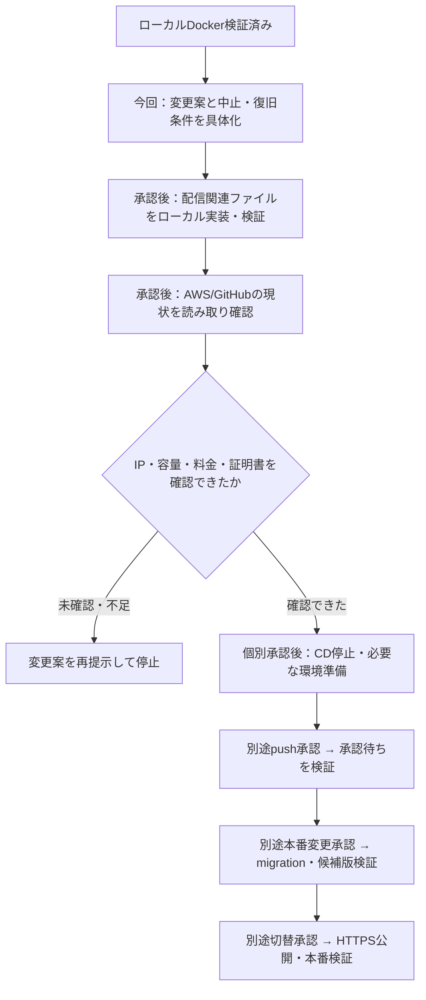

# AWSデプロイ準備：変更案と実行順

> 公開用資料：環境固有の識別子・個人PCパスは匿名化。仮値のコマンドはそのまま実行しないでください。公開は手動で、自動デプロイは未導入です。後段のCD関連は過去の設計・ローカル検証を含み、GitHub未反映の資料・コードがあります。

> 最新（2026-11-21 11:58 JST）：**Next.js初回公開と認証・テスト案件の公開HTTPS試験に成功し、公開先は3001。** 検証枠のUIDを所有者1000へ合わせ、mode600・特権削除・秘密保護を維持した。旧Vinext3002は復旧用に稼働継続。実測と残課題は [手動公開記録](MANUAL_PUBLIC_RELEASE.md) を参照。後段の失敗・未公開は履歴として保持。

最新（2026-11-17 21:21 JST）：**PC実Chromeの非公開HTTPSでログイン・案件保存35％・再読み込み・ログアウトに成功**。証明書dry-run/再読込hook/通常renew正常（実証明書の期限延長なし、11月21日15:26 JST）。候補だけの停止再開と保存保持も成功、旧Vinext/Nginxルーティング維持・HTTPS200。S3/IAMは承認待ち、GitHub production未作成、CD/公開経路変更はローカル準備のみ。詳細は[21節](PREDEPLOY_VALIDATION.md#21-公開前準備証明書非公開ブラウザー復旧cd)。後段は過去の履歴を含む。


最新（2026-11-17 20:08〜20:10 JST）：**AWS Next.js候補版が127.0.0.1:3001で稼働**。新正式DBへ確認済み2履歴を適用、runtimeは業務tableのCRUDのみ、migrationユーザーはロック。実HTTPでログイン/案件作成保存再取得/ログアウトと401を確認。Next約181〜188MiB/384MiB、MySQL約231MiB/512MiB、EC2 available最少約826MiB。旧公開HTTPS200・不変。S3/一般公開切替/Git push/再起動は未実施。詳細は[20節](PREDEPLOY_VALIDATION.md#20-aws-nextjs候補版の起動正式db移行ログイン保存検証)。後段の未起動/提案は過去の履歴。


最新（2026-11-17 19:40 JST（10:40 UTC））：AWS上の架空DB backup→別空DB restoreの定義/全行/整合性一致、アプリ用最小CRUD・TLS必須・他DB/DDL拒否、Next.jsと同じ接続設定/Prisma adapterで正常TLSと不正CA/誤名/平文拒否を確認。MySQL約205MiB/512MiB、host最少約891MiB、旧公開HTTPS200。**実Next HTTP候補/Prisma migration/EC2外backupは未実施。** 詳細・残作業・S3承認案は[検証19節](PREDEPLOY_VALIDATION.md#19-awsでの検証dbバックアップ復元アプリ用tls接続)。後段は過去時点の記録を含む。


最新更新（2026-11-17 18:41 JST）：**AWS MySQLのみ起動済み・healthy**。暗号化追加EBSへの保存、正常停止・コンテナ再作成後の検証データ保持、3306非公開、秘密/ログのEBS配置・swap/core制限を確認。旧公開HTTPS200、既存Docker/Nginx不変。DB自動起動はdisabled。Next.js未配信、本番SQLの別保存先backup/restore・ネットワークTLS接続・実再起動は未検証。以降の「DB未起動」等は当時の履歴で、現状は[最新検証18節](PREDEPLOY_VALIDATION.md#18-aws-mysql初回起動と永続化検証)を優先する。


最新B5：[33節](#33-自動mountとdb専用起動保護の反映結果)にfstab backup/自動mount/DB専用依存・guard/Compose restart=noの反映と無起動検証を記録。DBはdisabled/inactive・許可markerなし。既存Docker/Nginx/公開は維持。

最新のB4手動mount：[32節](#32-承認b4追加ebsの手動mount結果)。新UUIDを/srv/siteflow-mysqlへ接続し3種のprobeで一致、空き約9.84GiB/旧HTTPS200。fstab/Docker/DB/Nextは変更していない。

最新のB3限定実行：[31節](#31-承認b3追加10gibのxfs-format結果)。新EBSだけXFS作成成功、UUID=<DATA_EBS_UUID>、未mount。次のmountは別承認。

最新の実態：[30節](#30-新ebsのユーザー作成接続とnvme照合)にユーザー手動の新EBS vol-<VOLUME_ID>作成/attach報告と、06:26 JSTの/dev/nvme1n1/10GiB/同VolumeId/AWS sdf一致・署名/mountなしを記録。B3 format以降は未承認/未実施。

最新のB準備：[29節](#29-b作成前のaz構成確認とconsole設定値)にAZ ap-southeast-2c/既存rootだけを読み取り確認した結果とconsole作成値を記録。**B1作成/B2attach/B3format/B4mountはそれぞれ未承認、変更なし。**

最新の限定実行：[28節](#28-承認a旧2imageの整理完了)のAだけ承認/完了。2026-11-17 05:52 JST、旧04d3/bf9を参照0確認後に除去し、root空き9.69GiB/旧公開HTTPS200を確認。B/Cは未承認。

最新は[実行計画冒頭の3承認群](AWS_DEPLOY_PLAN.md)と[27節](#27-候補起動優先の実行単位とローカル準備)。旧Vinextを候補確認まで維持するため、追加encrypted DB EBS10GiBを推奨。A旧2image整理/B保存先/C非公開候補とbackup・操作確認をまとめ、本番は各群の承認後。旧手順の細分化した承認は資料として残すが、同じ調査を反復しない。

作成日：2026年11月16日 JST。根拠は[AWS_DEPLOY_PLAN.md](AWS_DEPLOY_PLAN.md)、[ローカルDockerの実測](LOCAL_DOCKER_CHECK.md)、現在の`ci.yml`とソース。

**ローカル実装・検証後、既存EC2を読み取り調査した。本番適用はまだ。** 初回は文書だけを作成し、その後ユーザーの承認でCI/CD・起動定義・公開migration・切替処理をローカル実装した。結果/ファイルの役割/再現は[LOCAL_DOCKER_CHECK.md](LOCAL_DOCKER_CHECK.md)。2026年11月16日12:27〜12:32 JSTのSSH/GitHub読み取り結果と実機への変更案は[11節](#11-既存ec2の読み取り調査と反映差分2026-11-16)。AWS/GitHub設定変更、push、デプロイ、停止・再開はしていない。

最新追記：ユーザーがAWSコンソールでElastic IPの関連付けを確認し、旧CD休止を個別承認した。2026年11月16日19:00 JSTに旧timerのstop/disableを実施・確認済み（[13節](#13-旧自動配信タイマーの休止結果)）。11〜12節の未確認/未実行は過去時点の記録。EC2本体の停止・サイズ変更や本番切替は未実施。

EBS確認後の最新案：gp3/20GiB/暗号化なし/終了時削除「はい」をユーザー確認として受領。[14節](#14-ebs確認後の容量対策とサイズ変更案)に2GB化の範囲/費用/停止影響/復旧条件を記録した。サイズ変更はまだ未承認・未実施。

最新の停止前条件：[15節](#15-既存スナップショットの保管と最新バックアップ作成案)の最新スナップショットを承認後に作成し、確認結果を報告してからEC2停止を個別承認する。既存の10月11日のスナップショットは削除しない。停止・タイプ変更・起動の一括承認を求めない。

最新の実行状況：snapshot1件の作成はユーザー承認済みだが、EC2ロールのCreateSnapshot dry-runが拒否され、ブラウザー接続も利用できず**新規snapshot未作成**。20:15 JSTに業務DB不在の再確認/sync/HTTPS確認まで実施。[16節](#16-承認後の事前確認と作成経路の制約)。承認待ちと権限制約を混同しない。

その後の完了確認：ユーザーが新snapshot `snap-<SNAPSHOT_ID>` の完了/100％と旧snapshot保持をコンソール確認した（[17節](#17-最新スナップショットの完了確認と停止前の状態)）。上の未作成は引き継ぎ時点の記録。復元試験は未実施で、EC2停止/サイズ変更/起動は引き続き各操作の直前承認が必要。

最新の停止状況：一時停止だけはユーザー承認済み。20:37 JSTの対象確認後、StopInstances dry-runが権限不足で拒否され、**まだ停止していない**。[18節](#18-一時停止承認後の確認とコンソールへの引き継ぎ)。サイズ変更/起動の承認はない。

最新のユーザー確認：対象EC2が**stoppedになった**との報告を受領（[19節](#19-停止完了の受領とサイズ変更の承認範囲)）。前段の稼働中という記録は過去時点。次はタイプ変更だけの承認を得る。AWS CLI用認証/IAM変更は行っていない。

最新の到達点：タイプ変更と起動をそれぞれ個別承認後、ユーザーがコンソールで実行。21:05〜21:06 JSTの読み取りで**同じEC2がt3.small/約2GB、同じEBS/IP、旧版HTTPS復旧、旧CD再起動後も無効**を確認した（[20節](#20-t3smallへの変更起動後の実測と旧版復旧)）。前段の未承認/停止中は各時点の履歴。Next.js/MySQLの本番導入はまだ。

次の承認対象：[21節](#21-docker-compose導入の版配置影響と承認範囲)のCompose v5.7.0追加だけ。公式Linux配布物のローカル取得/ハッシュ照合とWindows版での設定検査は完了。EC2への配置/実行は未実施。既存Docker Engineは更新しない。

最新結果：ユーザー承認後、21:27 JSTにCompose5.7.0を導入し、root/通常ユーザーの認識とDocker25への読み取り一覧取得、既存公開不変を確認済み（[22節](#22-compose導入結果と既存公開の維持)）。21節の未導入/未検証は承認前の記録。DB起動/新版切替はまだ行っていない。

最新の設計段階：公開用MySQLの構成/Volume/秘密管理/backup/復元/容量/非公開network/移行/rollbackを[PRODUCTION_MYSQL_DESIGN.md](PRODUCTION_MYSQL_DESIGN.md)へ整理した。**設計のみで、MySQL/volume/network/S3作成や公開切替は未実施。** 保存時暗号化・20GiBの余裕・EC2外保管方式は公開前の判断事項。

現在の提案は[25節](#25-整理対象の確定候補と暗号化s3の承認計画)と[事前検証9節](PREDEPLOY_VALIDATION.md#9-削除対象の再確認暗号化の推奨と個別承認手順2026-11-16)。本番は旧Vinextのみ、旧CDは休止中。上記の「設計のみ」は過去時点で、その後ローカル15＋3項目の検証と対象限定の再調査が完了した。削除/DB起動/設定/AWS変更は今回も行わない。

最新の限定操作：[26節](#26-停止4コンテナだけの承認付き整理結果)に停止4containerだけの整理完了を記録。23:07〜23:08 JSTに条件再確認/非公開backup後に除去、公開と直前版/全imageを維持。image削除など次の操作の承認へ流用しない。

## 1. 現在地と次の順序



EC2停止・サイズ変更・停止再開テスト・最終休止は、この図の承認で一括許可しない。公開前にローカルの新旧切替・失敗時復旧・公開用migration/TLSを追加検証する。2GB実機の負荷検証はサイズ変更後の別作業。

現在の判定：**ローカルのアプリ動作は合格。本番へそのままpushする段階には達していない。**

## 2. 変更対象の案

下表は初回の変更案。その後`deploy/`のローカル候補を作成し、実装時に`schema-hash.mjs`、`start-database.sh`、migrationの専用lock等も追加した。EC2上の既存スクリプト・Nginx設定の正確なパスは後続の読み取りで確認し、推測したパスを上書きしない。表の「今回未編集」等は初回作成時の状態で、現在のローカル結果とは区別する。

| 対象 | 変更案 | 影響と確認条件 |
| --- | --- | --- |
| `.github/workflows/ci.yml` | 既存build/test/HTTP確認を残し、main用の承認ジョブと承認済みSHA/digestの記録を追加 | workflow全体の成功前に承認を必要とする。PRは本番環境・公開秘密値へアクセスさせない。今回未編集 |
| `deploy/compose.production.yaml` | MySQLとNext.jsの新旧2枠を定義する候補 | DBの通常更新とアプリ更新を分ける。既存VinextコンテナをCompose管理へ勝手に取り込まない。初回は空いている枠だけ起動 |
| `deploy/mysql.cnf` | バッファ128MiB、接続数30、performance_schema無効を初期候補とする | ローカルで成功した設定。最適値や本番合格とは扱わない。MySQL上限512MiB、Next.js各384MiBを測定で評価 |
| `Dockerfile`・`.dockerignore`・公開用Prisma設定 | migration専用のbuild targetを追加する候補。SQL履歴を必要な場所だけ許可 | 現在はSQLをDocker入力から除いている。最終runnerへCLI/SQLを増やさず、一時migrationコンテナを分ける。別途ローカル変更承認が必要 |
| `deploy/release.sh` | 指定されたdigestの候補枠を起動し、readiness・設定・DB互換性を確認して切替 | 自動migration・自動復元・自動サイズ変更は行わない。対象が未承認/不明なら終了 |
| `deploy/cd-check.sh` | 既存の約5分ごとの取得処理に、承認結果・休止状態・排他制御を追加する候補 | EC2の現物を読み取ってから差分を確定。別workflowの成功やPR成功を本番承認と誤認しない |
| 既存Nginxの設定 | 現在のHTTPS/webrootを維持し、候補版と旧版の転送先だけを切替できる形へ整理 | 証明書検証と設定検査に成功してからreload。認証用HTTP入口は残す。実際の差分は現物取得後に確定 |
| 既存CD timer/serviceと休止制御 | CDタイマー停止に加え、再起動後も残るpauseファイルを確認 | 実行中のserviceも確認する。タイマー停止だけで進行中の配信が止まったとは判断しない |
| バックアップ処理 | 日次7世代と、通常期限削除から除外した休止前保管を分ける | EC2外の保存先・暗号化・権限・追加費用を別途承認。今回はS3等を作らない |

複数ファイルを一度に本番へ入れない。まずローカルの配信定義・承認ジョブ・一時migrationを実装し、検証してから次の承認へ進む。

## 3. 起動設定の仕様

### コンテナと保存先

- Next.jsは`NODE_ENV=production`、`SITEFLOW_WORKSPACE_MODE=public-integrated`、内部3000番。ホスト側は既存3001/3002番の枠を維持し、127.0.0.1だけに公開する。
- 現在は旧Vinextが3002番を使うという過去記録がある。後続の実機確認で一致した場合、初回Next.js候補は3001番。両方使用中なら中止し、既存コンテナを削除して空けない。
- MySQLは8.4系の検証済みdigestを固定する。共有Dockerネットワークでのみ接続し、本番の3306番はホストへ公開しない。DBのDNS aliasは証明書のSAN（接続先名の一覧）と一致させる。
- ボリューム名は例として`siteflow-production-mysql`を固定し、存在確認と所有確認を必須とする。初回作成・既存再利用を別モードにし、再開時に見つからなければ失敗させる。空ボリュームを自動作成して復旧成功としない。
- DBのデータはEBS上のボリュームへ置く。候補アプリの削除時にもボリュームを削除しない。`down -v`や一括pruneは運用手順へ入れない。
- MySQL/Next.jsは`unless-stopped`を候補とする。長期休止前に明示停止し、復帰時も記録した対象を明示起動する。Nginxは証明書/readinessの確認前にアプリ入口を再開しない。

### 設定の渡し方

実際の値はGit・Markdown・イメージ・ブラウザーへ入れない。EC2上の設定保管場所も新設案であり、まだ作っていない。

| 設定名・ファイル | 用途・必要条件 |
| --- | --- |
| `SITEFLOW_PUBLIC_ORIGIN` | 実際のHTTPS URLを固定。IP確認・証明書発行方針が確定するまで値を確定しない |
| `SITEFLOW_AUTH_SECRET` | 乱数32バイトの16進数64文字。固定して安全に保管し、通常の再起動で再生成しない |
| `SITEFLOW_DB_HOST` / `SITEFLOW_DB_PORT` | DBの固定DNS aliasと3306。TLSの接続先名照合を無効化しない |
| `SITEFLOW_DB_NAME` | `siteflow_public_`で始まる公開専用DB。ローカル検証DBを使わない |
| `SITEFLOW_DB_USER` / `SITEFLOW_DB_PASSWORD` | アプリ用CRUDユーザー。root/DDL権限を渡さない。パスワードは16文字以上の強い乱数 |
| `SITEFLOW_DB_TLS` / `SITEFLOW_DB_CA_FILE` | `required`とコンテナ内の絶対パス。CA公開証明書だけを読取専用マウント |
| DBサーバー証明書・秘密鍵 | MySQL専用マウントへ。CA秘密鍵はアプリ/MySQLへ常時マウントせず、安全な保管方法を決める |
| migration用接続設定 | 構造変更専用ユーザーとTLS設定。一時コンテナだけへ渡し、通常アプリへ渡さない |

候補保管場所は`/etc/siteflow/`とするが、現物に同名資源がないか確認してから確定する。秘密ファイルの所有者・読取権限を制限し、非rootのNext.jsがCAだけ読めることを確認する。`docker inspect`全体やCompose展開結果は秘密値を含み得るため、ログや教材へ貼らない。

## 4. 承認付きCI/CDの具体案

現在の`ci.yml`はbuild/test→ルートHTTP確認→main pushならGHCRへSHAタグを送信する1ジョブ構成。production環境/承認ジョブはない。以下は**追加する構造の例であり、完成済みworkflowではない**。

上記は修正前の説明。ローカルでは現在2ジョブと承認記録を実装済みで、実コードは`.github/workflows/ci.yml`。実際のGitHub上への反映はしていない。

```yaml
jobs:
  docker-build:
    # 既存build/test/smokeを維持。
    # mainだけGHCRへ保存し、その時点のdigestを出力する。
  release-approved:
    needs: docker-build
    if: github.event_name == 'push' && github.ref == 'refs/heads/main'
    environment: production
    # 承認後、受け取ったSHA/digest/run IDを記録する。
    # 公開許可フラグが未設定/falseなら失敗させ、成功にしない。
```

- `needs`は前のジョブ成功を待つ指定、`environment`はGitHubの承認対象環境。ジョブ名だけでは承認機能にならない。
- productionは本人をrequired reviewerにし、Prevent self-reviewが有効でないことを確認。main限定とし、管理者の保護回避を通常手順にしない。契約プラン名は未確認、公開リポジトリで現行Freeを含め利用対象という前段調査を引き継ぐ。
- **未作成のEnvironmentはworkflow参照時に保護なしで自動作成され得る。** 名前を書くだけで安全になったとしない。保護設定を別途承認・確認してから有効化する。
- 追加候補のリポジトリ変数`SITEFLOW_RELEASE_ENABLED`が正確に`true`でなければ、mainの最終ジョブを失敗させる。ジョブをskipしてworkflow全体が成功する形にはしない。変数設定もGitHub変更として別承認。
- mainの古い候補が承認待ちのまま残らないよう、workflowごとの同一refにconcurrencyを設定する。中断されたrunを配信許可にしない。EC2での切替開始後は別の排他ロックで完了まで保護する。
- EC2は対象repository、指定workflow、`event=push`、`head_branch=main`、現在mainのSHA、対象run ID、最終ジョブ成功、承認済みdigestの一致を確認する。取り出せない場合は配信しない。別runの成果物・過去のCI成功・最新タグへフォールバックしない。
- pull前と転送先切替直前の両方でpauseを確認し、処理全体を排他ロックで保護する。途中で休止要求が来た場合も切替を進めない。公開版の記録は成功確認後に一括更新し、中途半端な記録を復帰に使わない。
- SHAタグも再ビルドで内容が変わり得る。実際に配信するのは`image@sha256:...`で固定。承認後に違うdigestを作り直して使わない。
- Actionsはビルドと承認、EC2は既存の取得方式を再利用する。ActionsへAWS起動権限やEC2の新しいSSH秘密鍵を増やす前提にしない。既存の取得認証がどこまで使えるかは後続の実機調査事項。
- 承認済みの公開版記録をEBSと安全な別保管先へ残す。休止復帰を期限切れのActions成果物だけへ依存させない。

設定できない場合は、承認後に既存CDを停止したまま、ユーザーが確認したSHA/digestだけ手動配信する。手動workflow起動だけを本人承認の保護とは扱わない。

## 5. 最初のpush前に行うこと

1. 対象EC2/リージョン/IP/EBS/証明書/現行CD/Nginxの実設定を読み取り確認する。Elastic IP不明なら停止・サイズ変更しない。
2. 旧Vinextのdigest、起動条件、現在の転送先、設定の復旧用コピーを安全に確保する。秘密値の実物はこの文書へ入れない。
3. **別途承認後**、CDのpauseを永続化し、タイマーを停止する。実行中serviceがあれば安全な中断点か完了を確認し、切替途中で強制終了しない。排他ロックと稼働状態を確認してserviceも停止状態にする。VinextのWebコンテナとNginxはこの操作で止めない。
4. GitHub保護環境の作成を別途承認後に行い、保護設定を確認する。公開許可変数は未設定/falseのまま最初のpushへ進む。
5. `GITHUB_REVIEW.md`に沿って送信ファイルと履歴・画像・生成物・秘密情報を点検し、対象差分を提示してpushの承認を得る。一括追加しない。
6. push後もCDをpauseしたまま、承認待ち・拒否・承認の挙動を確認する。最初は承認しても許可変数がfalseなら最終ジョブが失敗することを確認。保護が有効と確認できた後、変数の有効化を別途承認し、承認済みrunの成功を確認する。本番切替はまだ行わない。

CD停止前のmain pushは禁止。CIへの承認ジョブ追加だけで旧EC2スクリプトが安全になったと判断しない。

## 6. migration・バックアップ・本番切替

### migrationの前提

現在の`db/design/migrations`には検証用初期スキーマと会議追加の2履歴がある。`migration_lock.toml`も公開向け未採用と明示しており、そのまま本番へ適用済みと扱わない。SQLをレビューし、新しい公開専用空DBを対象に試験する。

CLIはmigration専用イメージで実行する。公開用TLS設定で履歴を適用し、2回目は変更なしになること、既存認証/案件/会議テーブルの状態、誤CA/接続先違反、失敗時に配信を進めないことをローカルで検証する。検証用`.env`を読む既存のPrisma設定を本番へ流用しない。

本番ではバックアップ・DB名/ユーザー/適用履歴・SQLを確認して個別承認後に実行する。失敗したmigrationを成功扱いにしたり、履歴を書き換えて無理に次へ進めたりしない。

### バックアップ

本番公開前に、会議/取消を含む16テーブルをEC2外へ暗号化保存し、別の空DBへ復元して内容と操作を照合する。ローカル復元合格は本番保存先の試験を代替しない。SQL dumpだけではDBユーザー権限・CA・起動設定を再現できないため、構造と設定の復旧手順も別に保管する。

日次7世代と、2027年1〜4月または希望時の再開が確認できるまで消さない休止前保管を分ける。保存先/IAM/S3/スナップショット/鍵保管は費用と範囲を提示し別途承認。

### 候補版の検証と切替

1. migration適用済み・旧版へ戻せることを確認し、空いている枠へNext.js候補をdigest固定で起動する。DBを同時に再作成しない。
2. 内部readinessに公開Hostを明示して200を確認する。HTTPクライアントはHostを実際に送れるものを使う（Node24 fetchの挙動差は前段で確認済み）。トップページ200だけで次へ進めない。
3. 誤CA/DB停止/設定不足はreadiness失敗となり、転送先が旧版のままであることをローカルで先に検証する。
4. 本番切替の個別承認後、Nginx設定を検査してreloadし、証明書検証を有効にしたHTTPSでログイン・案件・会議・権限・ログアウトを確認する。
5. 不具合なら後述の復旧へ。成功しても旧版のイメージ/DB/ボリュームを自動削除しない。

2GB実機では、21件以上・同時5利用者・15分・新旧切替中を測定する。OOMなし、スワップ増加が続かず、利用可能メモリ200MiB以上を目安とし、ディスク空き25％以上を確認。未達なら公開を止め、別のサイズ案を説明する。

## 7. 復旧と休止・再公開

| 起きたこと | 取る行動 | 維持するもの |
| --- | --- | --- |
| 候補が起動しない/readiness失敗 | 切替しない。候補だけ停止して原因調査 | 旧VinextとNginx、DB、volume |
| 切替後に不具合 | CDをpauseのまま、旧版起動→設定検査→Nginx転送先を戻す→HTTPS確認 | 新DBの保存内容。旧Vinextから見えないことと消失は別 |
| DB構造変更に失敗 | 配信を止め、適用履歴と実構造を調査。履歴の偽装や自動dropをしない | 元DBと直前バックアップ |
| データを復元する必要がある | 復元時点と失われる更新を提示し別途承認。別DBへ復元・照合後に切替、復元セッションは無効化 | 元DBと検証結果 |

長期休止時は、対象と費用の承認→IP確認→pause/CD停止→書込み停止→最終バックアップと別DB復元→Next.js/MySQL正常停止→Nginxの再開制御→EC2停止の順。停止テストの承認と最終休止の承認は別。

再公開時は承認→EC2起動/IPとEBS確認→pauseを保ったまま保存済みMySQL/Next.js起動→readiness→HTTP webrootで証明書更新→検証後HTTPS公開→保存データ/会議/新規保存/バックアップ確認。再開時の自動migration・自動最新main取得は行わない。通常CD再開は別承認。

## 8. 費用と実行前に残る確認

- 前段の仮定では2GBで2027年1〜4月は約98.43ドル。推定クレジット80.63ドルでは17.80ドル不足し、年内消費・バックアップ・通信・税等は別。[費用の前提](AWS_DEPLOY_PLAN.md#13-aws費用クレジット残高と確認日時)を引き継ぐ。今回は価格の再照会/請求確認をしていない。
- 次の読み取りで、Elastic IPの割当/関連付け、EBSの種別/単価/空き容量、実クレジットの対象サービス、証明書期限、GitHubプラン/production保護、CDの認証と実行方式を確認する。未確認項目は未確認のまま記録し、権限追加で解決しない。
- 1GBの現状へ新旧Next.jsとMySQLを追加する許可はない。2GBへの変更もIP確認・停止影響・料金を提示した後の別承認。
- 決定事項・招待・進捗差分・重要業務優先などは未完成。会議の最小機能と全要件の完成を区別する。

## 9. 次の調査と、個別承認が必要な操作

ローカル実装の承認を受け、48件のLinux配信テスト、実Nginx3項目、公開migration6項目、Compose検査5項目と、通常アプリの17シナリオを確認した。型検査/lint・業務等56件・秘密情報検査も成功。配信件数は最終ログに合わせ47から48へ訂正した。今回の実機調査で再実行した結果ではない。

次の工程は、既存AWS/EC2・GitHubを読み取り専用で再確認すること。対象はElastic IP、EBS/容量、インスタンス、証明書、CD/Nginxの配置/起動方法と認証方式、GitHub環境保護/取得権限。秘密値はログ/文書に出さず、権限がなければ未確認とする。調査の許可を権限追加・インストール・設定変更へ流用しない。

AWS/GitHub設定変更・push・本番切替・サイズ変更・停止再開は、実機現物の確認結果と具体的な差分/影響を提示し、実行前にそれぞれ承認を得る。

### 実機適合時に必須の追加確認

- Nginxは専用includeへ2行（転送先と`set $siteflow_slot`）、server側へ`add_header X-SiteFlow-Slot $siteflow_slot always`と`proxy_hide_header X-SiteFlow-Slot`が必要。locationにadd_headerを足して既存のセキュリティヘッダー継承を変えない。実物取得前に上書きしない。
- root管理の`current.json`・`schema.json`・enabled/pause/incidentの意味と保管を確定する。公開用の初期DB/CA/アカウント/バックアップを準備し、適用証明のDB名・接続先・CA指紋・schemaHashを照合する。
- 候補を公開へ切替えた後に失敗した場合、接続保護のため候補も残してincidentでCDを止める。復旧の確認・接続終了・記録保管・候補整理は承認後に行う。自動再試行で状態を悪化させない。
- 初回成功後の旧Vinext停止とprevious記録の保管は別途承認。以降の通常更新は、管理ラベル/記録が一致する自分のNext.js旧枠に接続がなければ停止して再利用する。古いcontainer/imageは自動削除しないため、容量を監視し整理も対象を提示して承認する。
- migrationイメージは約2.91GBから0.99GBへ軽量化したが、実機の追加占有量は未確認。既存空き約7.2GiBという過去値だけで25％空きを保証しない。2GB RAM・負荷・LinuxのTLS鍵読取り・実GitHub承認・旧Vinextとの実切替は未検証。

## 10. 前段階の確認と根拠

今回の結果は、ソース/既存文書の照合と変更案の作成。アプリや設定を変更していないため、前段で合格した型検査・Docker・DB試験を反復して今回の成果には数えない。

実際の確認結果：

- この手順書と計画書のローカルリンク、UTF-8、コードブロックの対応、文書差分の空白検査は成功。
- 学習ガイドは既存68テーマのIDと過去70履歴を維持し、AWS準備の記録を追加（計71履歴）。実コード16抜粋と行番号を現ソースに照合した。
- 検証専用Chromeで1440/390幅の全テーマ切替・横はみ出し、AWS図3状態、自己チェックの再読込保持、印刷イベント前後の復元を確認。スクリーンショットも確認し、一時プロファイルは回収した。実際のPDF出力の試験ではない。
- 今回編集した共有成果物はこの手順書、`AWS_DEPLOY_PLAN.md`、`LEARNING_GUIDE.html`のみ。前段からあるDockerfile等の差分を新規変更と扱わない。`.github/workflows/`には今回も差分がない。

2026年11月16日に公式資料で確認した一般仕様（実アカウント設定の確認とは別）：

- [GitHub：Environmentの管理](https://docs.github.com/en/actions/how-tos/deploy/configure-and-manage-deployments/manage-environments)
- [GitHub：承認と本人承認の制限](https://docs.github.com/en/actions/how-tos/deploy/configure-and-manage-deployments/review-deployments)
- [GitHub：同時実行の制御](https://docs.github.com/en/actions/how-tos/write-workflows/choose-when-workflows-run/control-workflow-concurrency)
- [Docker：手動停止とunless-stopped](https://docs.docker.com/engine/containers/start-containers-automatically/)
- [AWS：停止時に保持されるEBSと失われ得る自動割当IP](https://docs.aws.amazon.com/AWSEC2/latest/UserGuide/how-ec2-instance-stop-start-works.html)

## 11. 既存EC2の読み取り調査と反映差分（2026-11-16）

### 今回の範囲・時刻・結論

実機の確認日時：2026年11月16日03:27:06〜03:31:43 UTC（12:27:06〜12:31:43 JST）。ユーザーの依頼に基づくSSH・AWS参照API・GitHub GETだけの調査。アプリ/CI/CD/本番設定の編集、CD実行、証明書更新、コンテナ起動停止、イメージ取得、EC2停止/再起動/サイズ変更、pushはしていない。SSH等の通常アクセスログは発生し得る。

**既存環境は再利用できるが、今のままのpush/公開は不可。IPの固定確認と容量対策を先に行う。** EC2ロールの参照権限不足とAWS画面への接続制約により、Elastic IPとEBS種類は今回も確定できていない。推測で「固定IP」としない。

### 実機で確認できたこと

| 対象 | 今回の確認結果 | 判断・残る条件 |
| --- | --- | --- |
| 稼働先 | シドニー、t3.micro、公開IPv4 `13.237.188.172`。登録済みSSHホスト鍵で照合成功 | 別の過去接続先はホスト鍵不一致で接続中止。known_hostsの削除/書換えなし |
| RAM・swap | RAM総量913MiB、利用可能314MiB。swap総量2047MiB、使用46MiB | 一時点の測定。1GBのまま新旧Next.js＋MySQLを載せない。2GB案も未承認・未測定 |
| ディスク | EBSルート20GB、XFS、空き7.2GB、使用65％。Docker保存先 `/var/lib/docker` は同じ領域 | 25％空きを残すなら追加に使える量は概算2GB程度。DB・バックアップ・展開時の一時領域まで含めた余裕は未証明 |
| Docker保存量 | イメージ6個/論理6.203GB、コンテナ7個（稼働1）、ローカルvolume 0、build cache約2MB | imageの論理サイズは共有層があり単純加算不可。停止済み旧版を一括pruneしない |
| 旧公開版 | `siteflow-3002`、main SHA `ae3e31a78da037d0f855e9143ea5cce5e0a6cfe3`、132.9MiB/上限192MiB | mountなし、restartはunless-stopped、3002→3000をloopbackだけで公開。現在のローカルMySQLはAWSに存在しない |
| 空いている枠 | 3001番は未listen、3002番だけ旧版が使用 | 初回Next.js候補は3001。最終直前にも再確認する |
| Nginx | `/etc/nginx/conf.d/siteflow.conf`、HTTPSから `127.0.0.1:3002` へ転送 | 公開Host/転送ヘッダーあり。新方式用include/slotヘッダーはまだない |
| HTTPS | `https://13.237.188.172/` は200、TLS検証結果0（成功）。IPをSANに含むLet's Encrypt証明書 | 現在有効であることと2027年の再公開成功は別 |
| 証明書期限 | 2026-11-21 06:26:22 UTC＝11月21日15:26:22 JST | 短期証明書。更新実行・dry-runは今回していない |
| 証明書更新 | Certbot 5.8.0。webroot `/var/www/letsencrypt`、shortlived。03/15時UTC＋最大30分の乱数遅延、Persistent=true | enabled/待機中、直前service終了0。更新時hookは `systemctl reload nginx`。期限を実際に延長できることは今回未検証 |
| 自動配信 | `siteflow-cd.timer` enabled/active。起動1分後、前回service終了から5分＋精度10秒 | PC再起動と無関係。サーバー再起動後にも動くため、timerを一時stopするだけでは長期休止対策にならない |
| 実行元 | serviceはec2-user、`<USER_HOME>/siteflow-cd/check-update.sh`→`deploy.sh`。state/deployed-shaが現mainと一致 | 現在は同じSHAのため更新なし。スクリプトを手動実行して調査していない |
| GitHub | publicリポジトリ、現mainは旧版。既存認証でenvironments GET 200/0件、actions/runs GET 200/最新push成功 | production未作成。本人承認の実動作、artifact取得、トークンの必要権限全体は未検証 |
| ツール | Amazon Linux 2023、Docker server25.0.16/client25.0.14、Nginx1.30.5。jq/curl/flock/ss/unzip/Pythonあり | root経由の `docker compose` は未導入。導入前に承認が必要。全OS更新やDocker Engine置換は提案範囲に含めない |
| 新配置先 | `/etc/siteflow`、`/var/lib/siteflow`、`/etc/nginx/siteflow`、`/usr/local/lib/siteflow` は未存在 | 候補の配置先に既存同名ファイルはなかった。作成は未実施 |

EC2内の `DescribeAddresses`・`DescribeInstances`・`DescribeVolumes` はUnauthorizedOperationだった。権限を追加していない。メタデータのpublic-ipv4は現在のアドレスを示すだけで、Elastic IPの証拠ではない。NVMeのmodel/serialからEBSであることとvolumeの識別は確認したが、gp2/gp3等の種類・暗号化・DeleteOnTerminationは確定できない。AWSコンソールでこれらを参照してから停止・サイズ変更を判断する。

### 現行CDと、ローカル候補の差

現行はmain SHAと最新pushのCI SHA・completed/success、GHCRのSHAタグの存在を確認してdeploy.shを呼ぶ。deploy.shは排他ロック、192MiBの候補起動、トップ200、Nginx全体のバックアップ/転送先置換、HTTPS200、SHA保存、旧コンテナ停止/名前変更を行う。途中失敗時の復旧処理はある。

現在の方式には公開用環境変数、DBネットワーク/CA、DB readiness、production承認、永続pause/incident、schema記録照合がない。単にNext.jsイメージをpushすると、トップだけ成功してDB機能が利用できない版へ切り替わる可能性がある。新workflowの承認待ちだけに依存せず、旧CDを止めてからpushする。

| 反映する対象（提案・未適用） | 具体的な差分・理由 | 復旧方法・承認単位 |
| --- | --- | --- |
| 旧CDの休止 | 現serviceが動作中でないことを確認し、timerをstop/disable。新CDはenabledなし/pausedありから準備する | 公開版/Nginx/Dockerは継続。旧service/スクリプト/stateの保管後、手動復旧可能にする。旧CDの再有効化は最新mainを配信し得るため、自動で戻さない。**CD設定変更として事前承認** |
| RAM | t3.small/2GBを第一候補。実機buildをせずGHCR成果物を取得。migrationと候補起動を同時に行わない | IP確定・停止影響・料金の提示後に**サイズ変更と停止/起動を承認**。変更前後の容量測定と15分負荷が必要 |
| ディスク | まずEBS種類/暗号化を確認し、MySQL/アプリ/migrationの実配置後も25％空きを確認。イメージ論理サイズだけで足りると判断しない | 不足時は保存が必要な旧版を列挙し、対象限定整理とEBS拡張の費用を比較して別承認。一括prune/自動拡張なし |
| Compose | 既存Docker Engineを維持し、検証済みComposeプラグインを全実行者から使える場所へ追加する案 | Amazon Linuxで使える導入方法・版・配布元とチェックサムを事前確定。**ホスト変更の承認後**に導入/設定検査。今回はインストールなし |
| 新CDの実行権限 | root所有の `/usr/local/lib/siteflow/` にスクリプト、`/etc/siteflow/` に設定/認証ファイル、`/var/lib/siteflow/release` にstateを置く案。root実行serviceから呼ぶ | 現ec2-user実行をそのまま流用するとEUID所有確認やNginx操作に適合しない。root所有/秘密0600を維持し、既存認証の必要権限を確認。**systemd/配置変更を承認**。旧CDは別のまま残す |
| GitHub production | required reviewerは本人のみ、prevent self-reviewは無効、デプロイブランチはmain限定、可能なら管理者の保護迂回も禁止。許可変数 `SITEFLOW_RELEASE_ENABLED` は最初false | publicならFreeでもrequired reviewerが利用できる一般仕様を確認。契約プラン名/本人承認実行は未確認。設定は**GitHub変更として承認**。使えなければサーバーCDを無効のまま固定digestを提示する都度承認の手動配信にする |
| Nginx | HTTP challenge/webrootとHTTPS証明書パス、proxy_set_headerを維持。`location /` のproxy_passだけ専用includeへ。serverにslot応答/上流slot非公開設定を追加する案 | 旧3002/greenを初期stateに一致させてから検査・reload。設定全体の保管、`nginx -t`、HTTPS確認。失敗時は保管設定へ戻す。**本番設定変更と切替はそれぞれ承認** |
| DB/本番設定 | 専用network/volume、MySQL TLS、固定auth secret、CRUD/DDL/backup権限分離を用意。OriginはIP方針確定後の実HTTPSと一致。例のsiteflow.example.comは使わない | 自動空初期化を避け、初回だけ明示初期化→migration→別DBバックアップ復元。保存先/秘密保管を確定して**作成・適用を承認** |

root実行案は新CDがDocker/Nginxを操作するための候補であり、EC2のAWS IAM権限を増やす意味ではない。新CD用トークンを自動発行/権限拡張していない。既存ファイルは0600で、内容を画面/文書に記録せず、既存のGitHub宛GETだけに使用した。

### 本番反映の順序と中止条件

1. **今ここ：読み取りと提案。** AWSコンソールでElastic IP/EBSを確認する。IP不明ならサイズ変更・停止へ進まない。請求/残クレジットの最新値も本番作業前に確認する。
2. **承認後：旧CD休止。** 実行中serviceとロックを確認し、旧timerをstop/disable。旧公開版とHTTPSが変わらないことを確認。これを終える前にpushしない。
3. **承認後：容量/ホスト準備。** 停止・サイズ変更を個別承認し、2GB等の確定構成へ。IPが変わる場合はOrigin/証明書/URL/既存CD内の固定HTTPS先を含めた別案を先に承認。Compose・root管理配置を準備する。
4. **承認後：GitHub設定とpush。** productionを保護し、許可変数falseのままworkflow等を送る。pushは別承認。CI/両イメージ/digest/承認待ちを実確認する。保護や取得権限が不明なら新CDを有効にしない。
5. **承認後：DB準備と本番適用前検査。** 初期化/migrationを対象固定で実施。EC2外のバックアップ・別DB復元・TLS鍵のLinux権限・readinessを確認。アプリ/DB/バックアップ/画像/一時展開込み25％空きがない、またはOOM/連続swap増なら中止。
6. **承認後：初回切替。** 旧3002を維持し候補3001を起動。slot初期記録を合わせ、Nginx設定検査後にHTTPS経路切替、ログイン/案件/会議/チーム境界を確認。新旧切替を含む既定の負荷条件を満たすまで公開完了としない。旧Vinext停止/整理は別承認。
7. **別承認：休止・再公開テスト/最終休止。** 最終バックアップ、永続pause、アプリ/DB正常停止を確認。停止/起動でEBSを保持し、2027年1〜4月または希望時は同じ保存データから再開。短期証明書を更新してからHTTPS公開し、通常CD再開も別承認。

### 旧Vinextへの戻し先

- container：`siteflow-3002`、port：3002、管理ラベル：`siteflow-cd`。
- SHA：`ae3e31a78da037d0f855e9143ea5cce5e0a6cfe3`。
- image：`ghcr.io/syucream02/siteflow@sha256:46305b1d7ab09f8a7ce1002d2b82dd75d934545b5d45288f805ea646cba741fd`（実機RepoDigestsで照合）。
- root管理のNginxバックアップと新方式の初期current/previous記録を整えてから切り替える。旧版はメモリデモなので新MySQLの案件/会議は表示できない。旧版へ戻しても新DBを削除/巻き戻さない。旧CDを再開して戻す方法は採用しない。

### 費用と未確認の扱い

今回AWS Billing/契約にはアクセスできず、クレジット残高も再照会していない。11月15日の残高87.87ドル・推定80.63ドル・有効期限2027-10-07はユーザー提供値を引き継ぐ。前段の2GB案は1〜4月約98.43ドルで、推定残高との差は約17.80ドル。EBS種類/実単価、年内消費、通信、税、バックアップ等が別なので確定請求額としない。今回新規の有料リソースは作成していない。保持するEBS/Elastic IP等は停止中も課金対象となり得る。

再現に使った参照処理：`free -m`（MiB表示のRAM）、`df -hT / /var/lib/docker`（領域/ファイルシステム/人が読める容量）、`docker stats --no-stream`（1回だけ使用量）、`docker system df`（保存量）、項目限定の`docker inspect`（秘密envを出さず構成）、`systemctl show/list-timers`（状態/起動元）、`openssl x509 -noout -dates -issuer -ext subjectAltName`（公開証明書の期限/発行者/対象）、`curl --output /dev/null --write-out ...`（本文保存なしのHTTP/TLS確認）。秘密鍵、認証ファイル、Docker Env全体は表示していない。最初の複数行SSH照会には改行由来の構文エラーがあり、後続をLFで送り直して必要な結果を取得した。拒否されたAWS参照を成功と数えない。

2026-11-16に再参照した一般仕様：[GitHub required reviewerと自己承認](https://docs.github.com/en/actions/reference/workflows-and-actions/deployments-and-environments)、[AWS Elastic IPの性質/料金](https://docs.aws.amazon.com/AWSEC2/latest/UserGuide/elastic-ip-addresses-eip.html)、[EC2停止時の保持/消失](https://docs.aws.amazon.com/AWSEC2/latest/UserGuide/how-ec2-instance-stop-start-works.html)、[Docker Composeプラグイン](https://docs.docker.com/compose/install/linux/)。これは実アカウント設定・本番適用成功の根拠ではない。

## 12. Elastic IPの確認と旧CD休止の実行案

### 確認済みの前提

2026年11月16日、ユーザーがAWSコンソールで `13.237.188.172` がElastic IPで、`i-<INSTANCE_ID>` に関連付けられていることを確認したと申告。これを現在の計画の前提とする。エージェントによるDescribeAddresses再取得ではなく、参照権限不足は変更していない。Elastic IPの解放・関連付け解除をせず維持する。停止/サイズ変更の承認はまだ得ていない。

12:41:35 JST（03:41:35 UTC）のSSH再参照結果：timerはenabled/active/waiting、serviceはinactive/dead/MainPID=0/Result=success。lslocksに対象のdeploy.lockは表示なし。公開コンテナは従来のsiteflow-3002/同じSHAで、HTTPS200・TLS検証成功。瞬間の状態なので実行直前に再確認する。

### 次に承認を求める操作：旧自動配信タイマーの休止のみ

目的は、準備中のmain更新で旧方式の自動配信が始まることと、将来のEC2再起動で旧CDが戻ることを防ぐこと。対象は `siteflow-cd.timer` のみ。EC2自体の停止、コンテナ停止、Nginx変更、AWSリソース設定、GitHub設定/pushはこの承認に含めない。サーバーのsystemd設定を変えるため事前承認が必要。

実施案（**未実行、承認後のみ**）：

1. serviceの稼働有無を再参照する。動作中なら強制終了せず、完了を待つ。timerを停止することで追加の定期起動を止め、その後service inactive/ロックなしを確認する。進行中の配信が完了する前に次の準備へ進まない。
2. `sudo systemctl stop siteflow-cd.timer`：sudoは管理権限、systemctlはサービス管理、stopは現在のタイマーを止める指定。この操作自体は実行中のserviceを止めない。Webアプリ/Docker/Nginxは継続する。
3. `sudo systemctl disable siteflow-cd.timer`：disableは起動時にタイマーを自動起動する登録を外す指定。現在の停止と再起動後の停止を分けて確認する。unitファイルや配信スクリプトを削除しない。
4. `systemctl is-active siteflow-cd.timer` はinactive、`systemctl is-enabled siteflow-cd.timer` はdisabledを期待する。これらはその状態の時に非0終了となり得るため、表示値で確認する。service inactive/ロックなしも確認する。
5. コンテナ名/イメージ/転送先が従来どおりであること、HTTPS200とTLS検証成功を確認する。今回の確認でEC2再起動はしない。失敗なら次の工程へ進まず、状態を報告する。

この休止ではtimerによる定期実行/起動時実行を止める。誰かがserviceやスクリプトを手動実行することまでは禁止しない。新CDの永続paused/incidentは別工程で導入し、まだ存在しないファイルで保護済みと説明しない。

復旧が必要な場合は、main/既存stateのSHAが一致し、未承認版を配信しないことを確認したうえで、**再開の承認後にだけ** `sudo systemctl enable --now siteflow-cd.timer` を実行する。enableは自動起動登録、--nowは同時に現在起動する指定。承認なしに自動復旧しない。休止は公開停止ではないので、公開の障害復旧とCD再開を混同しない。

### 変更前の識別記録

sha256sumで現物を読み取り照合。識別値は秘密値ではなく、設定を変更したことやバックアップを作ったことを意味しない。トークン/秘密鍵は対象外。

| ファイル | SHA256 |
| --- | --- |
| `<USER_HOME>/siteflow-cd/check-update.sh` | `4c6a2989d81a066959b44baf01150252de044decd1e1ca98d9a88366d4fd52fd` |
| `<USER_HOME>/siteflow-cd/deploy.sh` | `41d49346f1cc3b722bc81756fe195982c7b992a46685006edb09dde1003d080b` |
| `/etc/systemd/system/siteflow-cd.timer` | `6a2f7df063cc9de7adf6a3516a3cdca6f485799f2e9c194a460fa7cdbbe0df25` |
| `/etc/systemd/system/siteflow-cd.service` | `49da643774b99958b638db5197d0095abb08078ccc17cf6f8d65784b3c747791` |
| `/etc/nginx/conf.d/siteflow.conf` | `2c874b818a1e865283f62cec2e61478d3c4d104beb523bb700e58815bd64d595` |

### この後の別承認・未確認事項

旧CD休止を確認してから、EBSの種類/暗号化/削除設定と最新費用を確認し、2GB化、Compose導入、DB/バックアップ/新CD配置を順に具体化する。Elastic IP確認だけでは容量・費用・証明書更新・停止再開試験が合格したことにはならない。EC2停止/サイズ変更、AWS設定変更、GitHub設定/push、本番切替はそれぞれ実行前に承認する。クレジットや料金は今回再照会していない。

## 13. 旧自動配信タイマーの休止結果

実施日時：2026年11月16日10:00:04〜10:00:05 UTC（19:00:04〜19:00:05 JST）。ユーザーが12節で提示した旧timerだけの休止を「お願いします」で承認した後に実施。登録済みホスト鍵を照合したSSHで対象EC2へ接続し、`sudo -n systemctl stop siteflow-cd.timer`、`sudo -n systemctl disable siteflow-cd.timer` の2操作だけを変更として実行した。`-n`はsudoのパスワード入力待ちをせず、権限不足なら失敗する指定。

| 確認 | 実施前 | 実施後 |
| --- | --- | --- |
| 旧timer | active/waiting、enabled | inactive/dead、disabled |
| 配信service | inactive/dead、MainPID=0 | inactive/dead、MainPID=0、Result=success |
| 配信ロック | serviceは未実行 | lslocksに対象deploy.lockなし |
| 旧公開コンテナ | siteflow-3002、既存SHA/3002番 | 同じコンテナID・同じimage IDでRunning=true |
| Nginx | 既存siteflow.conf | SHA256が実施前と一致。編集/reloadなし |
| 公開HTTPS | 直前段階で正常 | HTTP200、TLS検証結果0（成功） |

公開サイトは維持され、旧CDからの定期/起動時の自動配信だけを止めた。削除されたのはsystemdが管理する自動起動登録のシンボリックリンクで、unit本体・配信スクリプト・状態・イメージ・データは削除していない。実行中処理を強制終了していない。EC2停止/起動/サイズ変更、Elastic IP操作、AWSリソース設定変更、GitHub設定/push、DB準備、本番切替は行っていない。

**現在の運用上の注意：mainへpushしても旧timerから自動配信されない。** ただしpushはまだ未承認で、GHCR保存やCIは別に発生する。手動service実行まで禁止した状態ではなく、新CDのpaused/incident保護も未導入。EC2を再起動して状態を確認するテストは実施していない。

再開が必要な場合は12節の手順どおり、配信対象main/保存SHAと未承認版がないことを確認し、別途承認後にのみenable --nowする。休止解除を自動で行わない。新方式の準備が完了するまでは旧timerをdisabledのまま維持する。

次はEBS属性/実費用を読み取り確認し、2GB化と必要なホスト準備を具体化する段階。今回の休止承認を、EC2停止/サイズ変更や他の本番設定変更への承認に流用しない。

## 14. EBS確認後の容量対策とサイズ変更案

### ディスクの現在地と、今回維持する範囲

2026年11月16日にユーザーがAWSコンソールで確認した情報：**gp3、20GiB、暗号化なし、終了時に削除は「はい」**。実際のコンソール確認時刻は未提供で、19時台に記録した。EC2ロールからの独立照会ではない。

「終了時に削除」はEC2をterminate（インスタンス終了/削除）した時の設定であり、stop（一時停止）でEBSを消す設定ではない。今回はstop→サイズ変更→startの案で、terminateを使わない。Elastic IPも解放/関連付け解除しない。

今回の候補では既存gp3と容量を維持し、拡張/削除/暗号化/終了時削除属性の変更を含めない。20GiBに全イメージ/DB/バックアップを収めても25％空きという合格は未確認。不足なら対象限定の整理とEBS拡張を比較して、別の承認を求める。

暗号化なしは保存媒体の暗号化が未実装という意味。HTTPS/MySQL TLS（通信の暗号化）やパスワードのハッシュ保存で、EBS全体を暗号化したことにはならない。暗号化する場合は暗号化スナップショット/新volume等を用いた移行が別途必要で、追加保存費/鍵/停止/復旧条件を提示して承認を得る。本番DB準備段階で方針を明示し、今回ついでに実行しない。終了時削除を「いいえ」にする/終了保護を付ける案も、バックアップの代わりではなく別のAWS設定変更として扱う。

### 次の具体案：同じEC2をt3.smallへ変更

| 項目 | 内容 |
| --- | --- |
| 対象 | シドニー `i-<INSTANCE_ID>`、現在t3.micro/1GB → t3.small/2GB |
| 目的 | MySQL512MiB＋Next.js各384MiB＋OS等の余裕を検証できる容量にする。2GBで本番合格したという意味ではない |
| 維持 | 同じEBS/既存ファイル、Elastic IP `13.237.188.172`、VinextイメージとNginx、旧CDのdisabled状態 |
| 必要な操作 | ①EC2一時停止、②停止中のインスタンスタイプ変更、③同じEC2の起動。各操作を実行前に明示して承認を得る |
| 公開への影響 | 停止から起動/正常性確認までHTTPSにアクセスできない。所要時間は状況によるため保証しない。更新作業の間だけの停止で、長期休止の承認ではない |
| 含めない操作 | EBS変更/削除/スナップショット、新規EC2、IP変更、IAM変更、Compose導入、GitHub設定/push、Next.jsへの本番切替 |
| 費用差 | EC2毎時0.0132ドル増、730時間で約9.64ドル増。開始後はt3.small単価で課金。gp3/IPv4/追加費用は次項 |

### 実行前・実行後・失敗時の手順（未実行）

1. 実行直前に対象インスタンス/Elastic IP関連付け、旧CD inactive/disabled・service停止中/ロックなし、旧版/HTTPS、EBSと稼働版を確認。AWSコンソールでt3.smallが選べる互換性/契約条件も確認する。意図と異なる対象/価格なら止める。
2. EC2一時停止の承認後、EC2コンソールの「インスタンスの状態」→「インスタンスを停止」を使用。「終了（削除）」や強制停止は選ばない。stoppedになったことを確認する。
3. タイプ変更の承認後、対象がstoppedであることを確認し「アクション」→「インスタンスの設定」→「インスタンスタイプを変更」でt3.smallを選択。ほかの設定を一括変更しない。
4. 起動の承認後、同じ対象をstart。状態/ステータスチェック、同じElastic IPとEBSの関連付けを確認する。AWSが表示する状態が不明なら別インスタンスを作らず調査する。
5. SSHでメモリ総量が約2GBになったこと、同じファイル/volume/旧Vinextイメージ、docker/nginx、HTTPS200と証明書検証、旧CD inactive/disabledを確認する。Dockerのunless-stoppedによる起動を期待するが、実確認前に復旧済みとしない。旧版が手動停止済み/復帰失敗なら、対象を特定して追加の復旧操作を提示する。
6. 起動失敗時はコンソール/状態を調べ、必要なら追加の停止・t3.microへ戻す変更・再起動をそれぞれ承認後に実行する。無断で2台目作成/4GB化/EBS交換/再起動を繰り返さない。ディスクを変えていないのでデータ復元やDB巻き戻しを最初の対処にしない。

現在のEC2ロールにDescribeInstances等の参照権限すらないため、ここでAWS制御権限を自動追加しない。操作時に既存のログイン済みコンソールが利用できなければ、手順を案内してユーザーに実行してもらい、その後SSHで結果を検証する。権限がないまま「変更できる」とは約束しない。

### 更新した費用と残課題

2026年11月16日19時台にAWS公式EC2/EBS公開JSONを再取得。gp3保存費は0.096ドル/GiB月で20GiB＝1.92ドル。IOPS3000/throughput125MiB毎秒相当の基準内を仮定し、実際の性能設定は未確認。IPv4は毎時0.005ドル。

- t3.small稼働730時間＋IPv4＋gp3保存費：約24.84ドル/月。現在のmicro同条件は約15.21ドル。
- 長期停止730時間＋同じIPv4/gp3保持：約5.57ドル/月。今回の短いサイズ変更のための停止とは別の参考値。
- 2027年1〜4月のsmall連続稼働：合計約98.11ドル。推定残高80.63ドルが全額残る仮定でも約17.48ドル不足。

基準超過のgp3性能、CPU超過、通信、バックアップ/スナップショット、税、年内消費は別。Billing/残高/割引は未照会。過去節の98.43ドル/17.80ドル等はEBS月2ドルの仮定で、最新の計算は[計画書13節](AWS_DEPLOY_PLAN.md#13-aws費用クレジット残高と確認日時)を優先する。残高87.87ドル/推定80.63ドル/期限2027-10-07は11月15日ユーザー提供値のまま。

参照（2026-11-16）：[AWSのタイプ変更手順と停止の必要性](https://docs.aws.amazon.com/AWSEC2/latest/UserGuide/change-instance-type-of-ebs-backed-instance.html)、[終了時削除の意味](https://docs.aws.amazon.com/AWSEC2/latest/UserGuide/preserving-volumes-on-termination.html)、[EBS暗号化移行](https://docs.aws.amazon.com/ebs/latest/userguide/encryption-examples.html)、[終了保護](https://docs.aws.amazon.com/AWSEC2/latest/UserGuide/Using_ChangingDisableAPITermination.html)。一般仕様を参照しただけで実機への操作はしていない。

## 15. 既存スナップショットの保管と最新バックアップ作成案

### 既存バックアップ（ユーザーによるAWSコンソール確認）

| 項目 | 確認内容 |
| --- | --- |
| ID | `snap-<SNAPSHOT_ID>` |
| 作成日時 | 2026年10月11日13:48 JST |
| 状態 | completed/100％ |
| 元ボリューム | `vol-<VOLUME_ID>` |
| 作成時容量/暗号化 | 8GiB/なし |
| 保存方針 | ユーザー指定により削除しない。置換・期限設定・自動整理の対象にしない |

2026年11月16日に受領。EC2内のDescribeSnapshotsおよびAWS Backup参照は権限不足だったため、APIから独立に確認した結果ではない。旧8GiBスナップショットは古い時点のバックアップとして扱い、容量が違うだけで無効とは判断しない。現在20GiBの内容/最新設定を含むとは扱わず、復元試験も未確認。

### 承認を求める範囲

**同じシドニー地域で、現在の20GiBルートEBSから標準スナップショットを1件作成し、完了と公開サイトを確認する案。未実行。** 作成に先立つSSHの読み取り確認と `sync` を含む。既存snapshotの削除、EC2/アプリ停止、サイズ変更、復元用volume作成、暗号化コピー、Fast Snapshot Restore、Archive化、IP操作、IAM変更、GitHub操作は含めない。新snapshotのIDは作成後に記録し、仮のIDを実在扱いしない。

### 無停止取得の注意と準備

AWSはルートEBSではEC2停止後の取得を推奨する。一方、今回は「EC2停止前に最新バックアップを確保」「既存サイトへの影響を最小限」というユーザー条件に合わせ、稼働中に先行取得する。突然の停止時に近いディスク状態としてのバックアップで、アプリ全体の整合性や起動可能性を実証したものではない。

実行直前に旧CD inactive/disabled、service停止中/配信ロックなし、実ボリュームID/現在容量、旧コンテナ/イメージ/Nginxの識別値、HTTPS200/証明書検証を確認する。既知のAWS稼働版はメモリデモで、MySQLは未導入。新たなDBや書き込みサービスが見つかった場合はこの前提で続行せず、バックアップ方法を見直す。設定変更/配信/build/イメージ取得を同時に進めない。

承認後の `sync` はオプションなしで実行する。OSが保留しているファイル書き込みをディスクに反映するが、アプリ内のメモリを書き出す命令ではなく、以後の書き込みも止めない。ディスクI/O増加による一時的な応答遅延の可能性はあるため、無影響を保証しない。ルートのアンマウントやfsfreeze、アプリ停止を無断で追加しない。厳密な整合性が必要と判明した場合は短時間停止を含む別案の承認を求める。

### 作成手順（承認後、AWSコンソール）

1. シドニー地域を選び、EC2→「ボリューム」で `vol-<VOLUME_ID>` を選択。20GiB/gp3、対象EC2のルートであることを再確認。取り違えた場合は作成しない。
2. 読み取りの事前確認とsync完了後、「アクション」→「スナップショットの作成」。保存先は通常の同一リージョン、説明に作成目的と元volume、Nameタグは `siteflow-before-t3-small-<実際のJST日時>` とする。秘密情報をタグ/説明へ含めない。新規作成対象を既存snapshotの削除/置換にしない。
3. 標準層、所有アカウント内の非公開で1件だけ作成。作成要求がタイムアウトして結果不明なら一覧とIDを確認し、重複作成を避ける。画面に追加料金のサービスや想定外の共有設定があれば確定せず止める。
4. 新ID/作成日時/元volume/容量/暗号化状態を記録し、pending→completed/100％になるまで確認する。完了待ちの間もEC2停止やサイズ変更へ進まない。時間はデータ量等により数時間かかる場合がある。
5. 元EBSを変更せず、旧スナップショットが残っていること、旧コンテナ/イメージ/Nginxが不変、CD休止継続、HTTPS200/TLS検証成功を確認し報告する。

EC2内の既存権限では作成/参照ができるとは確認できていない。操作可能なログイン済みAWSコンソールが使えない場合はユーザーへ手順を案内し、その確認結果とSSHによる公開状態を照合する。IAM権限を自動追加しない。

### 暗号化・料金

元EBSが非暗号化のため、直接作成するsnapshotも非暗号化。非公開のまま保持し、共有/公開しない。snapshotには認証設定や秘密ファイルも含まれ得るので、イメージや教材として配布しない。この案はバックアップ用の暗号化を達成するものではない。暗号化コピーを希望する場合は別承認で、追加snapshot/鍵/費用を提示する。

2026年11月16日19:39 JST頃に取得したAWS公式EBS公開JSONのシドニー標準snapshot単価は **0.055ドル/GiB月**。保存されたブロック量・増分に応じた課金で、元volume20GiBやdfの使用量がそのまま請求容量とは限らない。

| 新しい標準snapshot 1件の保存量の例 | 1か月の参考保存費 |
| --- | ---: |
| 8GiB相当 | 0.44ドル |
| 13GiB相当 | 0.715ドル |
| 20GiB全量相当 | 1.10ドル |

保守的には新しい1件分を月約1.10ドル、4か月保持なら約4.40ドルとして予算化する。既存snapshotの保持費は継続し、上の新規分とは別。旧snapshotとの増分共有や過去からの依存関係があるため、単純加算を確定請求としない。税/無料枠/クレジット適用は未確認。FSR/Archive/直接APIのブロック操作等は利用しない。今回作成料金や保存費を発生させる操作はしていない。

### 作成後の合格条件と復元確認の段階

- **作成確認**：新ID、実際の作成日時、元volume一致、volume size20GiB、completed/100％、標準層、所有者/非公開、想定どおりの暗号化状態、旧snapshot保管を確認。不明/pending/errorなら停止の承認へ進まない。
- **復元手順の確認**：snapshotから必要なAZに20GiB以上のvolumeを作成できる条件と権限を確認する。実際のvolume作成は別承認。完了したsnapshotであることだけで「復元テスト済み」にしない。
- **復元試験（未実施・別承認）**：元EBSを残して一時volumeへ復元。元のルートを置換せず、隔離した検証先でファイル/Nginx/起動設定を照合する。XFSのUUID重複に注意し、現行volumeを誤って初期化しない。起動まで試すなら別EC2/隔離ネットワーク等の費用と本番CDが誤起動しない条件も提示する。復元20GiB gp3は保存費月1.92ドル相当の保持期間分等が別途発生する。

新snapshot完了と確認範囲/未検証点を報告後、EC2停止、t3.small変更、起動をそれぞれ直前承認する。起動後は同じElastic IPとEBSの関連付け、旧版HTTPS/証明書、同じコンテナイメージとNginx、旧CD無効を確認する。復元実証までを停止前条件にする場合は、その試験の承認と完了を先に行う。

参照：[AWSのsnapshot作成/稼働中取得/ルート停止推奨/暗号化継承](https://docs.aws.amazon.com/ebs/latest/userguide/ebs-creating-snapshot.html)、[snapshot状態とサイズ表示](https://docs.aws.amazon.com/ebs/latest/userguide/ebs-describing-snapshots.html)、[公開料金JSON](https://b0.p.awsstatic.com/pricing/2.0/meteredUnitMaps/ec2/USD/current/ebs.json)、[EBS料金](https://aws.amazon.com/ebs/pricing/)。前2資料は20:08 JST頃に再参照。既存snapshotはユーザー確認で、エージェントによる作成/復元結果ではない。

## 16. 承認後の事前確認と作成経路の制約

2026年11月16日、ユーザーは最新snapshot1件の作成を承認。作成前の書き込みDB確認と、作成後のID/完了状態/作成日時/復元検証有無の報告を指定した。EC2停止/サイズ変更/EBS交換、旧snapshot削除は未承認・禁止を維持する。

### 確認・実行できたこと

- 20:13:23 JSTのSSH参照：同じ20GiB/XFS/元volume、稼働コンテナは旧Vinextのsiteflow-3002だけ。mountなし、同じimage ID。DB関連プロセス/稼働service/代表ポートに該当なし。プロセスFDをrootで参照し、業務DBファイルの該当なし、権限拒否0。開かれていたのはcontainerd/dockerdの内部Bolt管理DBのみで、完全に無書き込みのOSであるとは説明しない。
- docker topは最初COMMのみの指定で失敗したためPID/COMMへ修正し、アプリのnodeプロセスを確認。コマンド引数や秘密envを表示していない。
- 20:15:29〜20:15:30 JST：コンテナが旧版1件のみ/業務DBプロセスなし/旧CD inactive・disabledを再確認し、`sudo -n sync`完了。公開HTTPS200/TLS検証結果0。syncはアプリのメモリや以後の書き込みまで固定するものではない。コンソール作成まで時間が空く/構成変更がある場合は直前確認を再度行う。

### 未作成である理由と現在の報告値

`aws ec2 create-snapshot --region ap-southeast-2 --volume-id vol-<VOLUME_ID> ... --dry-run` はUnauthorizedOperationで拒否された。dry-runなので実snapshotは作成されない。IAMや認証情報を追加/変更していない。ブラウザー接続ホストも利用不可で、ツールからコンソールを操作できなかった。前回のURL安全確認制約を回避する代替操作はしていない。

| 報告項目 | 現在の状態 |
| --- | --- |
| 新snapshot ID | 未発行（未作成） |
| 完了状態/作成日時 | 該当なし |
| 復元検証 | 未実施。復元用volume/EC2は作っていない |
| 旧snapshot | 削除操作なし。保管指定は維持 |
| サイト/EC2 | HTTPS正常。停止/サイズ変更/EBS交換なし |

作成そのものの承認を再度求める必要はない。ユーザーが既存AWSコンソールで、シドニー→EC2→ボリューム→対象vol（20GiB/gp3/対象EC2のルート）→アクション→スナップショット作成を実行する経路へ引き継ぐ。説明/Nameは15節どおり。1件だけ非公開の標準層で作り、旧snapshotは選択/削除しない。新ID/元volume/20GiB/作成日時/状態の報告後、completedとサイト継続を確認する。作成結果不明なら重複作成しない。

## 17. 最新スナップショットの完了確認と停止前の状態

ユーザーが2026年11月16日にAWSコンソールから手動作成し、次を確認したと報告。エージェントのAPI照合ではなく、ユーザー確認として採用する。

| 項目 | 記録 |
| --- | --- |
| 新snapshot ID | `snap-<SNAPSHOT_ID>` |
| 元EBS | `vol-<VOLUME_ID>`（現在20GiBの対象ルートEBS） |
| 作成日 | 2026年11月16日。時刻/タイムゾーンの表示値は未提供なので推測しない |
| 状態 | 完了済み/100％（ユーザー確認） |
| 復元検証 | 未実施。一時volume/別EC2は作っていない |
| 旧snapshot | `snap-<SNAPSHOT_ID>` はユーザー確認で保持。削除しない |
| その他 | Snapshot側のVolumeSize/共有設定/保存層/暗号化の値は今回の報告に含まれず独立確認なし。承認案は標準/非公開/元EBSに合わせ非暗号化 |

20:32:37 JST（11:32:37 UTC）のSSH参照：対象インスタンスID/typeは同じt3.micro、public-ipv4は13.237.188.172、実ルートvolume識別は同じ、容量20GiB/空き7.2GB。旧siteflow-3002は同じimageでrunning/unless-stopped、Nginx設定SHA256不変、nginx/dockerはactive/enabled。旧CDはtimer inactive/disabled、service inactive、配信ロックなし。HTTPS200/TLS検証結果0。

Elastic IPの関連付けは前段のユーザー確認を引き継ぎ、今回のmetadata照合は同じEC2から同じ公開IPが見えることを確認したもの。DescribeAddressesが成功したとは扱わない。停止・起動の前後にもコンソールのElastic IP関連付けを確認する。

**最新snapshotが完了したことは確認済みだが、実際に復元して起動できた実証ではない。** 稼働中取得の整合性の限界も残る。停止前に厳密な復元試験を希望する場合は費用/対象を別途承認する。保存層/所有者/アクセス許可/暗号化/元volume/容量は、コンソールで停止前の対象確認と合わせて最終照合する。想定外なら停止しない。

次は対象EC2の**一時停止だけ**の承認を求める。対象/バックアップ/関連付けの最終照合→停止承認→EC2コンソールの「インスタンスを停止」→stopped確認で一度止まる。「終了（削除）」/強制停止は使わない。t3.smallへの変更と起動は、その後それぞれ別に承認する。停止中はサイトへアクセスできない。既存EBS/旧snapshot/Elastic IPを変更・削除しない。

## 18. 一時停止承認後の確認とコンソールへの引き継ぎ

2026年11月16日、ユーザーはEC2一時停止だけの確認に「はい」と回答。停止は承認済みで、t3.smallへの変更/起動/EBS操作/IP操作は未承認。

20:37:18 JST（11:37:18 UTC）のSSH確認：instance-idとpublic-ipが対象どおり、ルートvolume識別一致、旧CD inactive/disabled/service停止中、既存SHAのsiteflow-3002、Nginx設定SHA256不変、HTTPS200/TLS検証成功。snapshot完了は17節のユーザー確認を引き継ぐ。Elastic IP属性自体をAPIで独立に再照会できてはいない。

`aws ec2 stop-instances --region ap-southeast-2 --instance-ids i-<INSTANCE_ID> --dry-run --output json` は権限拒否。`--dry-run`付きで検査しただけなので停止リクエストは出していない。既存IAMに権限を追加せず、sudo shutdown等による別経路の停止もしていない。最後の実測状態は稼働中であり「停止済み」と記録しない。

ブラウザー接続は前段から利用できないため、ユーザーのAWSコンソール操作へ引き継ぐ。再承認は不要。手順はシドニー→EC2→インスタンス→対象 `i-<INSTANCE_ID>` を選択→公開IP/Elastic IPの関連付けとsnapshot対象を最終照合→「インスタンスの状態」→「インスタンスを停止」。終了/削除・強制停止・タイプ変更は選ばない。状態がstoppingからstoppedになったことを確認して報告してもらう。通常停止が拒否/失敗なら回避せず報告する。

stoppedになったらHTTPSが応答しなくなるのは予定された公開停止。SSH接続失敗だけでstoppedと断定せず、コンソールの状態を根拠にする。EBSとElastic IPの関連付けを維持し、サイズ変更/起動はまだ行わない。

## 19. 停止完了の受領とサイズ変更の承認範囲

2026年11月16日20:52 JST頃に、ユーザーからコンソールで「停止済み（stopped）」になったとの報告を受領。実際の停止時刻は未提供で、受領時刻を停止時刻として扱わない。エージェントから停止や状態API照会に成功したものではない。停止中のSSH/HTTPS不通を障害と判定せず、接続試行の反復を行わない。

次は同じ `i-<INSTANCE_ID>` をt3.micro→t3.small（2GB）にする**タイプ変更だけ**を承認してもらう。承認後に、停止中/対象一致を確認してEC2コンソールの「アクション」→「インスタンスの設定」→「インスタンスタイプを変更」でt3.smallを保存する。想定外の追加設定/互換性エラーがあれば止めて報告する。

変更後もstoppedのまま維持し、起動は別承認。既存EBS/新旧snapshot/Elastic IPは変更・削除しない。EC2の単価増は起動後に発生し、差額は既存公開単価で毎時0.0132ドル、730時間で約9.64ドル。最新バックアップはsnap-<SNAPSHOT_ID>でユーザー確認の完了済み、実復元試験は未実施。ローカルAWS認証やIAM権限を整える案は説明だけで導入していない。

## 20. t3.smallへの変更・起動後の実測と旧版復旧

ユーザーは停止完了報告後、タイプ変更だけを「はい」で承認し、コンソールで変更したと報告。続いて起動だけを「はい」で承認し、コンソールで起動したと報告。エージェントがAWS変更APIを実行したわけではない。各操作の実施時刻は未提供で、以下は起動後の検証時刻を記録する。

| 確認 | 2026-11-16 21:05:24 JST（12:05:24 UTC）の実測 |
| --- | --- |
| 対象/タイプ | `i-<INSTANCE_ID>` / `t3.small`。IMDSv2とSSHで確認 |
| RAM | 総量1909MiB、利用可能1484MiB、swap2047MiB/使用0。変更前RAM総量913MiB |
| root EBS | 同じ `vol-<VOLUME_ID>`、XFS、20GiB/空き7.2GB/使用65％。容量は増えていない |
| 公開IP | 同じ13.237.188.172。Elastic IPであることは前段のユーザー確認を根拠とし、今回metadataは同じEC2の公開IPを確認 |
| 旧アプリ | siteflow-3002が稼働、同じSHAとimage ID、127.0.0.1:3002→3000、restart unless-stopped、mountなし |
| アプリ使用量 | 約54.63MiB/既存上限192MiB。一時点でありピーク/負荷測定ではない |
| Docker/Nginx | active/running/enabled。起動タイムスタンプは11:55:39 UTC＝20:55:39 JST。検証時のuptimeは約9分 |
| Nginx設定 | 以前のSHA256と一致、proxy_passは3002のまま。設定編集/reloadなし |
| 旧CD timer | inactive/dead/disabled。実際のサーバー再起動後も休止を維持 |
| 旧CD service | inactive/dead/MainPID=0、起動タイムスタンプなし、配信ロックなし |
| Certbot timer | active/waiting/enabled。今回証明書更新を手動実行していない |
| 内部アプリ/HTTPS | 3002番HTTP200、公開HTTPS200/TLS検証結果0、本文にSiteFlowを確認 |
| 公開証明書 | IP SAN一致、有効期限11月21日15:26:22 JST。期限延長されたわけではない |

さらに21:06:34 JST（12:06:34 UTC）、PC側の通常HTTPSクライアントで同じ公開URLが200を返し、SiteFlow本文を含むことを確認。証明書検証の無効化はしていない。ブラウザーの全画面操作や負荷試験を行った結果ではない。

**この段階の合格：2GB化・同じEBS/IPの維持・既存Vinext/HTTPSの復旧・再起動後の旧CD休止維持。** MySQL/新旧Next.jsを含む実機負荷、DB保存/復元、本番migration、本人承認付き新CD、Next.js切替、2027年の長期休止/再公開まで合格したことにはならない。今回の再起動は旧版での再起動確認であり、Next.js/MySQL版の停止再開試験とは区別する。

新snapshot snap-<SNAPSHOT_ID>/旧snapshotは前段のユーザー確認で保持、実復元試験は未実施。今回の検証ではAWSリソース設定変更、コンテナ操作、EBS交換/削除、IP操作、GitHub設定/push、デプロイをしていない。

次は未導入のComposeについて導入する版/配置先/影響を確定し、ホスト変更の承認後に導入・設定確認する。その後、公開用DB/秘密設定/バックアップ運用/新CDを別の承認範囲で準備する。旧CDはdisabledのまま維持し、mainへ無断pushしない。

## 21. Docker Compose導入の版・配置・影響と承認範囲

### 目的と今回確認した事実

Composeは、アプリ/DBの起動条件をYAMLでまとめ、Dockerへ指示するCLIプラグイン。Docker Engine（コンテナを動かす常駐処理）とは別で、追加しただけではサービスを起動しない。将来のMySQL起動に既存の `deploy/compose.production.yaml` を使うために必要。

2026年11月16日21:13:37 JSTのEC2読み取り：Amazon Linux 2023/x86_64、Docker client25.0.14/server25.0.16、API1.44/min1.24。root/ec2-userともcompose未導入。候補の `/usr/local/lib/docker/cli-plugins` と他の主要配置先に既存Composeファイルなし。curl/sha256sum/install/mktemp/Pythonあり、空き7.2GB。旧サイトHTTPS200/TLS検証成功、旧CD inactive/disabledを維持。

現在のWindows側はCompose v5.7.0。過去の試験は版番号未記録のため、今回 `node scripts/check-deploy-config.mjs` を再実行し5項目成功：profiles/継承、external volume/network必須、DB非公開/アプリloopback、メモリ/読取専用bind、volume変数不足拒否。コンテナ/DB/volume/networkを起動・作成しない検査。EC2 Linux版の動作やDocker25との実通信の合格ではない。

### 版・取得元・配置先

| 項目 | 固定する内容 |
| --- | --- |
| 候補版 | **v5.7.0**。公式releaseはdraft=false/prerelease=false、2026-11-02公開。latest URLで追従しない |
| 配布ファイル | `docker-compose-linux-x86_64`、34,125,466バイト（約32.5MiB） |
| 公式URL | `https://github.com/docker/compose/releases/download/v5.7.0/docker-compose-linux-x86_64` |
| SHA256 | `7758048ad38e580f22559603312874fec8bb638d021a9e64182385fc17cc12a2` |
| 照合 | ローカルworkに取得しGet-FileHashで計算。公式release APIのasset digestと配布`.sha256`の両方に一致 |
| EC2の配置先 | `/usr/local/lib/docker/cli-plugins/docker-compose`。所有root:root、モード0755。親ディレクトリもroot管理/他者書込不可 |
| 費用・保存量 | 新しいAWSリソース/契約/固定費は追加しない。既存EC2のディスク約33MiB、一時コピー込み約65MiB程度を使う。通信等の既存料金は別 |
| 更新方針 | 手動導入は自動更新されない。版/ハッシュを記録し、将来の更新も理由・検証・承認を伴う。今回OS/Engine全体を更新しない |

GitHub公式connectorでreleaseメタデータを確認し、配布物をPC側だけへ取得した。最初のchecksum照合はPowerShellがContentをbyte配列で返したため解析に失敗。UTF-8へ正しく変換後、公式2系統/実ファイルのSHA256一致を確認した。未照合のバイナリを実行していない。秘密設定/アプリソースを配布物へ含めない。

### 承認後の導入と、失敗時の戻し方（未実行）

1. SSHでEC2/OS/CPU/既存公開/旧CD休止と空き容量、rootのDocker contextがローカルsocketであることを再確認する。既存のComposeや同名の導入待ちファイルが見つかれば上書きしない。
2. 承認範囲として公式Linuxバイナリ1件をEC2の専用一時領域へコピー/取得し、固定SHA256と再照合。不一致や取得失敗なら配置/実行せず停止する。ソースコード/秘密ファイルを送らない。
3. root管理の候補ファイルとして配置し、所有/0755とSHA256を確認。候補の `version --short` で5.7.0、`ls --all --format json` で既存daemonへの読み取り通信が成功することを確認してから、正式なプラグイン名へ配置する。旧アプリはCompose管理に取り込まない。
4. `docker compose version`（通常ユーザー/rootともプラグイン認識）、`sudo -n docker compose ls --all --format json`（rootでDocker API読み取り）を確認。旧版はdocker run管理なのでComposeプロジェクトが0件でも正常。API互換性はこの段階で実証する。問題があればEngine更新や別版への変更を自動で行わない。
5. 既存container/image/port、Nginx設定の識別値、旧CD inactive/disabled、公開HTTPS200/TLS検証/SiteFlow本文が前後で一致することを確認。ここで完了とし、Compose up/build/pull/down、DB作成、デプロイを行わない。
6. 不具合時は、今回新規作成した候補/正式ファイルに限定し、所有/固定ハッシュと対象パスを確認して取り除く。同名の既存ファイルがあった場合は触らず中止する。空ディレクトリの整理以外の再帰削除をしない。旧コンテナ/イメージ/volume/設定は削除しない。

**承認対象は「Compose追加＋読み取りの動作確認＋今回追加分に限る失敗時の撤去」だけ。** 必要なホスト変更なので実行前承認を求める。EC2停止/再起動/サイズ変更、Docker Engine更新/restart、Nginx変更/reload、DB/volume/network作成、MySQL起動、GitHub設定/push、本番切替、新規snapshotは含まない。既存SSH/sudoを使いIAM権限やDockerグループを追加しない。

`version`は版表示、`ls`は一覧の取得、`--all`は停止中も対象、`--format json`は機械判定できるJSON出力、`sudo -n`は管理権限で入力待ちなしという意味。候補バイナリの直接実行もこの承認に含め、承認前にEC2へコピー/実行/インストールしない。

### 合格・未検証の境界

- 合格済み：現在のWindows Compose5.7.0による設定検査5件、公式Linux配布物の2系統のハッシュ照合、配置先の事前調査、既存公開正常。
- 未実施：EC2 Linux版の実行/認識、Docker25 API互換性、ホスト導入/撤去、Composeによる実DB起動と永続化/鍵権限/負荷。互換性未確認のまま本番サービスを作成しない。
- アプリ/DB/API/型の変更はない。今回、本体テスト/ビルド/全DB試験は再実行しない。導入が通っても新版公開完了とは扱わない。

参考（2026-11-16参照）：[Docker公式のComposeプラグイン導入/全ユーザー配置/手動更新の注意](https://docs.docker.com/compose/install/linux/)、[公式v5.7.0 release](https://github.com/docker/compose/releases/tag/v5.7.0)、[読み取り一覧コマンド](https://docs.docker.com/reference/cli/docker/compose/ls/)。公式導入ページの例示版は5.6.0だったが、この案は実際のrelease/ローカル現行版5.7.0へ固定する。

## 22. Compose導入結果と既存公開の維持

ユーザーが21節の限定範囲を「おけ」で承認後、2026年11月16日12:27:35〜12:27:39 UTC（21:27:35〜21:27:39 JST）に、既存SSH/sudoで実施した。IAMやAWS制御APIを使う作業ではない。

### 実際の変更と検証

| 対象 | 実施結果 |
| --- | --- |
| 対象ホスト | instance-id一致、x86_64、Docker contextはローカルunix socket、既存Composeなしを直前確認 |
| 取得物 | 固定公式URLからLinux x86_64 v5.7.0を専用/tmpへ取得、承認済みSHA256と一致 |
| 候補検証 | root所有/0755の候補でversion短縮表示5.7.0、Docker25へのread-only `ls --all --format json`成功、0プロジェクト |
| 正式配置 | `/usr/local/lib/docker/cli-plugins/docker-compose`、root:root/0755、SHA256は21節と一致。root管理ディレクトリを新規作成 |
| 認識/通信 | ec2-user/rootともDocker Compose version v5.7.0。正式配置後のrootによる一覧JSON取得成功、0プロジェクト |
| 旧版 | 稼働/停止済みを含む全containerのID/image/name/port一覧が前後で一致 |
| 既存Docker | client25.0.14/server25.0.16のまま。更新/restartなし |
| Nginx/CD | Nginx設定SHA256不変。旧CD timer inactive/disabledを維持。設定編集/reloadなし |
| 公開 | EC2側HTTPS200/TLS検証成功/SiteFlow本文一致。21:28:17 JSTにPC側からも通常のHTTPS検証付きで200/SiteFlow本文を確認 |
| 後片付け | 候補は正式ファイルへの配置後に削除、一時downloadファイル/専用一時フォルダーは回収。成功したため正式プラグインは保持 |

今回の合格は **Linux上の版認識と、現在のDocker25 APIを使う読み取り一覧取得**。MySQL作成/起動やComposeの全操作、実DB保存/復元/負荷まで互換性を実証した結果ではない。Composeが0プロジェクトであることは、旧版が従来のdocker run管理であるため想定どおり。

実行したファイル操作は、専用一時領域への取得、root管理ディレクトリ/候補バイナリの作成、候補検証後の正式名配置、今回の一時ファイルのみの削除。既存ファイルの上書き/再帰削除、旧container/image/volume削除はなし。失敗時の撤去処理は用意したが今回発動していないため、実際の撤去試験をしたとは扱わない。

### 未実施・復旧・次の段階

- EC2停止/再起動/サイズ変更、EBS/IP/IAM操作、Docker Engine更新、Nginx再読込、DB/volume/network作成、Compose up/build/pull/down、GitHub設定/push、本番切替は今回行っていない。
- 復旧が必要なら、利用中のCompose管理サービスがないことと対象のroot所有/ハッシュを照合し、今回の追加プラグインだけを撤去する。通常運用での撤去/版変更は対象/理由を提示して承認を得る。自動更新は設定していない。
- 次は公開用MySQLのnetwork/volume/TLS/最小権限/固定秘密設定とバックアップ・復元手順を具体化し、作成/起動/設定変更の範囲を別途承認してから進める。旧CDはdisabled、公開は旧Vinextのまま維持する。

新しい常駐サービス/契約/有料リソースは追加していない。既存EC2のプラグイン保存領域約33MiBと通常の取得/実行のみ。既存AWS費用や通信が無料になるわけではない。今回アプリのコード/API/DB定義/CIを変更せず、型検査/本体ビルド/業務DB試験は再実行しない。

## 23. 公開用MySQLの設計レビュー

ユーザーの「まず設計案とリスク」「起動/AWS変更/切替/pushは承認まで行わない」という指定に基づき、[専用の運用設計書](PRODUCTION_MYSQL_DESIGN.md)を作成した。学習用の短い解説は既存LEARNING_GUIDE.htmlへ集約し、新しい学習ファイルは増やさない。

主な提案：同じEC2上のMySQL8.4系/512MiB、Next.js各384MiB、外部管理named volumeと専用bridge/TLS、root/CRUD/DDL/backup/restore権限分離、日次暗号化dumpをEC2外へ保管し別の空DBへ復元、旧Vinext3002維持→候補3001→承認切替。DBとアプリを同時に再作成しない。既存release.shとComposeでアプリ枠を二重管理しない。

主な未決/未実装：root EBS非暗号化の扱い（架空データ限定でも認証情報は保存される）、追加後25％空きを残せるか、S3/age/復号鍵保管/通知の導入範囲、実機DB/TLS鍵権限/復元/負荷。ログ上限/stop_grace_period/healthcheck/binlog方針は設定変更候補で、今回は変更していない。

実装に進む前に設計をレビューし、保護されたCompose/mysql.cnf/release.shの具体差分やホスト準備/S3/IAM等の範囲を提示して承認を得る。本設計は新しい有料リソース、秘密生成、MySQL起動、migration、GitHub設定/push、本番切替の実行許可ではない。

## 24. 公開前の読み取り・ローカル事前検証

2026-11-16、設計の基本方針採用後に[事前検証記録](PREDEPLOY_VALIDATION.md)を作成した。21:57:55 JST時点でEC2空き約7.1GB/使用65％、RAM1909MiB/available1461MiB、旧CD休止/旧Vinext/HTTPSを維持。旧2image（参照する停止4container）の条件付き整理案は固有合計2.345GB。現公開/直前版/local-onlyの可能性がある1.0/証明書更新環境は保持し、まだ何も削除していない。

ローカルの使い捨てTLS MySQL/Next.jsで15項目成功：5ユーザー/105案件/45秒1100読み取り、正常停止後2回の同Volume再作成/全16table照合、専用backup/restoreユーザーで別の空DB復元とアプリ再ログイン。サンプル時Next151.6〜176.7MiB/MySQL264.3〜265.4MiB。実Nginx/Next/TLS DBの3切替試験も成功したが、旧転送先はfixture、Docker CLIはprocess adapter。実機15分/2GB試験と実Vinext復旧を代替しない。

設計上の追加：S3はSSE-S3＋age/公開防止/HTTPS/Versioning/日次7成功世代と旧版30日、protected/configは自動削除なし。EC2権限はprefix限定、保護対象/特定versionの削除拒否。既存非暗号化rootを暗号化copyから置換する案と暗号化DB用EBS追加案を比較。いずれも未作成/未適用。証明書ローテーションも未検証。

今回の変更は検証用のGit対象外ローカルhelperと文書のみ。次は削除対象/保存時暗号化の選択/保護された設定差分をレビューする。**本番削除・MySQL起動・Docker設定・EBS・S3/IAM・push・本番切替は操作ごとの承認を得る。** 現在の公開先へ無承認で進まない。

## 25. 整理対象の確定候補と暗号化・S3の承認計画

2026-11-16 22:47 JST以降にEC2/registryの読み取りだけを実施。候補A `04d3b36a25dc`（11月1日23:38:41 JST、1,285,978,706B）/候補B `bf9dda4647e1`（10月28日06:48:17 JST、1,285,978,949B）の参照は停止4containerのみでmountなし/SizeRw0。現公開ae3と直前8ddは別imageで保持する。旧CD内にBを指す過去の試験state/inspect JSONがあるが既知の現行scriptに直接参照なし、これらの記録は削除しない。実削除とその後の復旧試験は未実施。

[対象表/依存の根拠と限界/個別承認順](PREDEPLOY_VALIDATION.md#9-削除対象の再確認暗号化の推奨と個別承認手順2026-11-16)へ完全IDと操作の影響を記録。固有約2.345GB整理で空き7.09→推定9.28GiB。新image/DB/tmp/25％reserveを考えると境界にあり、取得前10GiBゲートを提案。足りなければ無断で取得/起動せず計画を見直す。

DB導入前のroot暗号化を推奨し、encrypted root20GiBと30GiBを比較。30GiBは保存費月2.88ドルで現状比＋0.96ドル。旧root20GiB保持は月1.92ドル、20GiB相当snapshotは1件月最大1.10ドルの条件付き予算。停止時間は仮30〜90分/作業枠2hで未実測。EIP保持、root交換/起動/容量拡張の個別承認、旧root/snapshot保持、DB書き込み前の旧版復旧を条件にする。

S3はSSE-S3＋age、非公開/HTTPS/Versioning、prefix限定IAMと削除Deny、daily7成功セット＋旧版30日、protected/configは再開確認まで自動削除なし。40archive相当/100〜256MiBの例では保存＋月1000回ずつのPUT/LIST・GET等で約0.11〜0.26ドル/月、通信等別。実IAM/復号/S3復元/暗号化は未実施。設定は未確定/未承認で、今は調査と提案を保存しただけ。

## 26. 停止4コンテナだけの承認付き整理結果

2026-11-16 23:07〜23:08 JST。条件付き承認に従い`36d92b8410d4`、`36e877f02407`、`330e54de523a`、`bc19c9bd2f01`の完全ID/name/image/停止状態/mountなし/SizeRw0/docker diffなしを再確認し、root専用の復旧記録を作成してから4件だけをdocker rmした。force/volume削除なし。

記録はEC2の`/var/backups/siteflow-container-cleanup/20261116T140723Z-a7201bd6/`（root所有、dir0700/file0600）。12ファイルの保存/読み戻し/hash検査後に削除し、各完了/最終resultも追記した。inspect内のenv/設定値は秘密としてGit/画面に出していない。同じ非暗号化root上の記録でEC2外backupではない。

現公開siteflow-3002/直前siteflow-backup-3001-1793967269/保留siteflow-legacy-backupのID/設定/状態/開始時刻は不変。全6imageも前後一致。Nginxhash不変/CD inactive・disabled/service inactiveを維持。EC2とPC双方からTLS検証付きHTTPS200。空き約7.09GiB/65％で、大きな容量増はまだない。

根拠・完全対象・起動条件・復旧制限：[実行記録10節](PREDEPLOY_VALIDATION.md#10-承認された停止4コンテナの整理結果2026-11-16)。元のcontainer ID/履歴は復元できず、保存設定からの再作成は別承認/未検証。image2件の削除、EBS暗号化/容量/停止起動、S3/MySQL/Next/push/切替は未実施。次は残ったimageの参照0を再確認して、その2件だけの削除を個別承認する。

## 27. 候補起動優先の実行単位とローカル準備

ユーザーが候補版のlogin/案件操作を最優先とし、local実装と無影響読み取りを包括許可、本番に影響する操作は関連する単位で承認する方針へ変更。[最新計画](AWS_DEPLOY_PLAN.md)にA容量整理/B暗号化data EBS10GiB/C非公開候補起動・backup・操作確認を記録した。旧公開3002/Nginxは維持し、push/公開切替/S3自動化/長期休止は別のまとまりとする。

今回localのみ：compose/mysql.cnf/release.shのlog上限/停止猶予/健康確認/binlog方針、start-database.shのmount/実serial/bind先検査、新候補確認scriptとtestsを実装。実MySQL6項目/Compose5分類/候補unit4件/実Next+TLS DBで4分類成功。Linux既存配信48件と追加後のDB起動関連12件、型検査/業務42件/Next build成功。[目的・失敗対処・限界](PREDEPLOY_VALIDATION.md#11-候補起動を優先したローカル実装と検証)。

本番未変更。旧15＋3試験と既存EC2情報は再利用し再調査していない。新EBS/実mount/本番secret/TLS鍵権限/backup暗号化搬出/実account発行/実機15分負荷は残る。起動準備すべての自動化完了ではない。次の承認はA/Bを対象・費用付きで提示し、結果が揃ってからCへ進む。

## 28. 承認A：旧2imageの整理完了

2026-11-17 05:52:36〜05:52:39 JST。ユーザーが「まずA」だけ承認したため、旧04d3/bf9の完全ID/タグ/digest/参照0/保存情報を確認し、image rmを2件だけ実行。現公開d749/直前31b/local1.0/hello-worldの4imageと全3containerは維持。Nginxhash/CD休止状態不変、EC2/PCのHTTPS200、root空き9.69GiB（削除前7.09GiB）、使用52％。

private receiptは旧復旧dir内の`image-cleanup-20261116T205236Z-e9488733/`（root専用）へ保存。古いimageが必要なら固定digest再取得と保管した起動設定を使用するが、実復元試験はしていない。[対象/完全ID/記録/確認方法](PREDEPLOY_VALIDATION.md#12-承認a旧2イメージの整理結果2026-11-17)。B EBS/C DB・候補/S3/push/切替は未承認/未実施。次はBを別承認して進める。

## 29. B作成前のAZ・構成確認とconsole設定値

2026-11-17 06:01:04 JST、IMDSv2で同EC2 i-<INSTANCE_ID>/region ap-southeast-2/AZ ap-southeast-2c、root mapping xvdaを取得。lsblkは<DATA_EBS_SERIAL>の20GiB nvme0n1のみ、root XFS。/srv/siteflow-mysqlはpath/mount/fstabすべて未存在。旧Vinext/HTTPS200/CD休止を維持。rootのgp3/非暗号化/終了時削除は以前のユーザーconsole確認で今回AWS API独立確認をしたものではない。

作成案：シドニー/ap-southeast-2c/gp3 10GiB/3000IOPS/125MiB毎秒/空snapshot/暗号化あり/alias/aws/ebs、Name=siteflow-mysql-data。前回単価で月0.96ドル目安、未attachやEC2停止中も保存費は発生。UI値が違えば作成せず確認。[画面別の入力手順と確認項目](PREDEPLOY_VALIDATION.md#13-b準備ebs作成値と画面別手順2026-11-17)。今は最終作成ボタンを押さず、承認後に1件だけ作成→available/新VolumeId/暗号化等を確認→attachせず停止する。

attach時は未使用確認後の/dev/sdfを候補とし、OSは実NVMe serialと新VolumeIdを一致させて特定。新diskだけXFSへformat後、UUIDで/srv/siteflow-mysqlへmount、mysql subdirを外部Docker volumeへbindする案。UUID自動mount＋nofailは旧OS起動維持のためだがDB誤起動防止ではない。現MySQL restart unless-stoppedはhost guardを通らないため、DB専用systemdのRequiresMountsFor/guardとDocker DB再起動方針の変更を本番起動前に実装/検証・別承認する。Docker/Nginx全体をDB mountへ依存させない。

ユーザーの最新指定を優先し、作成/attach/format/mountは別承認。systemd/実再起動/DB/Next/push/切替も含めない。今回コード/設定/資源の変更は文書更新以外なし。backup/復元は追加EBS snapshotとEC2外暗号化SQL/秘密設定を分け、既存root snapshotに新dataが含まれるとは扱わない。

## 30. 新EBSのユーザー作成・接続とNVMe照合

ユーザーが暗号化EBS vol-<VOLUME_ID>を同EC2へ/dev/sdfで手動接続したと報告。2026-11-17 06:26:58 JST、読み取りだけで新disk /dev/nvme1n1/10GiB、lsblk/sysfs serial同VolumeId、ebsnvme-idで同VolumeIdと/dev/sdfを照合した。既存rootはvol-<VOLUME_ID>の20GiB nvme0n1/p1を/へmount。新diskはFS署名/UUID/partition/mountなし。root/旧ae3公開/Nginxhash/HTTPS200を維持した。

[証拠・コマンド・format/mountの未実行手順](PREDEPLOY_VALIDATION.md#14-ユーザー作成接続後のnvme読み取り照合2026-11-17)。暗号化/gp3/KMS等のAWS実属性をOS probeで独立確認したわけではない。作成/attachの実時刻は未提供、Codex実行と誤記しない。次は新VolumeId/未使用条件を再照合してB3 XFS formatだけを承認する。B4 mount、B5 fstab/起動保護、本番DB/Next/公開はまだ。

## 31. 承認B3：追加10GiBのXFS format結果

2026-11-17 06:34:15 JST、B3だけの承認後、新vol-<VOLUME_ID>のnvme1n1/10GiB/serial/AWS名/未mount/署名なし等を再照合しmkfs.xfs -L SITEFLOW_DBを強制なしで1回実行。XFS/UUID **<DATA_EBS_UUID>**/label SITEFLOW_DB/未mountを確認した。既存root20GiBのFS/UUID/mount、fstab/Nginxhash、3containerは前後一致、HTTPS200。

[詳しい事実・影響・次の範囲](PREDEPLOY_VALIDATION.md#15-b3承認後の新10gib-xfsフォーマット結果)。formatだけでmount/dir作成/fstab/DB/Next/pushは実行していない。次はB4のUUID指定mountを個別承認する。自動mount/専用起動管理はその後の別承認・未実装部分を含む。

## 32. 承認B4：追加EBSの手動mount結果

2026-11-17 06:40:24 JST、B4だけ承認後、新vol-<VOLUME_ID>/10GiB/XFS/UUID<DATA_EBS_UUID>と未mountを再照合。mount先は未存在で既存dataなし、安全な親dirを確認して空dirを作成し、UUIDで/srv/siteflow-mysqlへ1回mount。findmnt/lsblk/dfでsource nvme1n1/UUID/XFS/rwが一致、空き約9.84GiB/使用2％。

rootのFS/UUID/mount、fstab/Nginxhash、3containerのID/image/状態/StartedAt/port/restartは不変、HTTPS200。[詳細と未実施](PREDEPLOY_VALIDATION.md#16-b4承認後の手動マウント結果)。手動mountのみで自動mountは未設定。fstab/Docker/DB subdir/Volume/DB起動/Next/pushは含めない。次は自動mount設定とDB起動保護を別承認で整える。

## 33. 自動mountとDB専用起動保護の反映結果

2026-11-17、ユーザーが今回のfstab/DB専用systemd/Compose設定を承認。06:58 JSTにbackup→UUID/nofail/10秒device待ちのfstab1行、/etc/siteflow/mysql-host.env、/usr/local/lib/siteflowのguard/起動script/Compose、siteflow-mysql.serviceを反映。daemon-reloadのみで、DB unitはdisabled/inactive/起動許可markerなしを保持した。既存Docker/Nginxのサービス定義/依存/PID/起動時刻や3containerは変更なし。

成功backupはEC2の`/var/backups/siteflow-mount-protection/20261116T215801Z-b933f05a/`。元fstab内容と元権限0644を照合し、private記録/最終権限を保存。findmnt検査/systemd verify/Compose解析、実mount正例、誤UUID/EBS拒否、private namespace内だけでmount不在を再現して拒否を確認。host mountとEC2/PC HTTPS200を維持。ローカルLinux14件/Compose5分類/型/業務42/build成功。

[具体設定・失敗試行と復帰・戻し方・未検証](PREDEPLOY_VALIDATION.md#17-自動マウントとmysql起動保護の設定結果)。nofailはOS継続、DB unitのRequiresMountsFor/BindsTo/AfterとguardがDB開始を制御。Compose MySQL restart=noでdaemon自動再開を止め、既存appのpolicyは維持。実DB containerは未作成なので、実daemon再起動時動作や実EBS不在boot/DB停止は未実証。MySQL/Next起動/push/公開切替は行っていない。

## 34. MySQL初回起動後の運用状態

2026-11-17 18:41 JST、ユーザー承認範囲でDB初回起動と再作成後の保持を確認。[実測・配置・復旧・未検証事項](PREDEPLOY_VALIDATION.md#18-aws-mysql初回起動と永続化検証)。サービスsiteflow-mysqlはactive(exited)/disabled、実コンテナsiteflow-production-mysql-1はhealthy。restart=noなのでDockerによる起動保護の迂回を避ける。EC2再起動時に自動復帰する設定はまだ承認・検証していない。

運用ファイル：/usr/local/lib/siteflow配下Compose/mysql.cnf/secure wrapper/start-database/check-database-mount、/etc/systemd/system/siteflow-mysql.service、追加EBS上config/mysql-runtime.envとsecrets/tls/server/logs/mysql。初期化用一時drop-inは撤去済み。誤って空DBへ作り直す操作は禁止。今回作成した検証DBはsiteflow_validation_ebs、架空1行を保持している。Prisma/実ユーザーは未投入。

CA保管場所はPCのwork/private-mysql-ca-84a0c73f07c0。CA秘密鍵は暗号化、鍵とpassphraseファイルは所有者だけが読めるACL、Git無視・Docker context除外。EC2には公開CA/サーバー証明書のみを送り、サーバー秘密鍵はEBS内で生成。秘密値は読み出してログや文書へ貼らない。PC故障に備えたCA別媒体保管は未実施。設定控えfirst-start-20261117T094034ZはDB backupではない。

障害時：旧SiteFlowは維持し、DB専用unitの正常停止のみで封じ込める。ログはEBS上mysql-error.logを必要範囲だけ確認し秘密を転記しない。復帰はmount/UUID/EBS ID/所有権を確認して専用unitから既存データ起動。root EBS・volume・既存DBを削除しない。DB自動起動有効化、S3等のoff-host backup、Next.js候補配信はそれぞれ追加範囲の承認後。

## 35. 架空DB復元・最小権限・TLSの実測後

2026-11-17 19:40 JST（10:40 UTC）、[実施証拠・操作説明・復旧・次の承認範囲](PREDEPLOY_VALIDATION.md#19-awsでの検証dbバックアップ復元アプリ用tls接続)を参照。source.sqlとresult.jsonは/srv/siteflow-mysql/backups/tls-resume-20261117T103937Z/へ保持、初回dumpはvalidation-20261117T103431Z/。元DB、siteflow_public_preview、siteflow_restore_check_20261117104006を保持。app-passwordはEBSのsecrets/配下root0600、値を表示しない。

復旧の順序は元DBを触らず新しい空DBへ→検証→必要なら別途接続先変更の承認。今回app schemaは未適用なので案件/会議/ログインの復元合格ではない。TLSは実接続コードとadapterのSELECTで検証し、実Next HTTPはまだ起動していない。

今回作成した不正証明書試験用clientは停止後のID/label/読取専用mountを照合して整理済み。DB/SQL/旧公開は保持。MySQLの自動起動は引き続きdisabled。S3/IAM作成・暗号化archive/EC2外restoreは未実施で、19節の案に承認を得てから進む。検証DBへ本番Prismaを混ぜず、新しい正式DBで準備する。

## 36. Next.js非公開候補の現在地と復旧

2026-11-17 20:08 JST、ユーザー承認内でsiteflow-next-candidateをEC2内127.0.0.1:3001へ起動。正式DBはsiteflow_public_app。image/SQL/移行証拠・非秘密runtime・架空アカウントの保管場所は[20節](PREDEPLOY_VALIDATION.md#20-aws-nextjs候補版の起動正式db移行ログイン保存検証)。アカウントの実値はログ/会話へ表示しない。

旧公開は3002/Nginx/HTTPSのまま。候補異常時は候補だけ正常停止しDBを保持、guard照合後に既存containerの再開を検討する。正式DB/ユーザーを再作成しない。候補のrestart=noとDB unit disabledを理解し、EC2再起動で自動復帰済みと扱わない。公開切替/再起動/boot試験/Git push/恒常配信変更は別承認。

新正式DBのSQL控えは/srv/siteflow-mysql/backups/candidate-20261117T111053Z/siteflow_public_app.sql、暗号化EBS/root0600。当該控えのrestoreとEC2外保存は未検証。復旧は別の空DBへの復元から行い、元DBを上書きしない。証明書notAfterは11月21日15:26 JSTで、今回は更新なし。長期公開前に更新/実ブラウザーHTTPS/backup/保護付き配信を完了する。

## 37. 公開前の証明書・ブラウザー・復旧・CD

[21節の結果とゲート](PREDEPLOY_VALIDATION.md#21-公開前準備証明書非公開ブラウザー復旧cd)を最新事実とする。S3の変更範囲は[S3_BACKUP_APPROVAL.md](S3_BACKUP_APPROVAL.md)、JSONはdeploy/backup。まだ作成しない。

### 本人のブラウザー確認経路

EC2のprivate TLS proxyはloopback3443だけ、Next候補3001へ転送する。PCで鍵認証SSHを使い、ローカル34439へ転送し、scripts/private-preview-proxy.mjsのCONNECTを専用Chromeだけに設定する。通常Chromeは旧公開のまま。証明書の期限とarchive世代を先に確認し、期限切れ/変更後の古いbindなら私設proxyを作り直す。警告を無視しない。

例示するSSH全体（**現時点では試験後に終了済み。再確認時だけ実行**）：

~~~powershell
ssh -i <LOCAL_PATH> -o BatchMode=yes -o StrictHostKeyChecking=yes -o ExitOnForwardFailure=yes -o ServerAliveInterval=30 -o ServerAliveCountMax=2 -N -L 127.0.0.1:34439:127.0.0.1:3443 ec2-user@13.237.188.172
~~~

- -iは本人の既存鍵、BatchModeは対話的な別認証へ移行しない、StrictHostKeyCheckingは登録済みホスト鍵を厳守、ExitOnForwardFailureは転送できなければ終了、ServerAliveは30秒×2回の応答監視。-Nはコマンドを実行せず転送だけ、-Lは両側をloopbackへ限定する。AWS公開設定/hosts/証明書の信頼設定は変更しない。
- 端末でnode scripts/private-preview-proxy.mjsを起動するとPCの127.0.0.1:31289だけでCONNECT転送を受ける。専用Chromeは--proxy-server=http://127.0.0.1:31289、別の--user-data-dir、--incognitoで起動する。通常profileやOS全体のproxyへ設定しない。新しい所有者限定profileを用意し、他サイトへ秘密を送らない。
- scripts/check-private-preview-browser.mjsはSITEFLOW_BROWSER_CHECK_APPROVED=yesとSITEFLOW_PREVIEW_PROFILEを明示し、新profileで実Chromeを検証する再現用。実行すると架空案件を作るため、単にページを見る操作とは区別する。アカウント実値をログへ表示しない。証明書に問題があれば中止する。
- 終了時は専用Chrome、該当SSH/nodeのPIDと起動引数を照合して終了し、label/IDで照合した私設TLS proxyだけ停止する。一般のChrome/SSHやDocker全体を止めない。

### 現在の候補だけを復旧する手順

今あるrecordは/srv/siteflow-mysql/config/candidate-20261117T110748Z/result.json。検証用toolsの実保管先は/srv/siteflow-mysql/config/recovery-check-20261117T121545Z/。下記は**実行例**で、DBの再起動を今回は実施していない。対象操作を承認してから使う。

~~~bash
sudo bash /srv/siteflow-mysql/config/recovery-check-20261117T121545Z/recover-candidate.sh status /srv/siteflow-mysql/config/candidate-20261117T110748Z/result.json
sudo env SITEFLOW_RECOVERY_APPROVED=yes bash /srv/siteflow-mysql/config/recovery-check-20261117T121545Z/recover-candidate.sh restart-candidate /srv/siteflow-mysql/config/candidate-20261117T110748Z/result.json
sudo env SITEFLOW_RECOVERY_APPROVED=yes bash /srv/siteflow-mysql/config/recovery-check-20261117T121545Z/recover-candidate.sh restart-db /srv/siteflow-mysql/config/candidate-20261117T110748Z/result.json
~~~

statusは識別/guardと稼働状態の確認。sudoは限定されたroot操作、envの明示yesは実施許可、restart-candidateは候補だけ、restart-dbは候補を先に止めてDB unitのguard経由で再開する。秘密/UUID不一致なら開始しない。DB healthyと候補readinessが戻らなければ候補を停止したまま報告し、元データを消さない。旧Vinextは触らない。Docker restartやcompose down -vで代用しない。

### 承認付きCDの反映・切替順

1. GitHub Settings→Environments→production：Required reviewers本人のみ、Prevent self-reviewはOFF、Allow administrators to bypassはOFF、Selected branches/tagsにBranch mainだけ。VariablesのSITEFLOW_RELEASE_ENABLEDはfalse。REST用例はdeploy/github-production-*.example.json。bypassは公開REST schemaにないためUIで確認する。本人reviewの実動作はまだ未検証。
2. S3/正式DB復元と公開直前証明書確認を終え、送信対象/秘密/履歴/未追跡ファイルをdocs/GITHUB_REVIEW.mdで点検。commit/pushは個別承認後。GHCRでアプリとmigrationの固定digest、schemaHash、revision、CI成功を得る。
3. EC2常設反映も先に承認。新settings/state/tokenは暗号化EBSへ、tokenはroot0600・読取権限だけ。deployの新scriptを所定位置へ置き、新unitの依存/構文を検証する。旧siteflow-cd.timerは停止/無効のまま。新siteflow-release.timerもまだenableしない。stateはpaused/許可変数falseで用意する。
4. Nginxの変更案はdeploy/nginx-siteflow-bootstrap.example.conf。HTTP challenge/SSL/転送headerを維持し、includeをlegacy3002に向けたまま構成整理する。本番設定変更の承認→元confの権限付きbackup→include/state/container/imageを照合→nginx -t→reload→旧HTTPS200。失敗したら元confへ復元して構文/HTTPS確認。まだ本番へ適用していない。
5. 公開切替の別承認後だけ許可/pausedを変更。mainの同一SHA・本人のproduction承認記録・成功job・同run/attemptのartifact・schema/CA/DB証跡を照合する。新Nextは3101/3102へ、旧3002/確認3001に触れない。候補readyと余裕を確認して切替し、連続HTTPS/slot一致を検査。失敗は旧includeへ戻し、DBスキーマ/データを自動で巻き戻さない。
6. GitHub保護やAPI認証が使えなければ自動配信を無効にし、固定digestとSQL証跡を提示して本人承認の手動切替へ。保護設定を弱めて通さない。休止前はserver側pausedとGitHub許可false、再開時も自動最新main取得を再開しない。

EC2全体/全Dockerの停止再起動、EBS交換/削除、legacy削除はこの手順の許可に含まれない。正式DBの最新SQL控えは/srv/siteflow-mysql/backups/prepublic-20261117T122152Z/siteflow_public_app.sqlで同じEBS内。S3往復/正式DB復元は承認後。21:21時点では旧公開・Next候補・MySQLだけ稼働し、私設TLS proxyとPC側helperは停止済み。

## 2026-11-18：正式DBのS3保存成功・本人復号待ち

ユーザーがCloudShellでS3/IAM作成と設定読み戻し成功を報告。CodexはEC2ロールの実効List/Put/Getを確認した。EC2ロールに管理設定の読取権限やGetObjectVersionは追加していない。S3/IAM全設定の確認はユーザー実行のCloudShell結果に基づく。

- 保存確認：2026-11-18 19:55 JST（10:55 UTC）。正式DB siteflow_public_app、InnoDBの全16テーブル。ユーザー1、案件2、session0。
- バケット：siteflow-db-backups-<AWS_ACCOUNT_ID>-ap-southeast-2（ap-southeast-2）。オブジェクト：protected/20261118T105451Z-ca777913/siteflow_public_app.sql.gz.age
- VersionId：jdfp5GyziCeQ8GI3j9Ork9GO4ECB4Y0v。暗号文 4289 bytes。SHA-256：ba364bb8846b384c0d9c37be5730ce99ba887a25247283263e8fdd1a1f3da984
- 目録：protected/20261118T105451Z-ca777913/manifest.json。VersionId：cmEVaTlCUoh18SYhelDfHaPyeX.XWEEv。SHA-256：ffe3ad05cf6bdeec8d9722f0033b166e21f7b8d83c4635ef1caddffd603dd915
- SSE-S3 AES256。single PUTのIf-None-Match:*で同名上書きを防止。S3から取得したVersionId・サイズ・暗号化方式・SHA256 checksumが一致。目録も再取得して版とハッシュ一致。
- MySQL専用ユーザー sf_s3_backup：正式DBのSELECT/SHOW VIEWのみ、REQUIRE SSL。接続設定は暗号化EBSのsecrets/s3-backup-client.cnf、root0600。認証値は出力・記録しない。
- dump --single-transaction --quick --skip-lock-tables --no-tablespaces --set-gtid-purged=OFF --column-statistics=0 --skip-triggers --skip-events --skip-add-drop-table --hex-blob --order-by-primary。16テーブルがInnoDB、trigger/routine/eventなしと確認。整合した読取専用snapshotを使い、復元先を強制するCREATE DATABASE/USEを含めない。DDLが並行実行されないことも運用条件。
- gzip -nはgzip圧縮時のファイル名・時刻を付けない指定。age --recipients-fileは公開鍵の宛先を読み、復号鍵なしで暗号化する。公式age v1.3.2 Linux archive SHA256 cbe24006683f8eb669266162894b9a522a1af52f2665fbc63a4bb032ed26ac10 と照合。
- 一時backupコンテナ：192MiB上限、memory-swapも192MiBでswap禁止、core=0、log-driver=none、read-only、cap-drop ALL。SQL平文ファイルを新規作成せずdump→gzip→ageをパイプ接続した。
- 全16テーブルの行数・データハッシュ・DDLハッシュが前後で一致。比較用の行データはDBコンテナ内だけでハッシュ化。旧公開/候補/MySQLのID・開始時刻・Nginx設定は不変、旧HTTPS200。
- 処理中の最低MemAvailableは824307712 bytes（約786MiB）。終了時MySQL243.1MiB、Next146MiB、旧Vinext97.49MiB。暗号化EBS空き約9.63GiB。小さな架空DBの観測であり、将来負荷の保証ではない。
- EC2記録：/srv/siteflow-mysql/backups/s3-20261118T105451Z-ca777913/result.json。ローカル確認控え：work/s3-backup-result.json。暗号文と目録を保持し、古いデータやbackup用停止コンテナは削除していない。

### 次の本人操作：VersionId指定の取得とPC上の非表示入力

CloudShellで以下を実行する（S3読み取りのみ）。--bucketは対象bucket、--keyは保存パス、--version-idは今回の固定版、--expected-bucket-ownerは所有者の取り違え防止、--regionはSydney、--checksum-mode ENABLEDはS3 checksumの取得、最後の引数は暗号文のローカル保存名。

~~~bash
aws s3api get-object --bucket siteflow-db-backups-<AWS_ACCOUNT_ID>-ap-southeast-2 --key protected/20261118T105451Z-ca777913/siteflow_public_app.sql.gz.age --version-id jdfp5GyziCeQ8GI3j9Ork9GO4ECB4Y0v --expected-bucket-owner <AWS_ACCOUNT_ID> --region ap-southeast-2 --checksum-mode ENABLED siteflow-db-20261118T105451Z-ca777913.sql.gz.age
~~~

CloudShellのアクション→ファイルのダウンロードで末尾のファイル名を指定し、WindowsのDownloadsへ保存する。既存同名があれば上書きせず別名とし、補助スクリプトへ引用符付きの第1引数で実パスを渡す。ファイルは暗号文なのでCloudShell/PCにも秘密鍵は送らない。

~~~powershell
node "<LOCAL_PATH>"
~~~

nodeはローカル補助スクリプトの実行。既定でDownloadsの上記暗号文を読み、サイズ/ハッシュと暗号化済みidentityの指紋を照合。YESは固定版取得済みの本人確認であり、パスフレーズではない。パスフレーズはageの非表示プロンプトにだけ入力する。平文backupをPCへ保存せず、復号したgzipをSSHの匿名パイプ経由で暗号化EBSのrestore-input.sql.gzへ送信し、gzip破損検査後に確定する。age失敗時は確定しない。秘密鍵はEC2へ送らない。

SSHは既存鍵、BatchMode=yesで対話SSH認証を使わず、StrictHostKeyChecking=yesで登録済みhost鍵を照合、ConnectTimeout=10で接続上限10秒、ServerAliveInterval=15/ServerAliveCountMax=2で切断を検出する。受信コンテナはnetwork none、64MiB/swap禁止、core=0、ログなし。

### 未検証・中止条件・元へ戻す考え方

**今回の正式DB backupの本人復号、固定VersionId指定での運用者取得、別DBへのTLS復元、復元した16テーブルと外部キーの照合、復元側ログイン/案件操作は未実施。** 補助スクリプトは構文と非対話時の停止だけ確認した。復元成功とは扱わない。日次自動実行・7世代整理・30日Lifecycle実経過・protected/configの復旧も未検証。

失敗時は再実行/削除/権限拡張をせず停止する。元DB/既存公開は今回変えていないため切り戻し操作は不要。今回のバックアップ用ユーザーは読み取り権限のみで、不要なら別途承認を受けロックする。鍵/パスフレーズ紛失時は過去暗号文を新しい鍵では復元できない。

費用：新規EC2/KMS等なし。protectedの暗号文とJSON目録、PUT/GETがS3使用量へ加算され、protectedは自動削除されない。今回の数KBだけの保存・少数要求の計算上は月0.01USD未満だが請求実績は未照会。従来の100〜256MiB×40個の試算（月約0.11〜0.26USD等）と区別する。

公開前には正式DB復元合格、最新HTTPS証明書の期限/更新確認、承認付きCDの実設定・動作確認、切替承認が残る。2026-11-18のコンソール表示は残額78.78USD/無料プラン期限2027-04-08だったため、以前報告のcredit有効期限2027-10-07とは別条件として再確認が必要。アップグレードや契約変更はしていない。

## 2026-11-18 20:12 JST：本人復号成功後、復元前のSQL確認で停止

本人の非表示入力によるage復号・SSH転送・gzip整合性検査は成功。入力は暗号化EBSの `/srv/siteflow-mysql/backups/s3-20261118T105451Z-ca777913/restore-input.sql.gz`（4,089 bytes）。秘密鍵/パスフレーズはEC2へ送っていない。根拠は work/s3-personal-decryption-result.json と同EBSのpersonal-decryption-receipt.json。

新しい空DB siteflow_restore_s3_20261118t105451 への復元処理を開始したが、dump-safety-review段階の専用コンテナがexit1で停止した。入力はroot所有0600なのにコンテナ実行ユーザーはnode、cap-drop ALLで読み取り権限がないという設定不一致を確認。OOMではない。生のstderrや秘密情報を表示していない。**正式DBへの書き込み・復元DB作成・復元用ユーザー作成・SQL取込・アプリ起動は未実施。**

読み取り確認で復元DB存在数0、復元ユーザー存在数0。旧Vinext/Next候補/MySQLのIDと開始時刻は維持、MySQL healthy、HTTPS200。停止したSQL確認コンテナと復号済み入力は保持。記録は `/srv/siteflow-mysql/backups/restore-check-20261118T111216Z/failure.json`、work/s3-restore-failure-check-result.json。

work/s3-restore.py に、SQL確認だけ network none / read-only bind / cap-drop ALL / no-new-privileges / 128MiB・swap禁止を維持してuser0:0とする修正を用意した。他のアプリ確認コンテナのユーザーや入力ファイル0600は変更しない。**修正後の再実行はしていないため、修正で解消したとは未判定。** 承認後は入力と空DBのガードから再確認し、16テーブル・外部キー・ログイン/案件操作を続ける。誤ったDBへの変更を伴う切り戻し操作は不要。

## 2026-11-18：読取権限修正の検証成功・別DB取込後の定義比較で停止

今回のユーザー承認はファイル保護を維持する最小修正と復元検証の再開。修正範囲超過または再エラー時は停止・報告する条件に従った。

### 権限修正と事前検証（成功）

SQL確認用コンテナだけuser0:0に変更。network none、read-only rootfs、cap-drop ALL、no-new-privileges、128MiB/swap禁止、core=0、log-driver noneは維持。入力restore-input.sql.gzはroot:root0600のまま。唯一のホストbindは同ファイルを/run/input.gzへreadonlyで渡すもの。読取可・書込不可、無関係のホスト秘密ファイルが見えないことを実確認した。chmod777、広い権限緩和、公開ディレクトリへの秘密コピーはなし。アプリ確認用もcheck-candidate.mjs/account.jsonの単一ファイルbindへ絞った。根拠：work/s3-restore-access-result.json。

### TLS取込と停止地点

復元先siteflow_restore_s3_20261118t105451が正式DBと異なり未存在であることを確認し、新規作成後にテーブル数0を再確認した。dump内のCREATE DATABASE/USE/DROP等・正式DBへの修飾参照がないこととCREATE TABLE16件を確認。専用loaderに対象DBだけSELECT/INSERT/CREATE/ALTER/INDEX/REFERENCES/LOCK TABLESを付与し、VERIFY_IDENTITY付きTLSでgzipをストリーム取込した。LOCK TABLESはdumpが出力する取込時ロックのため。DROP/DELETE/UPDATE/global/grant権限は付けない。取込成功後loaderをACCOUNT LOCKし、再接続不可にした。

整合性比較でRESTORED_DATA_OR_SCHEMA_DIFFERS_FROM_S3_BACKUPとなったためfull-integrity段階で停止。失敗記録：/srv/siteflow-mysql/backups/restore-check-20261118T113549Z/failure.json。復元DBやデータの削除・再取込はせず、復元アプリは起動していない。runtimeユーザーは作成済みだがCRUD権限付与前、接続REQUIRE SSL。認証ファイルは暗号化EBS上の/srv/siteflow-mysql/secrets/s3-restore-restore-check-20261118T113549Z/に本人限定で保持し値は記録しない。

### 追加の読み取り調査（実測）

- 正式DBの16テーブルの行数・データハッシュ・DDLハッシュはS3バックアップの目録と完全一致。正式DB不変を確認。
- 復元16テーブルの行数・データハッシュはすべて一致。raw SHOW CREATE TABLEの文字列ハッシュだけ全16件で不一致。
- information_schemaの列134行（型/NULL/default/charset/collation等）、インデックス90行、テーブル16行（engine/collation/row format/create options）の定義は一致。
- 外部キー27個の定義が一致し、複合キーとNULLを考慮した参照先不存在行は0。
- 全16件のSHOW CREATE TABLEから冗長な「 CHARACTER SET utf8mb4」明示部分を除いて比較すると一致。実定義が異なる根拠は今回の比較では見つからず、同じ設定の明示/省略をraw文字列比較が不一致としたもの。データ破損と扱わない。
- 旧Vinext/Next候補/MySQLのIDと開始時刻を維持、Nginx設定不変、MySQL healthy、HTTPS200。秘密鍵/パスフレーズ送信、公開切替、EC2再起動、Git pushなし。

根拠：work/s3-restore-integrity-check-result.json、work/s3-restore-metadata-result.json。追加調査は読み取りのみ。比較処理をEC2で変更したり復元処理を再実行したりしていない。

### 未完了と再開案

ログイン・案件作成/保存/再取得・ログアウト、復元側CHECK TABLE16件の一括検査、アプリ試験完了後のruntimeロックとリソース集計は未実施。復元試験全体を合格とは扱わない。

次の承認対象案：データハッシュの完全一致は維持し、DDLは列・インデックス・外部キー・テーブル実定義の一致と、条件を限定した冗長なcharset明示の扱いで検証する比較処理へ修正する。文字列を無条件に削って済ませず、charset/collationの実定義一致も必須にする。既存の復元DBを削除/上書き/再取込せず、読み取り確認から続け、復元DBだけにCRUD権限を付与して非公開アプリ試験を行う。これは今回の「ファイル読取権限修正に限る」を超えるため未実施。

## 2026-11-18：比較修正の合格後、復元アプリのDB命名チェックで停止

承認された比較修正をwork/s3_schema_compare.pyへ実装。実効定義を比較して一致を必須とした後だけ、引用符で囲まれた値/名前を保護し、COLLATEに続く冗長なCHARACTER SET utf8mb4明示を限定的に正規化する。データハッシュは無変更で比較。型/NULL/default/collation/index/FK/引用文字列の差と実効確認前の拒否を含む9テスト成功。列コメント、table comment、TABLE_CONSTRAINTS/ENFORCED、REFERENTIAL_CONSTRAINTS/UPDATE_RULE/DELETE_RULEも照合対象に追加した。

既存復元DB siteflow_restore_s3_20261118t105451 を再利用し、再取込はしていない。実効定義・全16テーブルデータ比較、27外部キーの定義比較と孤立行0、CHECK TABLE16件は実行順序上すべて通過し、integrity-before-app.jsonを保存した。記録：/srv/siteflow-mysql/backups/restore-resume-20261118T115655Z/。

その後、復元DBの15業務テーブルだけに専用ユーザーsf_restore_runtime_1118のCRUDを付与。正式DB、_prisma_migrations、global、DDLの権限は付けない。独立auth secret・専用DB passwordは暗号化EBSの400:1000ファイルをreadonlyで渡し、環境変数にはファイルパスだけ。検証用Next.jsを公開portなし、384MiB/swap禁止、core0/logなしで起動し、同じnetwork namespaceからHTTP確認を実行したがexit1となり停止した。

examples/mysql/public-api-settings.tsのreadPublicApiSettingsはDB名に ^siteflow_public_[a-z0-9_]+$ を要求する。今回の復元DB名siteflow_restore_s3_20261118t105451は合致しないことを確認。これは設定取り違えを防ぐ既存の安全チェックであり、比較コードの問題とは別。検証DB名を決める際に事前照合できていなかった。安全チェックを緩和していない。生のログや認証情報を表示していない。

### 停止後の読み取り確認

- 正式DBの16テーブル/行数/データ/DDLはS3目録と一致。復元DBの行数/データもS3目録と一致。案件2件、session0件。
- 新検証アプリとHTTP checkerは停止、OOMなし、公開portなし、ログなし。元のVinext/Next候補/MySQLはID・開始時刻を維持、MySQL healthy、Nginx設定不変、HTTPS200。
- loaderは前段階でlocked。runtimeには復元DB内の15テーブルだけSELECT/INSERT/UPDATE/DELETEがあり、今回は停止時点で追加のロック/権限変更をしていない。認証情報・backupファイルは暗号化EBS上に保護したまま保持。
- 秘密鍵/パスフレーズ送信、DB再取込、正式DB変更、公開切替、EC2再起動、Git pushなし。

根拠：work/s3-compare-test-result.json、work/s3-resume-failure-check-result.json、同EBSのfailure.jsonとintegrity-before-app.json。9テストと実定義比較は合格だが、復元側ログイン・案件操作・ログアウトと復元試験全体は未合格。

### 次の承認対象案（未実施）

アプリの安全チェックを維持し、命名規則に適合する新しい専用DB siteflow_public_restore_s3_20261118 を空で作り、同じ復号済みbackupを1回だけ取込む。既存の復元DBを削除/上書きしない。専用ユーザーを新DBだけへ限定し、比較修正済みの方法と非公開アプリで再検証する。名前のpublicは内部の命名規則で、DBの外部公開は行わない。新しいAWSリソースや契約は不要。今回の既存復元DB再利用条件を変更するため、承認前に実行しない。

公開前には復元側のアプリ試験合格、最新証明書/更新確認、承認付きCDの実設定/実動作、公開切替承認が引き続き必要。決定事項・招待・進捗差分等の未完成機能を完成済みに扱わない。

## 2026-11-18：適合名の新DBへ1回取込成功・確認用HTTPのHost送信不備で停止

明示承認後、siteflow_public_restore_s3_20261118 の未存在を確認して新規作成し、テーブル数0を再確認。既存のsiteflow_restore_s3_20261118t105451と正式siteflow_public_appには書き込まない。S3 VersionId jdfp5GyziCeQ8GI3j9Ork9GO4ECB4Y0vから本人復号済みの同一gzipを1回だけVERIFY_IDENTITY付きTLSで取込。DB名ポリシーは変更しない。

新loader sf_public_restore_loader_1118 は新DBだけSELECT/INSERT/CREATE/ALTER/INDEX/REFERENCES/LOCK TABLES、取込後ロック。新runtime sf_public_restore_runtime_1118 は新DBの15業務テーブルだけSELECT/INSERT/UPDATE/DELETE、DDL/global/_prisma_migrationsの操作権限なし。秘密値は暗号化EBSのs3-restore-restore-check-20261118T121749Zディレクトリに保管し、アプリ用ファイルはuid1000/0400を維持。

全16テーブルの行数/データ、実効の列/型/NULL/default/charset/collation/インデックス/制約の一致、外部キー27個と孤立参照0、CHECK TABLE16件を通過し、/srv/siteflow-mysql/backups/restore-check-20261118T121749Z/integrity-before-app.jsonへ記録。比較修正は実効一致後だけ冗長charset表記を扱い、データや定義の差を無条件に無視しない。

非公開検証アプリを新DB用設定で起動したが、restore-app-readinessで確認コマンドが失敗し停止した。DBの再取込やアプリの再試験はしていない。MySQL側の実接続DB証明へ進む前であり、設定上の新DB接続先確認と実接続確認は区別する。ログイン/案件操作/ログアウトは未実施。

### 原因を切り分けた読み取り・独立診断

同じアプリイメージのNode v22.23.5で、network none・秘密mountなし・read-only・64MiB/swap禁止・logなしの独立コンテナを使用し、ループバック内のHTTPサーバーに送るHostを比較した。fetchは指定hostを送らず127.0.0.1:一時portとなり、http.request/http.getは指定した13.237.188.172となった。アプリのreadinessは想定外Hostを503で拒否する仕様のため、確認用コードのfetchが不適切だった。これはHost検証を外して直す問題ではない。

- 新DB・正式DB・以前の復元DBの16テーブルのデータはS3目録と一致。正式DBはDDLも目録と完全一致。新DBの案件2・session0。
- 検証アプリは停止、公開portなし、OOMなし。既存Vinext/Next候補/MySQLのIDと開始時刻は不変、Nginx設定不変、HTTPS200。
- 新アプリ設定：mysql.siteflow.test:3306 / siteflow_public_restore_s3_20261118 / sf_public_restore_runtime_1118 / TLS required。新DB以外にruntime書込権限なし。実接続DBの証明は未完了。
- 秘密鍵/パスフレーズ送信、公開切替、EC2再起動、Git push、正式DB変更、既存DB削除なし。

根拠：work/s3-public-failure-check-result.json、同EBSディレクトリのfailure.jsonとintegrity-before-app.json。

### 次の最小修正案（実行していない）

確認用readiness通信だけをfetchからhttp.requestへ変更し、既に検証済みのscripts/check-candidate.mjsと同じHost指定方式にする。アプリ本体・Hostチェック・DB名チェック・TLSチェックは変更しない。今回作成済みの新DBと専用ユーザーを再利用し、追加DB作成/再取込なしで接続先証明→ログイン/案件操作/ログアウト→検証アプリ停止/専用ユーザーロック→元DB/既存サービス比較を行う。予期しないエラー時は停止・報告というユーザー条件に従い、今回は再開しない。

復元試験全体は未合格。公開前にはこのアプリ試験完了、証明書の最新期限/更新確認、承認付きCDの実設定と動作確認、公開切替承認が残る。

## 2026-11-19 継続確認：HTTP修正は成功・無効な監視機能を使った接続確認で停止

確認用コードだけをhttp.requestへ修正。work/restore-ready-http.mjs と模擬サーバーのwork/test-restore-ready-http.mjsで正しいHostの送信と不正Host拒否を確認。アプリ本体のHost/認証/CSRF/DB名/TLSチェックは無変更。

既存DB siteflow_public_restore_s3_20261118 と既存専用ユーザーを再利用し、追加DB/ユーザー作成・権限付与・再取込はなし。runtimeの既存権限が15業務テーブル×CRUDの60件だけで、新DB外・migration表・global・schema-wide・継承roleの権限がないことを確認した。秘密ファイルuid1000/0400もガード。

実環境では正しいHostの/api/readyが200/ok:true、不正Host invalid.siteflow.testが503/ok:falseとなる確認を通過した。その後、APP_ACTUAL_DATABASE_MISMATCHで停止した。失敗記録は /srv/siteflow-mysql/backups/restore-resume-20261118T122959Z/failure.json。このエラー名だけで誤接続と断定しない。検証アプリは停止し、ログイン/案件作成は未実施。

読み取り調査で@@performance_schema=0を確認。performance_schema.threadsは0件で、接続確認コードが無効な監視表を前提にしていたことが判明。information_schema.PROCESSLISTには現行接続4件が見えている。MySQL設定を変更/再起動して監視機能を有効化していない。根拠：work/s3-connection-proof-diagnosis-result.json。

正式DBは全16テーブルの行数/データ/DDLがS3目録と一致。復元DBの行数/データも一致、案件2・session0。検証アプリ停止、OOMなし。既存Vinext/Next候補/MySQLはIDと開始時刻を維持、MySQL healthy、Nginx設定不変、HTTPS200。秘密情報出力・Git push・公開切替・EC2再起動・DB再取込なし。

### 次の限定修正案（未実施）

接続先確認SQLだけをinformation_schema.PROCESSLISTのUSER/DB列による検査へ変更する。正しいHostでreadiness成功直後に、復元用runtimeユーザーの接続がsiteflow_public_restore_s3_20261118を使用し、他DBへの接続がないことを確認。監視設定/アプリ本体/認証/CSRF/TLS/権限は変更しない。作成済みDBと保護済みcredentialsを再利用し、追加作成/再取込なしでログイン→案件作成/保存/再取得→ログアウトと旧session拒否→検証アプリ停止/専用ユーザーロック→元DB/既存サービスの最終照合へ進む。

ユーザーの「エラーが発生した場合は原因調査・修正案提示して停止」に従い、今回はクエリ修正とアプリ試験再実行はしていない。S3復元のDB整合性検証と正/不正Host確認は成功だが、実接続先証明・業務操作・総合復元合格は未完了。公開前の残りは業務操作合格、証明書最新確認、承認付きCDの実設定/実動作、公開切替承認。

## 2026-11-19 04:52 JST：S3復元後のAPI業務操作まで合格

最新の結論：**検証済みS3バックアップから本人復号・別DBへのTLS復元・DB整合性確認・復元側API操作まで成功**。前節までの「停止/未完了」は過去時点の記録。公開切替や既存EC2再起動の成功を意味しない。

### 今回の変更と接続証明

接続先確認SQLだけをperformance_schema.threadsからinformation_schema.PROCESSLISTへ変更。監視設定、MySQL、アプリ本体、Host/認証/CSRF/TLSチェック、DB名チェックは変更しない。既存の復元DBと既存の権限を再利用し、DB作成/再取込/権限拡大なし。

- 正式DB：mysql.siteflow.test:3306 / siteflow_public_app。既存候補のユーザーは変更しない。
- 復元DB：mysql.siteflow.test:3306 / siteflow_public_restore_s3_20261118。専用ユーザーsf_public_restore_runtime_1118。
- 実接続：information_schema.PROCESSLISTで専用ユーザー→復元DBが2件、他DBが0件。確認できた後だけ書込試験へ進んだ。
- 権限：15業務テーブルのSELECT/INSERT/UPDATE/DELETEだけ、60件。新DB外・_prisma_migrations・global・schema-wide・継承roleの権限なし。正式DBへの拒否を試すための書込SQLは実行しない。
- 正しいHostでreadiness200、不正Hostで503/ok:false。未認証の案件APIは401。Host拒否は/api/readyで実測したもので、全APIの全Host条件を網羅したとは扱わない。

### バックアップとDB整合性

- 保存先：siteflow-db-backups-<AWS_ACCOUNT_ID>-ap-southeast-2 / protected/20261118T105451Z-ca777913/siteflow_public_app.sql.gz.age。SSE-S3 AES256、age事前暗号化。
- VersionId：jdfp5GyziCeQ8GI3j9Ork9GO4ECB4Y0v。暗号文4,289 bytes、SHA256 ba364bb8846b384c0d9c37be5730ce99ba887a25247283263e8fdd1a1f3da984。S3再取得時の版/ハッシュ/サイズ一致は前段階で確認済み。
- 本人がVersionId指定で取得し、PCの暗号化済みage identityとBitwarden保管のパスフレーズで復号。秘密鍵/パスフレーズはEC2へ送信せず、PCへ平文backupを保存せずSSHで暗号化EBSへ転送。gzip検査成功。
- 新DBが未存在→新規作成→テーブル0件を確認して、同じbackupを1回だけVERIFY_IDENTITY付きTLSで取込済み。今回は作成済みDBを再利用しただけ。以前の復元DBも削除/上書きしない。
- API試験前に16テーブルの行数・データハッシュがS3目録と一致。134列の型/NULL/default/実効charset/collation等、90行のインデックス情報、54テーブル制約、27外部キー制約情報と削除/更新規則が一致。
- SHOW CREATE TABLEは、実定義一致後だけ冗長なCHARACTER SET utf8mb4表記を正規化して一致確認。実際の定義差や引用値を削らない9テスト成功。
- CHECK TABLE16件成功、外部キー27個、孤立参照0件。空のMeeting等のテーブルは構造/0件一致の確認であり、会議データが入った場合の完全復元試験とは区別する。

### 復元アプリの業務操作（実施済み）

1. 正Hostreadiness200・未認証401、実接続先と権限を確認。
2. 復元済みの架空アカウントでログイン。Secure/HttpOnly session Cookieと案件取得を確認。
3. 復元DB内に検証案件1件を作成。ID 013eda8f-17c2-4637-929c-0e05b23dbf53。進捗25%に保存し、再取得でも25%を確認。
4. ログアウト成功、同じ旧sessionで401、DB内session0件を確認。
5. 外部公開portのない検証アプリだけを停止。今回の新loader/runtimeユーザーは両方ACCOUNT LOCKで、再接続できない状態にした。復元DB/検証案件/停止コンテナ/保護ファイルは記録として保持。

実行経路はDockerの検証アプリと同じnetwork namespace内のHTTP。既存checkerの返却scopeは汎用のSSH説明だが、今回はPCブラウザーやNginxの経路切替では試験していない。既存テストを成功後に再実行していない。

### 安全性・資源の測定結果

正式DBの16テーブル/行数/データ/DDLは前後で完全一致。以前の復元DBも完全一致。既存Vinext/Next候補/MySQLのID・開始時刻、Nginx設定は不変、MySQL healthy、HTTPS200。秘密情報は出力せず、公開切替・EC2再起動・Git push・CD反映なし。

最低MemAvailable 732192768 bytes（約698MiB）。試験中MySQL253.9MiB/512MiB、既存Next146.1MiB/384MiB、旧Vinext95.64MiB/192MiB、検証Next159.5MiB/384MiB。暗号化EBS空き約9.62GiB。小さな架空データでの観測であり同時利用・負荷の保証ではない。

根拠：work/s3-processlist-validation-result.json、EC2の /srv/siteflow-mysql/backups/restore-resume-20261118T195130Z/result.json、同directoryのhost-checks.json/app-connection-proof.json/integrity-before-app.json。結果のutcは2026-11-18T19:52:09.594351+00:00。

### 未検証事項と本番公開までの残作業

- 復元側のPCブラウザーUI/公開Nginx経由HTTPS操作は今回未検証。既存候補の過去のブラウザー確認とは区別する。
- 日次自動バックアップ/7世代整理の常設と連続実行、Versioning/Lifecycleの実日数経過、非空会議データや大量データ、障害中の復元・所要時間の目標は未検証。S3に1件保存/復元成功したことと区別する。
- 検証DBと同一MySQL/EC2が稼働する条件での復元試験。別EC2・EBS全損からの再構築、秘密設定/TLS構成の復旧、実EC2停止/再開は未検証。age鍵/パスフレーズを失うと旧backupは復号できない。
- 公開前の優先順：HTTPS証明書の最新期限と自動更新の確認→公開用設定と復旧手順の最終照合→承認付きCDのGitHub/EC2への適用と承認動作確認（または承認付き手動配信）→公開切替の個別承認→公開HTTPSで最終操作確認。
- Git push/CD本番反映・公開経路/本番設定変更・再起動等は未承認のまま行わない。2027年公開/休止は費用・無料プラン期限と復旧条件を確認して別途承認する。決定事項・招待・進捗差分等の未完成機能は完成扱いにしない。

### 2026-11-19に更新した承認ルール

原因/影響範囲が明確で本番へ影響しない、承認済み検証内の軽微なコード・読取SQL・HTTP修正、テスト、ログ/読取調査、安全な再試験は都度承認なしで続ける。正式DB操作、DB作成/削除/再取込、権限拡大、EC2停止/再起動、本番設定/公開切替、Git push/CD、秘密情報の保存先/扱い変更は事前承認。接続先不明・誤接続/誤書込疑い・秘密漏洩疑い・想定外のデータ変更・影響不明・本番異常は必ず停止。AGENTS.mdにも記録し、過去の細かい停止記録と現在の運用ルールを区別する。

## 2026-11-19：HTTPS証明書の実配信・自動更新を読み取り確認

**結論：証明書は自動更新済みで、現在の期限は 2026-11-25 03:18:43 JST。今すぐ手動更新する必要はない。** 証明書更新、dry-run、Nginx設定変更、reload/restart、AWS設定変更、Git pushはこの調査では実行していない。11月17日記録の11月21日期限は過去の証明書の情報。

### 1. 実配信証明書とCertbot証明書の一致

- PCから https://13.237.188.172/ へ通常の証明書検証付きでGET。2026-11-19 05:09:07 JST確認、HTTPS200、TLS1.3、証明書検証成功。-kやrejectUnauthorized:falseは使わない。
- 現在のnotBefore：2026-11-18 11:18:44 JST（UTC 2026-11-18T02:18:44.000Z）。notAfter：2026-11-25 03:18:43 JST（UTC 2026-11-24T18:18:43.000Z）。確認時点の残りは約142時間。notBeforeは有効開始で、実際の更新処理完了時刻とは区別する。
- 発行元：Let’s Encrypt YE2。SANにIP Address:13.237.188.172。serial：06A9B482C31AD2F406EF035009FD1574A32C。SHA256指紋：5e5a9e165b6b1a2a4c2e8c20f2a3742e0396eb4e7a117426c7798096d1009a0f。
- EC2の/etc/letsencrypt/live/13.237.188.172/fullchain.pemの葉証明書と、PCで取得した実配信証明書のSHA256/serial/期限が一致。Nginxのssl_certificateもこのliveパスを参照。現在の実体は/etc/letsencrypt/archive/13.237.188.172/fullchain12.pem。秘密鍵ファイルは読んでいない。

### 2. 自動更新の設定・タイマー・直近ログ

- Certbot 5.8.0（既存venv）。renewal設定はwebroot、/var/www/letsencrypt、Let’s Encrypt本番ACME endpoint、preferred_profile=shortlived、ECDSA。今回は約6日16時間の短期証明書であり、90日有効という前提を置かない。
- certbot-renew.timer：enabled/active/waiting。OnCalendar=*-*-* 03,15:00:00、RandomizedDelaySec=30m、Persistent=true。EC2のタイムゾーンUTCで毎日03/15時が基準（JST12/00時）、最大30分のタイマー遅延あり。Persistentは停止中のタイミングを再開時に補う設定で、EC2停止中に更新できる意味ではない。
- 最終timer起動：2026-11-19 00:00:31 JST。service終了00:00:33 JST、Result=success/ExecMainStatus=0。oneshot serviceがinactive/deadなのは実行完了後の正常な待機状態。ExecMainCode=1は終了形式であり、終了ステータス1と混同しない。
- 観測時点の次回timer予定：2026-11-19 12:03:33 JST。更新処理の完了時刻はタイマー起動予定と同じとは限らない。
- 通常実行：<USER_HOME>/certbot-venv/bin/certbot renew --quiet。更新時期でなければ見送る。
- 実更新成功：2026-11-18 12:17:17 JST。Certbotログにrenewal successと既存deploy hookの実行があり、Nginx journalにも同時刻のreload開始/完了がある。既存hookはsystemctl reload nginxのみ。pre/post hookなし。
- 直近の2026-11-19 00:00:33 JSTはnot due / no renewals attempted / no renewal failures。失敗ではない。初回の広い分類がNo renewal failuresもrenewalFailedに数えたため、読み取り抽出だけ修正し正確な文で確認した。ログ全文、ACME token、鍵は表示していない。
- タイマー有効という設定だけでなく、期限が延長された実配信証明書と自動更新・reloadの実績を確認した。ただし将来の失敗が起きない保証ではない。

### 3. 既存サービスの正常性・未変更

Vinext/Next候補/MySQLのID・開始時刻を調査前後で比較し不変。MySQL healthy、候補の/api/readyは正Hostで200/ok:true（DB読取確認）、公開HTTPS200。Nginx設定SHA256は2c874b818a1e865283f62cec2e61478d3c4d104beb523bb700e58815bd64d595で不変。DBへの書込やログイン試験は実行していない。

### 4. 今すぐ必要な対応

手動renew/force-renewalやNginx変更は不要。現行の更新経路を維持し、本番公開直前にも外部証明書とEC2 live証明書の指紋・期限・HTTPSを再照合する。短期証明書なので今回の確認を2027年まで有効なものとして扱わない。

EC2を休止すれば更新処理は動かない。2027年の再公開時はEIP、時刻同期、HTTP-01の到達性、タイマー、証明書の実期限を確認し、必要な更新・reloadは事前承認後に実施する。期限切れ証明書をブラウザーの警告回避や検証無効化で通さない。

### 5. 将来、更新が必要になった場合の承認用手順（未実施）

1. 外部/EC2指紋・期限、Certbot実行中の有無、Nginx設定/コンテナID/開始時刻、HTTPS200/候補ready200/MySQL healthyを記録。HTTP-01で使う80番と/.well-known/acme-challenge/の既存webroot経路を確認する。ルーティングを変えない。
2. 対象lineageとrenewal設定を、対応する4つのliveリンクとarchiveの証明書/鍵の組が分かる形で保護バックアップする案を提示する。保存先は既存暗号化EBSのroot0700領域、ファイル0600、Git/チャット/ログへ秘密を出さない。秘密情報の保存先を追加する行為なので、バックアップも実更新・成功後hook reload・結果検証・必要な切り戻しとまとめて事前承認を得る。この調査ではコピーしない。
3. nginx -tで現設定を確認し、承認済みの対象だけCertbot renewを実行。通常の時期判定を尊重し、--force-renewalは既定で使わない。更新不要でexit0なら、新しい期限になったとは扱わない。
4. 下記は将来の承認後の実行案で、今回は未実行。過去の手動予行で用いた一時unitと同じ制限を想定する。実行中のtimer処理と衝突する場合は停止/強制解除せず待って照合する。

~~~bash
sudo systemd-run --quiet --wait --pipe --collect --property=MemoryMax=256M --property=MemorySwapMax=0 --property=LimitCORE=0 --property=RuntimeMaxSec=180 <USER_HOME>/certbot-venv/bin/certbot renew --cert-name 13.237.188.172 --non-interactive --no-random-sleep-on-renew
~~~

sudoは対象の管理操作、systemd-runは一時unit、--quietは管理メッセージ抑制、--waitは終了待ち、--pipeは出力受取、--collectは完了した一時unitの管理情報回収。MemoryMaxは256MiB上限、MemorySwapMax=0はswap禁止、LimitCORE=0はcore抑止、RuntimeMaxSecは180秒上限。renewは既存更新設定を使い、--cert-nameはこのIPのlineageだけを対象、--non-interactiveは質問待ちをしない、--no-random-sleep-on-renewは手動実行時だけCertbot側のランダム待ちを省く。ログは内容を分類して記録し、秘密を含みうる生の例外/ACMEログを表示しない。期限判定で見送られる可能性と失敗の可能性があり、タイマー設定を変更するコマンドではない。

5. 成功時は既存deploy hookによりNginxがreloadされる。Nginx停止やDocker全体の再起動、候補/DB再起動は不要。新証明書を配信していることは次の指紋照合で確認する。

### 6. 更新後の合格条件と失敗時の切り戻し

- PCから通常のTLS検証付きHTTPS200。SANが同じIP、期限が将来で更新前より延び、外部leaf指紋/serialとEC2 liveの指紋/serialが一致。Nginxが新証明書を配信していることを確認する。
- certbot service正常/更新成功ログ、deploy hookとNginx reload成功、timerがenabled/activeのまま。Nginx設定hashが不変。候補ready200、MySQL healthy、旧Vinext/Next候補/MySQLのIDと開始時刻が不変、OOMなし。
- 発行が失敗してliveが変わっていなければ、既存の有効証明書と公開を維持して停止・調査する。鍵やarchiveを削除しない。
- EC2のliveは新しいのに外部が古い場合は反映不一致。nginx -t、現行worker状態、reloadログを調査し、承認範囲内のreload以外を追加しない。
- 切り戻しは、更新前に記録した一致する証明書/中間chain/秘密鍵の組とlive4リンクを、旧証明書が有効かつ失効していない場合だけ復元し、nginx -t→承認済みreload→外部指紋/HTTPS/既存サービスを確認する。期限切れ・失効済みの旧版に戻すことを復旧成功としない。Certbot管理履歴も再照合し、復元を通常運用として放置しない。今回は切り戻し操作も未検証。

### 7. 読み取りコマンドの役割・根拠

openssl x509 -in /etc/letsencrypt/live/13.237.188.172/fullchain.pem -noout -dates -serial -fingerprint -sha256 は公開証明書だけを読み、-inが入力、-nooutはPEM本体表示なし、-datesが有効期間、-serialが識別番号、-fingerprint/-sha256が内容の指紋。秘密鍵を読むコマンドではない。

curl --fail --silent --show-error --max-time 15 --output /dev/null --write-out "%{http_code}" https://13.237.188.172 は通常のTLS検証付きHTTP取得。--failはHTTPエラーを失敗、--silentは進捗抑止、--show-errorは失敗表示、--max-timeは15秒上限、--outputは本文を保存せず破棄、--write-outは状態コードだけを出す。

systemctl showは状態の読み取り、--propertyは出す項目の限定。journalctl -u certbot-renew.service --since "7 days ago" --no-pager -o json は当該unit/直近7日/ページャーなし/JSONで取得する意味。取得した本文はそのまま出さず、時刻と分類だけを出した。今回certbot renewやdry-runを呼んでいない。

根拠ファイル：work/https-public-20261119.json、work/s3-https-audit-20261119-result.json、work/s3-https-log-clarify-20261119-result.json（初回分類の否定文誤拾いを精査した結果）、work/s3-https-readiness-20261119-result.json、work/https-certificate-check-20261119.json。直近ログだけの観測で、将来失敗通知や長期間の更新連続性は未検証。

実環境はCertbot5.8。参考：[Certbot公式renew/deploy-hook説明](https://eff-certbot.readthedocs.io/en/stable/using.html#renewing-certificates)、[Let’s Encrypt公式の証明書chain（YE2）](https://letsencrypt.org/certificates/)。公式stableページは閲覧時5.10表示のため、実環境バージョンとは区別する。実更新方法は今回実行したものではなく、承認後の手順案。

補足：通常のcertbot-renew.serviceはMemoryMax/MemorySwapMax/LimitCOREがinfinityであり、過去の手動予行unitの256MiB/swap0/core0とは別設定。今回変更していない。リソース制限や更新失敗通知の常設は、必要性と影響を検討し別途承認する改善候補。

## 2026-11-19：承認付きCD・公開切替の最終監査

旧公開と正式DB接続は正常。GitHubのproduction未作成、新CD未導入、公開image証跡/配信補強/復帰整備と再検証が不足し、現状の自動公開切替はNO-GO。実際のGitHub CIとローカル差分、pushの影響、当日の手順、Vinextへの具体的な経路rollback、証明書再確認は [PUBLIC_RELEASE_AUDIT.md](PUBLIC_RELEASE_AUDIT.md) を参照。

今回、read-onlyとローカルの構文6件/承認record純粋テスト/Compose5項目だけを実施。Docker engine停止でLinux統合は未再実行。Git push/Actions実行/本番反映/DB変更なし。

## 承認付きCD導入前の準備（2026-11-19）

### 2026-11-21 再レビュー指摘の修正

最新はAWS_CD_STAGE1.md（ローカル資料 `docs/AWS_CD_STAGE1.md`・GitHub未反映）。FINALを確定点にし、ABORTとの排他裁定・共通lock/active・incident先行保存・完了候補必須へ修正した。停止状態の基盤準備はGOだが、配信ロールは明示Deny、台帳はSTOP#0で構築する計画。構築・EC2配置・Actions・公開はまだ実行しない。
GitHub変数falseは新規開始の抑止、途中停止はAWS側STOP。FINAL成立後のSTOPは次の配信を止める。確定済み公開の復旧とincident/lock解除は、確認後の別承認。EC2本体を停止する計画ではない。

### 2026-11-20追記：PAT不要の新CD

最新は第1段階のローカル実装・検証記録（ローカル資料 `docs/AWS_CD_STAGE1.md`・GitHub未反映）。Actionsの本人承認と署名、OIDC/STS、固定SSM、DynamoDBの短期許可を利用する。既存のCD・公開環境には反映していない。候補確認の許可で公開切替はしない。進行中停止はAWS側STOP、正式DB migrationは別承認。旧方式の記録は以下に保持する。

最新のローカル変更・production画面設定・Linuxテスト・候補更新/rollback・復帰試験計画は[APPROVED_CD_SETUP.md](APPROVED_CD_SETUP.md)を参照。新CDはEC2未導入。候補更新だけの承認でrelease.shを実行しない（Nginxの公開切替を含む）。正式DB更新、公開切替、再起動、push/Actionsは各承認が必要。
## 2026-11-21：新CDを保留し、既存候補の手動公開準備を完了

初回版は11月17日の稼働中候補をイメージIDで固定する。最新mainとの同一性を主張しない。新CD/OIDC/DynamoDB/高度な機能は保留し、既存コードと186件の過去テストを保持する。

EBS保護付きの同一コンテナ起動設定・5分ごとの最大約4MiB状態記録・正式DBのage暗号化S3保存と再取得照合・Nginx設定退避を実施。既存3コンテナのID/開始時刻とNginx設定は不変、旧HTTPS200。新バックアップの再復元、実再起動、公開切り替えはしていない。

最新の設定値・操作の意味・未検証・切り戻し・次の承認範囲は [手動初回公開の記録](MANUAL_PUBLIC_RELEASE.md) を優先する。過去の新CD必須という公開条件は今回には適用しない。

## 2026-11-21：手動公開を試行し、readiness 404で旧経路へ復帰

本人の公開切り替え承認後、直前確認→Nginxを3001へ変更→構文検査→reloadまで実施。直後の公開`/api/ready`が404となったため、承認範囲の退避設定復元→構文検査→reloadで3002へ戻しHTTPS200を確認した。候補直接ready200/MySQL healthy、既存3コンテナのID/開始時刻と退避済みNginx内容の一致を確認。Cookie・ログイン・案件操作へは進んでおらず、正式DBへの業務書き込みはない。

Next.jsの公開は未完了。404の原因は未確定で、追加修正・再切り替えはせず停止した。最新の事実・記録先・残課題は [手動公開記録](MANUAL_PUBLIC_RELEASE.md) を参照する。

## 2026-11-21：readiness待機を修正して1回再試行、検証アカウント読取で中断

新worker確認、新規TLS接続、最大30秒・readiness200/ok:trueの3回連続確認と、旧版の静的ファイル参照照合を検証処理へ追加。モック10件成功後、本人承認の再試行を1回実施。公開readinessとNext.js画面の参照一致は成功したが、一時検証枠はアカウント読取準備で中断し、旧版照合を伴ってVinextへ復帰した。

アカウントはUID1000/mode600、検証枠はUID0/cap-drop ALLでアクセスできない構成。秘密ファイルを緩和せず、追加再試行は行っていない。Cookie・ログイン・案件操作は未実施、正式DBの業務書き込みなし。最新結果と未実施の最小修正案は [手動公開記録](MANUAL_PUBLIC_RELEASE.md) を参照。以前の404の直接原因は確定扱いにしない。
