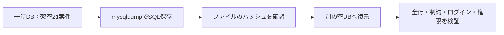

# ローカルMySQLのバックアップ・復元訓練（2026-11-15）

## 最新：会議記録も含む復元（2026-11-15）

会議の追加後、同じ使い捨てDB方式で再検証した。16テーブルの全行・履歴が一致し、会議1件・対象20件・確認2件（うち取消1件）・終了状態を保持できた。実DB8項目成功、後片付け完了。SQL47,119バイト、バックアップ工程185ms、復元と全行照合696ms（このPCと架空データのみの実測）。本番/S3/自動保存の検証結果ではない。結果は`work/backup-restore/results.json`。以下は以前の13テーブル時点の記録。

## 今回できたこと

既存データを上書きせず、一時的なバックアップ元DBと復元先DBを作り、SQL保存・復元・全行の比較・復元後の操作を確認した。これは使い捨ての架空データによる訓練であり、本番バックアップの運用開始ではない。AWS・S3・CI/CD・Docker構成・本番は変更していない。依存ライブラリの追加もない。



## 仕組みと対象ファイル

- `examples/mysql/check-backup-restore.mjs`：一時DB・ユーザーの作成から後片付けまでの通し検証。元の開発DBや既存検証DBのデータは操作しない。
- `examples/mysql/backup-check-settings.mjs`：ランダムな実行タグからDB名を生成する。ローカルポート、復元先名、PC内Dockerの接続先、SQLのSHA-256を検査する。
- `examples/mysql/prisma-backup-check.config.ts`：検証スクリプトの子プロセスにだけ渡す設定から、一時DBへのマイグレーション先を決める。接続先は127.0.0.1固定。schemaは既存のintegrated.prisma、migrationsは既存のdb/design/migrations。
- `tests/backup-check.test.mjs`：別DB名・SSH/TCP接続・不正設定・内容変更・空/欠落ファイルの拒否を検証する。
- `examples/mysql/package.json`：再実行用のtest:backup-restoreを追加。examplesのtsconfigには新しいPrisma設定を型検査対象として追加した。

一時DB名は毎回別の `siteflow_backup_check_<実行タグ>_source` と `_restore`。既存名と衝突した場合は上書きしない。復元先にテーブルがある場合も拒否する。バックアップはwork/backup-restore配下がGit対象外であることを確認してから作る。

## 実行方法と影響

ローカルDocker/MySQLと既存の環境ファイル・依存関係・生成済みPrisma Clientが必要。秘密情報を表示・転載しない。`examples/mysql` を作業ディレクトリにして：

```powershell
npm.cmd run test:backup-restore
```

Windows用npm実行ファイルから専用スクリプトを呼ぶ。オプションはない。PC内のMySQLコンテナを読み取り確認し、一時DB2つと一時ユーザーを作成、架空データを保存して復元する。終了時は成功・失敗にかかわらず後片付けを試み、削除できたことも確認する。結果だけをwork/backup-restore/results.jsonへ残す。失敗時もSQL・認証情報・元の例外本文はログに出さない。

内部で使う主要処理：

| 処理・指定 | 目的・影響 |
| --- | --- |
| prisma migrate deploy --config prisma-backup-check.config.ts | 既存マイグレーションを指定した一時DBだけへ適用する。設定ファイル自体を生成する処理ではない |
| mysqldump | 指定した一時DBの構造とデータをSQLへ保存する。DBの作成名を埋め込む指定は使わない |
| --single-transaction | InnoDBの一貫した時点を取得する。取得中のDDL変更は行わない |
| --quick | 行を順に読み出す。Node側もストリームでファイルへ渡す |
| --no-tablespaces | 表領域の情報を含めない |
| --set-gtid-purged=OFF | GTID関連の設定を持ち込まない |
| --column-statistics=0 | 列統計の取得を行わない |
| --hex-blob | バイナリ値を16進数で出力する |
| --skip-add-drop-table | テーブル削除SQLを付けない。空の復元先に限定する検査も別に行う |
| --default-character-set=utf8mb4 | 文字コードを指定し、日本語を含む架空データを保存する |
| --protocol=socket / --user=root | コンテナ内のUnixソケットと既存rootを使う。今回の隔離した訓練用で、本番の専用バックアップ権限を実装したものではない |
| docker exec -i | 指定コンテナ内で実行し、標準入力を接続する。資格情報はコマンド引数へ展開せずコンテナ内の環境変数から読む |

復元前にファイルのサイズとSHA-256を今回作成した値に照合する。ハッシュは転送破損を見つける検査で、暗号化・署名や、悪意ある改ざんへの防御の代わりではない。SQLには架空アカウントのハッシュ・セッションも含まれるためGitへ入れず、検証後に削除する。WindowsのACLによるアクセス制限は今回検証していない。

## 実際の結果

条件：このWindows PC、MySQL 8.4.13、架空21案件・2チーム・2ユーザー、同じMySQLインスタンス内の別DB。全テーブルは13個。認証・マイグレーション履歴も対象。招待とverificationは空のテーブルであり、その機能の動作確認をした意味ではない。

| 項目 | 結果 |
| --- | --- |
| SQLのサイズ | 36,885バイト |
| バックアップ＋ファイル検査 | 151ms |
| 復元＋全テーブルの全行照合 | 538ms |
| 安全確認4件＋業務42件 | 46件成功 |
| 実DBの復元確認 | 8項目成功 |
| 本体・検証用の型検査、lint、ビルド | 成功 |

8項目の内容：

1. 壊れたSQLとバックアップ元DBへの復元を拒否し、復元先を変更しない。
2. 全13テーブルの件数・全行を照合。所属、担当/進捗履歴、保管状態、アカウント、セッション、適用履歴が一致。
3. 復元済みの空でないDBへの再投入を拒否し、内容を保持。
4. 復元したPrisma適用履歴を使って再実行し、データが変わらない。
5. 重複所属・別チームへの参照を拒否。トランザクションの途中失敗で更新を取り消す。
6. 復元された古いセッションが使えることを確認後、全セッションを無効化。再ログイン・案件取得/更新・別チーム拒否をHTTPで確認。
7. 復元後も副担当による保管・復元と自己昇格を403で拒否し、案件を変更しない。
8. 復元先で更新しても元DBの全行は変わらない。

最後に今回のDB・ユーザー・SQL2ファイルが残っていないことを確認した。初回は接続先確認SQLの別名に予約語を使って失敗したが、後片付けは完了。別名を修正して通し直し、成功した結果を記録した。

## 今回の限界と次の段階

- この短い復元時間を、本番での復旧60分以内の達成結果とは扱わない。サーバー再構築・秘密情報の復旧・ネットワーク・S3からの取得・大きなDBは測定していない。
- 毎日の自動保存、S3への別保管、暗号化、保持期限、失敗通知は未実装。24時間以内のデータ損失という目標も未達成/未測定。
- 稼働中のMySQLデータディレクトリをそのままコピーする方式ではない。今回の手順は空の専用DBでのみ動き、任意の本番DBを復元する汎用ツールではない。
- 本番ではバックアップ用・通常実行用・マイグレーション用の権限を分ける。認証secretなど、DBダンプに含まれない情報の復旧手順も必要。
- 通常の更新は旧アプリと互換性のあるDB変更から始める。アプリだけ戻す操作と、データを過去に戻す復元は別。今回、破壊的マイグレーションの取り消しや時点復旧は実装していない。
- 次は公開用の統合設定とDB/TLSをローカルで検証する。AWS契約・インスタンス・本番・配信設定の変更は個別承認後に行う。

参考：[MySQLのmysqldump](https://dev.mysql.com/doc/refman/8.4/en/mysqldump.html)、[Prismaの検証/本番でのマイグレーション](https://www.prisma.io/docs/orm/v7/prisma-migrate/workflows/development-and-production)。
