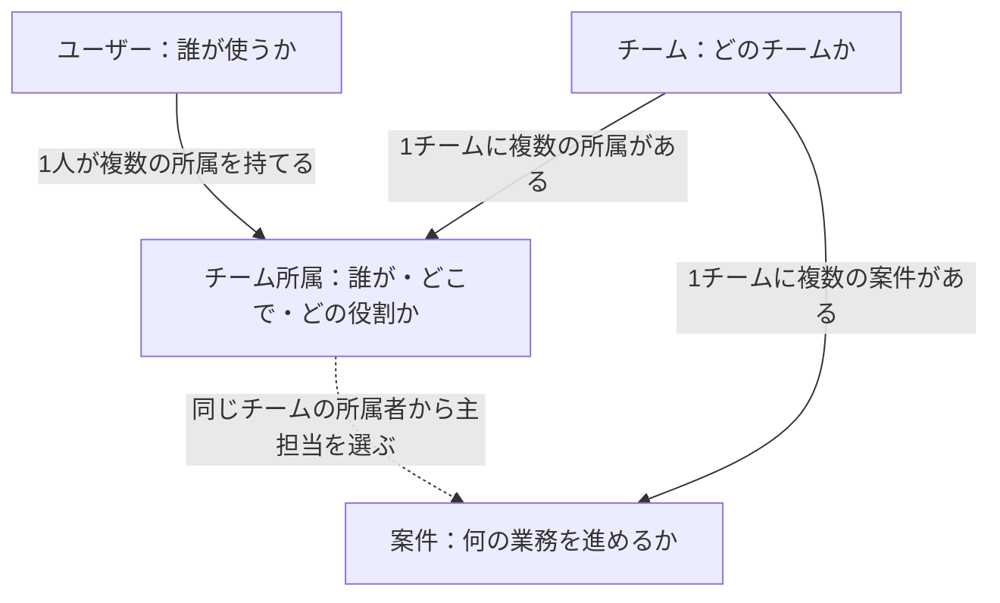
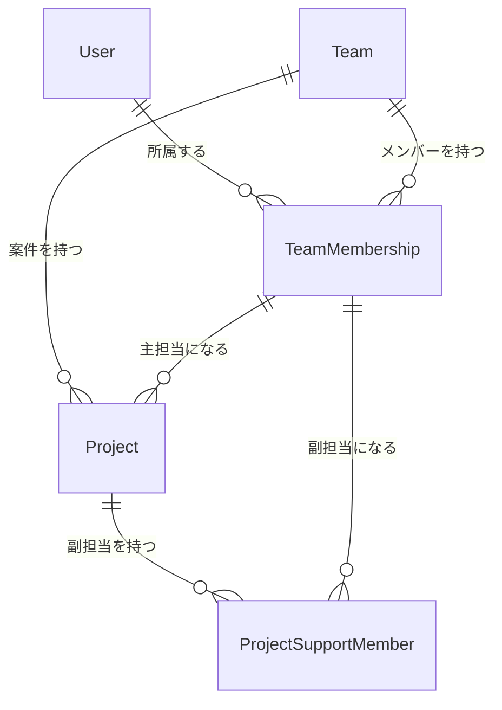

# SiteFlowのデータ設計：最初の4種類

## 最新：会議の対象と確認記録（2026-11-15）

Meeting（会議）、MeetingProject（開始時に固定した対象）、MeetingConfirmation（確認時の値と取消監査）を追加した。確認時の進捗/状態/案件版と確認者/日時を保存し、取消時は元記録を保持する。新モデルのUUID列はVARCHAR(36)、既存モデルを参照する列は既存型と整合させる。チームを含む外部キーと、会議内の対象/並び順の一意制約を持つ。
ローカル検証専用DBへ追加マイグレーションを適用した。本番未適用。全業務確認の開始・確認・取消・再開・終了まで接続済みで、差分・重要業務優先・決定事項は未実装。詳細は[MEETING_FLOW.md](MEETING_FLOW.md)。以下の会議が未実装という記述は当時の記録。

## 最新のアーカイブ・復元ルール（2026年11月15日）

正式仕様（2026-11-15のユーザー指定）：現在所属するチーム管理者または案件の主担当のみアーカイブ・復元できる。副担当だけでは不可。完了以外の案件も保管可能で、archivedAtと共通versionを更新する。進捗・状態・案件・人物・副担当・過去履歴を保持し、物理削除はしない。過去の主副担当を許可する記録は当時の仕様であり、この指定を優先する。

通常一覧/詳細/編集と保管用の読み取りを分離。保管中は通常の基本編集・担当/進捗/状態変更を404で拒否する。保管専用の一覧/詳細/副担当/進捗履歴/担当履歴は現在所属するメンバーが読める。外部公開する意味ではない。

復元は状態を変更しない。完了案件はDONEのままで、再開したい場合は復元後に理由付きで状態変更する。主副担当全員の現在の所属を確認し、元所属者が残る場合は主担当と副担当の完成形を両方指定して復元する。復元・担当の追加/解除・担当差分履歴・版を同じトランザクションで保存する。

同じ保管状態への再送は最新の版であれば変更なしとする。通常案件の担当だけを復元APIで変えることは拒否する。アーカイブ/復元自体の実行者や操作履歴は未実装で、archivedAtとversionのみ。担当を変えた復元の場合だけ既存の担当履歴へ差分を追加する。

分離APIで業務40件・API/DB統合96件成功。本体画面は未接続。API/制限/再現はSCHEMA_DATABASE_CHECK.md最新節。以下の保管や復元が未実装という記録は当時の結果として読む。

## 最新の状態変更・完了・再開ルール（2026年11月15日）

ユーザー回答「おすすめでいこう」により、確認待ちかつ進捗100％で完了、理由付きで進行中へ再開し進捗を保持する案を採用した。独立した承認者を要求する仕様ではなく、現在の管理者/主副担当が操作できる。

| 現在の状態 | 変更できる状態 |
| --- | --- |
| 未着手 | 進行中・保留 |
| 進行中 | 確認待ち・保留 |
| 確認待ち | 進行中・保留・完了（100％のみ） |
| 保留 | 進行中 |
| 完了 | 進行中（再開理由必須・現在の担当の所属を再確認） |

この遷移表は初版の実装判断。保留からは以前の状態を自動復元せず進行中へ戻し、未着手へ戻す操作は用意しない。同値・メモなしは変更なし、メモだけは拒否。進捗は状態変更で自動増減しない。再開時の進捗は保持し、その後に進捗APIで修正する。

再開時に主担当または副担当が現在の所属を持たなければ409とし、先に担当変更APIで調整する。過去の人物/履歴は保持する。担当変更と再開は2回の明示的な操作であり、作業項目/決定事項の選択的引き継ぎは未実装。所属解除の未完了担当チェック/最後の管理者保護を実装した意味でもない。

分離APIで状態変更と履歴・版の一括保存を実装し、業務37件・API/DB統合85件成功。本体画面は未接続。以下の状態変更・完了・再開が未確定/未実装という記録は当時の結果として読む。詳細はSCHEMA_DATABASE_CHECK.md最新節。

## 最新の進捗入力ルール（2026年11月15日）

ユーザー回答「おすすめでいこう」により、今回提示した「0〜100％を1％刻み」「100％と完了は別操作」を採用した。進捗は手入力で、作業項目の完了件数から自動計算しない。

分離APIに進捗のみの更新を実装。状態は自動で変えず、進捗の減少も入力修正として許可する。現段階では未着手のまま進捗が増えることもある。状態を進行中/確認待ち/完了へ変える操作と、その遷移規則は次段階で設計する。「完了には100％が必要か」、再開時の状態/進捗/担当再確認も今回確定したわけではない。

今回の実装判断：完了済みの進捗変更は409で拒否し、再開APIは未実装。同じ進捗をメモなしで再送した場合は変更なしとして履歴・版・更新日時を維持する。メモだけの送信は400で理由を返し、無言で捨てない。進捗変更と履歴・版を一括保存し、現在の所属と管理者/主副担当の権限を確認する。

実測は業務31件・API/DB統合74件成功。本体画面はメモリデモであり、このAPIとは未接続。詳細はSCHEMA_DATABASE_CHECK.mdの最新節。以下の古い記録の「整数/小数・自動完了が未確定」は当時の状態として読む。

作成日：2026年11月12日
更新日：2026年11月14日（第7節にDBへの具体化案、第8節にPrisma案へのリンクを追加）

現在の統合候補は第10節と `db/design/integrated.prisma`。それ以前の主担当・作成者を所属で参照する案は、履歴保持のため人物記録を参照する形へ調整した。

## この文書の位置づけ

夕方の会議で案件の進捗・決定事項・次の対応を共有する、新しいSiteFlowの設計メモ。
ユーザー提供の「SiteFlow_要件引き継ぎ.md」（2026年11月12日）を基準にする。

今回はユーザー・チーム・チーム所属・案件だけを整理する。
以下の項目名は設計上の候補であり、PrismaのスキーマやAPIの仕様を確定したものではない。
認証・DB保存は未実装で、現在のアプリは再読み込みでデータが戻るメモリ上のデモのまま。

## 1. まず理解する関係

実線はデータのつながり、点線は主担当の選択ルールを示す。DBの列や外部キーの具体的な形は後で決める。

例えば、架空の山田さんは1つのアカウントで「青葉チームの管理者」と
「中央チームのメンバー」になれる。役割はユーザー自身ではなく、チーム所属に保存する。
案件には所属チームを持たせ、青葉チームの案件に未所属の人を主担当として指定できないようにする。

## 2. 保存する項目のたたき台

IDはデータを区別する識別子。名前が変わっても、同じ人・同じ案件だと分かるように使う。
「参照」は、別のデータのIDを保存してつなぐこと。

### ユーザー：利用者の情報

| 項目の候補 | 意味 | 要件・扱い |
| --- | --- | --- |
| `id` | ユーザーを区別するID | Better Authとの互換性を優先し、具体的な形式は統合検証時に確認 |
| `name` | 表示名 | 保存方法・入力の必須条件は認証設計で確認 |
| `email` | メールアドレス | 登録・ログイン・招待に使用。重複と表記の扱いは認証設計で確認 |
| メール認証済みか | メールの所有を確認できたか | チーム作成・参加の前提。具体的な項目はBetter Authと照合 |

パスワード、セッション、認証リンクなどの保存構造はここで自作しない。
Better Authの管理するデータと照合して、別途設計する。

### チーム：情報を共有する単位

| 項目の候補 | 意味 | 要件・扱い |
| --- | --- | --- |
| `id` | チームを区別するID | 業務データのIDはUUID v4を使う方針 |
| `name` | チーム名 | 必須とする案。文字数などの制限は後で決める |

ログイン済み・メール認証済みの利用者が作成し、作成者の管理者所属も一緒に登録する。
チームだけが作成されて管理者がいない状態を防ぐため、両方を一括で保存する設計とする。

### チーム所属：利用者とチームをつなぐ情報

| 項目の候補 | 意味 | 要件・扱い |
| --- | --- | --- |
| `id` | 所属を区別するID | 独立したIDを持ち、チームとユーザーの組合せも一意にする案。理由は第7節 |
| `teamId` | 所属先チームへの参照 | 必須 |
| `userId` | 所属するユーザーへの参照 | 必須 |
| `role` | そのチームでの役割 | 管理者またはメンバー |

同じチームとユーザーの組合せは重複させない。
既存チームへの参加は管理者からの招待を経由する。招待自体は後で別に設計する。

### 案件：進捗を共有する業務

| 項目の候補 | 意味 | 要件・扱い |
| --- | --- | --- |
| `id` | 案件を区別するID | UUID v4を使う方針 |
| `teamId` | 案件の所属チームへの参照 | 必須。1案件は1チームに属する |
| `name` | 業務名 | 必須 |
| 主担当への参照 | 責任を持つ担当者 | 必ず1人。同じチームの所属者から選ぶ。`primaryMembershipId` で所属を参照する案を第7節に記載 |
| `dueDate` | 納期 | 必須。日付として扱う |
| `progress` | 案件全体の進捗率 | 必須。0〜100%、初期値0%。権限のある担当者が手入力 |
| `status` | 現在の状態 | 必須。未着手・進行中・確認待ち・保留・完了。初期値は未着手 |

引き継ぎで決まっている任意項目は、業務番号・副担当（0人以上）・業務概要・発注者・備考。
省略した要件ではなく、次の設計段階で追加する。副担当を単純な文字列の一覧として持たせず、
同じチームへの所属や主担当との重複防止を確認できる関連データとして設計する。

進捗率と状態は別々に保存する。作業項目の完了件数から案件の進捗率を自動計算しない。
ただし「100%なら必ず完了か」「完了には100%が必要か」、小数の可否、状態遷移と再開は未決。

## 3. この段階で守りたいルール

- 未所属チームのデータを閲覧・編集できない。画面で隠すだけでなく、APIで所属と権限を確認する。
- チーム内の全メンバーが案件を閲覧・作成できる。作成者と主担当は別でもよい。
- 案件の編集と担当変更は、当該チームの管理者、案件の主担当・副担当が行える。
- チーム管理者は、そのチーム内の役割。他チームの管理者権限にはならない。
- UUIDを知っているだけでは取得・更新できない。データを参照・関連付けするときもチーム境界を確認する。

## 4. 今のコードとの関係

現在の `lib/siteflow/domain.ts` と `components/siteflow/workspace.tsx` は指摘管理用。
現段階では変更しない。既存の完了件数による完了率と、新しい案件の手入力進捗率は別のものとして扱う。
既存の `db/schema.ts` は空で、`db/index.ts` はCloudflare D1用の接続の雛形。
MySQL用のテーブルや接続があることを意味しない。

今回追加したのはこの文書だけ。依存ライブラリ、アプリ、DB、AWS・CI/CDは変更しない。

## 5. 後で設計・検証すること

- Next.js・Node.js・Prisma・MySQL・Better Authの統合。Next.jsとPrisma・MySQLの独立した接続検証は成功済み。認証用スキーマと本体への組み込みは未実施。
- 主担当・副担当と同一チームの制約は第7節に設計案を記載。実際のPrismaスキーマ・MySQLでの拒否条件、所属解除時の担当や履歴の扱いは引き続き要検証。
- 項目の文字数・日付の扱い、進捗率と状態の整合、作成者・日時・更新競合用のversionなど。
- 進捗履歴・担当変更履歴、招待、アーカイブ、作業項目、会議と確認記録、決定事項、選択的引き継ぎ。

これは最初の4種類の概念を学ぶためのたたき台であり、これだけでv1.0の要件がそろうわけではない。

## 6. 今回の確認と次の練習

引き継ぎ文書と照らし合わせ、複数所属・チームごとの役割・主担当1人・手入力進捗率を記載した。
文書のみの追加なので、型検査・業務テスト・ビルドは実施せず、内容と差分を確認する。

まず「1. まず理解する関係」を読み、次にチーム所属の表を読む。
練習は、架空の1人が2チームに所属し、それぞれで役割が異なる例を考えること。
その役割をユーザーではなくチーム所属に保存する理由を、自分の言葉で説明してみる。

## 7. DBへ具体化する案（2026年11月14日）

### 今回の到達点

この節は実装前の設計案。要件で決まっている振る舞いと、実装のために推奨する構造を分ける。
Prismaスキーマの変更、マイグレーション、テーブル作成、認証やAPIの追加は行っていない。
接続確認用の `examples/mysql/prisma/schema.prisma` に業務モデルはなく、実行済みのSELECTは保存機能の実装を意味しない。

### 4種類の情報を、架空の具体例で考える

| 種類 | 例 | 何を区別するか |
| --- | --- | --- |
| ユーザー | 山田さん | 同じアカウントを使う1人 |
| チーム | 青葉チーム、中央チーム | データを共有する範囲 |
| チーム所属 | 山田さんは青葉では管理者、中央ではメンバー | 人とチームの組合せ、その中での役割 |
| 案件 | 青葉チームの橋梁点検 | チームに属する業務とその主担当 |

例えば、主担当を「青葉チームの山田さんの所属」にすると、中央チームの権限と区別できる。
担当者名を文字列でコピーする方式だと、同姓同名や名前変更に対応しにくい。参照用のIDでつなぎ、表示するときに名前を取得する。
下記のモデル名・フィールド名は設計用の候補で、既存APIの仕様ではない。

線の両端は、1件と0件以上の関係を示す。各案件の主担当は1つの所属を参照するが、所属する全員が担当案件を持つ必要はない。
「4種類」は最初に理解する業務概念であって、完成時のテーブル数ではない。副担当の関連とBetter Authのセッション等は別の保存先になる。

### IDと担当の参照方式

| 対象 | 今回の推奨案 | 理由・まだ確認すること |
| --- | --- | --- |
| User | Better Authが管理するユーザーを参照 | 認証と業務用に別々のユーザー一覧を作らない。ID型・長さ・生成方法は採用バージョンの生成スキーマと照合する |
| Team | 業務用のUUID v4のIDとチーム名を持つ | 名前が変わっても参照先が変わらない。名前の重複禁止は要件にないため勝手に設けない |
| TeamMembership | 独立したUUID v4のID、`teamId`、`userId`、`role` | 所属そのものを担当や履歴から参照しやすくする。チームとユーザーの組合せも重複させない |
| Project | `teamId` と必須の `primaryMembershipId` を持つ | 主担当を1列で必須にし、主担当が0人または複数になる構造を避ける |
| ProjectSupportMember | `teamId`、`projectId`、`membershipId` で副担当を関連付ける | 副担当が0人でも複数人でも扱える。文字列の配列ではなく、所属を参照する |

主担当と副担当を同じ担当者テーブルの役割だけで表す案では、「主担当が最低1人いること」の保証に別の処理が必要になる。
今回は主担当を案件の必須列、副担当を別の関連にする案を推奨する。
独立した所属IDがあっても、同じ人の同じチームへの所属は重複登録できないようにする。

`role` の業務上の値は管理者とメンバーの2種類。管理者権限はUser全体に付けず、この所属に持たせる。
Better AuthのOrganizationプラグインでチーム・招待を管理するか、独自の業務テーブルで管理するかは、採用前の照合事項。
プラグインを採用する場合はID・モデル名・役割をそちらと整合させ、同じチーム所属を二重管理しない。この案をそのままDDLとして確定しない。

### DBで守るルールとAPIで守るルール

DBの制約は保存されるデータの整合性、APIの確認は「今この人が操作してよいか」を担当する。両方が必要。

| ルール | 設計案 | 現状 |
| --- | --- | --- |
| 同じ人が同じチームに重複所属しない | `TeamMembership` の `(teamId, userId)` を一意にする。Prismaでは `@@unique([teamId, userId])` の形を検討 | 未実装 |
| 実在しない所属・チームを参照しない | 外部キーを設ける。外部キーは「参照先が存在する」ことをDBで確認する仕組み | 未実装 |
| 主担当は案件と同じチーム | 案件の `(teamId, primaryMembershipId)` から所属の `(teamId, id)` をまとめて参照。所属側の組合せには一意制約を設ける | Prisma・MySQLでの検証前 |
| 副担当も案件と同じチーム | 副担当の `(teamId, projectId)` と `(teamId, membershipId)` をそれぞれ案件・所属へ関連付ける。参照先の組合せを一意にする | Prisma・MySQLでの検証前 |
| 同じ副担当を重複登録しない | 案件と所属の組合せを一意にする | 未実装 |
| 主担当と副担当が重複しない | APIで確認し、主担当変更と副担当の調整をトランザクションで処理する。案件のversionによる競合検出も組み合わせる。別テーブルの主担当との比較は、上の一意制約だけでは保証されない | 詳細・競合検証は未実装 |
| 操作権限がある | APIでログイン・対象チームへの有効な所属・操作権限を確認。UUIDや所属IDを知っているだけでは許可しない | 未実装 |
| チーム作成で管理者が残る | チームと作成者の管理者所属をトランザクションで一緒に保存。トランザクションはまとめた処理をすべて成功かすべて取り消しにする仕組み | 未実装 |

1つずつのIDを参照するだけでは「存在するが別チームの所属」を選べてしまう。
上記の複数列の関連付けは、その誤関連付けをDB側でも防ぐための案であり、実際に拒否できたという検証結果ではない。
同じチームに所属していることと、現在も有効なメンバーであることは別。所属解除の設計とAPIの確認も必要。

案件・所属・履歴を連鎖的に削除する設定は、この段階で導入しない。
所属解除・退会・最後の管理者の離脱は、現在の担当と過去の履歴を保持できる扱いを先に決める。
参照されている所属を物理削除できなくする制約も候補にするが、それだけでは所属解除の業務ルールは完成しない。

### スキーマ作成前に残る判断

- 進捗率の整数・小数、完了状態と100%の関係：ユーザーへ確認中。推奨案は整数で0〜100、完了にするには100%が必要だが100%への変更だけでは自動完了しない。未回答の間は確定仕様にしない。
- 認証用スキーマ、チーム・招待の管理方式、メールの重複と表記、ID型・長さ：Better Authの採用バージョンと生成結果で照合する。
- 所属解除・再参加・最後の管理者・担当と履歴の保持、作成者への参照、日時・version・アーカイブ、状態遷移・再開の条件：実装前に具体化する。
- 副担当以外の任意項目、文字数上限・業務番号の重複可否・日付型：次のスキーマ案で明記する。任意項目を要件から落としたという意味ではない。

### 実装時に確認する例

以下はテスト予定であり、DBで実行済みの結果ではない。

1. 山田さんが青葉で管理者・中央でメンバーとして所属できる。
2. 山田さんを青葉へ二重登録すると拒否される。
3. 青葉の案件に中央にしか所属していない人を主担当・副担当として指定すると拒否される。
4. 主担当なし、同じ副担当の二重登録、主担当と副担当の重複が拒否される。
5. チーム作成の途中で管理者所属の登録に失敗したら、チームだけが残らない。
6. APIの利用者が青葉に所属していなければ、青葉の正しい案件IDを送っても取得・更新できない。

今回は文書の内容を引き継ぎ資料・公式資料と照合し、文書の差分・空白を確認する。コードやDBに変更がないため、型検査・テスト・ビルドは再実行しない。
次に読むのはこの節の具体例とIDの表。練習は「山田さんが青葉では管理者でも、中央の管理者にはならない理由」を所属のデータで説明すること。

参考：[Prismaの明示的な多対多関連](https://www.prisma.io/docs/orm/v7/prisma-schema/data-model/relations/many-to-many-relations)、[複数列による関連](https://www.prisma.io/docs/orm/v7/prisma-schema/data-model/relations/one-to-many-relations)、[参照先の削除時の扱い](https://www.prisma.io/docs/orm/v7/prisma-schema/data-model/relations/referential-actions)、[Better AuthのDBと認証用スキーマ](https://better-auth.com/docs/concepts/database)。

## 8. Prisma形式の案と構造検査

第7節の後の学習段階として、`db/design/schema.prisma` に関連を具体化し、Prisma 7.10.1のvalidateに成功した。
認証用ユーザーの接続点、チーム、所属、案件、主担当・作成者・副担当の複数列の関連を記載した。
項目の型や文字数には仮置きがあり、User以外の認証テーブルは含まない。進捗率と完了条件も未回答のため確定していない。
DBへは適用しておらず、MySQLでの制約テスト・認証・画面との統合は未実施。
読む順序・構文・コマンド・実際の結果は [PRISMA_SCHEMA_DRAFT.md](PRISMA_SCHEMA_DRAFT.md) を参照。

## 9. 認証・チーム管理との照合

Better Auth 1.7.23と公式CLIを検証用に追加し、OrganizationをTeam、MemberをTeamMembershipへ対応させた候補設定から、MySQL用の認証・チーム・招待モデルを生成した。
`db/design/auth-generated.prisma` のPrisma validateと生成設定の型検査に成功。DBへの適用やログインの実装は行っていない。
Organization利用を第一候補とするが、重複所属の制約・役割の2種類への制限・削除と履歴保持・IDの列型などの調整が必要。
特に作成者も所属を参照する第7節の案と、プラグインの所属の物理削除は、そのままでは組み合わせられない。所属解除と履歴参照を具体化してから統合する。
詳細と手順は [BETTER_AUTH_SCHEMA_REVIEW.md](BETTER_AUTH_SCHEMA_REVIEW.md) を参照。

## 10. 所属と履歴を分けた統合候補

`db/design/integrated.prisma` で認証・チーム・案件と2種類の履歴を統合し、現在のアクセス権はTeamMembership、過去の人物の識別はTeamParticipantへ分離した。
主担当・作成者・副担当・変更者は、同じチームの人物を複数列で参照する。人物記録に役割や有効所属の情報を二重保存せず、APIのアクセス権は必ず現在の所属で確認する。
所属と人物記録の重複禁止、業務参照のRestrict、admin/memberの役割enum、当時の表示名の保存を候補へ反映した。
Prisma validateとClient生成に成功。その後、SQL生成問題を専用設定で解消し、分離した検証用DBへ適用。所属削除後の履歴保持、別チームへの誤参照の拒否、重複禁止、トランザクションの13件が成功した。本体・認証APIへの統合は未実施。
設計方針・コマンド・実際の結果・未実装の拒否条件は [MEMBERSHIP_AND_HISTORY.md](MEMBERSHIP_AND_HISTORY.md) を参照。
最新のDB検証結果は [SCHEMA_DATABASE_CHECK.md](SCHEMA_DATABASE_CHECK.md) を参照。
