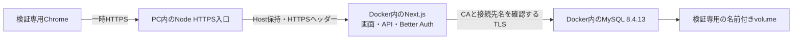

# Next.js＋MySQLのローカルDocker検証

## 最新：配信制御・公開migration・Nginx復旧（2026-11-16）

前段の承認後、CI/CD・Docker・配信スクリプトの**ローカルファイル**を実装した。AWS操作・SSH・GitHub設定変更・push・本番切替・EC2停止/サイズ変更はしていない。実機へ適用する前に[AWS手順書](AWS_DEPLOY_RUNBOOK.md)の未確認事項を確認し、操作ごとの承認を得る。

### 変更したもの

| ファイル | 役割と変更理由 |
| --- | --- |
| `.gitattributes` | 新しいdeployのsh/incだけLF改行を固定。WindowsでcheckoutしてもLinux用スクリプトや専用includeがCRLFで失敗しないようにする。Git設定や既存SQL履歴の正規化は行わない |
| `.github/workflows/ci.yml` | 既存build/業務テスト/HTTP確認を維持。Compose検査、Linux配信テスト、migrationイメージ、production承認ジョブを追加。許可変数なしなら最終ジョブは失敗する。PRは本番承認/イメージ送信をしない |
| `deploy/release-record.mjs` | 承認後にSHA、実行ID/試行回数、アプリ/migrationのdigest、schemaHashを記録。digestはイメージの内容を固定する識別子。ファイルを生成したことだけで本人の承認を偽装しないよう、CD側もGitHubを照合する |
| `deploy/cd-check.sh` | 本人だけがrequired reviewerで自己承認可能なproduction保護、mainの最新一致run、承認ジョブ、期限内の同一run成果物を照合。不明/失敗なら配信しない。トークンはprivateファイルから読み、curl設定を標準入力へ渡す。値を引数やログへ出さない |
| `deploy/release.sh` | root管理の記録・DB適用証明・休止状態を確認し、排他ロック→候補起動→DB readiness→Nginx切替→HTTPS/転送先を3回連続確認→公開版記録の順に処理する |
| `deploy/schema-hash.mjs` | PrismaスキーマとSQL履歴の指紋を計算。OSの改行差を正規化。構造が同じUI更新では既存のDB適用証明を利用でき、SQLが変われば新しい検証を要求する |
| `deploy/migrate.mjs`・`deploy/prisma-public.config.ts` | 専用DDLユーザーとCA/接続先名の検証後だけPrisma migrate deployを実行。migrate diffで設計との構造差分がないこと、履歴/会議テーブルを確認してから、確認日時・DB名/ホスト/CA指紋/schemaHashを含む記録を出力。これはroot管理の確認記録で、電子署名ではない。秘密値とPrismaの生ログは出力しない |
| `deploy/migration/package.json`・同lock | 既存と同じPrisma7.10.1関連3パッケージだけを別に固定。アプリ用のNext.js/Vite等をCLIへ同梱しない。ルートの依存設定は今回変更していない |
| `Dockerfile`・`.dockerignore` | SQL履歴だけを入力へ追加許可し、migration専用の小さな段階を作成。最終アプリへCLI/SQLは追加しない。source-auditは入力検査、deploy-check/proxy-checkは検証専用。最後のrunnerがrunner-baseを継承するため、target省略時はアプリが起動する |
| `deploy/compose.production.yaml`・`deploy/mysql.cnf` | DBと新旧アプリの定義。DBは外部公開せず、名前付きvolume/networkをexternal指定。アプリは127.0.0.1のみ、各384MiB、DB512MiB。CA/鍵は外部ファイルを読取専用マウント |
| `deploy/start-database.sh` | MySQL digest、volume/networkの所有ラベルと存在を確認。既定は既存データありの場合だけ起動。初期化許可時は空volumeだけ受け付ける。勝手にvolumeを作ったり消したりしない |
| `deploy/settings.example.json`・`deploy/nginx-upstream.example.inc` | 値と配置の例。実際のEC2設定ではない。既存ファイルを読み取って差分を確認するまで適用しない |
| `tests/deploy.test.mjs`・`tests/deploy-proxy-check.mjs` | 前者はLinux上の実シェルと代役コマンド、後者は実Nginx/Next.js/MySQLで切替と復旧を確認 |
| `scripts/check-deploy-config.mjs`・`examples/mysql/check-public-migration.mjs` | 前者は実Composeによる設定検査だけ。後者は使い捨てMySQLと公開migration/実Nginxの検証。既存開発DBを上書きしない |

### 確認した結果

| 検証 | 結果・範囲 |
| --- | --- |
| Linux配信処理 | 48件成功。未承認/休止/事故記録/未適用schema/別repo/PR/古いrun/期限切れ/スキップ/偽のreviewer/所有不一致/同時配信/host networkを拒否。コマンドとGitHub APIは代役 |
| 公開migration | 6項目成功。専用Dockerと実TLS MySQLで、承認なし/誤CA/証明書名不一致を適用前に拒否。2履歴・16テーブルを作り、2回目の履歴不変とアプリ用ユーザーのDDL拒否を確認。予期しないテーブル追加でも記録発行を拒否し、勝手に削除しない |
| 実Nginx切替/復旧 | 3項目成功。実Nginx1.22.1・実Next.js・実TLS MySQL。通常切替、候補設定不足で旧系維持、公開確認失敗で旧系へ復旧。旧系はHTTP代役、docker CLIの起動/停止もNodeプロセスの代役。EC2上のVinext復旧試験ではない |
| Compose | 実Docker Composeによる設定検査5項目成功。profiles/継承/loopbackポート/制限/externalを確認。実サービスのupはしていない。Linux本番でのTLS鍵の所有権等は別途確認 |
| アプリ | 最終通常イメージでHTTPSブラウザー17シナリオ成功。ログイン・案件保存・会議・再作成後の保持・誤CA拒否・ログアウト等。Windows専用Chrome1440/390幅、架空データのみ |
| 型・規約・業務 | 型検査・lintと、業務/会議/設定/readiness等56件が成功。業務ルール42件はこの56件にも含まれるため件数を足し合わせない |
| 秘密情報検査 | 実入力217ファイルと、最終アプリ全11層で検査用.env/鍵・照合対象の秘密値は未検出。SQLはスキーマ履歴だけ許可。任意ソースの未知の秘密まで保証する検査ではない。migration全層の個別アーカイブ検査ではない |
| 復元 | 会議込み16テーブルのバックアップ/復元8項目は前段の結果。SQL履歴を変えていないため今回は再実行していない。本番保存先・復元は未検証 |

サイズ改善：migrationは**約2.91GB→0.99GB（約66％削減）**。同じバージョンのまま、lockの登録エントリは1021→145へ縮小し、共通パッケージのバージョン差は0。通常アプリは約391MB。これはDocker inspectの論理サイズで、圧縮転送量や実機の追加占有量ではない。共有層、DBデータ、ログ、ダウンロード時の一時領域を含め、実機で25％空きを確認するまで配置可能と断定しない。

### 実Nginx試験で見つけた問題と修正

`nginx -s reload`の終了だけでは新しいworkerへ切り替わったと断定できず、復旧直後に候補を止めると502になることを確認した。

- 専用includeは`proxy_pass`と`set $siteflow_slot blue/green`の2行。server側で`X-SiteFlow-Slot`を付け、HTTPSで期待した枠と`ok:true`を3回連続確認する。
- 確認用のadd_headerはserver側へ置く。location側へ追加して既存セキュリティヘッダーの継承を変えない。実試験でnosniffヘッダーが残ることも確認した。実EC2の設定に合わせた差分確認は残る。
- 一度切替を試みた候補は復旧後も自動削除せず、処理中の接続を守る。`incident.json`に候補と復旧結果を記録し、次の自動配信を停止する。原因確認・接続の終了・後片付け・記録保管を承認後に行う。
- 通常の次回配信は、記録とラベルが一致する自分の旧Next.js枠だけ、TCP接続が残っていなければ停止して再利用する。container/imageは削除しない。既存Vinextをこの処理で勝手に停止しない。

初回公開後、旧Vinextを停止して非公開枠を空け、復旧用の記録を保管する操作は別途承認する。旧Vinextのprevious記録を保管先へ移してから通常CDを有効化する。この初回引継ぎを飛ばすと次回の枠再利用は安全のため拒否される。

### 再現用コマンド（ローカルのみ）

PowerShellでリポジトリルートから実行する。Docker Desktop、既存のルートnpm依存、ローカル検証用生成クライアントが必要。本番では実行しない。

```powershell
$taskDocker = 'C:\Users\syucream\AppData\Local\Programs\DockerDesktop\resources\bin\docker.exe'
node scripts/check-deploy-config.mjs
& $taskDocker --context desktop-linux build --target deploy-check --tag siteflow:deploy-check-20261116 --progress plain .
& $taskDocker run --rm --network none siteflow:deploy-check-20261116
& $taskDocker --context desktop-linux build --target migration --tag siteflow:migration-check-20261116 --progress plain .
node --experimental-strip-types examples/mysql/check-public-migration.mjs
& $taskDocker --context desktop-linux build --target proxy-check --tag siteflow:proxy-check-20261116 --progress plain .
node --experimental-strip-types examples/mysql/check-public-migration.mjs --proxy
& $taskDocker --context desktop-linux build --tag siteflow:docker-check-20261116 --progress plain .
node scripts/check-docker-image.mjs
node --experimental-strip-types examples/mysql/check-https-cookies.mjs --docker-public
```

`$taskDocker`は実行ファイルの場所、`&`はPowerShellの実行記号。`--context desktop-linux`は手元のDocker、`build`は作成、`--target`は検証/構造変更の段階、`--tag`は手元の名前、`--progress plain`はテキストログ、`.`は除外設定に従う材料。targetなしは通常アプリ。依存取得とローカルキャッシュ/イメージを作るが送信しない。

`run --rm`は試験コンテナを終了後に削除し、`--network none`は外部通信を禁止する。Linux拒否条件の試験はこの状態でも成功する。`--experimental-strip-types`はTypeScriptを実行するため型記述を取り除く指定で、型検査ではない。`--proxy`は実Nginx試験を選ぶ指定、`--docker-public`はアプリを完成イメージで起動する指定。各実DB試験は専用のネットワーク/volume/証明書/架空データを作り、最後に自分の資源だけ回収する。

migration内部の`migrate diff --from-config-datasource --to-schema db/design/integrated.prisma --exit-code --config deploy/prisma-public.config.ts`は、設定された実DBから設計図への差分を**読むだけ**。`--exit-code`で一致0・失敗1・差分あり2を区別し、0以外なら確認記録を出さない。SQLの適用や自動修復はしない。適用済み履歴があるだけで、実構造も正しいとは判断しない。

Compose検査は架空の補間設定ファイルを`--env-file`で指定し、`config --format json --no-env-resolution`でサービス用秘密ファイルの値を展開せず検査する。サービス/有料資源は作らない。検査用ファイルは回収し、結果だけworkへ残す。

専用lockの更新に使った`npm.cmd install --package-lock-only --ignore-scripts --no-audit --no-fund`は、`deploy/migration`でロックファイルだけ整理する操作。`--ignore-scripts`で生成時のスクリプトを実行せず、`--no-audit`/`--no-fund`は付加的な照会/案内を省く。ホストへnode_modulesは作っていない。Docker内の`npm ci`はlockに従って必要な依存を入れ、Prismaのクライアントを生成する。

### 本番適用時の前提（未実施）

Linux側にはbash、Docker/Compose、curl、jq、flock、ss、nginx、unzip等が必要。今回は検証専用イメージに入れたのみで、EC2へインストールしていない。設定/記録/トークンは実行者が所有し、他者が書き換えられない権限とする。秘密のruntime/tokenは600等で管理する。

- CDは`enabled`があり、`paused`と`incident.json`がない場合だけ動く。これらはまだEC2に作っていない。
- `settings.example.json`のパス・DB名・URLは例。実ファイル、空きポート、Dockerのローカルソケット、volumeラベル`siteflow.purpose=production-db`、Linux上のTLS鍵のmysql所有/読取り、実際のNginxヘッダーを確認してから適用する。
- `migrate.mjs`の入力は通常の公開DB設定に加え、`SITEFLOW_MIGRATION_APPROVED=yes`、`SITEFLOW_MIGRATION_USER=sf_migrate_...`、専用パスワード、承認済み`SITEFLOW_MIGRATION_DIGEST`。ユーザーを通常アプリと分ける。出力JSONを対象DB/CA/適用履歴と照合し、root管理の`schema.json`として配置する。未照合の出力を自動採用しない。
- 同じschemaHashなら通常UI更新でDDLを再実行しない。SQL/スキーマ変更、DBやCA変更は新しい照合と承認が必要。アプリ起動が勝手にmigrationや復元をすることはない。
- GitHubのproduction保護/本人承認、権限/契約プラン、既存CD停止、実機の容量・負荷・IP・証明書、本番の復元/EC2外バックアップと休止再開は未検証または未準備。実際のサーバーのパス/構成に合わせる変更は次段階。
- 決定事項・招待・進捗差分等は未完成。会議の最小機能を全要件の完成としない。

証跡：`work/deploy-tools-tests.log`、`public-migration-check.json`、`deploy-proxy-check.json`、`deploy-compose-check.json`、`deploy-image-audit.log`、`deploy-app-browser-check.log`。SQL dumpや秘密値を文書へ転記しない。

今回、新しいAWS資源を作成/変更していない。既存EC2等の通常料金は継続する。CI/GHCRの実際の利用条件・料金・認証は有効化前に確認する。

仕様の参考：[Prisma7のMySQL/TLS](https://www.prisma.io/docs/orm/v7/core-concepts/supported-databases/mysql)、[migrate diffの比較と終了コード](https://www.prisma.io/docs/orm/v7/reference/prisma-cli-reference#migrate-diff)、[GitHub環境保護のREST API](https://docs.github.com/en/rest/deployments/environments)、[workflow runのREST API](https://docs.github.com/en/rest/actions/workflow-runs)。2026-11-16に参照した一般仕様で、実アカウント設定の確認とは別。

---

以下は前段の検証記録。

記録日：2026年11月16日 JST。対象は手元のDocker Desktopのみ。AWS・EC2・公開中Vinext・GitHub設定・workflow・Nginx・systemdは変更していない。commit/push・GHCR送信・本番切替も行っていない。

## 今回の目的と構成

「手元の環境ファイルがないとビルドできない」問題を直し、公開用イメージを作れることと、実行時に渡した設定でDBへ接続できることを確かめる。



入口は既存Nginxの役割を模した**Node製の検証用入口**である。本物のNginx、公開証明書、AWSのネットワーク・2GB EC2の試験ではない。ボリュームはコンテナの外にデータを保存するDockerの領域。再作成してもデータが残ることと、別DBへ復元できることは別々に検証する。

## 変更したファイルと理由

| ファイル | 役割・主な変更 | なぜ必要か |
| --- | --- | --- |
| `examples/mysql/schema-check-settings.mjs` | 実行時に作業ルートを探し、ローカル設定を読む。本番でのローカル設定読込は禁止 | 固定の`new URL(..., import.meta.url)`がNext.jsに.envをビルド素材として探させていた。ダミーの秘密ファイルを足して解決しない |
| `.dockerignore` | 必要なソースだけを許可し、最後に.env・鍵・作業出力などを拒否 | Gitで無視していてもDockerには別の除外設定が必要。生成クライアントはLinux側で作る |
| `next.config.ts` | `output: 'standalone'`を追加 | 実行に必要なファイルをNext.jsが集める。開発用の全ソース・依存を最終イメージへそのまま置かない |
| `Dockerfile` | builderでインストール/ビルド、runnerで配信。`USER node`で管理者権限を使わず起動 | multi-stage（複数段階）でビルド道具と公開用の荷物を分ける。`node server.js`でstandaloneを起動する |
| `Dockerfile`の`source-audit`段階 | Dockerが実際に受け取るファイルを検査用に書き出す | 通常ビルドでは使わず、除外設定の実効性を確認する |
| `lib/siteflow/public-integrated-api.ts` | standalone固有の内部URLを扱う | 受信HostとOriginの検証を維持し、Dockerで待ち受ける内部URLにも対応する |
| `lib/siteflow/public-integrated-runtime.ts` | DB接続確認を共有し、会議テーブルの読取り確認を追加 | トップページの200だけで「DBまで使える」と判断しない |
| `app/api/ready/route.ts`・`lib/siteflow/readiness.ts` | 準備確認用のGET `/api/ready`。成功200、設定/Host/DB失敗503 | readinessは「配信先として利用できる準備が整ったか」の確認。返すのは`ok`のみ。DB全テーブル・全権限の保証ではない |
| `examples/mysql/check-https-cookies.mjs` | `--docker-public`で完成イメージを操作する検証を追加 | ホスト上のNext.jsでの成功と、Docker内での成功を区別する |
| `examples/mysql/tls-mysql-fixture.mjs` | 専用ネットワーク・ボリューム・MySQL再作成に対応 | 普段のDBを変更せず、実TLSと保存領域を試す |
| `scripts/check-docker-image.mjs` | 実際のDocker入力と最終イメージ各層を検査 | .env/鍵の無害な検査ファイルと、手元の長い秘密値をメモリ上で照合する。値そのものは記録しない |
| `tests/local-settings.test.mjs`・`tests/readiness.test.mjs`・`tests/public-integrated.test.mjs` | 設定読込・準備確認・内部URL許可と拒否のテスト | 許可範囲を広げ過ぎず、失敗時に秘密を応答へ出さないことを確かめる |

Dockerfileの`COPY --from=builder`は前段階の成果物を取り出す指定、`--chown=node:node`は実行ユーザーを所有者にする指定。`EXPOSE 3000`はポートの説明で、自動的にインターネットへ公開しない。DB設定と認証secretはビルド時に渡さず起動時だけに渡す。CAの公開証明書は読取専用でマウントし、CAの秘密鍵はアプリへ渡さない。

現在のCIが実行する`node --test tests/domain.test.mjs`を維持できるよう、対応するテストとdomainソースは最終段階に残している。workflow自体は変更していない。既存の192MiB制限で動作するという意味ではなく、EC2配信スクリプトには後続の承認付き変更が必要。

## 再現コマンドと影響

以下はリポジトリルートからPowerShellで実行する。Docker Desktopを起動し、既存のローカル検証用DBを用意した環境向け。コピーしてすぐ本番で使う手順ではない。

```powershell
$taskDocker = 'C:\Users\syucream\AppData\Local\Programs\DockerDesktop\resources\bin\docker.exe'
& $taskDocker --context desktop-linux build --progress plain --tag siteflow:docker-check-20261116 .
node scripts/check-docker-image.mjs
node --experimental-strip-types examples/mysql/check-https-cookies.mjs --docker-public
node --experimental-strip-types examples/mysql/check-backup-restore.mjs
node --experimental-strip-types examples/mysql/check-integrated-next.mjs
node node_modules/typescript/bin/tsc --noEmit --incremental false
node node_modules/typescript/bin/tsc --noEmit --project examples/mysql/tsconfig.json
node --experimental-strip-types --test tests/domain.test.mjs tests/meeting-domain.test.mjs tests/local-settings.test.mjs tests/readiness.test.mjs tests/public-integrated.test.mjs
npm.cmd run lint
```

- `$taskDocker`は実行ファイルの場所。`&`はそのファイルを実行するPowerShellの記号。`--context desktop-linux`は手元のDocker Desktop、`build`はイメージ作成、`--progress plain`はテキストログ、`--tag`はローカルの検証名、`.`は作業フォルダーをDocker入力にする。ネットワーク経由で依存を取得し、ローカルキャッシュとイメージを作る。pushはしない。
- `check-docker-image.mjs`は無害な検査ファイルを一時作成し、`source-audit`の出力と最終イメージ全層を検査する。専用workディレクトリと検査ファイルは最後に削除する。結果JSONのみ残す。任意のコードに埋め込まれた未知の秘密まで自動検出できる保証ではない。
- `--experimental-strip-types`はNodeでTypeScriptの型部分を取り除いて実行する指定。型が正しいかを調べるコマンドではない。
- `--docker-public`は検証スクリプトのオプション。Next.jsを完成イメージから起動する。一時MySQLは512MiB、Next.jsは384MiBの上限で、ホスト公開ポートは127.0.0.1の動的割当だけ。証明書・架空ユーザー・ネットワーク・保存領域・専用Chromeを作り、終了時に自分が作ったものだけ片付ける。
- バックアップ検証は別の一時DBを作り、dump→別の空DBへrestore→全行照合を行う。破損・元DB指定・空でないDBへの復元を拒否する。既存のMySQLコンテナを使うが普段の開発DBを上書きしない。機密を含み得る一時ダンプも削除する。
- 従来統合検証は専用ポートとwork内の別ビルド出力を使い、一時データだけ操作する。他の開発サーバーは停止しない。
- `tsc --noEmit`は型検査のみ、`--incremental false`は型検査キャッシュを保存しない指定。`--project`は検証用tsconfigを選ぶ指定。`--test`は続くファイルをNodeのテストとして実行する。通常テストはDBを書き換えない。
- `npm.cmd run lint`はESLintで規約違反を調べる。`.cmd`はPowerShellでスクリプト制限の影響を避けるWindows用の呼出し方。`--fix`を付けていないため自動修正しない。

## 結果と合格範囲

2026年11月16日 01:00 JSTまでに以下を確認した。AWS本番の成功とは区別する。

| 検証 | 実際の結果 |
| --- | --- |
| 通常Dockerビルド | 成功。環境ファイルやDBへの接続なしでLinux用生成クライアントとNext.jsをビルド |
| 型検査 | 本体・`examples/mysql`とも成功 |
| ESLint | 成功（自動修正なし） |
| 業務/会議/設定/公開入口/readinessテスト | 56件成功 |
| 既存CIと同じイメージ内テスト | 42件成功 |
| 秘密情報混入検査 | 実Docker入力198ファイル・最終イメージ11層/8,942エントリを検査。root/配下.env・鍵の検査ファイルが除外され、照合対象のローカル秘密値は未検出 |
| Docker公開モード | 17シナリオ成功。画面HTTPS・DB通信ともTLS1.3 |
| 従来のローカルNext.js統合 | 5項目成功。保管/復元の副担当拒否も維持 |
| 別DBへのバックアップ・復元 | MySQL8.4.13、会議を含む16テーブル。全行一致、適用履歴、再ログイン、権限とチーム境界、再マイグレーション、元DB不変を確認。8検証項目成功 |
| 表示 | 架空データの案件詳細を1440px/390pxで確認。横はみ出しなし |
| 後片付け | Docker公開検証のコンテナ・ボリューム・ネットワーク・証明書・Chromeプロファイルを削除。復元訓練の一時DB/ユーザー/dumpも削除 |
| 学習教材 | 68テーマ/70履歴。既存の実コード16抜粋を照合し、全テーマ切替、Dockerの図3状態、自己チェックの再読込保持、印刷イベント前後の復元を1440/390幅の専用Chromeで確認 |

17シナリオには、既定で閉じるモード・不正設定・想定外Hostの拒否、HTTPSログインとSecure/HttpOnly Cookie、案件作成/編集/再読込、チーム切替、固定secretでの再起動、誤CAの503と復帰、readinessの200/503、22案件の会議開始/確認/取消/再確認/終了/終了後変更拒否、Next.js/MySQL再作成後の案件/会議/セッション保持、ログアウト、既存ルートデモを含む。会議操作はログイン済みブラウザーからAPIを呼ぶ確認で、会議UI全操作の再試験ではない。

Docker公開検証は既存migration.sqlを一時DBへ順番に適用している。Prisma CLIの適用履歴も含めた16テーブル復元は**別の復元検証**の結果であり、TLS公開モードで本番向けmigration deployまで検証したという意味ではない。

MySQLはInnoDBバッファ128MiB・最大接続30・performance_schema無効、上限512MiB。Next.js上限384MiB。操作後一時点の`docker stats`ではNext.js **130.1MiB**、MySQL **220.5MiB**。ピーク値でも同時利用の性能結果でもない。Docker Desktopのホストには余裕があり、2GBのEC2上でOS/Nginx/新旧コンテナと共存できる合格証拠にはしない。新旧同時稼働・15分負荷・OOM/スワップ推移は次段階で測定する。

途中の失敗と修正：

1. 固定URLの.env参照がNext.jsのビルド素材として解釈された。実行時のローカル設定読込へ変更し、本番での読込を拒否した。
2. standaloneでの内部URLが`0.0.0.0:3000`となり、API入口が403で拒否した。固定の待受け設定と内部URLだけを許可し、公開Host/Originの照合は維持。HTTP/HTTPS経路と不正なポート/Hostの拒否をテストした。
3. 検証用Node24の`fetch`が指定したHostを送らず、許可される接続の試験も403になった。小さなローカルHTTPサーバーで挙動を確認し、Host試験を`http.request`へ変更した。診断用の一時ログはアプリから取り除いた。

ローカル証跡は`work/docker-build.log`、`work/docker-tests.log`、`work/docker-image-tests.log`、`work/docker-image-audit.json`、`work/docker-public-check/results.json`、`work/docker-backup-run.log`、`work/docker-local-regression.log`。workはGit/Dockerから除外される。共有用文書には秘密値やdump本文を転記しない。

## 復旧・残課題

ローカルのイメージを変更しても、GitHubへ送っていないため既存EC2はこの版を受信していない。失敗した一時コンテナは検証のfinally処理で削除し、既存の開発DB/ボリュームや公開用イメージは削除しない。共有作業中のため、`git reset`や既存変更の一括取り消しは復旧手段にしない。

今後も、Dockerfileだけをmainへpushしてはいけない。現行CDは約5分ごとにmainのCI成功を監視しており、production承認待ちも休止フラグも未実装。CI/CD・CD停止・AWS変更・push・本番切替は具体的な差分と影響を提示して個別承認後に行う。

本番のElastic IP判定、期限の短いHTTPS証明書の更新、EBS種別/単価/空き容量、2GB実機での新旧コンテナ切替と負荷、実際のNginx、日次7世代バックアップと長期保管、本番の復元手順、公開用migration実行者、本人承認ジョブと休止時配信防止は未完了。Dockerのボリューム再作成検証をEC2停止・再開テストと呼ばない。

決定事項・招待・進捗差分・重要業務優先等は未完成。会議の最小機能が動くことを全要件の完成としない。

費用・クレジット・GitHub承認機能の調査結果は[AWS計画](AWS_DEPLOY_PLAN.md)の11/13節を参照する。次にAWSへの準備へ進む前にユーザーの承認を得る。
