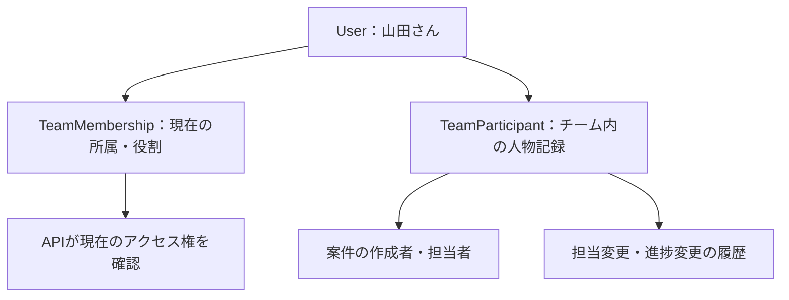

# 所属解除と履歴を両立する統合案（2026年11月14日）

## 現在地：チーム作成・所属管理のローカル実装（2026-11-25）

以下の旧節は当時の設計履歴。現在はTeam/TeamMembership/Invitation/TeamParticipantを再利用し、画面と専用MySQLのAPIを実装・自動検証した。本番未反映。一般公開登録・招待限定登録・実メール本人確認/送信は公開前の検討課題として残す。Organizationプラグインは生成用候補のまま、有効化していない。

### 操作と権限

- メール認証済み利用者は既存POST /teamsから作成でき、自分が管理者になる。名前は1〜80文字、同名可。slugは変更しない。所属0件でも作成と本人宛て招待を確認できる。
- 管理者だけが改名・招待発行/取消・役割変更・他人の所属解除を行う。一般メンバーは現在のメンバー一覧を閲覧し、条件を満たせば退出できる。管理者の権限を会議進行役へ流用しない。
- 最後の管理者の降格・解除・退出を拒否する。TeamParticipant、過去の案件担当・会議・メモ・snapshot・履歴を解除のために更新/削除しない。

### 招待は本人専用一覧から参加

秘密の招待トークンやメール送信は使わない。InvitationのIDは参照用で、IDだけでは参加できない。サーバーが現在の本人メール・認証済み状態・宛先を照合する。宛先は正規化し、MySQLのアクセント同一視で別アドレスを取得しないようバイナリ比較する。メールやuserIdの自己申告では承認しない。

期限は発行から7日。roleはmember固定、statusはpending/accepted/rejected/canceled。期限切れ表示はexpiresAtから計算し、承認時にも再確認する。ロック待ち後に時刻を取得し直し、状態更新SQLでもDB時刻で期限を検査する。未知状態、期限切れ、取消後、使用済み、発行者が現在の管理者でない場合は拒否する。旧Invitationは適用前に0件と確認しており、旧データの推測による有効化は行っていない。

発行時にサイト全体のアカウント検索をしない。未登録の宛先も同じ受付結果になり、アカウントは作らない。現在のチームへの重複所属/有効な重複招待は拒否する。参加できるのは既存の認証済みアカウントだけ。発行者の降格・解除・退出時は、その人の保留招待を同じtransactionで取消す。再参加は新しい招待と一般メンバー所属が必要で、旧管理者権限を復活させない。

### 解除条件と競合

未保管・未完了案件の主副担当、進行中会議の進行役、未対応MeetingActionItem担当が残る間は解除を拒否する。保管案件の未対応事項も対象。本体から全件数を検査し、画面には各先頭20件と案件/会議への導線を出す。対応後に再確認する。終了済みの事項は次の会議で選択して引き継ぎ・再割当し、保管案件は必要に応じ既存の復元手順を使う。自動引き継ぎや会議外の更新画面は追加していない。

管理更新はuserId順の現在所属行→Team行→必要なInvitation行の順にロックする。既存の案件・会議サービスが先に取得する所属行ロックと順序をそろえる。全メンバーを短時間ロックする構成は、小規模v1.0の安全性を優先したもの。大量チームの性能は未測定。

ReadCommittedのtransactionで現在の権限、全管理者数、業務担当、Team.versionを再検査する。UIはexpectedVersionを送信し、古ければ409。所属作成/解除・招待の状態・版番号は一括保存し、途中例外で全取消する。デッドロックで安全に再試行できる既知エラーは409を返し、自動で無限再試行しない。全デッドロックの網羅保証ではない。

### 失効と不在進行役

解除後のAPIは現在所属で拒否する。他チームとログインセッションは維持する。画面はTEAM_ACCESS_DENIEDを受けた対象チームの表示と保持データをクリアし、残る所属または所属0件へ移動する。既に配信された情報自体を回収する仕組みではない。

既に進行役が不在の会議は設定画面で検出・報告する。会議を自動修正せず、管理者の通常操作による代行も許可しない。限定復旧は今回実装していない。

### DB変更と検証

追加migrationは20261125_team_management。Team.versionをNOT NULL DEFAULT 1で1列追加した。既存テーブル・列・会議記録を削除していない。専用ローカルDBと手動確認用DBの一致、既存migration完了を確認してから適用した。別開発DB・本番へ適用していない。

新規単体4件・新規DB/API18件・中継追加1件を含む関連269件成功、Chrome通し11項目と応答喪失1項目成功。担当追加と解除、最後の管理者の同時退出、招待承認と取消、途中例外の全取消、過去記録保持と再参加を検証した。全ケース・全負荷・全ブラウザーの保証ではない。実際の結果・未検証・再現方法はVERIFICATION.mdの最新節を参照する。

---

その後、SQL生成問題を解消し、分離した検証用DBへマイグレーションを適用してDB統合テスト13件に成功した。現在の結果と再現手順は [SCHEMA_DATABASE_CHECK.md](SCHEMA_DATABASE_CHECK.md) を参照。以下の未検証記述は統合案を作った時点の記録。

## 今回の目的と到達点

現在の所属を解除しても、過去の案件の作成者・担当者・変更者を残せるよう、認証用と案件用のスキーマを `db/design/integrated.prisma` へ統合した。
Prisma 7.10.1でvalidateとClient生成に成功。DBへの適用、ログイン、所属解除・引き継ぎAPIの実装は行っていない。
既存の接続検証用スキーマ・API・画面は今回変更していない。

## なぜ「人物記録」を追加したか

Better Authの所属解除は、現在の所属レコードを削除する。
以前の案件案はその所属を作成者・担当者として参照していたため、参照を残すと所属を削除できず、連鎖削除すると過去の業務記録が失われる問題があった。

今回は次の2つを分ける。

| 保存先 | 役割 | 所属解除時 |
| --- | --- | --- |
| TeamMembership | 現在のチームへのアクセス権とadmin/memberの役割 | 条件を満たせば削除する |
| TeamParticipant | そのチームで業務に関わった利用者を識別する人物記録 | 残す。権限・role・有効所属フラグは持たせない |

人物記録にはチームID・ユーザーID・作成日時等だけを持たせ、現在の所属状態や役割を二重管理しない。
人物記録があることから「今も所属している」と判断してはいけない。



例えば青葉チームを抜けた山田さんの所属はなくなるが、人物記録は残り、過去の案件や履歴が引き続き山田さんを識別できる。
青葉へ再参加した場合は、現在の所属は新しいレコードでも、人物記録は `(teamId, userId)` の一意な組合せで再利用する。
User自体を削除する退会・匿名化は別の設計であり、この所属解除と同じ操作にはしない。

## 所属解除の業務ルール

以下は今回の設計方針で、APIの拒否処理はまだ実装していない。

1. 所属を外した後は、そのチームの閲覧・編集を許可しない。APIはログイン情報からユーザーを特定し、TeamMembershipを確認する。選択中チームIDや人物記録を許可の根拠にしない。
2. 未アーカイブ・未完了の案件の主担当・副担当が残る場合、担当の引き継ぎ・解除を済ませるまで所属解除を拒否する。作業項目・決定事項も、将来の実装時に未完了の担当が残っていないか確認対象へ加える。
3. 完了済み・アーカイブ済み案件の過去の担当は人物記録で保持し、所属解除のために書き換えない。
4. 完了済み案件の再開やアーカイブ復元では、現在の担当者が有効な所属を持つか再確認し、必要な担当変更と履歴保存を一括で行う。
5. 最後の管理者は、別の管理者を設定するまで所属解除・管理者からの降格を許可しない。
6. 担当変更後も未選択の作業・決定事項は旧担当者のままという引き継ぎ要件を維持する。担当が残る間は所属も維持し、残った業務を完了・再割当してから所属解除する。

所属確認後に別リクエストが担当を変更する等の競合があるため、確認してから別々に保存するだけでは不十分。
今後のAPIでは、所属の変更・担当の変更を同じチーム単位のロック順序とDBトランザクションで扱い、権限・現在の担当・最後の管理者を保存直前に再確認する設計が必要。
Better Auth標準の解除・役割変更・チーム削除の入口から、業務側の確認を迂回できないことも、公開する前に検証する。
単に標準APIの前で一度検査するフックを追加すれば、並行処理まで安全になるとは扱わない。

## スキーマの変更点

| 項目 | 統合案の内容・理由 |
| --- | --- |
| 認証の4モデル、チーム・所属・招待 | 1.7.23の生成結果を基礎に取り込む。既存のtable mappingも維持 |
| TeamMembership | `(teamId, userId)` を一意にし、現在の所属と役割の唯一の参照先にする |
| TeamParticipant | `(teamId, userId)` を一意にする。案件・履歴からはチームIDと人物IDをまとめて参照する |
| 案件の主担当・作成者・副担当 | 所属IDではなく人物IDへ変更。同じチームの人物であることを複数列の外部キーで表す。有効な所属かどうかはAPIでも確認する |
| 作成者の表示名 | `createdByNameSnapshot` に作成時の名前を保存する案。現在のプロフィール名の変更と区別する |
| ProjectProgressHistory | 変更前後の進捗・状態、変更者、当時の名前、日時、任意コメントを保存する候補 |
| ProjectAssignmentHistory | 主担当変更・副担当追加／解除、前後の人物、変更者、当時の名前、日時を保存する候補 |
| 削除時の関連 | 業務用の参照はRestrictで保持。所属を削除しても人物や案件は連鎖削除されない構造にする |
| role | 所属と招待の役割をadmin/memberのenumへ絞る案。標準プラグインのownerや複数roleを受け付けないAPI側の確認は未実装 |
| ID型 | 認証生成結果に合わせて関連するIDをStringへ統一し、旧案のChar(36)との混在を避ける。実際のMySQL列・照合規則はDB検証前に再確認する |

基本の7モデルに、人物記録・案件・副担当・2種類の履歴を加え、統合案は12モデル。
人物記録は、現在の所属を確認した業務処理で初めて必要になった際にupsertする方針。upsertは「あれば再利用、なければ作成」の操作。
当時の名前は、履歴を作るサーバー側でUserから取得してコピーする。ブラウザーから送られた名前をそのまま正しい記録として信頼しない。

## まだコードだけでは保証されないこと

- スキーマを置いただけでは、所属を外した人のアクセスを拒否しない。認証・APIの所属確認・キャッシュの扱いは未実装。
- 主担当と副担当の重複、進捗0〜100と完了条件、versionの比較・加算、履歴と案件更新の一括保存は、別途検証が必要。進捗の整数／小数と完了条件は未回答の仮置きのまま。
- 人物記録との関連は「同じチームの過去の関係者」を保証する構造。現在も有効な所属があることまでは保証しない。
- ProjectAssignmentHistoryの変更種別と前後の人物IDの組合せは、APIで検査する。主担当の初回設定は前が空、通常の変更は前後が必要、副担当追加は後のみ、解除は前のみという案。
- 履歴のUPDATE・DELETEを禁止するAPIは未実装。通常利用者に過去履歴の変更・削除を許可しない方針だが、このスキーマだけでDB管理者の直接更新まで防ぐものではない。
- Session・Accountは認証用Userとの標準のCascadeを維持。業務参照があるUserやTeamの物理削除はRestrictで阻止する構造だが、退会・チーム削除の安全なAPI動作を検証したものではない。
- 作業項目・決定事項・会議・所属変更自体の監査履歴等は今回のモデルに追加していない。完成時の全スキーマではない。
- Better AuthのPrismaアダプターを経由したenumへの書き込み、標準の所属操作と業務ルールの共存は未検証。

## ファイルと再現手順

`db/design/schema.prisma` は前の業務案、`auth-generated.prisma` は公式CLIの生成結果として比較用に残す。
今回の統合候補は `db/design/integrated.prisma`。本体や検証APIの接続先を切り替えていない。
`examples/mysql/package.json` に次のコマンドを追加した。リポジトリのルートから実行する。

```powershell
npm.cmd --prefix examples/mysql run validate:integrated-design
npm.cmd --prefix examples/mysql run generate:integrated-design
```

`--prefix examples/mysql` は検証用パッケージの指定。
内部の `prisma validate --config prisma7.config.ts --schema ../../db/design/integrated.prisma` は設定と対象を指定して構造検査する。
`prisma generate` は同じ対象から接続用コードを `examples/mysql/generated/integrated/` へ生成する。DBへは接続しない。
生成先は既存のgenerated除外範囲の内側で、Git・Dockerの対象外。現在の接続検証が使うgenerated/client.tsを切り替えない。
接続検証用のgenerateで生成フォルダーを再作成した場合は、必要に応じて統合用Clientを再生成する。
整形には `prisma format --schema db/design/integrated.prisma` を使い、この候補だけを書き換えた。

## 実際の検証結果

| 検証 | 結果 |
| --- | --- |
| 統合案のPrisma validate | 成功 |
| Prisma Client生成 | 成功。DBへ接続して動くことは未確認 |
| 生成ClientのNode.jsでの読込 | 成功。インスタンス作成・DB接続なしで読込と役割enumを確認 |
| 検証用コード・本体の型検査 | 成功 |
| 本体ESLint | 成功 |
| 既存業務テスト8件 | 成功。新しい所属解除・DB履歴保持の実動作テストではない |
| Next.js本番ビルド | 成功 |
| SQLプレビュー | 未完了。終了コード0でもSQLファイルが生成されず、原因は未特定 |
| DB適用・所属解除・履歴保持・権限拒否・並行処理 | 未実施 |

SQLプレビューではPrismaの `migrate diff --config prisma7.config.ts --from-empty --to-schema ../../db/design/integrated.prisma --script --output ../../db/design/integrated-preview.sql` を試した。
`--from-empty` は空のモデル、`--to-schema` は統合案との比較、`--script` はSQL形式、`--output` は保存先を指定する読み取り型の生成処理で、DBへ適用するコマンドではない。
通常実行・制限外・対話端末で同じく出力されず、エンジン単体のバージョン表示は成功した。SQL生成ができたとは扱わない。
終了コードだけで成功したように見えるため、試行時に追加したpreview:integrated-designは実行メニューから外した。SQLファイル・マイグレーションは作成されていない。

通常検証は `npm.cmd run lint`（内部の `--ignore-pattern dist`・`--ignore-pattern .next` は生成先を除外、自動修正なし）、`node --experimental-strip-types --test tests/domain.test.mjs`（型を取り除いて読み込み、指定テストを実行）、`npm.cmd run build`（本番用生成物を作成）、`npx.cmd tsc --noEmit --incremental false`（コード出力・検査キャッシュ更新なしで型検査）。検証用のtypecheckは `--noEmit --project tsconfig.json` で指定設定を検査する。
追跡済みのキャッシュはビルド前の内容へ戻す。今回、依存の追加、DB操作、AWS・CI/CD・Dockerfileの変更は行っていない。

## 次の確認予定と練習

次のDB段階では、検証用データで以下を確かめる。いずれも実行済みではない。

1. 同じユーザーの同じチームへの所属・人物記録の二重登録が拒否される。
2. 別チームの人物を主担当・作成者・副担当・変更者に指定するとDBで拒否される。
3. 未完了の担当がない一般メンバーの所属を削除しても、完了済み案件・作成者・履歴が残る。
4. その人が再参加すると同じ人物記録を再利用できる。
5. 参照中の人物記録や、業務記録のあるUser・Teamの物理削除が拒否される。
6. API段階で、未完了担当・最後の管理者の解除拒否と同時操作を検証する。標準のOrganization APIからの迂回も拒否できることを確認する。

SQLプレビュー問題と仮仕様を整理してから、ローカル検証用DBへの適用と保存・拒否条件の検証へ進む。
まずTeamMembershipとTeamParticipantを読み比べる。練習は「人物記録があるのにアクセスを許可してはいけない理由」を説明すること。
