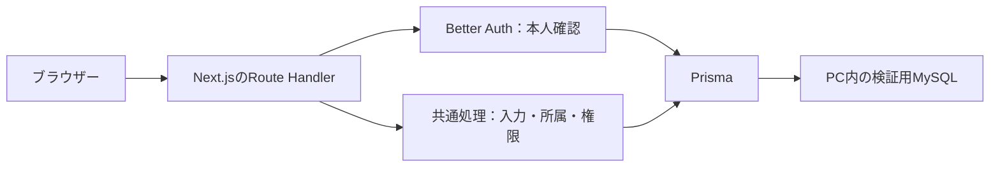

# Next.jsへのAPI統合：ローカル検証（2026-11-15）

最新：公開用統合モードとDB/TLSも使い捨て環境で確認した。[PUBLIC_INTEGRATED_TLS.md](PUBLIC_INTEGRATED_TLS.md) を参照。以下の開発専用integratedモードの記録は当時の段階で、同モードを本番に流用する方針ではない。

## 現在地と正式仕様

開発時の明示的なintegratedモードで、別APIプロセスを起動せずNext.jsからBetter Auth・Prisma・検証専用MySQLを利用できる。従来のlocal/public中継は比較用に維持。本番でのintegrated指定は拒否する。AWS・Dockerfile・CI/CD・Nginx・systemd・契約は変更していない。



- アーカイブ・復元は現在のチーム管理者または案件の主担当のみ。副担当だけ・作成者だけ・未所属は拒否。復元に自分を主担当とする値を送っても、変更前の権限で拒否する。
- 通常の編集は管理者・主担当・副担当。`canArchiveProject` と `canEditProject` を分け、案件ロック後に所属・担当・版を再確認する。
- 詳細の `canArchive` は画面表示用。保存APIは再確認し、ボタン非表示を許可の根拠にしない。
- 会議・決定事項・作業項目・選択的引き継ぎ・招待・自由登録・メール送信・再設定は未完成。体験デモ公開は当初のv1.0完成とは別。

## 主な変更と理由

| 場所 | 役割・理由 |
| --- | --- |
| lib/siteflow/domain.ts、project-archive-service.ts | 保管専用の権限を分離。副担当による操作と自己昇格を拒否 |
| examples/mysql/web-api-handler.ts | 既存の受付を標準Request/Responseへ移し、保存サービス・制約・トランザクションを再利用 |
| examples/mysql/api-handler.ts | 検証用Node HTTPと共通処理の変換。業務処理を二重実装しない |
| examples/mysql/auth.ts | Node/Next.jsで認証設定を共有。登録停止と準備済みアカウント方式を維持 |
| lib/siteflow/integrated-api.ts | 開発環境・PC内Origin・HostをDB生成前に検査。認証JSONからトークンを除く |
| lib/siteflow/integrated-runtime.ts | 認証とPrismaをプロセス内で共有。HMRで接続プール・secretを増やさない |
| app/api/siteflow/[...path]/route.ts | integrated時だけ別APIへのfetchを使わず直接実行 |
| package.json・ロックファイル | 既存と同じBetter Auth 1.7.23、Prisma 7.10.1を本体側で利用。dev/build前にClientを生成 |
| next.config.ts | 自動検証時だけキャッシュ・型設定をwork配下へ分離。通常の設定は維持 |
| eslint.config.mjs・tsconfig.json | 専用のNext.js生成キャッシュだけを検査対象外にする。手書きのソースは除外しない |
| components/siteflow/project-detail.tsx | 保管権限がなければボタンを表示しない。通常編集との違いを明記 |

Next.jsは内部URLをlocalhost表記にする場合がある。受信Hostは固定設定と完全一致させ、内部URLもPC内・同じポートに限定する。転送ヘッダーを権限の根拠にしない。認証CookieのPathは従来の `/api/siteflow`、HttpOnly・SameSite=Lax。今回のHTTP検証はローカル限定で、本番のSecure Cookie・固定secretとは別。

## 手動で試す

既存のローカルMySQL・検証用DB・準備用アカウントが必要。秘密ファイルを表示・転載しない。リポジトリルートのPowerShellで：

```powershell
$env:SITEFLOW_WORKSPACE_MODE = 'integrated'
$env:SITEFLOW_INTEGRATED_ORIGIN = 'http://127.0.0.1:5173'
npm.cmd run dev
```

最初の2行はこのPowerShellと子プロセスにだけ設定する。integratedはPC内でAPIを直接実行するモード、Originは許可するURL・ポートの完全な指定。`npm.cmd run dev` はWindowsのnpmから開発サーバーを起動する。事前処理でClientを生成し、`/workspace` を開く。テーブル作成やデータ初期化はせず、5175番のAPIは不要。開発secretはプロセス内だけなので再起動後は再ログインが必要。元に戻す場合はサーバーを停止し、このPowerShellを閉じる。

## 検証方法・結果

ルートで `npm.cmd run db:client` を実行すると、指定スキーマからClientを生成する。DBへは適用しない。続いてexamples/mysqlを作業ディレクトリにして：

```powershell
node --import tsx check-integrated-next.mjs --browser
```

`--import tsx` はTypeScript読込、`--browser` はブラウザー操作も検証する指定。PC内の空きポート・専用キャッシュでNext.jsを一時起動し、検証用DBの架空データを作成・更新後に削除する。自分で起動したNext.jsと専用Chromeだけを終了する。別APIの接続先は未使用ポートに指定し、中継への依存がないことも確認する。

- 単体92件成功：業務・既存中継・設定・統合の拒否条件・本文バイト上限・Cookie保持とトークン除去。
- 本体とexamplesの型検査、ESLint、本番向けビルド成功。ビルドは公開ではない。
- Next.js実起動：ログイン、実DB保存/再取得、同時編集の200/409、管理者/主担当の保管と復元、副担当の403・データ不変・自己昇格拒否、チーム境界、Host/Origin偽装、不正JSON/本文上限、登録停止、ログアウトを確認。
- 統合モードでブラウザー47項目成功。キーボード・入力保持・再試行・履歴・競合・保管/復元・1440/390幅など。副担当の保管ボタン非表示と直接API拒否を追加。
- 既存Node API/DBテスト101件成功。従来の公開用中継・Secure Cookie検証も含む。
- 型エラー、Next.js内部URL、Cookie Pathの差を修正した。tsx起動のWindows制限は許可付きで再実行。途中の失敗を成功に数えていない。

結果はGit対象外のwork/integrated-*.log、work/integrated-next/、work/workspace-preview/。画面画像は後者のarchive-denied-support-1440.pngとarchive-denied-support-390.png。

## 復元訓練の更新（2026-11-15）

PC内の一時DBで全13テーブルを別DBへ復元し、全行・認証・所属/権限・制約・履歴を確認した。詳細は [DATABASE_BACKUP_CHECK.md](DATABASE_BACKUP_CHECK.md)。次節の本番運用計画とは区別し、S3/定期保存/本番復元・性能は引き続き未実装/未検証。

## 承認済み方針と、次の作業（本番運用は未実装）

1. 既存EC2・Nginx/HTTPS・GHCR・約5分間隔のCDを活用。統合Next.jsの新旧コンテナと単一MySQLを計画する。
2. 2GBは検証候補。ビルドはCI側、接続上限は各2、更新・バックアップ・マイグレーションの同時実行を避ける。新旧同時起動、5人/20案件/10秒取得を想定して測定し、不足なら4GBを別途検討。
3. Elastic IP・実請求・EBS・セキュリティグループは未確認。確認前にEC2を停止しない。自動割当IPは同じ番号のままElastic IPへ変換できない。現在の公開設定はIPを拒否するので、固定Host/Origin検査を維持した対応が今後必要。
4. S3へ毎日とDB変更前の論理バックアップ、非公開・暗号化・7日保持を計画。別DBへの復元と所属・履歴・デモ期限を確認してから公開する。損失24時間以内・復旧60分以内は未測定の目標。認証secretは別管理。
5. DB変更は1回だけ適用し、旧アプリと互換性のある追加を先行する。アプリのロールバックとDB復元は別。
6. AWS契約・インスタンス・本番変更は費用・影響・戻し方を説明して個別承認。Dockerfile・CI/CD・Nginx・systemdも事前承認。今回の成功を本番公開の承認とは扱わない。
