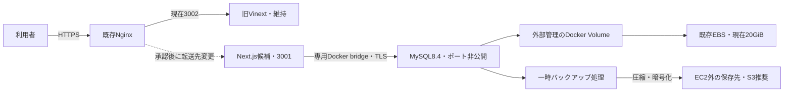

# SiteFlowの公開用MySQL設計案

最新（2026-11-17 21:21 JST）：**PC実Chromeの非公開HTTPSでログイン・案件保存35％・再読み込み・ログアウトに成功**。証明書dry-run/再読込hook/通常renew正常（実証明書の期限延長なし、11月21日15:26 JST）。候補だけの停止再開と保存保持も成功、旧Vinext/Nginxルーティング維持・HTTPS200。S3/IAMは承認待ち、GitHub production未作成、CD/公開経路変更はローカル準備のみ。詳細は[21節](PREDEPLOY_VALIDATION.md#21-公開前準備証明書非公開ブラウザー復旧cd)。後段は過去の履歴を含む。


最新（2026-11-17 20:08〜20:10 JST）：**AWS Next.js候補版がREQUIRES_APPROVED_PUBLIC_IPV4:3001で稼働**。新正式DBへ確認済み2履歴を適用、runtimeは業務tableのCRUDのみ、migrationユーザーはロック。実HTTPでログイン/案件作成保存再取得/ログアウトと401を確認。Next約181〜188MiB/384MiB、MySQL約231MiB/512MiB、EC2 available最少約826MiB。旧公開HTTPS200・不変。S3/一般公開切替/Git push/再起動は未実施。詳細は[20節](PREDEPLOY_VALIDATION.md#20-aws-nextjs候補版の起動正式db移行ログイン保存検証)。後段の未起動/提案は過去の履歴。


最新（2026-11-17 19:40 JST（10:40 UTC））：AWS上の架空DB backup→別空DB restoreの定義/全行/整合性一致、アプリ用最小CRUD・TLS必須・他DB/DDL拒否、Next.jsと同じ接続設定/Prisma adapterで正常TLSと不正CA/誤名/平文拒否を確認。MySQL約205MiB/512MiB、host最少約891MiB、旧公開HTTPS200。**実Next HTTP候補/Prisma migration/EC2外backupは未実施。** 詳細・残作業・S3承認案は[検証19節](PREDEPLOY_VALIDATION.md#19-awsでの検証dbバックアップ復元アプリ用tls接続)。後段は過去時点の記録を含む。


最新更新（2026-11-17 18:41 JST）：**AWS MySQLのみ起動済み・healthy**。暗号化追加EBSへの保存、正常停止・コンテナ再作成後の検証データ保持、3306非公開、秘密/ログのEBS配置・swap/core制限を確認。旧公開HTTPS200、既存Docker/Nginx不変。DB自動起動はdisabled。Next.js未配信、本番SQLの別保存先backup/restore・ネットワークTLS接続・実再起動は未検証。以降の「DB未起動」等は当時の履歴で、現状は[最新検証18節](PREDEPLOY_VALIDATION.md#18-aws-mysql初回起動と永続化検証)を優先する。


最新B5：ユーザー承認後にfstab UUID自動mount/nofail/timeoutと、DB専用systemd・実EBS/UUID guard・MySQL restart=noを実装/実機反映。[設定と限界17節](PREDEPLOY_VALIDATION.md#17-自動マウントとmysql起動保護の設定結果)。正例/誤ID/UUID/隔離namespaceのmount不在拒否は成功、既存公開維持。DB unitはdisabled/inactive/起動許可なしで、実DB/再起動/backupは未検証。後段の未実装/提案は作成時点を含む。

最新方針：[実行計画冒頭](AWS_DEPLOY_PLAN.md)を優先。旧公開を候補確認まで維持する指定のため、root交換を先行する提案から、encrypted DB用EBS10GiB追加へ推奨を変更した（未承認/未作成）。localのlog/停止猶予/healthcheck/binlog/誤mount拒否と候補checkerは実装・変更箇所の検証済み。[実測11節](PREDEPLOY_VALIDATION.md#11-候補起動を優先したローカル実装と検証)。後段の「未実装」は作成時点の記録を含み、AWSのDBは今も未起動。

2026年11月16日作成。**設計・提案のみ。MySQL起動、AWS/ホスト設定変更、切替、Git pushは未実施。** 根拠は既存ソースと[AWS実測/実施記録](AWS_DEPLOY_RUNBOOK.md#22-compose導入結果と既存公開の維持)。秘密値は含めない。

更新：ユーザーが本設計を基本方針として採用。続く[事前検証](PREDEPLOY_VALIDATION.md)ではEC2読み取りと使い捨てローカルDBの保持/TLS/専用権限復元15項目、Nginx切替3項目に成功した。冒頭の「設計のみ」は作成時点。**本番DB未起動・本番設定未変更**は継続する。S3暗号化/保存権限/世代保護、EBS移行、TLS証明書更新の具体案も事前検証書を参照。

追加の推奨判断（22:47〜22:49 JST調査後）：[事前検証9節](PREDEPLOY_VALIDATION.md#9-削除対象の再確認暗号化の推奨と個別承認手順2026-11-16)で、DB初期化前のroot暗号化を提案。20GiB整理後の推定空き約9.28GiBは取得開始ゲート案10GiBにわずかに足りないため、encrypted root30GiB（月＋0.96ドル）も比較する。**暗号化/容量変更は未承認。** 従来の20GiB容量仮予算より同節の最新image実サイズを使う。S3のIAM Action/Resource/Conditionと月約0.11〜0.26ドルの条件付き予算、個別承認順も同節を参照。

## 1. 推奨する全体構成

既存のt3.small/2GB、Docker25、Compose5.7.0、Nginx/HTTPSを使う。別APIサーバー/RDS/別EC2を増設せず、Next.jsに画面・Better Auth認証・業務APIを統合する。初回の公開範囲は従来の決定どおり架空業務データ・運営者が用意する個別アカウントのプレビュー。会議の最小機能と全要件の完成は区別し、決定事項/招待/進捗差分等は未完成のまま表示する。

MySQLは既存ローカル試験で使用した8.4.13/Linux amd64を候補にし、実装前に公式修正情報と取得するdigestを再確認する。常に変わるlatestタグは使わず、DBのパッチ更新もバックアップ/互換性/復元を伴う別作業にする。



この図は設計で、AWSで稼働しているのは旧Vinextだけ。公開経路を変えずにMySQLを準備し、DB/TLS/復元が合格した後でNext.js候補を3001へ置く。

## 2. 既存ファイルの役割と、追加が必要な部分

| ファイル | 役割・主な設定 | 現在/設計上の変更候補 |
| --- | --- | --- |
| `deploy/compose.production.yaml` | `mysql`、`blue`、`green`の起動条件。`profiles`は起動対象を分ける、`image`はdigestで版固定、`env_file`はホストの設定から値を渡す | 雛形あり。DB以外を誤って同時起動しない。今後log上限/DB停止猶予/healthcheck等を追加検討、今回は未編集 |
| `deploy/mysql.cnf` | `innodb_buffer_pool_size=128M`はDBのキャッシュ、`max_connections=30`は最大接続数、`performance_schema=OFF`は詳細監視のメモリ削減。TLSを必須化 | ローカルで使った初期値。本番負荷に合格した値ではない。初版は日次復元のみとし`skip-log-bin`追加を提案、時点復旧は提供しない |
| `deploy/settings.example.json` | releaseのstate/CA/network/DB/公開Originの例。アプリとDB設定が一致するか確認するための地図 | `siteflow.example.com`は例なので実際には使わない。実Originは既存の`https://REQUIRES_APPROVED_PUBLIC_IP`。実設定はEC2内root管理へ |
| `deploy/start-database.sh` | volume/networkの存在と所有ラベル、初回空領域/既存データの区別を確認してMySQLだけ起動 | ローカル拒否条件を検証済み。既定は再開モードで、空領域は明示的な初期化許可が必要。本番未実行 |
| `deploy/migrate.mjs`・`deploy/prisma-public.config.ts` | 専用ユーザーでTLS確認→Prisma migrate deploy→モデルとの実差分/履歴確認→管理記録 | 専用CLIコンテナの一時処理。アプリ起動の度に自動実行しない |
| `examples/mysql/public-api-settings.ts` | Origin/固定認証secret/DB名/非rootユーザー/パスワード/TLSの設定検査 | 実装済み。DB名は`siteflow_public_`で始める必要がある |
| `examples/mysql/public-database.ts` | CA/接続先名を検証するTLS接続。`connectionLimit:2`でアプリごとの接続を抑える | 実装済み。証明書検証を無効にしない |
| 今後の本番backup/restoreスクリプト・systemd timer | 専用ユーザー、暗号化保存、失敗検出、世代管理、復元先保護 | **未実装**。`examples/mysql/check-backup-restore.mjs`はローカル使い捨て訓練なので本番用としてそのまま使わない |

Docker Composeとrelease.shの両方から同じアプリ枠を管理しない。DBはComposeのdatabase profile、アプリの通常配信は既存候補のrelease.shがdocker runで担当する。blue/green profileは同じ起動条件の参照/手動復旧候補として残し、使う場合も現在のcontainer/stateと衝突しない手順を別途確認する。Compose導入だけでblue/green切替を実装済みとしない。

MySQLには`stop_grace_period:60s`（正常終了を待つ猶予）と、認証したSQLのSELECT 1で成功を確認するhealthcheckを追加提案する。mysqladmin pingだけでは認証/スキーマを保証しない。アプリのreadinessは別にDB設定/会議tableを確認し、最後は実際のCRUD/権限を検証する。起動順だけで準備完了と判断しない。

今後log上限を追加するなら、Compose側だけでなくrelease.shのアプリ起動にも同じ指定を入れる必要がある。保護された設定ファイルの変更は理由/差分/影響を提示して承認後に行う。全体のDocker daemon設定を変えたり、既存Vinextを再起動して適用したりしない。

## 3. データ永続化とネットワーク

### Volume

名前は既存案の `siteflow-production-mysql`、コンテナ内 `/var/lib/mysql` に接続する。networkは `siteflow-production-database`、どちらも`siteflow.purpose=production-db`という所有ラベルを付けて事前作成する案。Composeの`external:true`により、存在しなければ失敗させる。違うvolumeを自動作成して「データが消えたのに起動成功」とすることを防ぐ。

現行ホストのDocker保存先は`/var/lib/docker`で、root EBS上。**named volumeを作ってもEBSは追加されず、容量上限や暗号化も増えない。** コンテナ再作成とデータ削除を分け、`down -v`/volume rm/pruneを通常運用に使わない。既存DB再開時はauto.cnf/mysqlディレクトリ/履歴を検査し、空volumeを見つけたら初期化せず停止する。

### Network

- 専用のuser-defined bridgeにMySQL/Next.jsと必要時だけのmigration/backup/restoreを接続する。旧Vinextは接続しない。
- MySQLには`ports`を付けず、`3306:3306`も`REQUIRES_APPROVED_PUBLIC_IPV4:3306`も公開しない。`expose`もアクセス制御そのものではない。
- 接続名は雛形と同じ`mysql.siteflow.test:3306`。これはDocker内のaliasで、公的DNS登録は不要。DB証明書のSANにこのDNS名を含める。
- Next.jsの入口だけ`REQUIRES_APPROVED_PUBLIC_IPV4:3001/3002`へ公開し、既存Nginxから転送。ネットワークは通常bridgeを使う。アプリの外向き通信を一律遮断する`internal:true`への変更は、この初期案では行わない。
- Security Groupに3306を追加しない。現在のSG内容は本設計で独立再照会しておらず、公開前に参照する。Docker host/rootや同じbridge内の他コンテナまで遮断されるわけではないため、接続メンバーも制限する。

## 4. 認証情報・TLS・権限

実秘密はGit/イメージ/教材に入れず、EC2の`/etc/siteflow/`内に置く。ディレクトリは原則root:root/0700、秘密ファイル0600。新規作成時だけ強い乱数を生成し、再起動のたびに更新しない。

| 用途 | 保管/使用する値 | 方針 |
| --- | --- | --- |
| Next.js | runtime.env：Origin、固定Better Auth secret、DB接続先/DB名/CRUDユーザー/パスワード/TLS/CAパス | 現実装は環境変数を読むのでenv_fileを使用。`SITEFLOW_AUTH_SECRET`は乱数32バイトの16進64文字、DBパスワードは十分長い乱数。`NEXT_PUBLIC_`へ入れない |
| MySQL root | mysql-root-password：初期root秘密 | 現雛形のMYSQL_ROOT_PASSWORD_FILEで読ませる。アプリへ渡さない。MYSQL_ROOT_HOSTでrootを外部接続可能にしない |
| migration | 専用の一時envファイル：sf_migrate_で始まるユーザー/秘密/明示許可 | 対象DBだけのDDL権限。rootやユーザー管理等のglobal権限は与えない。普段のアプリ環境へ混ぜない |
| backup | backup-client.cnf：専用ユーザー/秘密/TLS接続先 | SELECTを基本に必要な対象DB権限だけ。ビューを扱う場合はSHOW VIEWを追加。root/DDL/PROCESS/全DBを読める権限を与えない |
| restore | 一時復元先だけに権限を持つ専用ユーザー | 本番DBへの書き込み権限を持たせない。復元先名を検査し、元と同じなら拒否 |
| CA公開証明書 | `/etc/siteflow/db/ca.pem` | Next.jsにはファイルをread-onlyでmount。公開証明書は0444等で非root nodeにも読めるようにする |
| DBサーバー証明書/秘密鍵 | `/etc/siteflow/db/server/`をMySQLへread-only mount | mysqlユーザーの実UID/GIDを固定imageで確認し、ディレクトリ通過/鍵0600の読取を検証。999等を未検証で決め打ちしない |
| CA秘密鍵/backup復号鍵 | EC2に常置せず、安全な手元/別保管へ | CA署名や復旧時だけ使用。紛失すれば再発行/復号ができないため、鍵そのものの別保管も確認 |

DBサーバーの証明書はSAN一致、CA有効性、TLS1.2以上を検証する。DB用の私設CA/365日有効のサーバー証明書を初期候補とし、30日前の期限確認を運用へ追加する。既存IP向けHTTPSの短期証明書とは別物。CA秘密鍵をMySQL/アプリへmountしない。

backup-client.cnfにはhost=mysql.siteflow.test、port=3306、専用user/秘密に加え`ssl-mode=VERIFY_IDENTITY`と`ssl-ca=/run/siteflow/ca.pem`を指定する設計。暗号化するだけで接続先検証を省略しない。restore用client設定も同じTLS方針にする。

`env_file`やComposeのfile-based secretは秘密保管庫でも暗号化でもない。Docker root権限があれば環境変数やmountは参照できる。Dockerアクセスを運用者に限定し、`docker inspect`全体、展開済みCompose設定、set -x、SQL/リクエスト本文の無差別ログを避ける。MySQLパスワードを`-p秘密値`やシェル履歴へ書かない。

**EBSは現在非暗号化。TLSやbackup暗号化で稼働DBの保存時暗号化を達成したことにはならない。** 既存20GiBを使う案は構成を変えない設計基準であり、このリスクを承認済みとみなさない。公開前に次のどちらを選ぶか明示的に判断する：

1. 架空業務データ限定のプレビューとして既存EBSを維持し、保存時暗号化未対応を残課題として扱う。認証情報も保存されることを説明する。
2. 保存時暗号化を公開条件にする場合は、暗号化された追加データEBSへVolumeを置く案と、root EBSの暗号化移行を比較する。前者は既存rootを交換せずDB領域を分離できる一方、mount/起動順/追加料金が必要。後者はroot交換/停止/復旧範囲が増える。どちらも別設計/見積/承認とし、今回は作成・交換しない。

## 5. メモリとディスクの見積もり

前提：t3.smallの実RAM1909MiB、swap2047MiB。21:05時点の旧Vinext使用約55MiB・上限192MiB、RAM available1484MiB。過去のローカルidle実測はNext.js130.1MiB/MySQL220.5MiBで、本番ピークの根拠にはしない。

| 状態 | コンテナの上限合計 | OS/Docker/Nginx等の仮予算 | 注意 |
| --- | ---: | ---: | --- |
| 初回移行：Vinext＋候補Next.js1台＋MySQL | 192＋384＋512＝1088MiB | 250〜450MiB | 合計1338〜1538MiBの計算上の枠。実測の合格ではない |
| 通常：Next.js1台＋MySQL | 384＋512＝896MiB | 同上 | 合計1146〜1346MiB |
| 新旧Next.jsの更新中＋MySQL | 384×2＋512＝1280MiB | 同上 | 合計1530〜1730MiBで余裕は小さい。旧Vinextは事前に承認後停止しておく |
| migration中：Vinext＋MySQL＋一時CLI512MiB | 192＋512＋512＝1216MiB | 同上 | 候補Next.jsの起動と重ねない |

上限は予約メモリではない。上限を超えるとOOM（メモリ不足による強制終了）の可能性がある。memoryとmemswapが同値の現雛形では各コンテナはswapを追加枠として使えない。OSのswap2GBがあるから安全とは判断しない。バックアップクライアントは128MiBを初期候補とし、暗号化処理も含め負荷/更新中と重ねない。処理が収まらなければ上限を無断で広げず再評価する。

**合格目標**：21件以上の案件、同時5利用者、15分、候補切替/保存/会議操作を含む条件でOOMなし、available200MiB以上を目安に維持、swap増加が継続しない。バックアップ実行時も別に確認する。未達なら公開せず同時作業削減/上限/サイズ案を再提示する。

ディスクは現状20GiB/空き7.2GB/使用65％。次は説明用の仮予算で、Dockerの共有layerや圧縮転送量を請求/実占有量と混同しない。

| 追加分 | 初期計画の目安 | 測定上の注意 |
| --- | --- | --- |
| MySQL/Next.js/migrationイメージ | 0.8〜2.0GiB程度の追加を仮置き | アプリ論理約0.39GB/migration約0.99GBは過去値。共有layer/展開時一時領域を実測する |
| 初期DB/redo/一時領域 | 0.3〜1.0GiBを仮置き | 案件件数だけではDBの最低占有やDDL時の一時領域を推定できない |
| 新ログ/暗号化backup一時領域 | 0.3〜0.6GiBを仮予算 | 実dumpサイズに応じて更新。小さなローカル訓練SQL47KBを本番容量に流用しない |

追加合計1.4〜3.6GiBなら空きは約3.6〜5.8GiBという粗い見積もりになり、**25％（約5GiB）空きを満たせない可能性がある**。pull/展開前にも領域を見積もり、実配置/初期化/backup後の空きを測定する。旧imageを勝手にpruneせず、必要な復旧版を列挙して対象限定整理とEBS拡張/追加データ領域を比較・承認する。

新しいMySQL/Next.jsのDockerログは各10MiB×3世代の上限を提案。既存Vinext/daemonを触らず新containerのlogging指定で制限する。DBは初版でbinlogを無効にし、日次dump以降の任意時刻復旧は未対応と明示する。MySQL自身のredoを無効にする意味ではない。

## 6. バックアップと復元

### 保存方式・保存先

日次1回の論理backup（SQLによる構造/データ保存）を採用。現時点の全16テーブル（業務/認証の15テーブル＋Prisma適用履歴1テーブル）、会議/確認取消履歴、認証情報を含める。schema/table数は実際のmigration版から判定し、今後の増加を固定16で拒否しない。InnoDBのsingle-transactionで取得中のDDLを禁止し、migrationと同じ管理ロックを使う。アプリ通常更新とDB構造変更を分ける。

推奨保存先は同じ地域の非公開S3。public access block、暗号化SSE-S3、TLSを必須とし、EC2ロールは専用prefixのPut/Get/List等だけを許可する案。作成/権限追加/料金は別承認。新しい固定アクセスキーをruntime.envへ追加しない。S3をまだ使わない間は暗号化ファイルをPC等へ手動搬出できるが、日次自動化/RPO達成とは扱わず公開前に方式を確定する。

**候補の新ツールage**は、公開鍵で暗号化し、復号鍵をEC2に置かずに済むため採用を提案する。未導入。暗号化ツールの版/公式配布物ハッシュを確定して導入承認を得る。dump→gzip圧縮→age暗号化をstreamでつなぎ、平文SQLをEBSへ書かない。backup用の一時client containerは`--log-driver none`にしてSQL stdoutをDockerログへ残さず、秘密client.cnfをread-onlyで渡す。

成功後だけ.partialを正式名に変更し、ciphertextのSHA256/時刻/schemaHash/MySQL digest/対象DBをmanifestに記録する。ハッシュは破損確認であり署名の代替ではない。暗号化済みarchiveとmanifestのS3転送/確認まで成功して初めてbackup成功とし、その後に日次成功7世代へ整理する。アップロード失敗時は古い成功backupを消さない。ローカル保持は直近2世代/総量の目標上限256MiBを初期案とし、超えるdumpなら容量計画を再提示する。成功backupを容量不足解消のため勝手に全削除しない。

公開直前/構造変更直前/長期休止前は日次prefixとは別の保護保管に分ける。通常EC2ロールに保護prefixのDeleteを与えず、日次7世代の期限処理から除外。2027年1〜4月または希望時の再開/復旧確認が済むまで自動削除しない。復号鍵は手元＋別の安全な場所へ保管し、鍵喪失時のリスクも確認する。

DBユーザー/権限、runtime設定/固定auth secret、CA公開証明書/DBサーバー鍵、mysql.cnf、image digestも復旧に必要。SQLにこれらが全部入るわけではない。秘密を含む設定一式は別の暗号化archiveとしてEC2外へ保存。CA秘密鍵はEC2外保管のまま管理する。

日次backupの失敗検知/最終成功日時/空き容量を運用者が確認できる仕組みを用意し、通知先/方法は承認前に具体化する。初期目標は**RPO24時間**（許容するデータ損失は最大1日）/ **RTO60分**（復旧にかける目標時間）、データ100MiB以下・運用者が対応可能な条件で、実際の訓練で測定する。自動監視/S3/復旧の実装がない現時点で達成済みとしない。

このRTOはDB単位の復旧目標で、EC2/EBS全損からの環境再構築は別の時間測定とする。S3保存/リクエスト、暗号化データEBS等を選ぶ場合の費用は、保存量・世代・実設定を固定した導入案の段階で見積もり、実行前承認する。

### 復元手順

1. archive取得→manifest SHA256→age復号とgzip検査。平文/鍵/SQLをログへ出さない。復号鍵は通常EC2に置かず、承認された復旧作業時の扱いを決める。
2. 元DB/volumeはそのまま残し、`siteflow_public_restore_<一時タグ>`という別の空DBを作る。元DB名、既存テーブルあり、対象volume不明なら拒否する。復元用ユーザーはそのDBだけに書ける権限にする。
3. dumpはDB名/USEを埋め込む`--databases`や`--all-databases`を使わず、対象DBのtable定義/データだけ出す。復元コマンドで明示した別DBにだけSQLを流す。Prisma履歴も復元する。
4. ソース取得時の全table件数/内容digest/履歴を照合し、会議確認取消/所属/主副担当/認証データを検証。復元したsessionを無効化し、再ログイン/権限/案件保存/会議を一時handlerで確認する。Nginxや本番Originの転送先は変えない。元DBの変更がないことも確認する。
5. 初回は公開前に実施。以降は少なくとも月次と主要migration後に復元訓練し、実時間/失敗条件を記録する。復元は同じMySQL内の別schemaで始めて2台目のMySQLを同時起動しない。EC2全損からの復旧は別の訓練が必要。
6. 本当にデータを戻す場合は、失われる更新範囲を提示して別承認。書き込みを止めて最終保管し、復元したDBを検証後、接続先名と管理記録を合わせて候補アプリを再起動/切替する。元DBを上書き/削除しない。MySQLのDB名を原子的にrenameできる前提で設計しない。

既存のEBS snapshotはOS/設定の保管として有用だが、本番DBのsingle-transaction dump/復元検証の代わりではない。今回のsnapshotはMySQL導入前で、将来保存するDBデータを含まない。

## 7. 実行コマンドの意味（設計例・今回は実行しない）

実機の秘密設定/ファイル配置/image digestが揃った後の参考。変数は既定値を入れず、対象/所有ラベルを検査してから使う。主要コマンドとオプションの意味・期待・影響を先に示す。

| コマンド/指定 | 意味と必要な理由 | 期待結果・影響 |
| --- | --- | --- |
| docker network create --driver bridge --label siteflow.purpose=production-db siteflow-production-database | bridgeは同ホスト内ネットワーク、labelは管理対象の識別 | network1個を作る変更。3306のホスト公開はしない。承認前に実行不可 |
| docker volume create --label siteflow.purpose=production-db siteflow-production-mysql | コンテナとは別の保存先に名前/所有ラベルを付ける | volume1個作成。既存dataの削除なし。別EBS追加/暗号化ではない |
| docker compose --env-file ＜非秘密の補間設定＞ -f deploy/compose.production.yaml --profile database config --quiet | --env-fileは補間用設定、-fは定義ファイル、profileはDBだけ、configは解析、quietは展開内容を出さない | 成功なら終了0、containerは起動しない。秘密を含むconfig出力全体を保存しない |
| bash deploy/start-database.sh | bashで既存の保護付き起動処理を使う | 初期化許可は空volume/初回だけ。実際にはmysqlを起動し初期データを書くので別承認 |
| docker compose ... up --detach --no-deps mysql | upは作成/起動、detachはバックグラウンド、no-depsは他サービスを起動しない | 上のスクリプトの内部処理。直接実行して保護を飛ばさない。blue/greenは起動しない |
| docker compose ... stop --timeout 60 mysql | 対象DBへ通常終了を要求し最大60秒待つ | dataは残る。時間切れで強制終了になり得るためstate/終了ログを確認し、失敗を正常停止としない |
| docker stats --no-stream / df -h / docker system df | statsは一時点使用量、no-streamは継続しない、df -hは人が読める空き容量、system dfはDocker保存量 | 読み取り。OS/RAM/diskとimage論理量を区別する |
| curl --fail --silent --show-error --max-time 3 --header 'Host: REQUIRES_APPROVED_PUBLIC_IP' http://REQUIRES_APPROVED_PUBLIC_IPV4:3001/api/ready | HTTP失敗は非0、進捗表示なし/エラー表示あり、上限3秒、Hostは公開名を明示 | 200かつJSON ok:trueを検査。root200だけでDB readyとは判断しない |

mysqldumpはDBの構造/データをSQLへ出す。次はbackup client内で使う**未実行の例**。`--defaults-extra-file`は最初のオプションに置き、秘密を引数へ直接書かない。接続/TLS/user/passwordは権限を絞ったclient.cnfで指定する。

```sh
mysqldump --defaults-extra-file=/run/secrets/backup-client.cnf \
  --single-transaction --quick --no-tablespaces \
  --set-gtid-purged=OFF --column-statistics=0 --hex-blob \
  --skip-add-drop-table --skip-lock-tables --skip-add-locks --skip-triggers \
  --default-character-set=utf8mb4 siteflow_public_preview
```

| 指定 | 意味・理由 |
| --- | --- |
| single-transaction | InnoDBの同じ時点から取得。DDLとの同時実行は禁止 |
| quick | 全行をメモリへためず順に読み出す |
| no-tablespaces | 表領域定義を含めず、PROCESS等の不要な権限を避ける |
| set-gtid-purged=OFF | 復元でサーバー全体のGTID状態を変更しない |
| column-statistics=0 | 統計情報をdumpへ追加しない |
| hex-blob | バイナリ値を16進表現にして内容を保持 |
| skip-add-drop-table | 復元SQLへ既存tableのDROPを追加しない。空DB確認も別に行う |
| skip-lock-tables | tableロックを使わずsingle-transaction方式に合わせる |
| skip-add-locks | 復元SQLへLOCK TABLESを追加しない。専用の空DBへ戻すため不要なLOCK TABLES権限を与えない。ローカル専用ユーザーで検証済み |
| skip-triggers | 現schemaはtrigger未使用。不要なTRIGGER権限/DEFINER持ち込みを避ける。将来追加時はbackup設計も変更する |
| default-character-set=utf8mb4 | 日本語等を含む文字列を扱う |
| 最後のDB名 | 固定した対象DBだけを出力。全DBやsystem DBをdumpしない |

暗号化の流れは`mysqldump → gzip -c → age -R ＜公開鍵一覧ファイル＞ → .partial`。`gzip -c`は圧縮結果を標準出力へ、age -Rは宛先公開鍵のファイル、矢印はpipe接続を意味する。実装時はpipefail/排他/終了コード/partial回収/権限を揃える。これはバックアップスクリプトそのものが完成しているという意味ではない。

## 8. 段階移行・合格条件・承認

| 段階 | 既存公開を守る方法 | 承認/合格条件 |
| --- | --- | --- |
| A：設計/ローカル調整 | AWS/公開設定は変更しない | 本設計の保存時暗号化/保存先/予算をレビュー。保護された設定の変更は差分を承認 |
| B：ホスト準備 | 旧CD disabled、Vinext3002とNginxは維持 | root設定/証明書/image取得/network/volume作成の範囲を提示して承認。データ領域取り違え/空き不足なら停止 |
| C：DBだけ初期化 | 3306非公開、空volume/明示許可だけ | MySQL512MiB起動を承認。TLS・鍵権限・root非公開・アプリCRUD/DDL拒否・data保持を確認 |
| D：migration/backup/restore | CLIを一時実行、candidate appの増台と重ねない | 構造変更/backup保存先/権限/復元作業を承認し、履歴/設計一致・別DB復元・元DB不変・最新成功backupを検証 |
| E：Next.js候補 | 3001だけ、Nginxは3002のまま | GHCR取得/pushは既存ルールどおり別承認。readinessとログイン/案件/会議/チーム境界、負荷を検証 |
| F：公開切替 | 旧Vinext/設定を保持し、戻し先を固定 | Nginx/new CD/production保護等の設定承認と切替の個別承認。HTTPS/slot/DB保存/ログアウトを確認 |
| G：通常運用へ | 成功後も旧image/DB/backupを自動削除しない | 旧Vinext停止、通常CD有効化、不要物整理も対象を示し別承認 |

短期証明書は現在11月21日15:26 JSTまで。切替前の有効性/更新の確認はDB計画と並行して必要。GitHubのproduction承認や実artifact取得、公開DBの実権限は未検証のままなので勝手に有効化しない。復旧時もauth secretを毎回作り直さず、必要なsession失効と再ログインを管理する。

## 9. 障害時の戻し方

| 障害 | 対応 | 保持するもの |
| --- | --- | --- |
| MySQLが起動しない/TLS失敗 | 旧Nginx転送先は維持。秘密を出さず原因を確認。volumeを消して初期化し直さない | 旧公開/volume/直前設定/backup |
| migration失敗/設計差分 | 新アプリを公開せず、履歴とDB実構造を調査。失敗履歴の偽装や自動downなし | 元DB/直前dump/既存公開 |
| 候補アプリreadiness失敗 | Nginxを触らず候補だけ停止/調査。停止操作は対象を示して承認範囲内で行う | 旧Vinext/新DBの保存内容 |
| 切替後アプリ不具合 | CDを休止し、保管した旧Nginx/起動条件と固定digestへ戻してHTTPS検証 | 新DBを削除/巻き戻さない。旧VinextではDB内容が見えないことを説明 |
| DB内容を戻す必要 | 損失範囲を承認し別DBへ復元・検証後に接続先を切替。元DBは残す | 元DBと最終保管/復元DB/復旧記録 |
| volume不明/ディスク不足 | 新しい空volumeやpruneでごまかさず停止/報告。容量対策を別承認 | 必要な復旧image/DB/backup |
| EC2/EBS全損 | EC2外のSQL/設定/鍵/image記録で再構築する別作業。必要リソース/費用を承認 | 暗号化backupとoff-host復号鍵 |

従来のVinextはメモリデモなので新MySQLを読まない。初回にVinextへ戻すのは公開画面の復旧で、DBデータの巻き戻しではない。将来のNext.js旧版へ戻すため、通常migrationは旧版も読める追加型変更を先に行い、破壊的変更は別計画にする。

## 10. 確認済みと残るリスク

確認済み：既存Compose雛形/TLS/設定検査/Prisma起動方式をソースで確認。過去のローカル16table復元8項目、公開migration6項目、通常Dockerアプリ17シナリオはその時点の実績。今回再実行していない。EC2にCompose5.7.0が入りDocker25の一覧APIが使えることは前段で実測済み。

未実装/未検証：本番backup/restore/通知/鍵運用/S3、age導入、DB healthcheck/log上限/binlog方針の反映、root EBS保存時暗号化、LinuxのMySQL鍵権限、20GiBでの実占有、2GB負荷、実production承認、新旧切替。これらを文書を書いただけで完成済みとしない。

今回変更するのは設計文書と既存学習ノート/検証記録のみ。起動定義/コード/秘密設定/DB/AWS/CI/CDは変更しない。

仕様参照（2026-11-16）：[MySQL mysqldump/権限/整合性](https://dev.mysql.com/doc/refman/8.4/en/mysqldump.html)、[binlogの有効/無効](https://dev.mysql.com/doc/refman/8.4/en/replication-options-binary-log.html)、[Docker bridge](https://docs.docker.com/engine/network/drivers/bridge/)、[Compose volume](https://docs.docker.com/reference/compose-file/volumes/)、[メモリ制限](https://docs.docker.com/engine/containers/resource_constraints/)、[container単位のログ上限](https://docs.docker.com/engine/logging/drivers/json-file/)、[age公式](https://github.com/FiloSottile/age)、[S3 SSE-S3](https://docs.aws.amazon.com/AmazonS3/latest/userguide/UsingServerSideEncryption.html)。仕様の参照は実機への導入/稼働証明とは別。
