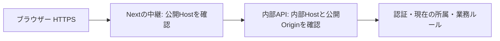

# 公開用のAPI中継とCookie（2026-11-15）

状態：中継部品とテストを実装し、明示設定でNext.js画面/ルートへ接続済み（WORKSPACE_PREVIEW.md）。PC内HTTPSで検証したが、**実公開環境は未準備・未検証。** 未指定の公開ビルドは案内/404を維持。CI/CD・配信設定は変更していない。

## 変更した場所

| ファイル | 役割 |
| --- | --- |
| lib/siteflow/api-proxy.ts | 許可経路・HTTPメソッド・Origin・JSON/本文上限・タイムアウト・認証応答の秘密値除去を共通化 |
| lib/siteflow/local-api.ts | 既存の開発限定/loopback Host検査を保ち、共通部分を呼ぶ |
| lib/siteflow/public-api-proxy.ts | 有効化フラグと固定HTTPS Originを確認。公開Hostを照合し、内部APIへ設定したOriginを送る |
| lib/siteflow/public-cookies.ts | Better Authの認証Cookieだけを転送し、応答の属性を検査する |
| examples/mysql/api-handler.ts / api-server.ts | 公開Originと内部Hostを分離して照合する。Hostは実際のlisten先から決める |
| tsconfig.json | allowImportingTsExtensionsを追加。Nodeの型除去テストとNext.jsが同じ.tsを読み込めるようにする。既存noEmitと組み合わせる |

初回型検査は.ts付きimportが許可されず停止し、上記の設定を追加後に成功。型検査を省略したり、strictを緩めたりしていない。新規依存なし。

## 2つの入口を混同しない

- 公開用中継はサーバー設定のenabled=trueと、正規化済みのHTTPS Originが必要。設定が不正なら503、無効なら404。設定値はクライアントから受け取らない。
- 受信Hostを公開Originのhostと照合する。Next内部のRequest URLがlocalhost/127.0.0.1のHTTPでも、受信Hostの照合は省略しない。X-Forwarded-Host/Protoから公開先を決めない。
- APIへの接続先は、サーバー設定のhttp://127.0.0.1:ポートだけを許可。公開OriginはAPIのCSRF/認証判定に使い、内部Hostはlisten先の検査に使う。リクエストのHostを任意に書き換える方式には依存しない。
- 役割や利用者ID、転送IP等の任意ヘッダーは転送しない。更新要求は同じ公開Originを必須とする。GETでも異なるOriginや明示的なcross-siteは拒否する。API側の所属/権限確認も残す。
- 許可したAPI経路・操作だけを中継する。登録/更新の本文は認証4096バイト・業務32768バイト以内のJSON。8秒のタイムアウト、リダイレクト拒否、no-store、CookieによるVary、認証応答の秘密値除去を共通化した。

実APIテストの初回は公開Hostと内部Hostを混同してINVALID_HOSTの403になった。原因確認を追加テスト1件へ絞り、受付のhostとoriginを別の引数にした後、ログインからログアウトまで成功した。検査を無効にする修正ではない。

## Cookieの扱い

このアプリの認証はBetter Auth既定の名前を使う。公開用中継で扱うのは__Secure-better-auth.と__Host-better-auth.で始まるCookieだけ。解析時のエラーに値を含めず、認証Cookieの同名重複は400で送信前に拒否する。無関係なCookieは内部へ送らない。

- 応答にはSecure・HttpOnly・SameSite=Laxを要求。Domain、重複属性、対応外の属性、不正なPath/期限などは拒否する。属性不足を勝手に補って隠す動作はしない。
- __Secure-のCookieはPath=/api/siteflowへ揃える。発行と削除の両方に同じ変換を適用し、Max-Age/Expiresは保持する。
- __Host-のCookieはPath=/を維持する。Domainは禁止。この接頭辞の条件をPath書換えで壊さない。PathはCookieの送信範囲であり、APIの権限確認の代わりにはならない。
- 複数のSet-Cookieは別々に返す。途中の1つでも不正なら全体を503にし、一部のCookieだけを返さない。Cookieやセッションの秘密値はJSONへ含めない。

接頭辞の条件は[MDNのSet-Cookie](https://developer.mozilla.org/en-US/docs/Web/HTTP/Reference/Headers/Set-Cookie)を参照。新規登録・OAuth・クロスドメイン・独自Cookie名・SameSite=Noneなどは未対応で、今回の対象へ含めない。

## 実際に確認したこと

- 新規10件を含む業務/中継/設定79件。公開Host/Origin、内部URL、許可操作、本文上限、Cookie転送/削除/接頭辞/属性不正、セッション表示項目、秘密値を出さない失敗を確認。
- API関連101件。新規の1件は専用DBと共通起動の実APIを使い、公開用中継→ログイン→Cookie返却→セッション/チーム取得→ログアウト→旧Cookie無効化を確認。検証データと一時セッションは終了時に削除した。
- この実API検証はNodeのRequestとloopback HTTPで行う。Cookieを手動で受け渡し、公開Originを指定したもの。ブラウザーが実HTTPSでCookieを保存/送信/削除できた結果ではない。DBも既存のローカル検証DBで、公開DBのTLS実測ではない。
- 本体/API型検査、lint、ビルド、ローカル接続の画面47シナリオを確認。詳細・結果はVERIFICATION.md。

## 次の確認

PC内の専用ページに加え、実際のNext.js案件画面→公開用中継→APIも確認済み。公開用ルートは明示設定でのみ有効にし、不正/不足時は閉じる。次は配信先・公開証明書・公開DB/TLS・CA・最小権限、費用や運用を具体化する。既存のCI/CD・Dockerfile等の変更が必要な段階では具体案を示して事前承認を得る。
