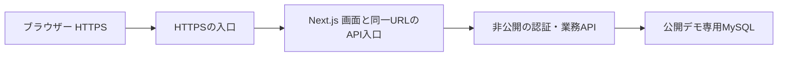

# 案件ワークスペースの公開準備案（2026-11-15）

## 最新の方針と現在地

公開用統合モードpublic-integratedで、ビルド済みNext.jsと使い捨てMySQLのTLSをPC内で確認済み（[PUBLIC_INTEGRATED_TLS.md](PUBLIC_INTEGRATED_TLS.md)）。単体97件・API/DB102件・公開用14シナリオ・従来ローカル5項目が成功。以下の「公開設定・DB/TLSは未実施」は以前の段階の記録で、実AWSでの設定・TLS・容量/配信・S3運用は引き続き未実施。機能開発はローカルで再開できる。

既存AWSのEC2・Docker・Nginx・HTTPS・自動CDを再利用する。Next.jsへAPIを統合するローカル専用モードでHTTP/実DBとブラウザー47項目を確認。詳細は [NEXTJS_API_INTEGRATION.md](NEXTJS_API_INTEGRATION.md)。PC内では架空21案件・全13テーブルを別DBへ復元して検証済み（[復元訓練](DATABASE_BACKUP_CHECK.md)）。公開用の統合・DB/TLS・本番のバックアップ復元運用・メモリ測定は未実施。AWS契約・インスタンス・本番変更は個別承認、CI/CD等の設定変更も事前承認。以下の分離API構成や未確認の記述には以前の段階の記録が含まれる。

正式な保管/復元権限はチーム管理者または主担当のみ。副担当だけでは不可。会議・決定事項・招待等を完成扱いにせず、体験デモと要件全体のv1.0を区別する。

**公開準備案。実公開環境は未準備、未検証。** 明示設定でNext.js画面/公開用ルートを接続し、PC内HTTPSでログイン・案件保存・再読み込み・ログアウトを確認済み。公開証明書・公開DB/TLSはこれから。クラウド操作・課金・配信変更はしていない。

## 最初に公開する範囲

採用担当者がURLから架空の案件を登録し、担当・進捗を変更して履歴を確認できるデモを目指す。既存の主要な案件画面を生かす。

- 「デモを試す」から体験者専用ユーザー・チーム・サンプルを発行する案。通常の新規登録やメール入力は要求しない。
- 体験者ごとにデータを分ける。共通の管理者パスワードを公開する運用にはしない。別体験者のIDを指定してもAPIで拒否する。
- 最初に「架空データ専用・保存期限あり・個人情報を入力しない」と案内する。
- 会議、招待、実メール認証、写真・報告書は次の版へ回す。ゲスト認証の方式・プラグインはまだ未採用。導入済みBetter Authとの互換性も確認する。

デモ発行はDBを増やす操作でもある。発行制限・件数上限・期限切れ削除を一緒に実装してから本公開する。その前の非公開プレビューでは、運営者が用意する個別アカウントで確認する。

## 構成案

HTTPSは通信を暗号化する仕組み。入口のリバースプロキシは外部の通信をアプリへ取り次ぐ。ブラウザーからは1つのURLに見せ、DB・内部APIのポートを外へ公開しない構成を提案する。自前運用の入口は[Next.js公式ガイド](https://nextjs.org/docs/app/guides/self-hosting)も参照する。

既存のHTTP API・保存サービス・業務ルールを再利用する方針。Next.js内に全部書き直す必要は現時点ではない。配信事業者、既存公開サーバーの構成、費用、ドメイン、TLS管理方法は未確認・未確定。ローカルDockerの動作だけで公開できるとは判断しない。

## ソースから確認した差分

| 場所 | 現在の事実 | 公開前に必要なこと |
| --- | --- | --- |
| app/workspace/page.tsx | development以外は案内だけ | 公開準備完了後、明示した公開モードで有効化。NODE_ENVをdevelopmentに偽装しない |
| lib/siteflow/local-api.ts | 開発時・loopback Host・内部127.0.0.1限定 | ローカル制限を残し、公開用Host/Origin・内部接続先・Cookieを設計 |
| examples/mysql/auth-check.ts / api-server.ts / public-api.ts | 共通起動へローカル/公開用設定を渡す。公開用は固定secretとHTTPS Originを指定。ローカル既定は毎起動で生成 | 実際のHTTPS/公開DB/TLS、公開用中継とCookieを確認 |
| examples/mysql/dev-auth.mjs | 検証サーバーを起動 | 停止処理も含む公開用APIの起動処理 |
| examples/mysql/database.tsなど | ローカル・検証用DB設定 | 実際の認証APIのDB生成箇所も確認し、公開専用DBと実行用の最小権限を用意。ローカル環境ファイルを流用しない |
| Dockerfile | ルート依存とNext.jsのみビルド・起動 | 公開API、その依存・Prisma生成物・起動方法を含む構成 |
| .github/workflows/ci.yml | Docker作成・業務テスト・ルートHTTP確認。main push時はイメージ送信 | DB接続版の確認は未実装。現在の成功を案件画面の公開完了としない |
| docs/GITHUB_REVIEW.md | 古い結果と競合マーカーが残っていた | 今回、保存前の現行手順へ整理。Git操作は未実施 |

## 認証・Cookie・運用

- 公開baseURLと許可Originを実際のHTTPSドメインへ固定する。リクエストのHostや転送ヘッダーを無条件に信用しない。業務の更新にもOrigin検査を残す。
- 認証用秘密値はサーバー環境で管理し、不足時は公開APIを起動しない。起動ごとの再生成をやめる。[Better Authの導入手順](https://better-auth.com/docs/installation)では、高エントロピーかつ32文字以上のsecretを要求する。
- CookieのHttpOnly・Secure・SameSite・Pathとログアウト時の削除を実ブラウザーで確認。現在のPath書換えと公開認証のURLを一致させる。秘密値をNEXT_PUBLIC_変数に入れない。
- 認証のログイン制限と、業務API/デモ発行の制限は別に設ける。認証ライブラリだけで案件作成まで制限されるとは扱わない。
- 中継経由で全員が同じIPに見える場合と、偽の転送ヘッダーを検証する。信用する入口だけがクライアントIPを設定する。[Better Authのレート制限](https://better-auth.com/docs/concepts/rate-limit)を参考にし、導入済み1.7.23での対応を確認する。最新版やBetaの設定をそのまま採用しない。
- デモ発行で既存ユーザーを管理者にしたり、任意の既存チームを操作したりできないようにする。発行と所属・サンプル保存の途中失敗は全体を取り消す。
- 公開専用DB・バックアップ・復元確認・ヘルスチェック・秘密値を出さないログ・停止/戻し方を用意。現在の検証用DBを公開データとして使わない。

公式資料は2026-11-15に参照した一般的な方針。使用中のバージョンで未確認のAPIを実装済みとはしない。

## 開発順と完了条件

| 順番 | 作業 | 完了の確かめ方 | 状態 |
| --- | --- | --- | --- |
| 1 | APIの受付と検証用起動設定を分離 | ローカル動作を保ち、型検査・業務/中継・API/DB・画面を必要範囲で確認 | 実装済み。検証詳細はVERIFICATION.md |
| 2 | 公開用必須設定・認証・DB接続 | 設定不足で起動拒否。固定secretで再起動後の有効セッション維持。異なるOrigin/権限外を拒否 | 入口と共通起動を実装。設定受渡しは代替依存、再起動はローカル実DBで確認。公開の実接続/HTTPSは未検証 |
| 3 | 公開専用環境の非公開プレビュー | HTTPS・Cookie・ログイン/ログアウト・チーム境界・保存/再読込・旧デモの動作 | 未着手。配信変更は事前承認が必要 |
| 4 | 体験者専用デモと後始末 | 2ブラウザーでデータ分離。重複発行・途中失敗・期限・上限・削除失敗を確認 | 未着手 |
| 5 | 本公開前の確認 | 復元、ヘルスチェック、ログ、停止/戻し方、固定した負荷条件の測定 | 未着手 |

日数は配信先・既存サーバー・予算を未確認のため見積もらない。段階3の前に配信先・対象ファイル・影響を具体化する。

### デモ制限の初期案：未実装・未測定

発行から24時間で失効・削除対象、1チーム30案件、同時有効100体験を仮の上限とする。期限はサーバーでも確認する。上限時は既存体験者を消さず新規発行を止める。期限切れ削除はユーザー・チーム・セッション・履歴を整合的に処理し、通常データには作用させない。

発行回数・ログイン制限の具体値は実際の入口/IPと負荷測定で確定する。この仮案は容量・費用・性能の達成を保証しない。条件と測定結果はNON_FUNCTIONAL_REQUIREMENTS.mdへ記録する。

## 次に触るファイル

Next.js公開プレビューの接続はWORKSPACE_PREVIEW.mdを参照。次は実配信の前に公開専用環境・CA・DB権限・費用・バックアップ/戻し方と境界を具体化する。未指定の公開ビルドは閉じ、通常の開発接続を維持する。今回DBスキーマや配信設定は変えていない。

その後に公開用設定・起動を用意する。`.github/workflows/`、Dockerfile、デプロイスクリプト、Nginx、systemdに必要な変更は具体案と影響を示して事前承認を得る。今回はそれらを編集していない。
