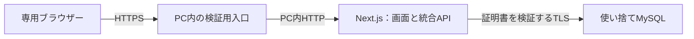

# 公開用の統合APIとDB/TLS：ローカル検証（2026-11-15）

## 今回の到達点

ビルド済みNext.jsのproductionをPC内のHTTPS入口から開き、別APIサーバーなしでログイン・案件保存を確認した。使い捨てMySQLにもPrismaからTLSv1.3で接続した。AWS・既存のMySQL・Dockerfile・CI/CD・Nginx・systemd・契約は変更していない。



ブラウザー側のHTTPSと、Next.jsからMySQLへのTLSは別の通信。片方だけの成功を両方の暗号化完了と扱わない。今回のHTTPSは自己署名鍵のSPKIを専用Chromeで例外扱いしたもの。公的CAやAWS上での検証結果ではない。DB側は検証用CAを明示的に信頼し、接続先名とCAが異なる場合は実接続を拒否した。

## 設定と役割

| 設定 | 意味 |
| --- | --- |
| SITEFLOW_WORKSPACE_MODE=public-integrated | 公開設定を使う統合APIを明示。未指定のproductionは従来どおりdisabled |
| SITEFLOW_PUBLIC_ORIGIN | 許可するHTTPS URLを固定。HostとOriginはこれに照合。公開用IPv4も許可し、PC内/プライベートIPv4・HTTP・不正なパスは拒否 |
| SITEFLOW_AUTH_SECRET | 起動ごとに生成せず、固定した64桁の16進数を指定。形式検査は乱数品質の保証ではない |
| SITEFLOW_DB_HOST / PORT / NAME | DB接続先。DB名はsiteflow_public_で始まる専用名。開発用設定へ戻さない |
| SITEFLOW_DB_USER / PASSWORD | rootを使わない実行用アカウント。TLS試験ではSELECT/INSERT/UPDATE/DELETEだけを許可 |
| SITEFLOW_DB_TLS=required | 平文へフォールバックせずTLSを使用 |
| SITEFLOW_DB_CA_FILE | 必要な場合に使うCAのPEMファイルの絶対パス。未指定はシステムで信頼するCA。private key・不正ファイル・1MiB超のファイルは拒否 |

CAは「証明書の発行元を信頼するための証明書」。サーバーの秘密鍵をアプリへ渡す設定ではない。配置・ローテーションは本番設計で別途決める。秘密値・内部URL・証明書パスは画面へ渡さず、接続エラーの本文にも出さない。

## 主な変更と理由

- `lib/siteflow/integrated-handler.ts`：ローカル/公開の認証・本文上限・応答処理を共通化。トークンをJSONに出さない。
- `lib/siteflow/public-integrated-api.ts`：必須設定、固定Host/OriginをDB生成前に検査。設定や接続の失敗は503とし、ローカル中継へ戻さない。
- `lib/siteflow/public-integrated-runtime.ts`：プロセス内で初期化を共有。プール作成だけでは接続済みと扱わず、SELECT 1で実際の接続を確認。失敗したプールは切断し、再試行可能にする。
- `examples/mysql/public-database.ts`：TLS1.2以上・証明書検証・必要なCAを設定。ソケット内部のhostname表記に依存せず、設定したDB_HOSTをNode標準のcheckServerIdentityで照合する。
- `public-api-settings.ts`・`proxy-origins.ts`・画面/APIのルート：公開IPv4のHTTPSと新しい統合モードを扱う。従来のlocal/public中継と開発用integratedは維持。
- `tls-mysql-fixture.mjs`：既存イメージから、PC内の空きポートだけにバインドした使い捨てMySQLを起動。CAの秘密鍵はサーバーへマウントしない。

設定が変わった場合は再起動を必要とし、古いDB接続やsecretと混在させない。CAファイル内容の変更も再起動して反映する。アプリ起動時にマイグレーションを自動実行しない。

## 再現コマンド

リポジトリルートで：

```powershell
npm.cmd run build
```

Prisma Client生成とNext.jsのproductionビルドを行い、ローカルの生成物を更新する。DBへの適用やデプロイはしない。

続いてexamples/mysqlを作業ディレクトリにして：

```powershell
npm.cmd run test:public-integrated
```

専用スクリプトを呼ぶnpmコマンドで、追加オプションはない。内部の `node --import tsx check-https-cookies.mjs --integrated-public` はTypeScript読込を有効にし、公開用統合の試験を選ぶ。専用Chrome・一時HTTPS鍵・CA署名付きDB証明書・使い捨てMySQLを作る。既存MySQLのデータを利用せず、終了時に自分で作った資源を削除する。

主要なDocker指定：`--pull=never` は既存イメージのみ使用、`--publish 127.0.0.1::3306` はPC内の空きポートを割り当てる。証明書はread-onlyのbind mountで渡し、MySQL内の専用コピーをmysql所有・秘密鍵600で扱う。終了時の `rm --force --volumes` は、この試験で作成したコンテナIDと付属の匿名ボリュームだけを削除する。設定ファイルの変更や新サービスの契約は行わない。

試験用スキーマは既存マイグレーションSQLからコンテナ内で準備する。これは本番のマイグレーション実行手順を完成させた意味ではない。

## 確認できたこと

- 単体97件成功。明示モード、IP/URL、設定不足、Host/Origin、証明書検証、エラーの秘密情報非公開、既存の中継/業務ルールを確認。
- 公開用統合14シナリオ成功。ブラウザー側・DB側ともTLSv1.3を確認。異なるCA、DB接続先名の不一致、平文を拒否。アプリ用DBユーザーのCREATEも拒否。
- ビルド済みNext.jsで、disabled/不正設定時は画面/APIを閉じる。正しい設定でも不正Hostは拒否。
- Secure・HttpOnly・Path=/api/siteflowのCookieでログイン。画面から案件作成/編集/再読込、チーム切替、ログアウトを確認。1440/390幅の画像も取得。
- 同じsecretとDBでNext.jsを再起動してもセッション維持。誤ったDB用CAに替えると503、秘密値を出さず、正しい設定と再起動で復帰。
- 従来ローカル統合のHTTP/実DB5項目、既存API/DB回帰102件成功。本体/API型検査・lint・ビルド成功。

結果はwork/public-integrated-check/results.jsonと同フォルダーのnext-workspace-1440.png / next-workspace-390.png。鍵・プロファイル・コンテナ・データは削除済み。

途中で、ソケット経由TLSの接続先名の扱いと、プール生成だけでは実接続が確定しない点を検出して修正。旧競合テストも「主担当から副担当へ変わった場合は保管403」という正式仕様へ合わせ、成功した担当変更と保存済みの担当/版を検査する形にした。検証を通す目的で証明書検証や権限を緩めていない。

## 残っていることと、機能開発の再開

機能開発はローカルで続けられる。今回を公開基盤の区切りとし、次は会議モードの最小版を検討できる。会議・決定事項・作業項目・招待・自由登録など、当初のv1.0要件は未完成のまま残す。

公開前には、EC2の固定IP/費用/容量、2GBでのメモリと新旧切替、イメージと配信/マイグレーション/戻し方、実環境のTLS、S3の自動保存/暗号化/保持/通知、体験者別デモの発行/上限/期限の確認が必要。今回の成功はAWS公開・本番証明書・性能目標の達成ではない。AWS契約・インスタンス・本番・保護対象の配信設定は個別承認後に変更する。

参考：[MariaDB Connectorの接続オプション](https://mariadb.com/docs/connectors/mariadb-connector-nodejs/node-js-connection-options)、[Nodeの接続先名の検証](https://nodejs.org/api/tls.html#tlscheckserveridentityhostname-cert)。
