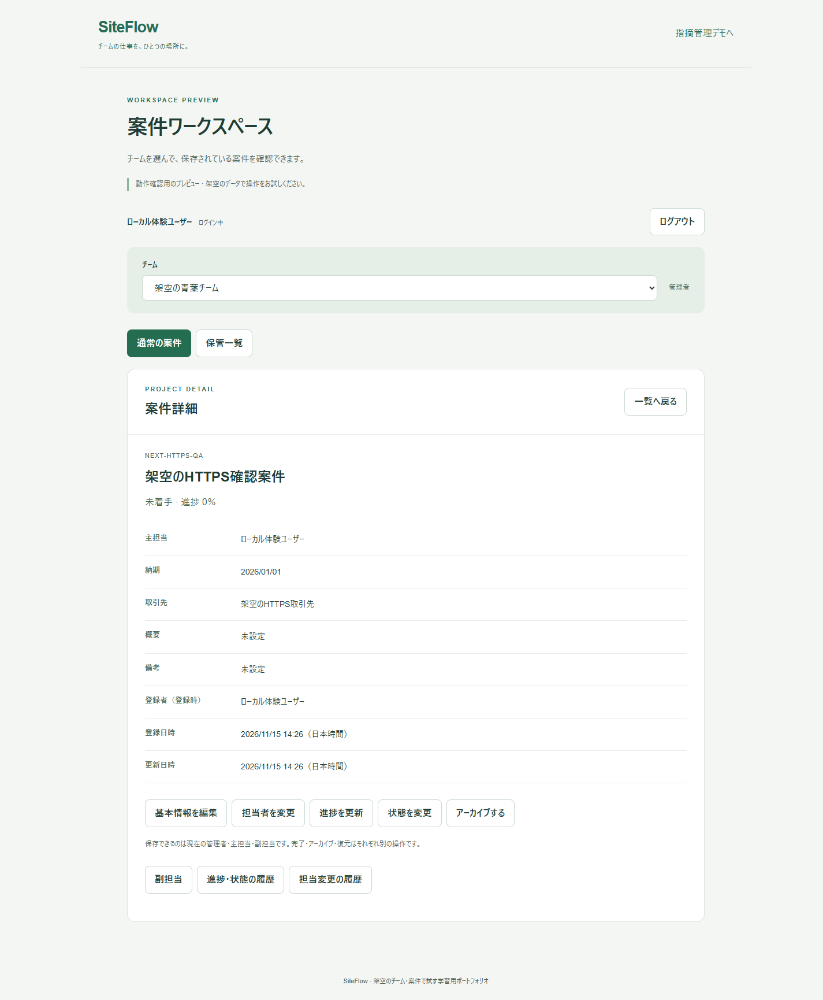
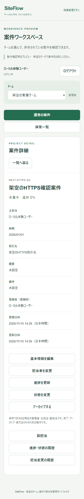

# Next.js案件画面と公開用中継の接続（2026-11-15）

状態：明示した設定で画面とルートを接続するコードを実装。**PC内HTTPSとビルド済みNext.jsで検証済み。インターネットへは未公開。** 普段の.env.local・開発サーバー・CI/CD・Dockerfile等は変更していない。



<details><summary>スマホ幅の確認画像</summary>



</details>

## 接続の選び方

画面とAPIはlib/siteflow/workspace-connection.tsの同じ判定を使う。環境変数はNext.jsサーバー側だけで読み、公開用の秘密値や内部API URLをクライアントへ渡さない。

| SITEFLOW_WORKSPACE_MODE | 動作 |
| --- | --- |
| 未指定 | developmentだけ既存local接続。それ以外は画面を案内にし、APIは404 |
| disabled | 開発中も含め、案内/404で閉じる |
| local | developmentだけ許可。productionでは誤設定として案内/503 |
| public | 以下の公開用URL設定がそろえば公開プレビュー接続を選ぶ。画面/APIとも受信Hostを確認する |
| 空文字・不明な値・publicの設定不足 | 案内/503。ローカル接続へ暗黙に戻さない |

publicにはSITEFLOW_PUBLIC_ORIGIN（正規化済みHTTPS Origin）とSITEFLOW_PUBLIC_API_ORIGIN（http://127.0.0.1:ポート）が必要。後者はNext.jsから内部APIへつなぐURLで、SITEFLOW_LOCAL_API_ORIGINを流用しない。公開Originには末尾の/やパスを付けない。実際の配信先を決める前に、これらを普段の設定へ書き込む手順ではない。

Next.jsの3項目と、認証APIの固定secret/DB設定は役割が違う。API側のSITEFLOW_PUBLIC_ORIGINはNext側と一致させる。APIのTLS/秘密値はPUBLIC_API_SETTINGS.mdを参照。公開用APIの自動起動・配信構成は別途必要。

## 変更した場所と理由

- proxy-origins.ts：固定の公開Origin/loopback内部接続先の検査を共通化。public-api-proxy.tsとapi-proxy.tsも同じ検査を使う。
- workspace-connection.ts：モード判定・画面のHost判定・APIの中継先選択。設定不足で意図しない接続へ戻さない。
- app/api/siteflow/[...path]/route.ts：ローカル専用関数の直接呼出しから、共通の接続判定へ変更。
- app/workspace/page.tsx：受信Hostと実行時設定で画面を選ぶ。force-dynamicでビルド時の環境に固定しない。headers()もサーバーで読む。既存構成はcacheComponentsを使用していない。[Next.js公式の動的描画](https://nextjs.org/docs/app/api-reference/file-conventions/route-segment-config)も参照した。
- connected-workspace.tsx：local/publicの表示文言だけを変更できるpropsを追加。publicではプレビュー表示と案内されたアカウントを使う説明にする。案件の保存ルールは変更なし。

初回の本番ビルド検証はログインフォームが表示されず、セッション取得403。導入済みNext.jsの内部処理は、TLS入口からの要求をhttps表記のloopback URLへ組み立てることを確認した。中継でloopbackのHTTP/HTTPS両表記へ対応し、受信Hostの固定公開Hostとの照合と、更新Origin検査は維持した。転送ヘッダーから認証用Originや接続先を決める修正ではない。

## 再現する確認

先にnpm run buildを実行する。Next.jsの.next/へ成果物と型情報を生成し、公開はしない。次の--prefix examples/mysqlは検証パッケージ、run test:next-previewはnode --import tsxでTypeScriptを読み込めるようにしてHTTPS検証を実行する。内部の--next-workspaceは簡易ページではなく実Next.jsを使う指定。

```sh
npm run build
npm --prefix examples/mysql run test:next-preview
```

- 前段階の証明書・専用Chromeの仕組みを再利用。SPKI例外、名前解決、一時データ/証明書の後始末はHTTPS_COOKIE_CHECK.mdを参照。
- 一時Next.jsをnext start --hostname 127.0.0.1 --port 空き番号で起動。--hostnameはPC内だけの待受け、--portは通常サーバーと分けるポート。NODE_ENVはproduction。TLS入口は既知のhttpsを転送し、受信HostをNext.jsへ保つ。
- 同じビルドを使い、disabled→設定不備→publicで一時Next.jsを起動し直す。設定は子プロセスの環境変数にだけ渡す。通常の.env.localや5173/5175のプロセスは変更しない。
- 出力はGit除外のwork/next-preview-checkに結果JSONと架空データの画像だけ。証明書/秘密鍵/専用プロファイルと、テスト用API・Next.js・TLS/HTTPサーバー・DBデータは終了時に削除/停止する。

## 実際の検証

9シナリオ成功。disabledの案内/404、誤設定の案内/503、publicでも違うHostは案内/403、実Next.jsのHTTPSログインとSecure/HttpOnly Cookie、案件作成/基本編集のDB保存、チーム切替/再読み込み後の保存と認証維持、1440/390の実画面、ログアウトでCookie/DB削除と401、旧ルートの表示を確認。

画面は既存Reactコンポーネントで、簡易検証ページではない。自己署名証明書の今回の鍵だけを専用Chromeで例外扱いするため、公的CAの信頼/期限/ホスト名検証や公開DBのTLS検証を完了した意味ではない。テスト用のDBは既存の専用DBを使い、公開用DB接続の条件を緩める変更はしていない。

設定の単体7件を含む86件、本体/API型検査、lint、ビルドが成功。既存のCookie8件と従来ローカル画面47シナリオも再確認した。詳細はVERIFICATION.md。

## 残る作業

公開先、公開証明書、公開専用DB/TLS/最小権限、APIの起動/バックアップ/戻し方と費用を具体化する。不特定多数に試してもらう場合の体験者別デモ発行・上限・後始末はまだ未実装。CI/CDやDockerfile等の配信変更が必要な段階では、具体案と影響を示して承認を得る。今回の接続コードの追加だけで、実配信の準備完了とは扱わない。
